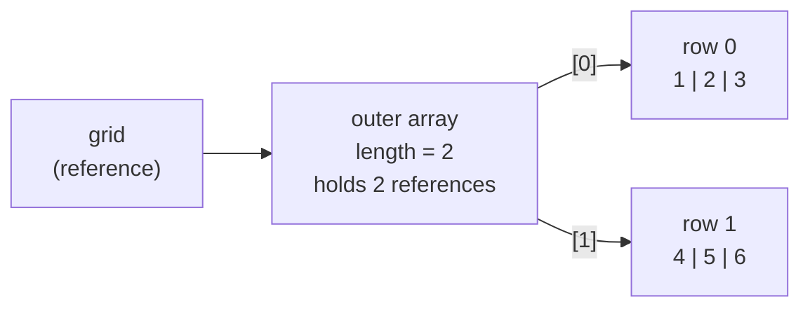

<a id="readme-top"></a>

# 2D Array

> **A 2D array is an array of arrays — a table of rows and columns where every cell is found with two indexes.**


| Quick Facts | Details |
|---|---|
| **Category** | Array — a table of rows and columns (array of arrays) |
| **Prerequisites** | 1D arrays, `for` loops, nested loops |
| **Key keywords** | `int[][]` · `new int[r][c]` · `arr[r][c]` · `arr.length` · `arr[r].length` |
| **Works with** | Java 8 and above |
| **At a glance** | rows = `arr.length` · columns of row `r` = `arr[r].length` · one cell `O(1)` · all cells `O(rows × columns)` |

## 🔰 Table of Contents

| Level | Sections |
|---|---|
| 🟢 **Level 1 — Understand** | [Definition](#-definition) · [Key Points](#-key-points) · [How It Works](#-how-it-works) |
| 🟡 **Level 2 — Use It** | [Syntax & Variations](#-syntax--variations) · [Common Patterns](#-common-patterns) · [When to Use](#-when-to-use) · [Example](#-example) · [Code](#-code) |
| 🔴 **Level 3 — Wrap-up** | [Time Complexity](#-time-complexity) · [Common Mistakes](#-common-mistakes) · [Interview Questions](#-interview-questions) · [Summary](#-summary) |

## 📍 Definition

A **2D array** is an array whose elements are themselves arrays. You can picture it as a **table with rows and columns**, and you reach one value — a **cell** — with **two indexes**: `arr[row][column]`.

In Java a 2D array is really an **array of arrays**: the outer array holds one reference per row, and every row is a separate 1D array. That is why the rows of a 2D array may even have **different lengths** (a *jagged* array).

| Term | Meaning | Example with `int[][] grid = {{1, 2, 3}, {4, 5, 6}};` |
|---|---|---|
| **Row** | One inner array | `grid[1]` → `{4, 5, 6}` |
| **Column** | The same position in every row | column `0` holds `1` and `4` |
| **Cell (element)** | One value, found by row and column | `grid[1][2]` → `6` |
| **Number of rows** | The length of the outer array | `grid.length` → `2` |
| **Number of columns** | The length of one row | `grid[0].length` → `3` |
| **Jagged array** | A 2D array whose rows have different lengths | `{{1}, {2, 3}}` |
| **Matrix** | A rectangular 2D array of numbers | a `2 × 3` matrix |

**Reading the expressions**

| Expression | What it is |
|---|---|
| `grid` | the whole table |
| `grid[1]` | row `1` — a 1D array |
| `grid[1][2]` | the cell in row `1`, column `2` |
| `grid.length` | the number of rows |
| `grid[1].length` | the number of columns in row `1` |

> [!TIP]
> **Real-life analogy:** a cinema seating chart. To find your seat you need two numbers — the **row** and the **seat in that row**. In a 2D array, the first index chooses the row and the second index chooses the cell inside it. Both count from `0`.

## 📌 Key Points

1. **Two indexes** — `arr[row][col]`, both starting at `0`; the last row is `arr.length - 1` and the last column of row `r` is `arr[r].length - 1`.
2. **An array of arrays** — `arr[r]` is itself a 1D array (an object), so each row can have its own length.
3. **Rows and columns** — `arr.length` is the number of **rows**, `arr[r].length` is the number of **columns** in row `r`.
4. **Default values** — `new int[2][3]` is filled with `0`, a `String[][]` with `null`, a `boolean[][]` with `false`.
5. **`new int[2][]` has no rows yet** — the 2 row slots are `null` until you create each row with `new`.
6. **Fixed size** — the number of rows and the length of every row are set when created and cannot change.
7. **Traversal needs nested loops** — the outer loop walks the rows, the inner loop walks the columns (see nested-loops.md).
8. **Printing and copying need care** — `System.out.println(arr)` prints a hash, not the values; and `int[][] b = a;` or `a.clone()` do **not** copy the rows.

> [!IMPORTANT]
> **A 2D array is an array of arrays — copying it is a two-step job.** `int[][] b = a;` only gives the same table a second name, and `a.clone()` copies only the outer array: the rows are still **shared** with the original. To get a truly independent copy, copy every row.

## ⚙️ How It Works

How `int[][] grid = {{1, 2, 3}, {4, 5, 6}};` looks as a table, and how it is stored:

```text
            col 0   col 1   col 2
  row 0  │    1       2       3
  row 1  │    4       5       6

grid[1][2]    → 6                 grid.length     → 2   (rows)
grid[0]       → {1, 2, 3}         grid[0].length  → 3   (columns)
```



The two indexes are followed one after the other:

```text
grid[1][2]

Step 1  grid[1]    follow the first index  → the row array {4, 5, 6}
Step 2  [2]        take element 2 of that row → 6
```

> [!NOTE]
> Because every row is its own array object, a jagged array is possible and `grid[r].length` can be different for each row. The 1D array basics are in array.md, and walking a table with loops inside loops is covered in nested-loops.md.

## 🔄 Syntax & Variations

### Declaring and creating

| Style | Example | Result |
|---|---|---|
| **Size only** | `int[][] g = new int[2][3];` | `2` rows × `3` columns, all `0` |
| **With values** | `int[][] g = {{1, 2, 3}, {4, 5, 6}};` | the rows hold these values (allowed only on the declaration line) |
| **`new` with values** | `new int[][]{{1, 2}, {3, 4}}` | an array expression — for example to pass it to a method |
| **Jagged** | `int[][] g = new int[3][];` | `3` row slots, all `null` — you create each row yourself |

> [!NOTE]
> Prefer `int[][] g` (type first). The C-style `int g[][]` is legal but discouraged.

### Reading and changing cells

```java
int[][] grid = {{1, 2, 3}, {4, 5, 6}};

int x = grid[1][2];             // read  → 6
grid[0][1] = 20;                // write → row 0 becomes {1, 20, 3}
int rows = grid.length;         // 2
int cols = grid[0].length;      // 3
```

### Walking a 2D array

```java
// index style — when you need the row and column numbers
for (int r = 0; r < grid.length; r++) {                 // rows
    for (int c = 0; c < grid[r].length; c++) {          // columns of row r
        System.out.print(grid[r][c] + " ");
    }
    System.out.println();                               // end of the row
}

// for-each style — when you only read the values
for (int[] row : grid) {                                // each element of the outer array is a row
    for (int value : row) {
        System.out.print(value + " ");
    }
    System.out.println();
}
```

### Jagged arrays

```java
int[][] jagged = new int[3][];          // 3 rows, the columns are not decided yet
jagged[0] = new int[]{1};
jagged[1] = new int[]{1, 2};
jagged[2] = new int[]{1, 2, 3};         // every row has its own length
```

Always use `jagged[r].length` for the number of columns — never assume that all rows are as long as the first one.

### Printing, comparing and copying

| Task | Use | Note |
|---|---|---|
| **Print the whole table** | `Arrays.deepToString(grid)` | `System.out.println(grid)` prints something like `[[I@6d06d69c` |
| **Print one row** | `Arrays.toString(grid[0])` | a row is a 1D array |
| **Compare two tables** | `Arrays.deepEquals(a, b)` | `a.equals(b)` and `a == b` compare references |
| **Copy one row** | `grid[0].clone()` | an independent row |
| **Copy the whole table** | loop: `copy[r] = grid[r].clone();` | `grid.clone()` is only a shallow copy — the rows stay shared |

## 🧩 Common Patterns

| Pattern | Idea | Skeleton |
|---|---|---|
| **Sum of all cells** | one running total | `sum += grid[r][c];` |
| **Row totals** | reset the total for every row | `int rowTotal = 0;` inside the outer loop |
| **Column totals** | the column number picks the slot | `colTotals[c] += grid[r][c];` |
| **Largest value and its position** | remember the value and `r`, `c` | `if (grid[r][c] > max) { max = ...; maxR = r; maxC = c; }` |
| **Transpose** | rows become columns | `t[c][r] = m[r][c];` into a new `int[cols][rows]` |
| **Diagonals** (square table) | one loop, two indexes that move together | `grid[i][i]` · `grid[i][n - 1 - i]` |
| **Search for a value** | nested loops, stop at the first hit | `if (grid[r][c] == target) { ...; break search; }` |
| **Fill a table** | compute each cell from its row and column | `table[r][c] = (r + 1) * (c + 1);` |
| **Jagged rows** | create each row with its own length | `rows[r] = new int[r + 1];` |

## 🎯 When to Use

| Need | Use | Benefit | Watch out |
|---|---|---|---|
| Table data — marks of students × subjects, a timetable | **2D array** | two indexes match the picture of rows and columns | the size is fixed |
| Boards and grids — tic-tac-toe, chess, a maze | **2D array** | every cell is found by `(row, column)` | check the bounds before looking at a neighbor (`r - 1`, `c + 1`) |
| Matrix work — add, transpose, multiply | **2D array** | direct access to every element | multiplication is `O(n³)` |
| Rows of different lengths — a triangle, ragged data | **jagged array** | no wasted cells | use `grid[r].length` for every row |
| The number of rows or columns keeps changing | **`ArrayList<ArrayList<Integer>>`** instead | it can grow and shrink | extra boxing and memory |
| Only a flat list of values | **1D array** instead | simpler | — |

## 🎲 Example

**Problem:** the marks of 3 students in 4 subjects are stored in a 2D array. Find each **student's total** (row total), each **subject's total** (column total), and the **highest mark** with its position.

```text
            Subject 0   Subject 1   Subject 2   Subject 3
Student 0       70          80          90          60
Student 1       85          75          65          95
Student 2       50          90          80          70
```

**Dry run — row by row**

| Row `r` | Marks | Row total | Highest so far |
|---|---|---|---|
| start | – | – | `70` at `(0,0)` — taken from `marks[0][0]` |
| 0 | `70, 80, 90, 60` | `300` | `90` at `(0,2)` |
| 1 | `85, 75, 65, 95` | `320` | `95` at `(1,3)` |
| 2 | `50, 90, 80, 70` | `290` | `95` at `(1,3)` — nothing is higher |
| column totals | – | `205, 245, 235, 225` | – |

✅ Row totals **300, 320, 290**, column totals **205, 245, 235, 225**, highest mark **95** at row `1`, column `3` — one pass over all `3 × 4 = 12` cells → **O(rows × columns)**.

## 💻 Code

> Save it as `TwoDArrayDemo.java`, then run `javac TwoDArrayDemo.java` followed by `java TwoDArrayDemo`.

```java
import java.util.Arrays;

public class TwoDArrayDemo {

    // Helper: prints "label : value" in neat columns
    static void show(String label, Object value) {
        System.out.printf("%-30s: %s%n", label, value);
    }

    public static void main(String[] args) {

        // ----- Create and access: two indexes, [row][column] -----
        int[][] grid = {{1, 2, 3}, {4, 5, 6}};
        show("grid.length (rows)", grid.length);
        show("grid[0].length (columns)", grid[0].length);
        show("grid[1][2]", grid[1][2]);
        show("grid[1] (a whole row)", Arrays.toString(grid[1]));
        grid[0][1] = 20;                                        // write one cell
        show("after grid[0][1] = 20", Arrays.deepToString(grid));

        // ----- Default values -----
        show("new int[2][3]", Arrays.deepToString(new int[2][3]));
        show("new String[1][2]", Arrays.deepToString(new String[1][2]));
        show("new int[2][] (no rows yet)", Arrays.deepToString(new int[2][]));

        // ----- Traverse: totals per student, totals per subject, highest mark -----
        int[][] marks = {{70, 80, 90, 60}, {85, 75, 65, 95}, {50, 90, 80, 70}};
        int[] colTotals = new int[marks[0].length];
        StringBuilder rowTotals = new StringBuilder();
        int max = marks[0][0];
        int maxR = 0;
        int maxC = 0;
        for (int r = 0; r < marks.length; r++) {
            int rowTotal = 0;                                   // reset for EVERY row
            for (int c = 0; c < marks[r].length; c++) {
                rowTotal += marks[r][c];
                colTotals[c] += marks[r][c];                    // the column number picks the slot
                if (marks[r][c] > max) {
                    max = marks[r][c];
                    maxR = r;
                    maxC = c;
                }
            }
            rowTotals.append(rowTotal).append(' ');
        }
        show("Row totals", rowTotals.toString().trim());
        show("Column totals", Arrays.toString(colTotals));
        show("Highest / position", max + " at (" + maxR + "," + maxC + ")");

        // ----- for-each: each element of the outer array is a whole row -----
        int sum = 0;
        for (int[] row : marks) {
            for (int value : row) {
                sum += value;
            }
        }
        show("Sum of all marks", sum);

        // ----- Diagonals of a square matrix -----
        int[][] sq = {{1, 2, 3}, {4, 5, 6}, {7, 8, 9}};
        int mainDiagonal = 0;
        int antiDiagonal = 0;
        for (int i = 0; i < sq.length; i++) {
            mainDiagonal += sq[i][i];                           // top-left to bottom-right
            antiDiagonal += sq[i][sq.length - 1 - i];           // top-right to bottom-left
        }
        show("Diagonal / anti-diagonal", mainDiagonal + " / " + antiDiagonal);

        // ----- Transpose: rows become columns -----
        int[][] m = {{1, 2, 3}, {4, 5, 6}};
        int[][] t = new int[m[0].length][m.length];             // 3 rows x 2 columns
        for (int r = 0; r < m.length; r++) {
            for (int c = 0; c < m[r].length; c++) {
                t[c][r] = m[r][c];
            }
        }
        show("Transpose of 2x3", Arrays.deepToString(t));

        // ----- Search with a labeled break (leaves BOTH loops) -----
        int target = 90;
        int foundR = -1;
        int foundC = -1;
        search:
        for (int r = 0; r < marks.length; r++) {
            for (int c = 0; c < marks[r].length; c++) {
                if (marks[r][c] == target) {
                    foundR = r;
                    foundC = c;
                    break search;
                }
            }
        }
        show("First 90 is at", "(" + foundR + "," + foundC + ")");

        // ----- Fill a table: multiplication table -----
        int[][] table = new int[3][4];
        for (int r = 0; r < table.length; r++) {
            for (int c = 0; c < table[r].length; c++) {
                table[r][c] = (r + 1) * (c + 1);
            }
        }
        show("Multiplication table 3x4", Arrays.deepToString(table));

        // ----- Jagged array: every row has its own length (Pascal's triangle) -----
        System.out.println("--- Pascal's triangle (a jagged array)");
        int[][] pascal = new int[5][];                          // 5 rows, the columns are not decided yet
        for (int r = 0; r < pascal.length; r++) {
            pascal[r] = new int[r + 1];                         // row r has r + 1 cells
            pascal[r][0] = 1;
            pascal[r][r] = 1;
            for (int c = 1; c < r; c++) {
                pascal[r][c] = pascal[r - 1][c - 1] + pascal[r - 1][c];
            }
        }
        for (int[] row : pascal) {
            System.out.println(Arrays.toString(row));
        }

        // ----- Copying: same reference, shallow clone, deep copy -----
        int[][] a = {{1, 2}, {3, 4}};
        int[][] same = a;                                       // a second name for the SAME table
        int[][] shallow = a.clone();                            // a new outer array, but the ROWS are shared
        int[][] deep = new int[a.length][];
        for (int r = 0; r < a.length; r++) {
            deep[r] = a[r].clone();                             // every row is copied
        }
        a[0][0] = 99;
        show("after a[0][0] = 99: same", same[0][0]);
        show("after a[0][0] = 99: shallow", shallow[0][0]);
        show("after a[0][0] = 99: deep", deep[0][0]);
        show("Arrays.deepEquals(a, deep)", Arrays.deepEquals(a, deep));

        // ----- Traps -----
        int[][] wide = new int[2][3];                           // 2 rows, 3 columns
        try {
            for (int r = 0; r < 3; r++) {                       // 3 is the number of COLUMNS, but r indexes the ROWS
                wide[r][0] = 1;
            }
        } catch (ArrayIndexOutOfBoundsException e) {
            show("rows / columns swapped", "ArrayIndexOutOfBoundsException");
        }
        int[][] notBuilt = new int[2][];
        try {
            notBuilt[0][0] = 1;                                 // row 0 was never created: it is null
        } catch (NullPointerException e) {
            show("new int[2][] then [0][0]", "NullPointerException");
        }
    }
}
```

**Output**

```text
grid.length (rows)            : 2
grid[0].length (columns)      : 3
grid[1][2]                    : 6
grid[1] (a whole row)         : [4, 5, 6]
after grid[0][1] = 20         : [[1, 20, 3], [4, 5, 6]]
new int[2][3]                 : [[0, 0, 0], [0, 0, 0]]
new String[1][2]              : [[null, null]]
new int[2][] (no rows yet)    : [null, null]
Row totals                    : 300 320 290
Column totals                 : [205, 245, 235, 225]
Highest / position            : 95 at (1,3)
Sum of all marks              : 910
Diagonal / anti-diagonal      : 15 / 15
Transpose of 2x3              : [[1, 4], [2, 5], [3, 6]]
First 90 is at                : (0,2)
Multiplication table 3x4      : [[1, 2, 3, 4], [2, 4, 6, 8], [3, 6, 9, 12]]
--- Pascal's triangle (a jagged array)
[1]
[1, 1]
[1, 2, 1]
[1, 3, 3, 1]
[1, 4, 6, 4, 1]
after a[0][0] = 99: same      : 99
after a[0][0] = 99: shallow   : 99
after a[0][0] = 99: deep      : 1
Arrays.deepEquals(a, deep)    : false
rows / columns swapped        : ArrayIndexOutOfBoundsException
new int[2][] then [0][0]      : NullPointerException
```

> [!NOTE]
> The copy lines are the important ones. After `a[0][0] = 99`, both `same` and `shallow` show `99` — the first because it is the same table, the second because `clone()` copied only the outer array and shares the rows — while `deep` still shows `1`. That is also why `Arrays.deepEquals(a, deep)` is now `false`: the tables no longer hold the same values.

## ⏳ Time Complexity

| Operation | Time | Note |
|---|---|---|
| read or write one cell `arr[r][c]` | **O(1)** | two index jumps |
| visit every cell | **O(rows × columns)** | `O(n²)` for an `n × n` table |
| one row total / one column total | **O(columns)** / **O(rows)** | |
| transpose | **O(rows × columns)** | needs a new table — extra space `O(rows × columns)` |
| search an unsorted table | **O(rows × columns)** | best case `O(1)` with a `break` |
| deep copy | **O(rows × columns)** | shallow `clone()` is only `O(rows)` |
| multiply two `n × n` matrices (three nested loops) | **O(n³)** | |

Space: `rows × columns` cells, plus one extra array object for every row (and one for the outer array).

**Feel the difference** — number of cells an `n × n` table has, and the steps of a three-loop matrix multiplication:

| n | cells to visit — `O(n²)` | matrix multiplication — `O(n³)` |
|---|---|---|
| 10 | 100 | 1,000 |
| 100 | 10,000 | 1,000,000 |
| 1,000 | 1,000,000 | 1,000,000,000 |

> [!TIP]
> **Rule of thumb:** visiting every cell of a table costs as many steps as the table has cells. When a table is large, avoid looking at each cell more than once, and use `break` as soon as you have your answer.

## 🚨 Common Mistakes

| # | Mistake | Why it is a problem | Fix |
|---|---|---|---|
| 1 | using `arr.length` for the columns (or `arr[0].length` for the rows) | on a non-square table the loop runs past the end → `ArrayIndexOutOfBoundsException` | rows: `arr.length`, columns: `arr[r].length` |
| 2 | `int[][] g = new int[2][];` and then `g[0][0] = 1;` | the rows are `null` until you create them → `NullPointerException` | create each row first: `g[0] = new int[3];` |
| 3 | `System.out.println(grid);` | it prints a hash such as `[[I@6d06d69c`, not the values | `Arrays.deepToString(grid)` |
| 4 | `int[][] b = a;` or `a.clone()` to "copy" the table | `b = a` is the same table; `clone()` shares the rows — a change in one shows in the other | copy every row: `b[r] = a[r].clone();` |
| 5 | `r <= grid.length` or `c <= grid[r].length` | the last valid index is one less → `ArrayIndexOutOfBoundsException` | use `<` |
| 6 | using `grid[0].length` as the column count of every row of a jagged array | other rows may be shorter or longer | use `grid[r].length` for each row |

## 🎤 Interview Questions

<details>
<summary><b>1. What is a 2D array in Java?</b></summary>

A 2D array is an **array of arrays**: the outer array holds one reference per row, and each row is a separate 1D array. You reach a cell with two indexes, `arr[row][column]`, both starting at `0`.

</details>

<details>
<summary><b>2. How do you find the number of rows and columns?</b></summary>

`arr.length` is the number of **rows**, and `arr[r].length` is the number of **columns** in row `r` (for a rectangular table `arr[0].length` is the same for every row). For a **jagged** array always use `arr[r].length`, because the rows can differ.

</details>

<details>
<summary><b>3. What is a jagged array?</b></summary>

A 2D array whose rows have different lengths. You create the outer array first (`new int[3][]`) and then each row separately (`g[0] = new int[1]; g[1] = new int[2]; …`). It is useful when a table is naturally uneven, such as Pascal's triangle, where row `r` has `r + 1` values.

</details>

<details>
<summary><b>4. How do you print a 2D array?</b></summary>

Use `Arrays.deepToString(grid)` to print the whole table in one line, or `Arrays.toString(grid[r])` for one row, or two nested loops to print it row by row. `System.out.println(grid)` only prints the type and a hash code, because the array does not override `toString()`.

</details>

<details>
<summary><b>5. How do you copy a 2D array?</b></summary>

`int[][] b = a;` copies only the reference — both names are the same table. `a.clone()` is a **shallow** copy: it makes a new outer array, but the rows are still shared. For an independent **deep** copy, copy each row: `for (int r = 0; r < a.length; r++) { b[r] = a[r].clone(); }`.

</details>

<details>
<summary><b>6. What is the difference between <code>new int[2][3]</code> and <code>new int[2][]</code>?</b></summary>

`new int[2][3]` creates the outer array **and** both rows, so all `6` cells exist and are `0`. `new int[2][]` creates only the outer array — its two row slots are `null`, and you must create each row yourself before you can use a cell, otherwise you get a `NullPointerException`.

</details>

## 🏁 Summary

- A **2D array** is an **array of arrays** — a table of rows and columns where a cell is found by `arr[row][column]`, both indexes starting at `0`.
- **`arr.length`** is the number of rows and **`arr[r].length`** the number of columns in row `r`; rows can have different lengths (**jagged** arrays).
- Walk it with **nested loops** — rows outside, columns inside — or with a for-each inside a for-each.
- **Printing and copying** need special care: `Arrays.deepToString` to print, a loop of `row.clone()` for a deep copy.
- Visiting every cell costs **O(rows × columns)**; reading one cell is **O(1)**.

### 📝 Cheat Sheet

| Question | Answer |
|---|---|
| Create | `new int[rows][cols]` · `{{1, 2}, {3, 4}}` · `new int[rows][]` (jagged) |
| Read / write a cell | `arr[r][c]` · `arr[r][c] = x;` |
| Rows / columns | `arr.length` · `arr[r].length` |
| Walk it | `for (r < arr.length) { for (c < arr[r].length) { ... } }` |
| Print | `Arrays.deepToString(arr)` |
| Copy | loop: `copy[r] = arr[r].clone();` — never `b = a` or `a.clone()` alone |
| Default values | `0` · `false` · `null` — and `null` rows for `new int[rows][]` |
| Valid indexes | `0` … `arr.length - 1` and `0` … `arr[r].length - 1` |
| Time | one cell `O(1)` · all cells `O(rows × columns)` |

> [!IMPORTANT]
> **Rows first, columns second:** the first index chooses the row and `arr.length` counts rows; the second index chooses the cell inside that row and `arr[r].length` counts columns — mixing them up is the most common 2D array bug.
