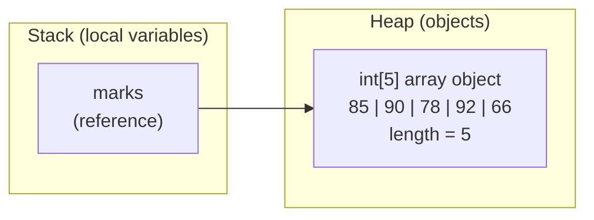
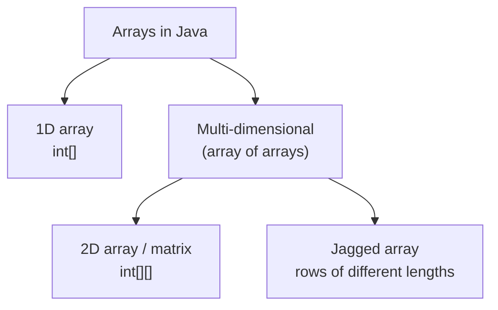
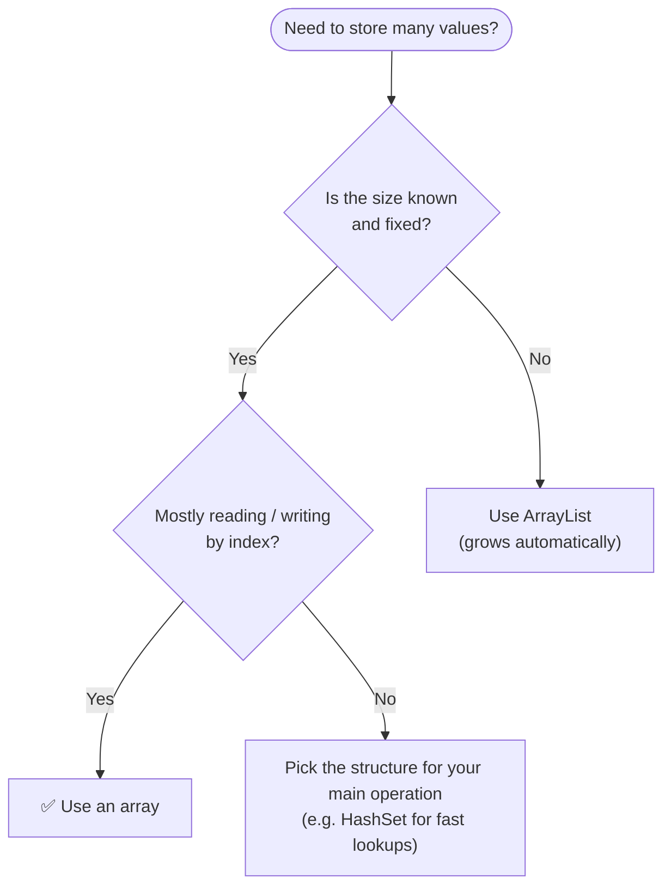

<a id="readme-top"></a>

# Array

> **An array is the simplest and fastest way to store many values of the same type — and the foundation that almost every other data structure is built on.**


| Quick Facts | Details |
|---|---|
| **Category** | Linear data structure |
| **Prerequisites** | Variables, data types, loops |
| **Indexing** | Zero-based (`0` … `length - 1`) |
| **Size** | Fixed once created |
| **Works with** | Java 8 and above |
| **At a glance** | Access `O(1)` · Search `O(n)` · Insert / Delete `O(n)` · Space `O(n)` |

## 🔰 Table of Contents

| Level | Sections |
|---|---|
| 🟢 **Level 1 — Understand** | [Definition](#-definition) · [Important Points](#-important-points) · [Memory Layout](#-memory-layout) |
| 🟡 **Level 2 — Use It** | [Creating Arrays](#-creating-arrays) · [Core Operations](#-core-operations) · [Use Cases](#-use-cases) · [Advantages](#-advantages) · [Limitations](#-limitations) · [Example](#-example) · [Code](#-code) |
| 🟠 **Level 3 — Master It** | [Time Complexity](#-time-complexity) · [Space Complexity](#-space-complexity) · [Common Patterns](#-common-patterns) · [Common Mistakes](#-common-mistakes) · [Interview Questions](#-interview-questions) |
| 🔴 **Level 4 — Wrap-up** | [Summary](#-summary) · [Cheat Sheet](#-cheat-sheet) |

## 📍 Definition

**Array** is a **fixed-size**, **ordered** collection of elements of the **same data type**, stored in **contiguous memory** and accessed through a **zero-based index**.

In Java, an array is also an **object**: it lives on the **heap**, your variable only holds a **reference** to it, and it always knows its own size through the built-in `length` field.

| Term | Meaning | Example with `int[] marks = {85, 90, 78}` |
|---|---|---|
| **Element** | One value stored in the array | `85`, `90`, `78` |
| **Index** | Position of an element (starts at `0`) | `marks[0]` → `85` |
| **Length** | Total number of slots | `marks.length` → `3` |

> [!TIP]
> **Real-life analogy:** picture a row of numbered lockers in a school corridor. Every locker is the same size, they sit side by side, and if you know the locker number you walk straight to it — no need to open the others.

## 📌 Important Points

1. **Zero-based index** — the first element is `arr[0]`, the last is `arr[arr.length - 1]`.
2. **Fixed size** — the length is set at creation and can never grow or shrink.
3. **Same type only** — an `int[]` stores ints, a `String[]` stores Strings.
4. **Contiguous memory** — elements sit side by side, so jumping to any index is instant.
5. **Arrays are objects** — created with `new`, stored on the heap, with a `length` **field** (not a method).
6. **Reference type** — `int[] b = a;` makes both names point to the *same* array; nothing is copied.
7. **Auto-initialized** — slots get default values even if you never assign them (table below).
8. **Bounds-checked** — an invalid index throws `ArrayIndexOutOfBoundsException` at runtime.
9. **Primitives or objects** — `int[]`, `double[]`, `char[]`, `String[]`, `Student[]` … all work.

**Default values** (after `new Type[n]`)

| Element type | Default value |
|---|---|
| `byte`, `short`, `int`, `long` | `0` |
| `float`, `double` | `0.0` |
| `char` | `'\u0000'` (the null character) |
| `boolean` | `false` |
| Any object (`String`, `Integer`, your own class…) | `null` |

> [!IMPORTANT]
> **`length` vs `length()` vs `size()`** — arrays use `arr.length` (a field), `String` uses `str.length()`, and collections such as `ArrayList` use `list.size()`. Mixing them up is a classic compile error.

## 🧱 Memory Layout

For `int[] marks = {85, 90, 78, 92, 66};` Java reserves **one block** of memory, big enough for all five ints, and places them side by side:

```text
      0       1       2       3       4       ← index
  ┌───────┬───────┬───────┬───────┬───────┐
  │  85   │  90   │  78   │  92   │  66   │   ← value
  └───────┴───────┴───────┴───────┴───────┘
     1000    1004    1008    1012    1016     ← address (illustrative)
```

Every `int` takes 4 bytes, so each address is 4 more than the previous one. Java finds any element with a single formula:

```text
address of arr[i]   = base address + (i × size of one element)
address of marks[3] = 1000 + (3 × 4) = 1012
```

One multiplication and one addition — no matter how big the array is. That is why array access is **O(1)**.

Where does everything live? The variable sits on the **stack**; the array object sits on the **heap**:



> [!NOTE]
> A primitive array such as `int[]` stores the **values** directly in its slots. An object array such as `String[]` stores **references**; the actual `String` objects live elsewhere on the heap.

## 🔄 Creating Arrays

### Declare → Create → Assign

```java
int[] numbers;               // 1. declare : just a reference, no array exists yet
numbers = new int[5];        // 2. create  : 5 slots, all start as 0
numbers[0] = 10;             // 3. assign  : fill the slots one by one
```

### Three ways to initialize

| Style | Syntax | Use when |
|---|---|---|
| Size only | `int[] a = new int[5];` | you know the size, values come later |
| Inline values | `int[] a = {10, 20, 30};` | you know the values up front (works only on the declaration line) |
| `new` with values | `int[] a = new int[]{10, 20, 30};` | you need an array *expression*, e.g. `show(new int[]{1, 2})` |

> [!NOTE]
> Prefer `int[] arr` (type first). The C-style `int arr[]` is legal in Java but discouraged.

### Types of arrays



| Type | Shape | Declaration |
|---|---|---|
| **1D array** | a single row | `int[] a = new int[5];` |
| **2D array** | rows × columns (a matrix) | `int[][] m = new int[3][4];` |
| **Jagged array** | rows of different lengths | `int[][] j = new int[3][];` |

```java
int[][] grid = {
    {1, 2, 3},               // row 0
    {4, 5, 6}                // row 1
};
System.out.println(grid[1][2]);   // 6  (row 1, column 2)

int[][] jagged = new int[3][];    // 3 rows, column counts not decided yet
jagged[0] = new int[]{1};
jagged[1] = new int[]{1, 2};
jagged[2] = new int[]{1, 2, 3};
```

> [!NOTE]
> A 2D array in Java is really an **array of arrays** — each row is its own array object, which is why jagged arrays are possible.

## ⚙️ Core Operations

| Operation | In Java | What happens |
|---|---|---|
| **Access** | `int x = arr[2];` | jump straight to the index |
| **Update** | `arr[2] = 50;` | overwrite that slot |
| **Traverse** | `for (int x : arr) { ... }` | visit every element once |
| **Search** | loop and compare, or `Arrays.binarySearch(arr, key)` on a sorted array | find where a value lives |
| **Insert** | shift elements right, then write the value | make room first |
| **Delete** | shift elements left over the removed slot | close the gap |
| **Sort** | `Arrays.sort(arr);` | put the elements in order |
| **Copy** | `Arrays.copyOf(arr, newLength)` or `arr.clone()` | independent duplicate |
| **Fill** | `Arrays.fill(arr, 0);` | set every slot to one value |
| **Print** | `Arrays.toString(arr)` / `Arrays.deepToString(arr2D)` | readable output |

### Insert — shift right, then write

```text
Insert 99 at index 2     (capacity 5, 4 slots in use)

Step 0  start            [10] [20] [30] [40] [  ]
Step 1  shift 40 right   [10] [20] [30] [40] [40]     arr[4] = arr[3]
Step 2  shift 30 right   [10] [20] [30] [30] [40]     arr[3] = arr[2]
Step 3  write the value  [10] [20] [99] [30] [40]     arr[2] = 99
```

### Delete — shift left over the gap

```text
Delete the element at index 1     (5 slots in use)

Step 0  start             [10] [20] [30] [40] [50]
Step 1  shift 30 left     [10] [30] [30] [40] [50]     arr[1] = arr[2]
Step 2  shift 40 left     [10] [30] [40] [40] [50]     arr[2] = arr[3]
Step 3  shift 50 left     [10] [30] [40] [50] [50]     arr[3] = arr[4]
Step 4  clear last slot   [10] [30] [40] [50] [ 0]     arr[4] = 0   → 4 slots in use
```

> [!NOTE]
> Shifting is exactly why inserting or deleting in the **middle** costs **O(n)** — up to `n` elements may have to move.

## 🎯 Use Cases

| Use case | Why an array fits | Example |
|---|---|---|
| **Fixed set of values** | the size is known and order matters | marks of 5 subjects, days of the week |
| **Lookup / frequency tables** | the index acts as the key → O(1) updates | `int[26]` to count the letters `a`–`z` |
| **Matrices and grids** | 2D arrays map to rows × columns | tic-tac-toe board, image pixels, spreadsheets |
| **Building other data structures** | arrays are the raw material underneath | `ArrayList`, `ArrayDeque`, `HashMap` buckets, `PriorityQueue`, `String` |
| **Algorithms** | sorting, binary search, DP tables, prefix sums, sliding window | `dp[]`, `prefix[]` |
| **Performance-critical code** | compact, no boxing, cache-friendly | games, real-time systems, competitive programming |
| **Program input** | Java hands you command-line arguments as an array | `public static void main(String[] args)` |

**Should I use an array?**



## ⭐ Advantages

- ✅ **Fast access** — `arr[i]` takes constant time, `O(1)`.
- ✅ **Cache-friendly** — neighbouring elements sit together in memory, so the CPU reads them efficiently.
- ✅ **Low overhead** — no per-element pointers, and primitive arrays (`int[]`) avoid boxing.
- ✅ **Simple and built in** — native syntax plus the helper class `java.util.Arrays` (sort, search, copy, fill …).
- ✅ **Foundation** — once arrays are clear, strings, lists, stacks, queues, heaps and hash maps are much easier to understand.

## 🚧 Limitations

| Limitation | Why it happens | Workaround |
|---|---|---|
| **Fixed size** | memory is reserved once, at creation | `ArrayList`, or copy into a bigger array with `Arrays.copyOf` |
| **Slow insert / delete in the middle** | elements must be shifted → `O(n)` | `LinkedList` (when you already hold the node) or rethink the logic |
| **One data type only** | arrays are homogeneous | wrapper / custom classes, or generic collections |
| **Slow search by value** | unsorted data must be scanned → `O(n)` | sort + binary search, or `HashSet` / `HashMap` for `O(1)` average lookup |
| **Wasted or insufficient space** | you have to guess the size up front | allocate exactly what you need, or use a dynamic structure |
| **No built-in `add` / `remove` / `contains`** | an array only has `length` | the helper class `java.util.Arrays`, or `ArrayList` |

## 🎲 Example

**Problem:** store the marks of 5 students, then find the **total**, the **average** and the **highest mark**.

| Input | Output |
|---|---|
| `marks = [85, 90, 78, 92, 66]` | Total = `411` · Average = `82.2` · Highest = `92` |

**Approach**

1. Create the array holding the 5 marks.
2. Traverse it once, adding every mark to `total`.
3. Average = `total / marks.length`.
4. Assume `marks[0]` is the maximum, compare it with every other element and keep the larger one.

**Dry run — finding the highest mark**

| Step | `i` | `marks[i]` | `max` after this step |
|---|---|---|---|
| start | – | – | `85` (taken from `marks[0]`) |
| 1 | 1 | 90 | `90` (90 > 85 → update) |
| 2 | 2 | 78 | `90` (78 < 90 → keep) |
| 3 | 3 | 92 | `92` (92 > 90 → update) |
| 4 | 4 | 66 | `92` (66 < 92 → keep) |

✅ Highest = **92**, found in a single pass over the array → **O(n)**.

## 💻 Code

> Save it as `ArrayDemo.java`, then run `javac ArrayDemo.java` followed by `java ArrayDemo`.

```java
import java.util.Arrays;

public class ArrayDemo {

    // Helper: prints "label : value" in neat columns
    static void show(String label, Object value) {
        System.out.printf("%-18s: %s%n", label, value);
    }

    // 1. Find the maximum ......... Time O(n) | Space O(1)
    static int findMax(int[] arr) {
        int max = arr[0];                         // assume the first element is the largest
        for (int i = 1; i < arr.length; i++) {
            if (arr[i] > max) {
                max = arr[i];                     // found a bigger one
            }
        }
        return max;
    }

    // 2. Linear search ............ Time O(n) | Space O(1)
    static int linearSearch(int[] arr, int key) {
        for (int i = 0; i < arr.length; i++) {
            if (arr[i] == key) {
                return i;                         // found -> return the index
            }
        }
        return -1;                                // not found
    }

    // 3. Insert at an index ....... Time O(n) | Space O(1)
    //    'size' = slots currently in use (the array needs spare room at the end)
    static void insertAt(int[] arr, int size, int index, int value) {
        for (int i = size; i > index; i--) {
            arr[i] = arr[i - 1];                  // shift right to make room
        }
        arr[index] = value;
    }

    // 4. Delete at an index ....... Time O(n) | Space O(1)
    static void deleteAt(int[] arr, int size, int index) {
        for (int i = index; i < size - 1; i++) {
            arr[i] = arr[i + 1];                  // shift left to close the gap
        }
        arr[size - 1] = 0;                        // clear the leftover last slot
    }

    // 5. Reverse in place ......... Time O(n) | Space O(1)
    static void reverse(int[] arr) {
        int left = 0, right = arr.length - 1;
        while (left < right) {
            int temp = arr[left];                 // swap the two ends ...
            arr[left] = arr[right];
            arr[right] = temp;
            left++;                               // ... then move towards the middle
            right--;
        }
    }

    public static void main(String[] args) {

        // ----- Create & initialize -----
        int[] marks = {85, 90, 78, 92, 66};
        show("Array", Arrays.toString(marks));
        show("Length", marks.length);
        show("First / Last", marks[0] + " / " + marks[marks.length - 1]);

        // ----- Traverse: total & average -----
        int total = 0;
        for (int m : marks) {
            total += m;
        }
        show("Total", total);
        show("Average", (double) total / marks.length);
        show("Highest", findMax(marks));

        // ----- Search -----
        show("Index of 92", linearSearch(marks, 92));
        show("Index of 50", linearSearch(marks, 50));

        // ----- Update (O(1)) -----
        marks[4] = 70;
        show("After marks[4]=70", Arrays.toString(marks));

        // ----- Insert & delete (we track 'size' ourselves) -----
        int[] list = new int[8];                  // capacity 8
        int size = 0;
        for (int v : new int[]{10, 20, 30, 40, 50}) {
            list[size++] = v;
        }
        insertAt(list, size, 2, 99);
        size++;
        show("Insert 99 at 2", Arrays.toString(Arrays.copyOf(list, size)));
        deleteAt(list, size, 0);
        size--;
        show("Delete index 0", Arrays.toString(Arrays.copyOf(list, size)));

        // ----- Reverse -----
        reverse(marks);
        show("Reversed", Arrays.toString(marks));

        // ----- Sort a copy, then binary search -----
        int[] sorted = marks.clone();
        Arrays.sort(sorted);
        show("Sorted copy", Arrays.toString(sorted));
        show("Binary search 90", "index " + Arrays.binarySearch(sorted, 90));

        // ----- Reference vs copy -----
        int[] alias = marks;                                // same array, two names
        int[] copy = Arrays.copyOf(marks, marks.length);    // independent copy
        alias[0] = 0;
        show("marks (via alias)", Arrays.toString(marks));
        show("copy (untouched)", Arrays.toString(copy));

        // ----- 2D array -----
        int[][] matrix = {
            {1, 2, 3},
            {4, 5, 6},
            {7, 8, 9}
        };
        int sum = 0;
        for (int r = 0; r < matrix.length; r++) {
            for (int c = 0; c < matrix[r].length; c++) {
                sum += matrix[r][c];
            }
        }
        show("2D array", Arrays.deepToString(matrix));
        show("Sum of all cells", sum);

        // ----- Out-of-bounds protection -----
        try {
            System.out.println(marks[10]);
        } catch (ArrayIndexOutOfBoundsException e) {
            show("Caught exception", e.getMessage());
        }
    }
}
```

**Output**

```text
Array             : [85, 90, 78, 92, 66]
Length            : 5
First / Last      : 85 / 66
Total             : 411
Average           : 82.2
Highest           : 92
Index of 92       : 3
Index of 50       : -1
After marks[4]=70 : [85, 90, 78, 92, 70]
Insert 99 at 2    : [10, 20, 99, 30, 40, 50]
Delete index 0    : [20, 99, 30, 40, 50]
Reversed          : [70, 92, 78, 90, 85]
Sorted copy       : [70, 78, 85, 90, 92]
Binary search 90  : index 3
marks (via alias) : [0, 92, 78, 90, 85]
copy (untouched)  : [70, 92, 78, 90, 85]
2D array          : [[1, 2, 3], [4, 5, 6], [7, 8, 9]]
Sum of all cells  : 45
Caught exception  : Index 10 out of bounds for length 5
```

> [!NOTE]
> The exact wording of the exception message depends on your Java version.

## ⏳ Time Complexity

| Operation | Best | Average | Worst | Why? |
|---|---|---|---|---|
| Access `arr[i]` | O(1) | O(1) | O(1) | address = base + i × size |
| Update `arr[i] = x` | O(1) | O(1) | O(1) | same direct jump |
| Traversal | O(n) | O(n) | O(n) | every element is visited once |
| Linear search | O(1) | O(n) | O(n) | best case: the key is the first element |
| Binary search *(sorted array)* | O(1) | O(log n) | O(log n) | the search range halves every step |
| Insert at the end *(spare room)* | O(1) | O(1) | O(1) | nothing to shift |
| Insert at the start / middle | O(n) | O(n) | O(n) | elements shift to the right |
| Delete at the end | O(1) | O(1) | O(1) | just reduce the logical size |
| Delete at the start / middle | O(n) | O(n) | O(n) | elements shift to the left |

> `Arrays.sort()` is typically **O(n log n)**.

**Feel the difference** — number of steps for `n` elements:

| n | O(1) | O(log n) | O(n) | O(n²) |
|---|---|---|---|---|
| 10 | 1 | ~3 | 10 | 100 |
| 1,000 | 1 | ~10 | 1,000 | 1,000,000 |
| 1,000,000 | 1 | ~20 | 1,000,000 | 1,000,000,000,000 |

Binary search finds one item among a million in about 20 steps; a linear search may need all million.

> [!TIP]
> **Rule of thumb:** one loop → `O(n)` · a loop inside a loop → `O(n²)` · halving the problem every step → `O(log n)` · no loop at all → `O(1)`.

## 🚀 Space Complexity

An array of `n` elements needs **O(n)** space: `n × (size of one element)` bytes, plus a small fixed object header.

| Element type | Bytes per element | `new Type[1000]` ≈ |
|---|---|---|
| `byte` | 1 | 1 KB |
| `short`, `char` | 2 | 2 KB |
| `int`, `float` | 4 | 4 KB |
| `long`, `double` | 8 | 8 KB |
| `boolean` | ~1 (JVM-dependent) | ~1 KB |
| object (`String` …) | 4–8 for the reference, plus the objects themselves | – |

**Extra (auxiliary) space used by common operations**

| Operation | Extra space | Reason |
|---|---|---|
| Access, update, traverse, search | O(1) | only a few loop variables |
| Insert / delete by shifting | O(1) | done inside the same array |
| Reverse in place (two pointers) | O(1) | one temp variable for swapping |
| Reverse into a new array | O(n) | needs a second array |
| Copy (`clone`, `Arrays.copyOf`) | O(n) | allocates a new array |
| Grow the array | O(n) | allocate a bigger array and copy the elements |
| 2D array with `r` rows and `c` columns | O(r × c) | one slot per cell |

> [!TIP]
> Interviewers often ask for an **in-place** solution — it simply means **O(1) extra space**.

## 🧩 Common Patterns

Once the basics are clear, most array interview questions boil down to a handful of patterns:

| Pattern | Core idea | Time | Space | Typical problems |
|---|---|---|---|---|
| **Two Pointers** | two indexes walk towards each other (or in the same direction) | O(n) | O(1) | pair sum, reverse, remove duplicates |
| **Prefix Sum** | pre-compute running totals to answer range sums instantly | O(n) build, O(1) per query | O(n) | range-sum queries, product except self |
| **Sliding Window** | keep a window of size `k` and update the result as it slides | O(n) | O(1) | maximum sum of `k` elements |
| **Kadane's Algorithm** | at every index, either extend the current run or start a new one | O(n) | O(1) | maximum subarray sum |

<details>
<summary><b>Two Pointers — does a sorted array contain a pair with a given sum?</b></summary>

```java
static boolean hasPairWithSum(int[] sorted, int target) {
    int left = 0, right = sorted.length - 1;
    while (left < right) {
        int sum = sorted[left] + sorted[right];
        if (sum == target) return true;
        if (sum < target) left++;      // need a bigger sum  -> move the left pointer right
        else right--;                  // need a smaller sum -> move the right pointer left
    }
    return false;
}
```

**Time** `O(n)` · **Space** `O(1)` — a brute force with two nested loops would be `O(n²)`.

</details>

<details>
<summary><b>Prefix Sum — sum of any range in O(1)</b></summary>

```java
static int[] buildPrefix(int[] arr) {
    int[] prefix = new int[arr.length + 1];        // prefix[i] = sum of the first i elements
    for (int i = 0; i < arr.length; i++) {
        prefix[i + 1] = prefix[i] + arr[i];
    }
    return prefix;
}

static int rangeSum(int[] prefix, int l, int r) {  // sum of arr[l..r], both inclusive
    return prefix[r + 1] - prefix[l];
}
```

**Time** `O(n)` to build, then `O(1)` per query · **Space** `O(n)`.

</details>

<details>
<summary><b>Sliding Window — maximum sum of k consecutive elements</b></summary>

```java
static int maxSumOfSizeK(int[] arr, int k) {       // assumes 1 <= k <= arr.length
    int windowSum = 0;
    for (int i = 0; i < k; i++) {
        windowSum += arr[i];                       // the first window
    }
    int best = windowSum;
    for (int i = k; i < arr.length; i++) {
        windowSum += arr[i] - arr[i - k];          // slide: add the new element, drop the old one
        best = Math.max(best, windowSum);
    }
    return best;
}
```

**Time** `O(n)` · **Space** `O(1)` — recomputing every window from scratch would be `O(n × k)`.

</details>

<details>
<summary><b>Kadane's Algorithm — maximum subarray sum</b></summary>

```java
static int maxSubarraySum(int[] arr) {
    int current = arr[0], best = arr[0];
    for (int i = 1; i < arr.length; i++) {
        current = Math.max(arr[i], current + arr[i]);   // extend the run or start fresh
        best = Math.max(best, current);
    }
    return best;
}
```

**Time** `O(n)` · **Space** `O(1)`.

</details>

## 🚨 Common Mistakes

| # | Mistake | Why it is a problem | Fix |
|---|---|---|---|
| 1 | `for (int i = 0; i <= arr.length; i++)` | off-by-one → `ArrayIndexOutOfBoundsException` | use `i < arr.length` |
| 2 | `System.out.println(arr);` | prints a hash like `[I@6d06d69c`, not the values | `Arrays.toString(arr)` or `Arrays.deepToString(arr2D)` |
| 3 | `arr1 == arr2` or `arr1.equals(arr2)` | both compare **references**, not contents | `Arrays.equals(arr1, arr2)` (`deepEquals` for 2D) |
| 4 | `int[] b = a;` expecting a copy | both names point to the **same** array | `Arrays.copyOf(a, a.length)` or `a.clone()` |
| 5 | `arr.length()` or `arr.size()` | `length` is a **field** → compile error | `arr.length` |
| 6 | `String[] s = new String[3]; s[0].length();` | slots default to `null` → `NullPointerException` | assign values before using them |
| 7 | `for (int x : arr) x = x * 2;` | the loop variable is a **copy**; the array is unchanged | use an indexed loop: `arr[i] = arr[i] * 2;` |
| 8 | forgetting empty arrays (`new int[0]`) | `arr[0]` throws an exception | check `arr.length == 0` first |

## 🎤 Interview Questions

<details>
<summary><b>1. Why is accessing an array element O(1)?</b></summary>

All elements are the same size and stored side by side, so Java computes the location with one formula — `base address + index × element size` — and jumps straight there. The cost does not depend on how many elements the array has.

</details>

<details>
<summary><b>2. What is the difference between an array and an ArrayList?</b></summary>

| Feature | Array | `ArrayList` |
|---|---|---|
| Size | Fixed | Grows automatically |
| Element types | Primitives **and** objects | Objects only (`int` is boxed to `Integer`) |
| Length | `arr.length` | `list.size()` |
| Helper methods | via the `Arrays` class | built in: `add`, `remove`, `contains` … |
| Speed / memory | Slightly faster, less memory | Small overhead (boxing, resizing) |
| Dimensions | Multi-dimensional supported | Use nested lists |

</details>

<details>
<summary><b>3. Can the size of an array be changed after creation?</b></summary>

No. To "resize", create a larger array and copy the old elements across. `ArrayList` does exactly this internally (it grows by about 1.5× when it is full).

```java
int[] bigger = Arrays.copyOf(arr, arr.length * 2);   // new array; old values copied, extra slots are 0
```

</details>

<details>
<summary><b>4. Where is an array stored in memory?</b></summary>

Arrays are objects, so they live on the **heap** — even an `int[]`. A local variable such as `marks` lives on the **stack** and only holds the reference.

</details>

<details>
<summary><b>5. What happens if you use an index that is out of range?</b></summary>

Java checks every index at runtime and throws `ArrayIndexOutOfBoundsException` (an unchecked exception). Unlike C or C++, it never silently reads or writes memory outside the array.

</details>

<details>
<summary><b>6. How do you compare two arrays?</b></summary>

`==` compares references. `equals()` is inherited from `Object`, so it also compares references. Use `Arrays.equals(a, b)` for 1D arrays and `Arrays.deepEquals(a, b)` for nested arrays.

```java
int[] a = {1, 2, 3};
int[] b = {1, 2, 3};
System.out.println(a == b);                 // false  (two different objects)
System.out.println(a.equals(b));            // false  (equals() is not overridden)
System.out.println(Arrays.equals(a, b));    // true   (compares the contents)
```

</details>

<details>
<summary><b>7. What is the difference between a shallow copy and a deep copy of an array?</b></summary>

`clone()`, `Arrays.copyOf()` and `System.arraycopy()` all make **shallow** copies. For an `int[]` that is a fully independent copy. For object arrays and 2D arrays, the inner objects or rows are still **shared** — copy them one by one if you need a deep copy.

</details>

<details>
<summary><b>8. What is a jagged array?</b></summary>

A 2D array whose rows have different lengths. It is possible because a 2D array in Java is an array of arrays, and each row is a separate array object.

</details>

## 🏁 Summary

- An array stores **same-type** elements in **contiguous memory**, accessed by a **zero-based index**.
- The size is **fixed** — to "grow" an array you create a bigger one and copy.
- Reading or writing by index is **O(1)**; inserting or deleting in the middle is **O(n)** because elements shift.
- Searching is **O(n)** on unsorted data and **O(log n)** on sorted data with binary search.
- Space is **O(n)** for the array itself; in-place algorithms need only **O(1)** extra.
- Arrays are **objects** and **reference types** — copying needs `clone()` or `Arrays.copyOf()`.
- Use an array when the size is known and speed matters; use `ArrayList` when the size keeps changing.

### 📝 Cheat Sheet

| Question | Answer |
|---|---|
| What is it? | A fixed-size, same-type, indexed collection in contiguous memory |
| Valid indexes | `0` … `length - 1` |
| Access / update | O(1) |
| Search | O(n) unsorted · O(log n) sorted |
| Insert / delete (middle) | O(n) |
| Space | O(n) |
| Best for | Known size, fast lookups by index, building block of other structures |
| Avoid when | The size changes often, or you insert / delete in the middle a lot |

> [!IMPORTANT]
> **Arrays trade flexibility for speed:** you give up a changeable size and get `O(1)` access in return.
