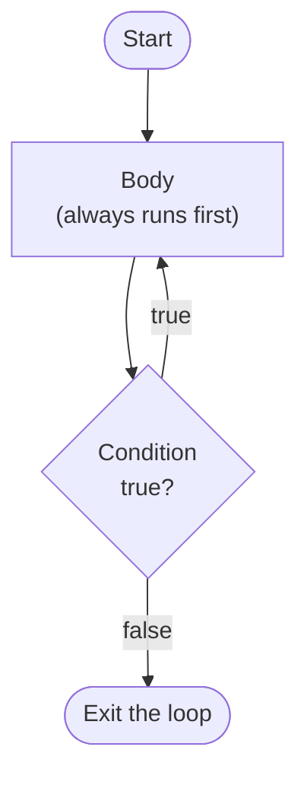
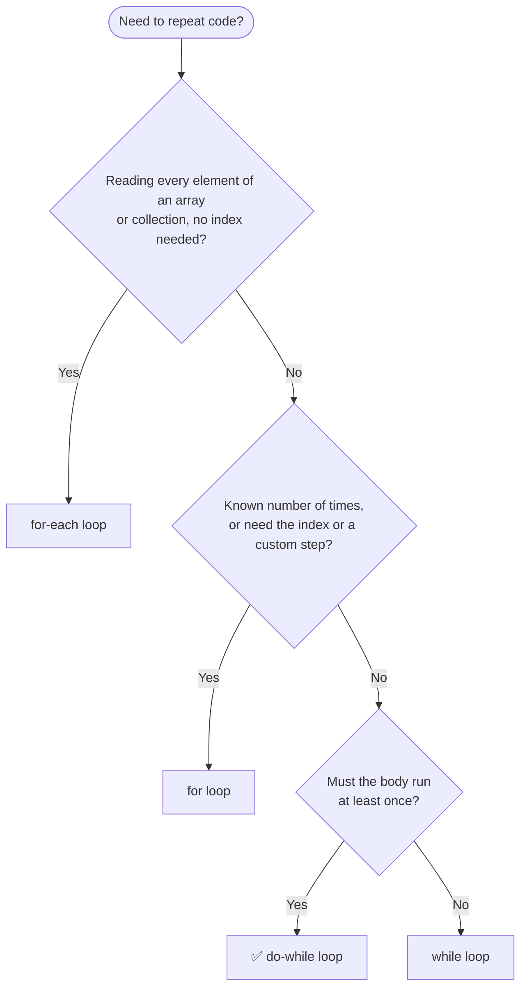

<a id="readme-top"></a>

# Do-While Loop

> **The `do-while` loop runs its body first and checks the condition afterwards — so the body always runs at least once.**


| Quick Facts | Details |
|---|---|
| **Category** | Loop — control flow |
| **Prerequisites** | Variables, operators, `if` conditions, while loop basics |
| **Key keywords** | `do` · `while` · `break` · `continue` |
| **Works with** | Java 8 and above |
| **At a glance** | `do { body } while (condition);` · the body runs **at least once** |

## 🔰 Table of Contents

| Level | Sections |
|---|---|
| 🟢 **Level 1 — Understand** | [Definition](#-definition) · [Key Points](#-key-points) · [How It Works](#-how-it-works) |
| 🟡 **Level 2 — Use It** | [Syntax & Variations](#-syntax--variations) · [When to Use](#-when-to-use) · [Example](#-example) · [Code](#-code) |
| 🔴 **Level 3 — Wrap-up** | [Common Mistakes](#-common-mistakes) · [Interview Questions](#-interview-questions) · [Summary](#-summary) |

## 📍 Definition

**Do-while loop** is an **exit-controlled loop**: it runs the body **first**, then checks a `boolean` condition, and repeats the body **as long as the condition is `true`**.

Because the check comes **after** the body, the body is guaranteed to run **at least once** — even when the condition is `false` from the start. That makes it the right loop whenever you must **act first and decide afterwards**: ask for input and check it, show a menu, try an action and see whether it worked.

| Term | Meaning | Example with `do { ... } while (value < 1);` |
|---|---|---|
| **Body** | The code that runs first and is repeated | `{ ... }` |
| **Condition** | The `boolean` expression checked **after** every run of the body | `value < 1` |
| **Loop-control variable** | The variable the condition depends on — it must change inside the body | `value` |
| **Initialization** | Written by you, before the loop | `int value;` |
| **Update** | Written by you, inside the body, so the condition can become `false` | `value = read();` |
| **Iteration** | One complete run of the body followed by the check | one prompt and one check |

**Entry-controlled vs exit-controlled loops**

| Type | Loops | Condition checked | Minimum runs of the body |
|---|---|---|---|
| **Entry-controlled** | `for`, `while` | **before** the body | 0 |
| **Exit-controlled** | `do-while` | **after** the body | 1 |

> [!TIP]
> **Real-life analogy:** tasting a dish while cooking. You must take the first spoonful before you can judge anything — only then do you decide whether it needs more salt. If it does, you add salt and taste again. The first taste can never be skipped.

## 📌 Key Points

1. **Body first, check afterwards** — the condition is evaluated after every run of the body, so the body runs **at least once**.
2. **A semicolon ends it** — `do { ... } while (condition);` needs the `;` after the parentheses; without it the code does not compile.
3. **Repeats while the condition is `true`** — the condition says when to **continue**, not when to stop.
4. **You manage the loop variable** — initialize it before `do` and update it inside the body; forgetting the update gives an infinite loop.
5. **Fewer checks** — for `n` iterations the condition is evaluated `n` times (a `while` or `for` loop evaluates it `n + 1` times).
6. **Body variables are invisible to the condition** — a variable declared inside the `{ }` body ends with it, so a variable used in the condition must be declared **before** the loop.
7. **`continue` jumps to the condition** — not to the top of the body, and no update runs for you.
8. **Use it when the first run cannot be skipped** — validation, menus, retry; use `while` when the body may need to run zero times.

> [!IMPORTANT]
> **Do first, ask later** — a do-while runs its body once before any check is possible. Never use it when the data may be empty or invalid from the start and the body would then fail; use a `while` loop for that.

## ⚙️ How It Works



Counting the digits of the number `0` with a **do-while** — the body runs before any check:

```text
int m = 0; int digits = 0;
do { m /= 10; digits++; } while (m > 0);

Step 0  setup       m = 0, digits = 0                 written by you, before the loop
Step 1  body        m = 0 / 10 = 0     digits = 1     runs BEFORE any check
Step 2  condition   0 > 0 → false → the loop ends     digits = 1
```

The same count with a **while** loop gives a different answer, because the check comes first:

```text
int m = 0; int digits = 0;
while (m > 0) { m /= 10; digits++; }

Step 0  setup       m = 0, digits = 0
Step 1  condition   0 > 0 → false → the loop ends     digits = 0     the body never ran
```

### A do-while written as a `while`

```java
do {                            // do-while
    body;
} while (condition);

body;                           // the same with a while: the body is written once before the loop ...
while (condition) {
    body;                       // ... and once inside it
}

while (true) {                  // or without the duplicate: loop forever and test at the end
    body;
    if (!condition) break;
}
```

> [!NOTE]
> The do-while is shorter than either `while` version, which is its whole reason to exist. How the other loops behave is covered in while-loop.md and for-loop.md, and `break` and `continue` in loop-control.md.

## 🔄 Syntax & Variations

### Basic syntax

```java
initialization;
do {
    // body: always runs at least once
    update;
} while (condition);            // the semicolon is required
```

| Rule | Detail |
|---|---|
| **Order** | the body runs first, then the condition is checked |
| **Condition** | required, a `boolean` expression in parentheses after `while` |
| **Semicolon** | required after `while (condition)` — otherwise "`';' expected`" |
| **Initialization and update** | written by you — before the loop and inside the body |
| **Braces** | optional for one statement — always write them |
| **Scope** | variables declared inside the body are not visible in the condition; declare them before `do` |
| **Minimum runs** | 1 |

### Common forms

| Form | Example | Behavior |
|---|---|---|
| **Input validation** | `do { value = read(); } while (value < 1 \|\| value > 10);` | asks again while the value is out of range |
| **Menu** | `do { showMenu(); choice = read(); ... } while (choice != EXIT);` | shows the menu at least once |
| **Retry** | `do { ok = tryConnect(); tries++; } while (!ok && tries < 3);` | tries once, then repeats up to a limit |
| **At-least-one pass** | `do { n /= 10; digits++; } while (n > 0);` | counts `0` as one digit |
| **Counter** (rare) | `do { ...; i++; } while (i <= 5);` | works, but a `for` loop is clearer |
| **Infinite + `break`** | `do { ...; if (done) break; } while (true);` | leaves from the middle of the body |

### Scope of variables

```java
int value;                      // declared BEFORE the loop
do {
    value = next();
} while (value < 0);            // OK: the condition can see value

do {
    int x = next();             // declared inside the body ...
} while (x < 0);                // compile error: cannot find symbol — x ended with the body
```

## 🎯 When to Use

| Need | Use | Benefit | Watch out |
|---|---|---|---|
| Ask for input and re-ask while it is invalid | **`do-while`** | the first prompt happens before any check is possible | declare the variable before the loop |
| A menu that must appear at least once | **`do-while`** | the menu is shown first, then the choice is tested | handle invalid choices too |
| Try an action at least once and retry (connect, download) | **`do-while`** | the action runs first, then success is checked | add a maximum number of attempts |
| A number must count as having one digit even when it is `0` | **`do-while`** | the body runs once for `0` | with `while`, `0` gives zero digits |
| The body may need to be skipped (empty data, zero count) | **`while`** instead | zero runs are possible | a do-while would run on empty data and fail |
| A known count, or you need the index | **`for`** instead | initialization, condition and update in one line | — |
| Only read every element | **for-each** instead | no index, no off-by-one | cannot go backwards or modify primitives |

**Which loop should I use?**



## 🎲 Example

**Problem:** keep asking for a number between `1` and `10` until the user enters a valid one. The first prompt has to happen **before** there is anything to check — which is why a do-while fits. Simulated typed values: `15`, `-3`, `7`.

**Dry run — the loop `do { ... } while (value < 1 || value > 10);`**

| Round | Prompt: typed value | In range 1–10? | Repeat? |
|---|---|---|---|
| 1 | `15` | no | yes — ask again |
| 2 | `-3` | no | yes — ask again |
| 3 | `7` | yes | no → stop |

✅ Accepted value = **7** after **3** prompts and 3 condition checks. Every check is `O(1)`, so the loop costs as many steps as there were prompts.

## 💻 Code

> Save it as `DoWhileLoopDemo.java`, then run `javac DoWhileLoopDemo.java` followed by `java DoWhileLoopDemo`.

```java
public class DoWhileLoopDemo {

    // Helper: prints "label : value" in neat columns
    static void show(String label, Object value) {
        System.out.printf("%-30s: %s%n", label, value);
    }

    public static void main(String[] args) {

        // ----- Counting: the body runs first, the condition is checked after it -----
        StringBuilder sb = new StringBuilder();
        int i = 1;                                      // initialization (before the loop)
        do {
            sb.append(i).append(' ');
            i++;                                        // update (inside the body)
        } while (i <= 5);                               // condition AFTER the body -- and a semicolon!
        show("Count 1..5", sb.toString().trim());

        // ----- At least once: the condition is false from the start, the body still runs -----
        int k = 10;
        int whileRuns = 0;
        while (k < 5) {
            whileRuns++;
        }
        int doRuns = 0;
        do {
            doRuns++;
        } while (k < 5);
        show("while / do-while (10 < 5)", whileRuns + " / " + doRuns);

        // ----- Input validation: ask first, then check -----
        int[] typed = {15, -3, 7};                      // pretend a user typed these, one per prompt
        int next = 0;
        int value;                                      // declared BEFORE the loop so the condition can see it
        do {
            value = typed[next];                        // "prompt" the user
            next++;
        } while (value < 1 || value > 10);              // ask again while the value is out of range
        show("Accepted value / prompts", value + " / " + next);
        // With a real keyboard:
        //   do { System.out.print("1-10: "); value = sc.nextInt(); } while (value < 1 || value > 10);

        // ----- Digits of a number: do-while counts 0 as one digit -----
        int[] numbers = {4729, 0};
        for (int p = 0; p < numbers.length; p++) {
            int m = numbers[p];
            int viaWhile = 0;
            while (m > 0) {
                m /= 10;
                viaWhile++;
            }
            m = numbers[p];
            int viaDo = 0;
            do {
                m /= 10;
                viaDo++;
            } while (m > 0);
            show("Digits of " + numbers[p] + " (while / do)", viaWhile + " / " + viaDo);
        }

        // ----- Menu: show it at least once, repeat until Exit -----
        int[] choices = {1, 2, 9, 3};                   // pretend choices; 3 = Exit, 9 is invalid
        int c = 0;
        int choice;
        sb.setLength(0);
        do {
            choice = choices[c];
            c++;
            switch (choice) {
                case 1:  sb.append("Add ");     break;
                case 2:  sb.append("List ");    break;
                case 3:  sb.append("Exit");     break;
                default: sb.append("Invalid "); break;
            }
        } while (choice != 3);
        show("Menu session", sb.toString().trim());

        // ----- continue in a do-while: it jumps to the CONDITION, not to the top -----
        sb.setLength(0);
        int j = 0;
        do {
            j++;                                        // update first, so continue cannot skip it
            if (j % 2 == 0) {
                continue;                               // goes to the condition check below
            }
            sb.append(j).append(' ');
        } while (j < 6);
        show("Odd numbers with continue", sb.toString().trim());
    }
}
```

**Output**

```text
Count 1..5                    : 1 2 3 4 5
while / do-while (10 < 5)     : 0 / 1
Accepted value / prompts      : 7 / 3
Digits of 4729 (while / do)   : 4 / 4
Digits of 0 (while / do)      : 0 / 1
Menu session                  : Add List Invalid Exit
Odd numbers with continue     : 1 3 5
```

> [!NOTE]
> The second and the fifth line show the one difference that matters: when the condition is false from the start, the `while` body runs `0` times and the `do-while` body runs `1` time — which is why `0` has `0` digits with a `while` loop and `1` digit with a `do-while`. In the `continue` loop, `j = 6` jumps to the condition `6 < 6`, which is `false`, so the loop ends.

## 🚨 Common Mistakes

| # | Mistake | Why it is a problem | Fix |
|---|---|---|---|
| 1 | no semicolon after `while (condition)` | compile error "`';' expected`" | write `} while (condition);` |
| 2 | declaring the condition's variable inside the body (`do { int x = ...; } while (x < 0);`) | `x` ends with the body → compile error "cannot find symbol" | declare it before `do` |
| 3 | a do-while on data that may be empty (`do { list.remove(0); } while (!list.isEmpty());`) | the body runs once before the check → `IndexOutOfBoundsException` on an empty list | use a `while` loop, which checks first |
| 4 | writing the **stop** condition instead of the **repeat** condition (`} while (value >= 1 && value <= 10);` for "ask until valid") | the loop repeats while the condition is `true` — here it would keep asking as long as the input is valid | repeat while the input is **invalid**: `while (value < 1 \|\| value > 10)` |
| 5 | forgetting the update | the condition never changes, so the loop never ends | update the loop-control variable inside the body |
| 6 | `continue` placed before the update | `continue` jumps to the condition, the update is skipped and the loop may never end | put the update before `continue` |

## 🎤 Interview Questions

<details>
<summary><b>1. What is a do-while loop and how is it different from a while loop?</b></summary>

A `do-while` loop runs its body first and checks the condition afterwards, so the body runs **at least once**. A `while` loop checks first, so its body can run zero times.

| Feature | `while` | `do-while` |
|---|---|---|
| Type | entry-controlled | exit-controlled |
| Condition checked | **before** the body | **after** the body |
| Minimum runs of the body | 0 | 1 |
| Ends with | nothing | `while (condition);` — a semicolon |
| Condition evaluated for `n` iterations | `n + 1` times | `n` times |
| Typical use | repeat while something holds — it may not run at all | validation, menus, "try at least once" |

</details>

<details>
<summary><b>2. When would you choose a do-while loop?</b></summary>

When the first run of the body cannot be skipped because it produces the value that the condition tests: asking for input and validating it, showing a menu, trying an action and checking the result, or processing a number where `0` must count as one digit. If the body may need to run zero times, use `while` instead.

</details>

<details>
<summary><b>3. Why must the variable used in the condition be declared before the loop?</b></summary>

The body is a block `{ ... }`. A variable declared inside it goes out of scope at the closing brace — **before** the condition after `while` is evaluated. So `do { int x = read(); } while (x < 0);` fails with "cannot find symbol". Declare `int x;` before `do`, then assign it inside the body.

</details>

<details>
<summary><b>4. What do <code>continue</code> and <code>break</code> do in a do-while loop?</b></summary>

`break` leaves the loop at once. `continue` skips the rest of the body and jumps to the **condition check** — not to the top of the body. No update runs for you, so an update placed after `continue` is skipped; put it before `continue`.

</details>

<details>
<summary><b>5. Can a do-while loop be rewritten as a while loop?</b></summary>

Yes. Either write the body once before a `while` loop and again inside it (the body is duplicated), or use `while (true) { body; if (!condition) break; }`. The do-while is simply the shortest way to say "run once, then keep going while the condition holds".

</details>

<details>
<summary><b>6. How many times is the condition evaluated, and what is the time complexity?</b></summary>

For `n` iterations the condition is evaluated `n` times, because the first run of the body needs no check before it. The time is the number of iterations multiplied by the cost of one body — the same as for the other loops — and since the body always runs once, the minimum cost is one run of the body.

</details>

## 🏁 Summary

- A **do-while loop** is exit-controlled: **run the body → check the condition → repeat while it is `true`**.
- The body always runs **at least once**, and the statement ends with a **semicolon** after `while (condition)`.
- The condition is evaluated `n` times for `n` iterations, and `continue` jumps to it — not to the top of the body.
- A variable used in the condition must be declared **before** the loop, because body variables end with the body.
- Use it for **validation, menus and retries** where the first run cannot be skipped; use `while` when the body may run zero times.
- The cost is the same as for the other loops: **iterations × cost of the body**.

### 📝 Cheat Sheet

| Question | Answer |
|---|---|
| Syntax | `do { body } while (condition);` — do not forget the `;` |
| Order | body → check the condition → repeat while `true` |
| Minimum runs | 1 — the body always runs once |
| Declare the condition's variable | before `do`, not inside the body |
| Validation pattern | `do { value = read(); } while (value is invalid);` |
| `continue` | jumps to the condition — put the update **before** it |
| Zero runs needed? | use a `while` loop instead |
| Time | iterations × cost of the body |

> [!IMPORTANT]
> **Do first, ask later:** use a do-while only when running the body once before any check makes sense — and remember the semicolon after `while (condition)`.
