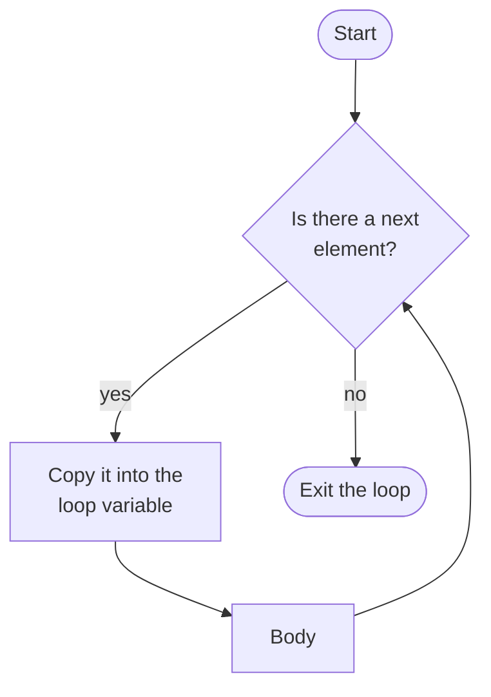
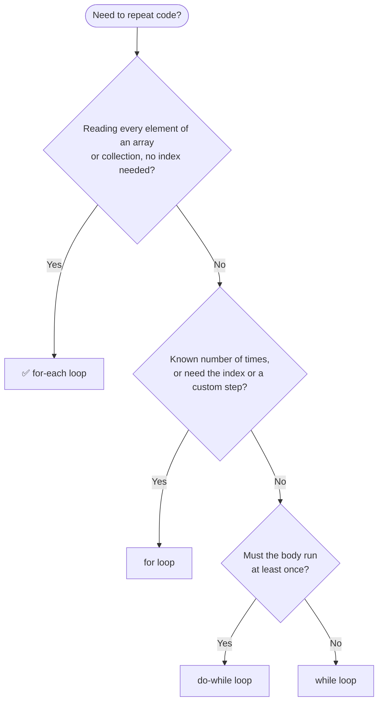

<a id="readme-top"></a>

# For-Each Loop

> **The for-each loop visits every element of an array or collection one by one — no index, no counter, no off-by-one.**


| Quick Facts | Details |
|---|---|
| **Category** | Loop — control flow (the "enhanced for" loop) |
| **Prerequisites** | Arrays, for loop basics, `ArrayList` basics |
| **Key keywords** | `for` · `:` · `Iterable` · `break` · `continue` |
| **Works with** | Java 8 and above |
| **At a glance** | `for (Type item : source) { body }` · Time `O(n)` — one visit per element |

## 🔰 Table of Contents

| Level | Sections |
|---|---|
| 🟢 **Level 1 — Understand** | [Definition](#-definition) · [Key Points](#-key-points) · [How It Works](#-how-it-works) |
| 🟡 **Level 2 — Use It** | [Syntax & Variations](#-syntax--variations) · [Common Patterns](#-common-patterns) · [When to Use](#-when-to-use) · [Example](#-example) · [Code](#-code) |
| 🔴 **Level 3 — Wrap-up** | [Time Complexity](#-time-complexity) · [Common Mistakes](#-common-mistakes) · [Interview Questions](#-interview-questions) · [Summary](#-summary) |

## 📍 Definition

**For-each loop** (the **enhanced for loop**) visits **every element** of an **array** or of any object that implements **`Iterable`** — such as `ArrayList`, `LinkedList`, `HashSet` — **one by one, from the first to the last**, and hands each element to you in a loop variable.

The loop hides the counter and the iterator, so there is no index to get wrong. Read the colon as **"in"**: *for each `mark` in `marks`*.

| Term | Meaning | Example with `for (int mark : marks)` |
|---|---|---|
| **Loop variable** | Holds the current element in every iteration | `mark` |
| **Source** | The array or collection being walked through (right of the `:`) | `marks` |
| **Element type** | The type of each element; the loop variable must be able to hold it | `int` |
| **Iterable** | The interface a collection implements so that for-each can walk it | `List`, `Set`, `Queue` |
| **Iterator** | The helper object that for-each uses behind the scenes on a collection | `names.iterator()` |
| **Iteration** | One visit to one element | one value of `mark` |

**What you no longer write**

| Part | Classic `for` loop | For-each loop |
|---|---|---|
| **Counter** | `int i = 0` | none |
| **Condition** | `i < marks.length` | none — it stops after the last element |
| **Update** | `i++` | none |
| **Getting the element** | `marks[i]` | the loop variable `mark` |

> [!TIP]
> **Real-life analogy:** a teacher taking attendance from the roll list: "for each student in the class, call the name and mark the register." She never counts seat numbers or worries where the list ends — she just takes the next student until there are no more.

## 📌 Key Points

1. **Syntax** — `for (Type element : source) { body }`; read the colon as "in".
2. **Works on arrays and any `Iterable`** — arrays, `List`, `Set`, `Queue`; not directly on a `Map`, a `String` or a single number.
3. **Visits every element, first to last** — forward only; you can leave early with `break`.
4. **No index** — you cannot know the position, go backwards, skip with a step or look at the neighbors.
5. **The loop variable is a copy** — assigning to it never changes the array or the list; for object elements the copy of the reference still points to the **same object**.
6. **Do not change the collection while looping** — adding or removing elements usually throws `ConcurrentModificationException`.
7. **`null` fails, empty is fine** — looping over a `null` array or collection throws `NullPointerException`; an empty one simply runs zero iterations.
8. **Under the hood** — for an array the compiler writes an index loop; for a collection it uses an `Iterator` (`hasNext()` and `next()`).

> [!IMPORTANT]
> **The loop variable is a copy** — `for (int m : marks) { m += 5; }` changes nothing in the array. To write values back, use an index-based `for` loop. (If the elements are objects, calling a method that changes the object does work, because the variable points to the same object.)

## ⚙️ How It Works



Tracing `for (int m : marks) { total += m; }` with `marks = {85, 90, 78}` and `total` starting at `0`:

```text
Step 1  next?    yes → m = 85          (a COPY of marks[0])
Step 2  body     total = 0 + 85 = 85
Step 3  next?    yes → m = 90
Step 4  body     total = 85 + 90 = 175
Step 5  next?    yes → m = 78
Step 6  body     total = 175 + 78 = 253
Step 7  next?    no → the loop ends                       total = 253
```

### What the compiler really runs

```java
// you write, for an array
for (int m : marks) { ... }

// the compiler runs (roughly)
for (int i = 0; i < marks.length; i++) {
    int m = marks[i];
    ...
}

// you write, for a collection
for (String s : names) { ... }

// the compiler runs (roughly)
Iterator<String> it = names.iterator();
while (it.hasNext()) {
    String s = it.next();
    ...
}
```

> [!NOTE]
> This is why changing a collection inside a for-each fails: the iterator remembers how many changes the collection had when the loop started and throws `ConcurrentModificationException` when it notices a change it did not make. The classic loops are covered in for-loop.md and while-loop.md, and `break` and `continue` in loop-control.md.

## 🔄 Syntax & Variations

### Basic syntax

```java
for (ElementType element : arrayOrCollection) {
    // body: element is the current item
}
```

| Rule | Detail |
|---|---|
| **Left of `:`** | declares the loop variable — its type must fit the elements, and it is local to the loop |
| **Right of `:`** | an array or an `Iterable`; it is evaluated once, before the loop starts |
| **`final`** | allowed — `for (final int m : marks)` stops you from reassigning the variable |
| **Order** | arrays: index `0` to `length - 1`; collections: the collection's own order (`List` keeps insertion order, `TreeSet` is sorted, `HashSet` has no guaranteed order) |
| **`break` / `continue`** | both work — `continue` moves on to the next element |
| **Braces** | optional for one statement — always write them |

### What you can loop over

| Source | Example | Loop variable |
|---|---|---|
| **Array** | `for (int m : marks)` | the element type |
| **2D array** | `for (int[] row : grid) { for (int cell : row) { ... } }` | `int[]` for each row, then `int` |
| **`List`, `Set`, `Queue`** | `for (String name : names)` | the generic type |
| **`Map` keys / values** | `for (String k : map.keySet())` · `for (int v : map.values())` | key type / value type |
| **`Map` entries** | `for (Map.Entry<String, Integer> e : map.entrySet())` | an entry with `getKey()` and `getValue()` |
| **Characters of a `String`** | `for (char ch : word.toCharArray())` | `char` |
| **Varargs parameter** | `static int sum(int... nums) { for (int n : nums) { ... } }` | `int` — varargs is an array in disguise |
| **Not allowed directly** | a `Map`, a `String`, a single `int` | compile error: "for-each not applicable to expression type" |

### The loop variable is a copy

```java
int[] marks = {85, 90, 78};

for (int m : marks) {
    m += 5;                      // changes only the copy
}                                // marks is still {85, 90, 78}

for (int i = 0; i < marks.length; i++) {
    marks[i] += 5;               // an index loop writes back
}                                // marks is now {90, 95, 83}
```

### Removing items while looping

| Wrong | Right |
|---|---|
| `for (String s : list) { if (s.startsWith("b")) list.remove(s); }` — usually `ConcurrentModificationException` | `list.removeIf(s -> s.startsWith("b"));` (Java 8) |
| | an `Iterator` and `it.remove()` |
| | a `while` loop, or an index loop that runs backwards |

## 🧩 Common Patterns

| Pattern | Idea | Skeleton |
|---|---|---|
| **Sum / count** | add up or count every element | `total += m;` |
| **Find max / min** | remember the best value so far | `if (m > max) max = m;` |
| **Count matches** | count only the elements that fit a rule | `if (name.startsWith("A")) count++;` |
| **Search with early exit** | stop as soon as the key is found | `if (s.equals(key)) { found = true; break; }` |
| **Process every object** | call a method on each element | `for (Student s : students) { s.print(); }` |
| **Build a result** | append every element to a builder | `sb.append(ch);` |
| **Walk a 2D array** | a for-each inside a for-each | `for (int[] row : grid) for (int cell : row)` |
| **Walk a `Map`** | read each key and value together | `for (Map.Entry<K, V> e : map.entrySet())` |

## 🎯 When to Use

| Need | Use | Benefit | Watch out |
|---|---|---|---|
| Read every element once, front to back | **for-each** | shortest code, no index, no off-by-one | the loop variable is only a copy |
| Walk any collection (`List`, `Set`, `Queue`) | **for-each** | works for every `Iterable` and uses the collection's own fast iterator | do not add or remove elements inside the loop |
| Call a method on every object | **for-each** | clear and safe | the objects are shared, so the changes are visible to everyone |
| Know the position, compare neighbors (`i - 1`, `i + 1`) | **`for`** instead | the index is available | keep `i` within the bounds |
| Change the elements of an array | **`for` with an index** | `arr[i] = …` writes back | a for-each variable is only a copy |
| Go backwards, skip, step, or work from both ends | **`for`** instead | full control of direction and step | get the start and stop values right |
| Remove elements while walking | **`removeIf`, an `Iterator` or `while`** instead | safe removal | a for-each throws `ConcurrentModificationException` |
| Repeat until something happens (not "every element") | **`while`** instead | the condition states the reason | make sure the loop ends |

**Which loop should I use?**



## 🎲 Example

**Problem:** given the names `["Asha", "Ravi", "Anil", "Meera"]`, count how many start with `"A"` and find the longest name. A for-each loop is enough because every name is read once and the position never matters.

**Dry run — the loop `for (String name : names)`**

| Iteration | `name` | starts with `"A"`? | `startsWithA` after | `longest` after |
|---|---|---|---|---|
| start | – | – | `0` | `""` |
| 1 | `Asha` | yes | `1` | `Asha` — 4 > 0 |
| 2 | `Ravi` | no | `1` | `Asha` — 4 is not > 4 |
| 3 | `Anil` | yes | `2` | `Asha` — 4 is not > 4 |
| 4 | `Meera` | no | `2` | `Meera` — 5 > 4 |
| end | – | – | `2` | `Meera` — no next element, the loop ends |

✅ **2** names start with `A` and the longest name is **Meera** — one pass, no index → **O(n)**.

## 💻 Code

> Save it as `ForEachLoopDemo.java`, then run `javac ForEachLoopDemo.java` followed by `java ForEachLoopDemo`.

```java
import java.util.ArrayList;
import java.util.Arrays;
import java.util.ConcurrentModificationException;
import java.util.LinkedHashMap;
import java.util.List;
import java.util.Map;

public class ForEachLoopDemo {

    // Helper: prints "label : value" in neat columns
    static void show(String label, Object value) {
        System.out.printf("%-30s: %s%n", label, value);
    }

    public static void main(String[] args) {

        // ----- Array: visit every element, no index -----
        int[] marks = {85, 90, 78, 92, 66};
        int total = 0;
        int max = marks[0];
        for (int m : marks) {                           // read the colon as "in": for each m in marks
            total += m;
            if (m > max) {
                max = m;
            }
        }
        show("Total / highest", total + " / " + max);

        // ----- List: the same loop works for every collection -----
        List<String> names = new ArrayList<>(Arrays.asList("Asha", "Ravi", "Anil", "Meera"));
        int startsWithA = 0;
        String longest = "";
        for (String name : names) {
            if (name.startsWith("A")) {
                startsWithA++;
            }
            if (name.length() > longest.length()) {
                longest = name;
            }
        }
        show("Names with A / longest", startsWithA + " / " + longest);

        // ----- Early exit works exactly as in a for loop -----
        boolean found = false;
        for (String name : names) {
            if (name.equals("Anil")) {
                found = true;
                break;
            }
        }
        show("Anil found?", found);

        // ----- 2D array: each element is a row, so use a for-each inside a for-each -----
        int[][] grid = {{1, 2, 3}, {4, 5, 6}};
        int sum = 0;
        for (int[] row : grid) {
            for (int cell : row) {
                sum += cell;
            }
        }
        show("Sum of the 2D array", sum);

        // ----- String: loop over the characters with toCharArray() -----
        int vowels = 0;
        for (char ch : "education".toCharArray()) {
            if ("aeiou".indexOf(ch) >= 0) {
                vowels++;
            }
        }
        show("Vowels in \"education\"", vowels);

        // ----- Map: loop over the entries (key + value) -----
        Map<String, Integer> stock = new LinkedHashMap<>();     // keeps insertion order, so the output is stable
        stock.put("pen", 10);
        stock.put("book", 4);
        stock.put("bag", 2);
        StringBuilder sb = new StringBuilder();
        for (Map.Entry<String, Integer> e : stock.entrySet()) {
            sb.append(e.getKey()).append('=').append(e.getValue()).append(' ');
        }
        show("Map entries", sb.toString().trim());

        // ----- An empty collection: zero iterations, no error -----
        int runs = 0;
        for (String s : new ArrayList<String>()) {
            runs++;
        }
        show("Iterations over an empty list", runs);

        // ----- The loop variable is a COPY: assigning to it changes nothing -----
        int[] scores = {85, 90, 78};
        for (int s : scores) {
            s += 5;                                     // changes only the copy
        }
        show("After s += 5 (for-each)", Arrays.toString(scores));
        for (int i = 0; i < scores.length; i++) {
            scores[i] += 5;                             // an index loop writes back
        }
        show("After += 5 (index loop)", Arrays.toString(scores));

        // ----- For objects the copy points to the SAME object -----
        Box[] boxes = {new Box(1), new Box(2)};
        for (Box b : boxes) {
            b.value += 10;                              // changes the real objects
        }
        for (Box b : boxes) {
            b = new Box(0);                             // re-points only the loop variable
        }
        show("Boxes after the two loops", boxes[0].value + ", " + boxes[1].value);

        // ----- Removing while looping fails -----
        List<String> fruit = new ArrayList<>(Arrays.asList("apple", "banana", "cherry", "blueberry"));
        try {
            for (String f : fruit) {
                if (f.startsWith("b")) {
                    fruit.remove(f);                    // changing the list during a for-each
                }
            }
        } catch (ConcurrentModificationException e) {
            show("Remove inside for-each", "ConcurrentModificationException");
        }
        fruit = new ArrayList<>(Arrays.asList("apple", "banana", "cherry", "blueberry"));
        fruit.removeIf(f -> f.startsWith("b"));         // the safe way (Java 8)
        show("After removeIf", fruit);
    }
}

class Box {
    int value;

    Box(int value) {
        this.value = value;
    }
}
```

**Output**

```text
Total / highest               : 411 / 92
Names with A / longest        : 2 / Meera
Anil found?                   : true
Sum of the 2D array           : 21
Vowels in "education"         : 5
Map entries                   : pen=10 book=4 bag=2
Iterations over an empty list : 0
After s += 5 (for-each)       : [85, 90, 78]
After += 5 (index loop)       : [90, 95, 83]
Boxes after the two loops     : 11, 12
Remove inside for-each        : ConcurrentModificationException
After removeIf                : [apple, cherry]
```

> [!NOTE]
> Two lines are worth a second look. `[85, 90, 78]` stays the same after `s += 5` because the loop variable is only a copy. And the boxes end up as `11, 12` because `b.value += 10` changes the real objects, while `b = new Box(0)` only re-points the loop variable and changes nothing.

## ⏳ Time Complexity

| What you loop over | Time | Note |
|---|---|---|
| an array of `n` elements | **O(n)** | one visit per element |
| an `ArrayList` of `n` elements | **O(n)** | the iterator or `get(i)` — both are `O(1)` per step |
| a `LinkedList` of `n` elements | **O(n)** | the iterator moves from node to node |
| a `HashSet` / `TreeSet` | **O(n)** | a `HashSet` also scans its empty buckets |
| a 2D array with `r` rows and `c` columns | **O(r × c)** | one visit per cell |
| a for-each nested inside a for-each over the same `n` elements | **O(n²)** | the inner loop restarts for every outer element |

Extra space is **O(1)**: the loop variable, plus one iterator object for a collection.

**Why for-each is the right tool for a `LinkedList`** — a `LinkedList` cannot jump to position `i`; `get(i)` has to walk along the links. So an index loop over it does far more work than a for-each:

| n | for-each — `O(n)` | `for (i) { list.get(i) }` — `O(n²)` |
|---|---|---|
| 1,000 | 1,000 | about 250,000 |
| 100,000 | 100,000 | about 2,500,000,000 |

(`get(i)` starts from the nearer end of the list, so the walks add up to about `n² / 4` steps.)

> [!TIP]
> **Rule of thumb:** for a collection you have not created yourself, use for-each — it is always `O(n)`, whatever the collection is. An index loop is only fast when the collection offers instant access to position `i`, like an array or an `ArrayList`.

## 🚨 Common Mistakes

| # | Mistake | Why it is a problem | Fix |
|---|---|---|---|
| 1 | `for (int m : marks) { m += 5; }` | `m` is a copy, so the array does not change | use an index loop: `marks[i] += 5;` |
| 2 | `list.remove(s)` or `list.add(x)` inside the for-each | the iterator detects the change → `ConcurrentModificationException` (and removing the second-to-last element silently skips one instead — never rely on it) | `list.removeIf(...)`, an `Iterator` with `it.remove()`, or a `while` loop |
| 3 | looping over a `null` array or collection | `NullPointerException` — an empty one is fine, a `null` one is not | check for `null` first, or make sure the source is never `null` |
| 4 | keeping a manual counter (`int i = 0; for (...) { ...; i++; }`) | the counter is easy to forget — and a `continue` can skip the `i++` | use a classic `for` loop when you need the index |
| 5 | `for (String k : map)` or `for (char c : "abc")` | a `Map` and a `String` are not arrays or `Iterable` → "for-each not applicable to expression type" | use `map.entrySet()` / `keySet()` / `values()` and `word.toCharArray()` |
| 6 | `for (int n : listOfStrings)` | the loop variable cannot hold the element → "incompatible types: String cannot be converted to int" | use the element's type, or a type it can be converted to |

## 🎤 Interview Questions

<details>
<summary><b>1. What is a for-each loop and when do you use it?</b></summary>

The for-each (enhanced for) loop visits every element of an array or `Iterable` collection from the first to the last, giving each one to a loop variable: `for (Type item : source)`. Use it whenever you only need to **read every element once** — it has no index, no counter and no off-by-one.

</details>

<details>
<summary><b>2. What can a for-each loop iterate over?</b></summary>

Arrays and any object that implements `Iterable` — `List`, `Set`, `Queue` and so on. A `Map` is not `Iterable`, so you loop over `map.keySet()`, `map.values()` or `map.entrySet()`. A `String` is not an array either, so you loop over `word.toCharArray()`.

</details>

<details>
<summary><b>3. What is the difference between a for loop and a for-each loop?</b></summary>

| Feature | `for` | for-each |
|---|---|---|
| Index available | yes | no |
| Direction and step | any — `i--`, `i += 2` | always forward, one by one |
| Change array elements | yes — `arr[i] = …` | no — the loop variable is a copy |
| Remove elements while looping | careful, with an index loop | not possible — `ConcurrentModificationException` |
| Works on | arrays and index-based lists | arrays and every `Iterable` |
| Off-by-one risk | yes | none |
| Speed on a `LinkedList` | `O(n²)` with `get(i)` | `O(n)` |

</details>

<details>
<summary><b>4. Can you change the elements or the collection inside a for-each loop?</b></summary>

Not through the loop variable: it is a **copy**, so `m += 5` does not change the array. For object elements, calling a method that changes the object works, because the copy points to the same object — but assigning a new object to the loop variable does not. Adding or removing elements of a collection during the loop throws `ConcurrentModificationException`; use `removeIf`, an `Iterator` or a `while` loop instead.

</details>

<details>
<summary><b>5. How does a for-each loop work internally?</b></summary>

For an **array** the compiler turns it into an index loop over `0 … length - 1`. For an **`Iterable`** it calls `iterator()` and then repeats `hasNext()` and `next()`. Collections like `ArrayList` keep a change counter; the iterator compares it with its own copy on every `next()`, and that is how it detects (fail-fast) that the collection was modified during the loop.

</details>

<details>
<summary><b>6. What happens when the array or collection is empty or null?</b></summary>

An **empty** source is fine: the body runs zero times. A **`null`** array or collection throws a `NullPointerException` as soon as the loop starts, so check for `null` first if the source can be missing.

</details>

<details>
<summary><b>7. Why is for-each better than an index loop on a LinkedList?</b></summary>

A `LinkedList` has no direct access to position `i` — `get(i)` walks along the links from the nearer end. A `for` loop that calls `get(i)` for every `i` therefore takes about `n² / 4` steps (`O(n²)`), while a for-each uses the iterator, which simply moves from one node to the next in `O(n)`.

</details>

## 🏁 Summary

- A **for-each loop** visits every element of an array or `Iterable` **first to last** and gives each one to the loop variable — read the colon as "in".
- There is **no index**, so you cannot go backwards, skip, or look at neighbors; use a classic `for` loop for that.
- The loop variable is a **copy**: assigning to it changes nothing, but calling a changing method on an object element does.
- Do **not** add or remove collection elements inside the loop — use `removeIf`, an `Iterator` or a `while` loop.
- It works for arrays and collections directly; for a `Map` use `entrySet()`, `keySet()` or `values()`, and for a `String` use `toCharArray()`.
- Time is **O(n)** — one visit per element — and for a `LinkedList` it beats an index loop, which is **O(n²)**.

### 📝 Cheat Sheet

| Question | Answer |
|---|---|
| Syntax | `for (Type item : source) { body }` — read the colon as "in" |
| Works on | arrays and any `Iterable` (`List`, `Set`, `Queue`) |
| `Map` | `entrySet()` · `keySet()` · `values()` |
| `String` | `for (char ch : s.toCharArray())` |
| 2D array | `for (int[] row : grid) { for (int v : row) { ... } }` |
| Change array elements | an index loop — the for-each variable is a copy |
| Remove while looping | `list.removeIf(...)` or an `Iterator` — never `list.remove(...)` inside the loop |
| Need the index, backwards or a step | a classic `for` loop |
| Time | `O(n)` — one visit per element |

> [!IMPORTANT]
> **Read with for-each, change with for:** use for-each to read every element, and switch to an index-based `for` loop the moment you need to write values back, know the position or remove items.
