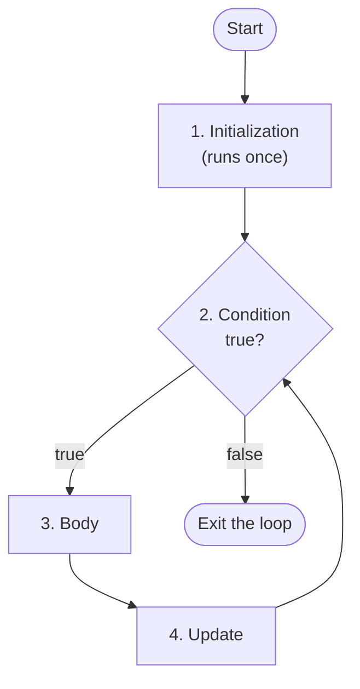
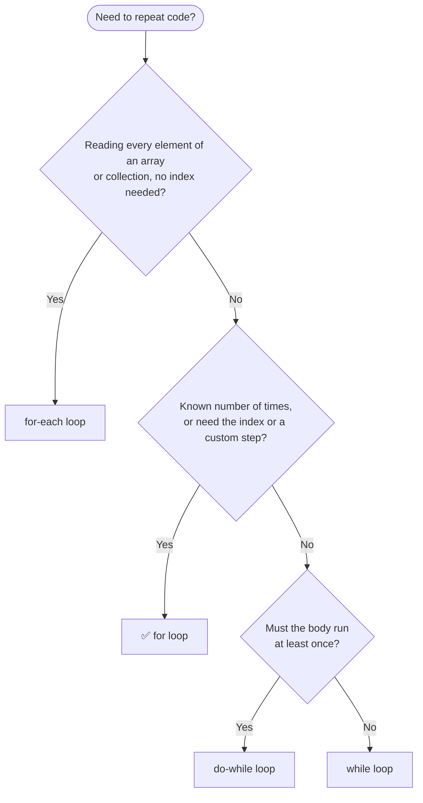

<a id="readme-top"></a>

# For Loop

> **The `for` loop repeats a block of code a known number of times — it keeps the counter's start, stop and step together in one line.**


| Quick Facts | Details |
|---|---|
| **Category** | Loop — control flow |
| **Prerequisites** | Variables, data types, operators, `if` conditions |
| **Key keywords** | `for` · `break` · `continue` |
| **Works with** | Java 8 and above |
| **At a glance** | `for (init; condition; update) { body }` · Time `O(iterations × cost of the body)` |

## 🔰 Table of Contents

| Level | Sections |
|---|---|
| 🟢 **Level 1 — Understand** | [Definition](#-definition) · [Key Points](#-key-points) · [How It Works](#-how-it-works) |
| 🟡 **Level 2 — Use It** | [Syntax & Variations](#-syntax--variations) · [Common Patterns](#-common-patterns) · [When to Use](#-when-to-use) · [Example](#-example) · [Code](#-code) |
| 🔴 **Level 3 — Wrap-up** | [Time Complexity](#-time-complexity) · [Common Mistakes](#-common-mistakes) · [Interview Questions](#-interview-questions) · [Summary](#-summary) |

## 📍 Definition

**For loop** is a **counter-controlled loop**: it repeats a block of code **while a condition stays `true`**, and it keeps the loop's **initialization**, **condition** and **update** together in a single header line.

It is the natural choice when you know **how many times** to repeat, or when you need the **index** of each step.

| Term | Meaning | Example with `for (int i = 0; i < 5; i++)` |
|---|---|---|
| **Loop variable** | The variable that controls the repetition (the counter) | `i` |
| **Initialization** | Runs once, before the first condition check | `int i = 0` |
| **Condition** | Checked before every iteration; the loop continues while it is `true` | `i < 5` |
| **Update** | Runs after the body of every iteration | `i++` |
| **Body** | The code that is repeated | `{ ... }` |
| **Iteration** | One complete run of the body | the run with `i = 0`, then `i = 1`, … |

**The three parts of the header**

| Part | Runs | How often | Can it be left out? |
|---|---|---|---|
| **Initialization** | before the loop starts | once | yes |
| **Condition** | before every iteration | iterations + 1 times | yes — a missing condition counts as `true` |
| **Update** | after every iteration | as many times as the body runs | yes |

> [!TIP]
> **Real-life analogy:** running laps on a track. You decide where to start counting (initialization), the stop rule "until 5 laps are done" (condition), and after every lap you tick the counter (update). Running one lap is the body.

## 📌 Key Points

1. **Three parts, two semicolons** — `for (init; condition; update)`; every part is optional, but both `;` must stay.
2. **Fixed order** — initialization (once) → condition → body → update → condition → … until the condition is `false`.
3. **Entry-controlled** — the condition is checked before the first iteration, so the body can run **zero** times.
4. **One extra check** — for `n` iterations the condition is evaluated `n + 1` times, the last time to find out that it is `false`.
5. **Local loop variable** — a variable declared in the initialization exists only inside the loop.
6. **`boolean` condition only** — Java does not accept `0` or `1` as true and false, so `for (int i = 5; i; i--)` does not compile.
7. **Any step you like** — the update can be `i++`, `i--`, `i += 2`, `i *= 2` and more, even several expressions separated by commas.
8. **Pick the loop by the need** — `for` when the count or the index matters, for-each when you only read every element, `while` or `do-while` when the count is unknown.

> [!IMPORTANT]
> **Off-by-one is the most common for-loop bug** — an array of length `n` has the indexes `0` to `n - 1`, so write `i < arr.length`, not `i <= arr.length`. Always check the first and the last value of the loop variable.

## ⚙️ How It Works



Tracing `for (int i = 1; i <= 3; i++) { sum += i; }` with `sum` starting at `0`:

```text
Step 0   init        i = 1                               runs once
Step 1   condition   1 <= 3 → true
Step 2   body        sum = 0 + 1 = 1
Step 3   update      i = 2
Step 4   condition   2 <= 3 → true
Step 5   body        sum = 1 + 2 = 3
Step 6   update      i = 3
Step 7   condition   3 <= 3 → true
Step 8   body        sum = 3 + 3 = 6
Step 9   update      i = 4
Step 10  condition   4 <= 3 → false → the loop ends      sum = 6
```

### The same loop written as a `while`

```java
// for loop
for (int i = 1; i <= 3; i++) {
    sum += i;
}

// the same loop written as a while
int i = 1;                      // initialization
while (i <= 3) {                // condition
    sum += i;                   // body
    i++;                        // update
}
```

> [!NOTE]
> A `for` is a compact `while` — with two differences. The loop variable of the `for` disappears after the loop, and `continue` inside a `for` jumps to the **update** (`i++`) before the next check. In the `while` version a `continue` placed before `i++` would skip the update and loop forever. The `while` loop is covered in while-loop.md, and `break` and `continue` in loop-control.md.

## 🔄 Syntax & Variations

### Basic syntax

```java
for (initialization; condition; update) {
    // body: runs once for every iteration
}
```

| Rule | Detail |
|---|---|
| **Parts** | separated by two semicolons; each part is optional |
| **Initialization** | declares a variable (`int i = 0`) or assigns an existing one; several variables of one type are allowed: `int i = 0, j = 9` |
| **Condition** | a `boolean` expression; if it is left out it counts as `true` |
| **Update** | any expression statements; several are separated by commas: `i++, j--` |
| **Braces** | optional for a single statement — always write them |
| **Scope** | a variable declared in the initialization exists only inside the loop |

### Common forms

| Form | Example | Behavior |
|---|---|---|
| **Count up** | `for (int i = 0; i < n; i++)` | `0` … `n - 1`, `n` iterations |
| **Count up, inclusive** | `for (int i = 1; i <= n; i++)` | `1` … `n` |
| **Count down** | `for (int i = n - 1; i >= 0; i--)` | `n - 1` … `0` |
| **Custom step** | `for (int i = 0; i < n; i += 3)` | every third value |
| **Doubling** | `for (int i = 1; i < n; i *= 2)` | `1, 2, 4, 8, …` |
| **Two variables** | `for (int i = 0, j = n - 1; i < j; i++, j--)` | moving in from both ends |
| **Existing variable** | `int i; for (i = 0; i < n; i++)` | `i` is still usable after the loop |
| **No parts** | `for (;;)` | infinite loop — leave it with `break` or `return` |
| **Empty body** | `for (int i = 0; i < n; i++);` | the `;` is the body — almost always a bug |

### Scope of the loop variable

```java
for (int i = 0; i < 3; i++) { }
System.out.println(i);        // compile error: cannot find symbol — i ended with the loop

int j;                        // declared outside the loop ...
for (j = 0; j < 3; j++) { }
System.out.println(j);        // 3 — ... so it is still alive after it
```

## 🧩 Common Patterns

Most `for` loops are one of a handful of patterns:

| Pattern | Idea | Skeleton |
|---|---|---|
| **Repeat `n` times** | run something a fixed number of times | `for (int i = 0; i < n; i++)` |
| **Accumulate** | keep a running sum, product or count | `sum += arr[i];` |
| **Find max / min** | remember the best value so far | `if (arr[i] > max) max = arr[i];` |
| **Count matches** | count only the items that fit a rule | `if (arr[i] % 2 == 0) count++;` |
| **Search with early exit** | stop as soon as the key is found | `if (arr[i] == key) { found = i; break; }` |
| **Traverse backwards** | start at the last index | `for (int i = n - 1; i >= 0; i--)` |
| **Two pointers** | start and end move towards each other | `for (int i = 0, j = n - 1; i < j; i++, j--)` |
| **Step / skip** | visit every k-th element | `for (int i = 0; i < n; i += k)` |
| **Build a result** | append every step to a string or builder | `sb.append(arr[i]);` |

## 🎯 When to Use

| Need | Use | Benefit | Watch out |
|---|---|---|---|
| Repeat a fixed number of times | **`for` counter loop** | start, stop and step sit in one line | an off-by-one at the boundary |
| Read or write `arr[i]`, know the position, look at neighbors (`i - 1`, `i + 1`) | **`for` with an index** | full control of the index, direction and step | keep `i` within `0` … `length - 1` |
| Walk backwards or skip elements | **`for` with `i--` or `i += step`** | for-each cannot do this | get the start and stop values right |
| Two positions at once (swapping ends, two pointers) | **`for` with two variables** | `i++, j--` in one header | the stop condition is `i < j` |
| Change the elements of an array | **`for` with an index** | `arr[i] = …` writes back | a for-each variable is only a copy |
| Only read every element | **for-each** instead | no index, no off-by-one | cannot modify primitives or go backwards |
| Repeat until something happens (unknown count) | **`while`** instead | the condition says exactly why the loop runs | `for (;;)` with `break` works but reads worse |

**Which loop should I use?**



## 🎲 Example

**Problem:** walk through the marks `{85, 90, 78, 92, 66}` with an index-based `for` loop and find the **total** and the **highest** mark.

**Dry run — the loop `for (int i = 0; i < marks.length; i++)`**

| Iteration | `i` | `marks[i]` | `total` after | `max` after |
|---|---|---|---|---|
| start | – | – | `0` | `85` (taken from `marks[0]`) |
| 1 | 0 | 85 | `85` | `85` |
| 2 | 1 | 90 | `175` | `90` — 90 > 85 |
| 3 | 2 | 78 | `253` | `90` — 78 < 90 |
| 4 | 3 | 92 | `345` | `92` — 92 > 90 |
| 5 | 4 | 66 | `411` | `92` — 66 < 92 |
| end | 5 | – | `411` | `92` — the condition `5 < 5` is `false` |

✅ Total = **411**, highest = **92** — 5 iterations and 6 condition checks, one pass over the array → **O(n)**.

## 💻 Code

> Save it as `ForLoopDemo.java`, then run `javac ForLoopDemo.java` followed by `java ForLoopDemo`.

```java
import java.util.Arrays;

public class ForLoopDemo {

    // Helper: prints "label : value" in neat columns
    static void show(String label, Object value) {
        System.out.printf("%-30s: %s%n", label, value);
    }

    public static void main(String[] args) {

        // ----- Counting up, down and with a custom step -----
        StringBuilder sb = new StringBuilder();
        for (int i = 1; i <= 5; i++) {                  // initialization; condition; update
            sb.append(i).append(' ');
        }
        show("Count up 1..5", sb.toString().trim());

        sb.setLength(0);
        for (int i = 5; i >= 1; i--) {                  // counting down: start high, use >= and i--
            sb.append(i).append(' ');
        }
        show("Count down 5..1", sb.toString().trim());

        sb.setLength(0);
        for (int i = 2; i <= 10; i += 2) {              // custom step: i += 2
            sb.append(i).append(' ');
        }
        show("Even numbers up to 10", sb.toString().trim());

        sb.setLength(0);
        for (int i = 1; i <= 6; i++) {
            if (i % 2 == 0) {
                continue;                               // skip the rest of the body; the update i++ still runs
            }
            sb.append(i).append(' ');
        }
        show("Odd numbers with continue", sb.toString().trim());

        // ----- Accumulate: sum of 1..100 -----
        int sum = 0;
        for (int i = 1; i <= 100; i++) {
            sum += i;
        }
        show("Sum of 1..100", sum);

        // ----- Traverse an array by index: total and highest -----
        int[] marks = {85, 90, 78, 92, 66};
        int total = 0;
        int max = marks[0];
        for (int i = 0; i < marks.length; i++) {        // i < length, NOT i <= length
            total += marks[i];
            if (marks[i] > max) {
                max = marks[i];
            }
        }
        show("Total / highest", total + " / " + max);

        // ----- Write back: only an index loop can change the elements -----
        for (int i = 0; i < marks.length; i++) {
            marks[i] += 5;                              // 5 grace marks for everyone
        }
        show("After +5 grace marks", Arrays.toString(marks));

        // ----- Two variables: reverse an array in place -----
        for (int i = 0, j = marks.length - 1; i < j; i++, j--) {
            int temp = marks[i];
            marks[i] = marks[j];
            marks[j] = temp;
        }
        show("Reversed", Arrays.toString(marks));

        // ----- Walk a String backwards -----
        String word = "loop";
        String reversed = "";
        for (int i = word.length() - 1; i >= 0; i--) {
            reversed += word.charAt(i);
        }
        show("\"loop\" reversed", reversed);

        // ----- Early exit: linear search with break -----
        int[] data = {4, 8, 15, 16, 23, 42};
        int found = -1;
        int checks = 0;
        for (int i = 0; i < data.length; i++) {
            checks++;
            if (data[i] == 16) {
                found = i;
                break;                                  // stop as soon as the key is found
            }
        }
        show("Index of 16 / checks", found + " / " + checks);

        // ----- How the update step changes the number of iterations (n = 10) -----
        int n = 10;
        int c = 0;
        for (int i = 0; i < n; i++) {
            c++;
        }
        show("i++        (n = 10)", c);

        c = 0;
        for (int i = 0; i < n; i += 2) {
            c++;
        }
        show("i += 2     (n = 10)", c);

        c = 0;
        for (int i = 1; i < n; i *= 2) {
            c++;
        }
        show("i *= 2     (n = 10)", c);

        c = 0;
        for (int i = 0; i < n; i++) {
            for (int j = 0; j < n; j++) {
                c++;
            }
        }
        show("nested, j < n  (n = 10)", c);

        c = 0;
        for (int i = 0; i < n; i++) {
            for (int j = 0; j < i; j++) {
                c++;
            }
        }
        show("nested, j < i  (n = 10)", c);

        // ----- Trap 1: a double counter is not exact -----
        int steps = 0;
        for (double d = 0; d < 1.0; d += 0.1) {
            steps++;
        }
        show("double counter 0..1 by 0.1", steps + " steps (expected 10)");

        // ----- Trap 2: a semicolon after the header is an empty body -----
        int printed = 0;
        for (int i = 0; i < 3; i++);                    // the ';' IS the loop body: nothing happens 3 times
        {
            printed++;                                  // a plain block: runs ONCE, after the loop
        }
        show("printed (expected 3)", printed);
    }
}
```

**Output**

```text
Count up 1..5                 : 1 2 3 4 5
Count down 5..1               : 5 4 3 2 1
Even numbers up to 10         : 2 4 6 8 10
Odd numbers with continue     : 1 3 5
Sum of 1..100                 : 5050
Total / highest               : 411 / 92
After +5 grace marks          : [90, 95, 83, 97, 71]
Reversed                      : [71, 97, 83, 95, 90]
"loop" reversed               : pool
Index of 16 / checks          : 3 / 4
i++        (n = 10)           : 10
i += 2     (n = 10)           : 5
i *= 2     (n = 10)           : 4
nested, j < n  (n = 10)       : 100
nested, j < i  (n = 10)       : 45
double counter 0..1 by 0.1    : 11 steps (expected 10)
printed (expected 3)          : 1
```

> [!NOTE]
> The last two lines are the traps. Adding `0.1` ten times gives `0.9999999999999999`, which is still `< 1.0`, so the loop runs an 11th time. And the semicolon after `for (int i = 0; i < 3; i++)` made the loop body empty, so `printed++` ran once instead of three times.

## ⏳ Time Complexity

| Loop | Iterations | Time |
|---|---|---|
| `for (i = 0; i < n; i++)` | `n` | **O(n)** |
| `for (i = 0; i < n; i += 2)` | about `n / 2` | **O(n)** — constants are ignored |
| `for (i = 1; i < n; i *= 2)` | about `log₂ n` | **O(log n)** |
| `for (i = n; i > 0; i /= 2)` | about `log₂ n` | **O(log n)** |
| `for (i = 0; i * i <= n; i++)` | about `√n` | **O(√n)** |
| `for (i < n)` containing `for (j < n)` | `n × n` | **O(n²)** |
| `for (i < n)` containing `for (j < i)` | `n(n − 1) / 2` | **O(n²)** |

The loop itself needs only a few variables, so its extra space is **O(1)**; the total time is the number of iterations multiplied by the cost of one body.

**Feel the difference** — number of iterations for `n` items:

| n | `i *= 2` — O(log n) | `i++` — O(n) | nested — O(n²) |
|---|---|---|---|
| 10 | 4 | 10 | 100 |
| 1,000 | 10 | 1,000 | 1,000,000 |
| 1,000,000 | 20 | 1,000,000 | 1,000,000,000,000 |

> [!TIP]
> **Rule of thumb:** count how often the loop variable moves — one step at a time → `O(n)`, halving or doubling → `O(log n)`, a loop inside a loop → multiply. Also remember the condition runs every iteration, so keep expensive calls out of it: compute `int len = list.size();` once if the call is not trivial.

## 🚨 Common Mistakes

| # | Mistake | Why it is a problem | Fix |
|---|---|---|---|
| 1 | `for (int i = 0; i <= arr.length; i++)` | the last index used is `arr.length`, which does not exist → `ArrayIndexOutOfBoundsException` | use `i < arr.length` |
| 2 | `for (int i = 0; i < 3; i++);` | the `;` is an empty body, so the real body below runs only once after the loop | remove the semicolon and always write braces |
| 3 | using `i` after the loop | `i` ended with the loop → compile error "cannot find symbol" | declare the variable before the loop if you need it afterwards |
| 4 | changing the counter inside the body (`i++` in the body as well) | the counter moves twice per iteration, so elements are skipped | let the update part change the counter; use `continue` to skip |
| 5 | a `double` counter (`for (double d = 0; d < 1.0; d += 0.1)`) | decimal fractions are not exact in binary — the loop runs 11 times, not 10 | count with an `int` and calculate the value: `i * 0.1` |
| 6 | `for (int i = 10; i > 0; i++)` | the counter moves away from the stop value, so the loop runs until `i` overflows | match the direction: `i--` for `i > 0` |

## 🎤 Interview Questions

<details>
<summary><b>1. What is a for loop and in what order does it execute?</b></summary>

A `for` loop repeats a block while a condition is `true` and keeps the initialization, condition and update in one header. The order is: **initialization** (once) → **condition** → **body** → **update** → **condition** again … until the condition is `false`. It is an **entry-controlled** loop, so the body may run zero times.

</details>

<details>
<summary><b>2. What is the difference between <code>for</code>, <code>while</code> and <code>do-while</code>?</b></summary>

| Feature | `for` | `while` | `do-while` |
|---|---|---|---|
| Best for | a known count or an index | an unknown count — repeat until something happens | the body must run at least once |
| Condition checked | before every iteration | before every iteration | after every iteration |
| Minimum runs of the body | 0 | 0 | 1 |
| Initialization and update | in the header | written by you around the body | written by you around the body |
| Ends with | nothing | nothing | `while (condition);` — with a semicolon |

</details>

<details>
<summary><b>3. Can any part of the for header be left out? What does <code>for(;;)</code> do?</b></summary>

Yes — initialization, condition and update are each optional, but both semicolons must stay. A missing condition counts as `true`, so `for (;;)` is an **infinite loop**. You leave it with `break`, `return`, an exception or `System.exit(...)`.

</details>

<details>
<summary><b>4. What is the scope of a variable declared in a for loop?</b></summary>

Only the loop itself: the variable exists from the initialization until the loop ends. Using it afterwards is a compile error, and you cannot declare another variable with the same name inside the body (`variable i is already defined`). A variable declared **before** the loop stays available after it.

</details>

<details>
<summary><b>5. What is the difference between a for loop and a for-each loop?</b></summary>

| Feature | `for` | for-each |
|---|---|---|
| Index available | yes | no |
| Direction and step | any — `i--`, `i += 2` | always forward, one by one |
| Modify array elements | yes — `arr[i] = …` | no — the loop variable is a copy |
| Two positions at once | yes | no |
| Readability for "visit every element" | more code, easy to get an index wrong | shortest and safest |

Use for-each when you only read every element; use `for` when you need the index, a different step or you must write back. For-each is covered in for-each-loop.md.

</details>

<details>
<summary><b>6. How do <code>break</code> and <code>continue</code> behave in a for loop?</b></summary>

`break` leaves the loop immediately. `continue` skips the rest of the current body and jumps to the **update** part (`i++`), then to the condition — so the counter still advances. That is why `continue` is safe in a `for` loop, while in an equivalent `while` loop a `continue` placed before `i++` would skip the update and loop forever.

</details>

<details>
<summary><b>7. What is the time complexity of a for loop?</b></summary>

It is the number of iterations multiplied by the cost of the body. A loop with `i++` over `n` items is `O(n)`; with `i *= 2` or `i /= 2` it is `O(log n)`; a loop inside a loop multiplies, giving `O(n²)` when both run `n` times. The loop's own extra space is `O(1)`.

</details>

## 🏁 Summary

- A **for loop** is a counter-controlled loop: **initialization** (once) → **condition** → **body** → **update**, repeated until the condition is `false`.
- The condition is checked **before** each iteration, so the body can run zero times, and it is evaluated one time more than the body runs.
- The loop variable declared in the header lives **only inside the loop**; the condition must be a `boolean`.
- The update can step by any rule — `i++`, `i--`, `i += 2`, `i *= 2` — and the header can hold two variables: `i++, j--`.
- Use `for` when the **count** or the **index** matters; use for-each to just read every element and `while` or `do-while` when the count is unknown.
- Time is **iterations × cost of the body**: one step at a time is `O(n)`, halving or doubling is `O(log n)`, nested loops multiply.

### 📝 Cheat Sheet

| Question | Answer |
|---|---|
| Syntax | `for (init; condition; update) { body }` |
| Order | init (once) → condition → body → update → condition … |
| Count up / down | `for (int i = 0; i < n; i++)` · `for (int i = n - 1; i >= 0; i--)` |
| Other steps | `i += 2` · `i *= 2` |
| Two variables | `for (int i = 0, j = n - 1; i < j; i++, j--)` |
| Infinite loop | `for (;;)` — leave it with `break` |
| Valid array indexes | `0` … `length - 1`, so `i < arr.length` |
| Time | iterations × cost of the body — `i *= 2` is `O(log n)`, nested loops multiply |

> [!IMPORTANT]
> **Check the boundaries first:** before you run a for loop, ask what the first and the last value of the loop variable are — most for-loop bugs are an off-by-one at one of those two ends.
