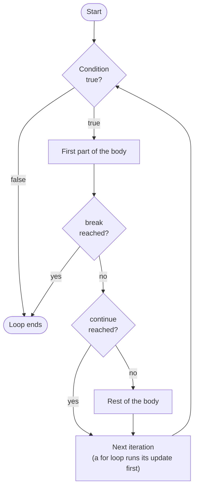

<a id="readme-top"></a>

# Loop Control

> **`break` stops a loop, `continue` skips to the next round, and labels reach the outer loop — three small tools that decide exactly when a loop leaves, skips or carries on.**


| Quick Facts | Details |
|---|---|
| **Category** | Loop — control flow (jump statements) |
| **Prerequisites** | `for`, `while` and `do-while` loops, `if` conditions, `switch` basics |
| **Key keywords** | `break` · `continue` · labels · `return` |
| **Works with** | Java 8 and above |
| **At a glance** | `break` — leave the loop · `continue` — skip to the next iteration · `break outer;` — leave an outer loop |

## 🔰 Table of Contents

| Level | Sections |
|---|---|
| 🟢 **Level 1 — Understand** | [Definition](#-definition) · [Key Points](#-key-points) · [How It Works](#-how-it-works) |
| 🟡 **Level 2 — Use It** | [Syntax & Variations](#-syntax--variations) · [Common Patterns](#-common-patterns) · [When to Use](#-when-to-use) · [Example](#-example) · [Code](#-code) |
| 🔴 **Level 3 — Wrap-up** | [Time Complexity](#-time-complexity) · [Common Mistakes](#-common-mistakes) · [Interview Questions](#-interview-questions) · [Summary](#-summary) |

## 📍 Definition

**Loop control statements** change the normal flow of a loop from inside its body. A loop normally ends when its condition becomes `false` and runs every iteration to the end — these statements let you **end it early** or **skip part of it**.

Java has two loop-control statements: **`break`** (end the loop immediately) and **`continue`** (skip the rest of this iteration and start the next one). A **label** lets both reach an **outer** loop, and **`return`** leaves the whole method — and with it every loop inside.

| Term | Meaning | Example |
|---|---|---|
| **`break`** | Leaves the innermost loop (or `switch`) immediately | `if (x == key) break;` |
| **`continue`** | Skips the rest of the current iteration and moves to the next one | `if (x < 0) continue;` |
| **Label** | A name followed by a colon, placed before a loop so that `break` and `continue` can target it | `outer: for (...)` |
| **Labeled `break`** | Leaves the labeled (outer) loop | `break outer;` |
| **Labeled `continue`** | Goes to the next iteration of the labeled loop | `continue outer;` |
| **`return`** | Leaves the current method and every loop inside it | `return i;` |
| **Jump statement** | Any statement that moves control somewhere else | `break`, `continue`, `return`, `throw` |

**What each statement does in each loop**

| Statement | In a `for` loop | In a `while` / `do-while` loop |
|---|---|---|
| **`break`** | the loop ends; the statement after the loop runs | the same |
| **`continue`** | jumps to the **update** (`i++`), then to the condition | jumps straight to the **condition** — there is no update of its own |

> [!TIP]
> **Real-life analogy:** checking a pile of exam papers. `continue` — you see a blank sheet, skip it and take the next one. `break` — you were looking for one particular paper, and the moment you find it you stop checking. A labeled `break` — the paper was in the second room, so you leave the whole building, not just that one desk.

## 📌 Key Points

1. **`break` ends the innermost loop at once** — the program continues with the first statement after that loop. It also ends a `switch`.
2. **`continue` skips only the rest of the current iteration** — the loop itself carries on with the next one.
3. **Where `continue` goes depends on the loop** — in a `for` it goes to the update first; in a `while` or `do-while` it goes straight to the condition, so an update placed after `continue` is skipped.
4. **In nested loops both affect only the innermost loop** — to reach an outer loop you need a label.
5. **A label is `name:` in front of a loop** — `break name;` leaves that loop, `continue name;` starts its next iteration.
6. **`break` inside a `switch` inside a loop leaves only the `switch`** — the loop keeps going.
7. **`return` leaves the method** — and with it every loop inside; exceptions and `System.exit(...)` leave even more.
8. **The compiler rejects nonsense** — a statement right after `break` or `continue` in the same block is "unreachable", and `break` or `continue` outside a loop does not compile.

> [!IMPORTANT]
> **A plain `break` in nested loops leaves only the inner loop** — the outer loop then carries on, which can silently overwrite your result. To stop both loops, use a labeled `break`, or put the loops in a method and `return`.

## ⚙️ How It Works



Tracing a `for` loop that uses both statements:

```text
for (int i = 1; i <= 6; i++) {
    if (i == 2) continue;
    if (i == 5) break;
    print(i);
}

i = 1   not 2, not 5   → print 1
i = 2   continue       → the print is skipped, the update i++ still runs, next iteration
i = 3   not 2, not 5   → print 3
i = 4   not 2, not 5   → print 4
i = 5   break          → the loop ends at once (i = 6 is never reached)

Output: 1 3 4
```

### Nested loops — which loop does `break` leave?

```text
Search the grid {{3, -1, 4}, {1, 5, -9}, {2, 6, 5}} for the first 5 — a label on the outer loop:

Step 1  r = 0   c = 0, 1, 2 → 3, -1, 4          no match (the -1 is skipped with continue)
Step 2  r = 1   c = 0       → 1                  no match
Step 3  r = 1   c = 1       → 5                  match → break outer → BOTH loops end      5 cells visited

With a plain break the inner loop ends, but the outer loop goes on:
Step 4  r = 2   c = 0, 1, 2 → 2, 6, 5            the match at (2, 2) overwrites the first one    8 cells visited
```

> [!NOTE]
> The statements work the same in `for`, `while`, `do-while` and for-each loops. The loops themselves are covered in for-loop.md, while-loop.md, do-while-loop.md and for-each-loop.md, and loops inside loops in nested-loops.md.

## 🔄 Syntax & Variations

### `break`

```java
for (int i = 0; i < n; i++) {
    if (condition) {
        break;                  // leave the loop now
    }
}
// execution continues here
```

### `continue`

```java
for (int i = 0; i < n; i++) {
    if (condition) {
        continue;               // skip the rest of this iteration
    }
    // only reached when the condition was false
}
```

### Labeled `break` and `continue`

```java
outer:                                          // label: a name and a colon, before the loop
for (int r = 0; r < rows; r++) {
    for (int c = 0; c < cols; c++) {
        if (grid[r][c] == target) {
            break outer;                        // leaves BOTH loops
        }
        if (grid[r][c] < 0) {
            continue outer;                     // abandons this row, goes on with the next r
        }
    }
}
```

| Rule | Detail |
|---|---|
| **`break` works in** | loops and `switch` statements |
| **`continue` works in** | loops only |
| **Label** | `name:` directly before the loop — short lowercase names such as `outer` are the convention |
| **`break label;`** | leaves the labeled statement |
| **`continue label;`** | the label must be on a loop; it starts that loop's next iteration |
| **Reach** | a label can only be used from **inside** the statement it names — Java has no `goto` (it is a reserved word that is never used) |
| **Unreachable code** | a statement directly after `break` or `continue` in the same block does not compile |
| **Outside a loop** | `break` outside a loop or `switch`, and `continue` outside a loop, do not compile |

### Ways to leave a loop

| Way | What it leaves | Use it for |
|---|---|---|
| **The condition becomes `false`** | the loop | the normal end |
| **`break`** | the innermost loop or `switch` | "found it" or a stop test in the middle of the body |
| **`break label`** | a labeled outer loop | leaving nested loops at once |
| **`return`** | the method, with all its loops | "found the answer" — return it |
| **`throw` (exception)** | the method, until it is caught | an error |
| **`System.exit(n)`** | the whole program | fatal errors only — rare |

### `break` inside a `switch` inside a loop

```java
for (int i = 1; i <= 4; i++) {
    switch (i) {
        case 2:
            break;              // leaves only the SWITCH — the loop continues with i = 3
        default:
            System.out.println(i);
    }
}                               // prints 1, 3, 4
```

A `continue` inside the `switch` is different: it belongs to the **loop**, so it skips to the loop's next iteration. To leave the loop from inside a `switch`, use a labeled `break` or `return`.

## 🧩 Common Patterns

| Pattern | Idea | Skeleton |
|---|---|---|
| **Search and stop** | stop as soon as the key is found | `if (a[i] == key) { found = i; break; }` |
| **Guard clause** | skip invalid items with a flat check instead of a nested `if` | `if (x < 0) { continue; }` |
| **Loop with no natural condition** | the exit test sits in the middle of the body | `while (true) { ...; if (done) break; }` |
| **First match in nested loops** | leave both loops at the first hit | `break outer;` |
| **Return the answer directly** | no flag, no `break` | `for (...) { if (match) return i; } return -1;` |
| **Skip blank lines or headers** | ignore items that do not matter | `if (line.isEmpty()) { continue; }` |
| **Retry with a limit** | repeat until success or out of attempts | `for (int t = 0; t < 3; t++) { if (tryIt()) break; }` |
| **Validate everything** | stop at the first failure | `if (!valid(x)) { ok = false; break; }` |

## 🎯 When to Use

| Need | Use | Benefit | Watch out |
|---|---|---|---|
| Stop as soon as the answer is known (search, first match, first error) | **`break`** | saves iterations — a hit at the start costs `O(1)` | code after the loop must handle "not found" |
| Ignore some elements and carry on | **`continue`** | a flat guard instead of a deeply nested `if` | in `while` / `do-while` put the update **before** it |
| Leave nested loops at once | **labeled `break`** (or a method with `return`) | no extra flag variable | keep labels rare and short; a method is often clearer |
| Skip to the next outer iteration | **labeled `continue`** | abandons the rest of the inner loop | easy to misread — add a comment |
| Hand back a value the moment it is found | **`return`** | the simplest code, no variables | the loop must be inside a method of its own |
| A loop has no natural condition (input loop, server loop) | **`while (true)` + `break`** | the exit test sits where it makes sense | make sure every path can reach the `break` |
| The stop rule fits cleanly into the loop header | **the loop condition** instead | one place to look for "why does it end" | — |

## 🎲 Example

**Problem:** find the position of the **first** `5` in the grid `{{3, -1, 4}, {1, 5, -9}, {2, 6, 5}}`, skipping negative numbers, and compare a plain `break` with a labeled `break`. The grid has a second `5`, which makes the difference visible.

**Dry run — the labeled version `break outer;`**

| Step | `r, c` | Value | What happens |
|---|---|---|---|
| 1 | 0, 0 | `3` | not negative, not `5` → next cell |
| 2 | 0, 1 | `-1` | negative → `continue`, the cell is skipped |
| 3 | 0, 2 | `4` | not `5` → next cell |
| 4 | 1, 0 | `1` | not `5` → next cell |
| 5 | 1, 1 | `5` | match → `break outer;` — both loops end |

✅ The labeled `break` finds `(1, 1)` after **5** cells. The plain `break` ends only the inner loop, so the outer loop moves on to row `2`, finds the second `5` and overwrites the result with `(2, 2)` — after **8** cells.

## 💻 Code

> Save it as `LoopControlDemo.java`, then run `javac LoopControlDemo.java` followed by `java LoopControlDemo`.

```java
public class LoopControlDemo {

    // Helper: prints "label : value" in neat columns
    static void show(String label, Object value) {
        System.out.printf("%-30s: %s%n", label, value);
    }

    // return leaves the method -- and every loop inside it
    static int indexOf(int[] a, int key) {
        for (int i = 0; i < a.length; i++) {
            if (a[i] == key) {
                return i;
            }
        }
        return -1;
    }

    public static void main(String[] args) {

        // ----- break: stop as soon as the answer is known -----
        int[] data = {4, 8, 15, 16, 23, 42};
        int found = -1;
        int checks = 0;
        for (int i = 0; i < data.length; i++) {
            checks++;
            if (data[i] == 16) {
                found = i;
                break;                                  // leave the loop now
            }
        }
        show("break: index of 16 / checks", found + " / " + checks);

        // ----- continue: skip some elements and carry on with the rest -----
        int[] values = {5, -2, 7, -9, 3};
        int sum = 0;
        for (int v : values) {
            if (v < 0) {
                continue;                               // guard clause: skip negatives
            }
            sum += v;
        }
        show("continue: sum of positives", sum);

        // ----- break and continue together -----
        StringBuilder sb = new StringBuilder();
        for (int i = 1; i <= 6; i++) {
            if (i == 2) {
                continue;                               // skip 2 (the update i++ still runs)
            }
            if (i == 5) {
                break;                                  // stop at 5
            }
            sb.append(i).append(' ');
        }
        show("continue at 2, break at 5", sb.toString().trim());

        // ----- continue in a while loop: the update must come BEFORE it -----
        sb.setLength(0);
        int w = 0;
        while (w < 6) {
            w++;                                        // update first, so continue cannot skip it
            if (w % 2 == 0) {
                continue;                               // jumps straight to the condition
            }
            sb.append(w).append(' ');
        }
        show("while + continue (odd)", sb.toString().trim());

        // ----- while (true) + break: the exit test sits in the middle -----
        int n = 1;
        int doublings = 0;
        while (true) {
            n *= 2;
            doublings++;
            if (n > 100) {
                break;
            }
        }
        show("Doublings until n > 100", doublings + " (n = " + n + ")");

        // ----- Nested loops: a plain break leaves only the INNER loop -----
        int[][] grid = {{3, -1, 4}, {1, 5, -9}, {2, 6, 5}};
        int target = 5;

        int pr = -1, pc = -1, plainVisits = 0;
        for (int r = 0; r < grid.length; r++) {
            for (int c = 0; c < grid[r].length; c++) {
                plainVisits++;
                if (grid[r][c] < 0) {
                    continue;
                }
                if (grid[r][c] == target) {
                    pr = r;
                    pc = c;
                    break;                              // leaves only the inner loop: the outer one goes on
                }
            }
        }
        show("plain break: pos / visits", "(" + pr + "," + pc + ") / " + plainVisits);

        int lr = -1, lc = -1, labelVisits = 0;
        outer:                                          // a label: a name and a colon before the outer loop
        for (int r = 0; r < grid.length; r++) {
            for (int c = 0; c < grid[r].length; c++) {
                labelVisits++;
                if (grid[r][c] < 0) {
                    continue;
                }
                if (grid[r][c] == target) {
                    lr = r;
                    lc = c;
                    break outer;                        // leaves BOTH loops
                }
            }
        }
        show("break outer: pos / visits", "(" + lr + "," + lc + ") / " + labelVisits);

        // ----- Labeled continue: abandon a row and go to the next one -----
        int[][] rows = {{1, 2, 3}, {4, -1, 6}, {7, 8, 9}};
        int rowsOk = 0;
        int cellsSeen = 0;
        rowLoop:
        for (int[] row : rows) {
            for (int cell : row) {
                if (cell < 0) {
                    continue rowLoop;                   // bad row: skip the rest of it, go to the NEXT row
                }
                cellsSeen++;
            }
            rowsOk++;                                   // reached only when the row had no negative
        }
        show("rows without negatives", rowsOk + " (cells seen: " + cellsSeen + ")");

        // ----- break inside a switch inside a loop leaves only the SWITCH -----
        sb.setLength(0);
        for (int i = 1; i <= 4; i++) {
            switch (i) {
                case 2:
                    break;                              // leaves the switch ... the loop goes on
                default:
                    sb.append(i).append(' ');
            }
        }
        show("break inside a switch", sb.toString().trim());

        // ----- return: leave the method and every loop inside it -----
        show("return: indexOf(23)", indexOf(data, 23));
        show("return: indexOf(99)", indexOf(data, 99));

        // for (int i = 0; i < 3; i++) { break; System.out.println("x"); }   // compile error: unreachable statement
    }
}
```

**Output**

```text
break: index of 16 / checks   : 3 / 4
continue: sum of positives    : 15
continue at 2, break at 5     : 1 3 4
while + continue (odd)        : 1 3 5
Doublings until n > 100       : 7 (n = 128)
plain break: pos / visits     : (2,2) / 8
break outer: pos / visits     : (1,1) / 5
rows without negatives        : 2 (cells seen: 7)
break inside a switch         : 1 3 4
return: indexOf(23)           : 4
return: indexOf(99)           : -1
```

> [!NOTE]
> Two lines deserve a second look. `plain break` ends with `(2,2)` — the **second** match — because only the inner loop stopped. And `break inside a switch` prints `1 3 4`: the `break` for `2` ended the `switch`, not the loop, so the loop carried on with `3` and `4`.

## ⏳ Time Complexity

| Situation | Best case | Worst case | Why |
|---|---|---|---|
| Search with `break` | `O(1)` — the key is the first item | `O(n)` — the key is last or missing | the loop stops at the first hit |
| The same search without `break` | `O(n)` | `O(n)` | it always visits every item |
| `continue` | no change | no change | it skips the rest of the body, not the iteration — the loop still moves on |
| Nested loops with a plain `break` | `O(n)` or more | `O(n²)` | only the inner loop stops; the outer loop still runs |
| Nested loops with `break outer` or `return` | `O(1)` | `O(n²)` | everything stops at the first hit |

In a `1,000 × 1,000` grid whose first match sits near the start, `break outer` stops after a handful of checks, while a plain `break` keeps scanning the remaining 999 rows — about a million checks if no other row matches.

> [!TIP]
> **Rule of thumb:** `break` and `return` make the **best case** faster — the worst case stays the same, because the key may be last or missing. `continue` saves the work in the body but never an iteration.

## 🚨 Common Mistakes

| # | Mistake | Why it is a problem | Fix |
|---|---|---|---|
| 1 | a plain `break` in nested loops, expecting both loops to stop | it leaves only the inner loop — the outer loop carries on and may overwrite the result | `break outer;`, or put the loops in a method and `return` |
| 2 | `continue` placed before the update in a `while` or `do-while` loop | `continue` jumps straight to the condition, the update is skipped, and the loop may never end | put the update before `continue`, or use a `for` loop |
| 3 | `break` inside a `switch` inside a loop, expecting the loop to stop | it leaves only the `switch` | a labeled `break`, or `return` |
| 4 | a statement right after `break` or `continue` in the same block | it can never run → compile error "unreachable statement" | delete it or move it before the jump |
| 5 | `break` or `continue` outside a loop (`if` in a plain method, or `continue` in a `switch` that is not in a loop) | compile error "break outside switch or loop" / "continue outside of loop" | use `return` to leave a method |
| 6 | using the index after a search loop without checking whether the `break` happened | after a loop that ran out, `i` equals `length` — a position that does not exist | keep a `found` flag or index (`-1` = not found), or `return` inside the loop |

## 🎤 Interview Questions

<details>
<summary><b>1. What is the difference between <code>break</code> and <code>continue</code>?</b></summary>

| Feature | `break` | `continue` |
|---|---|---|
| Effect | ends the loop completely | skips the rest of this iteration only |
| Next step | the first statement after the loop | the next iteration (in a `for`, the update runs first) |
| Works in | loops and `switch` | loops only |
| Typical use | "found it" or "stop now" | "ignore this item and go on" |

</details>

<details>
<summary><b>2. What does <code>break</code> do in nested loops, and how do you leave both loops?</b></summary>

A plain `break` leaves only the **innermost** loop; the outer loop continues. To leave both you can use a **labeled `break`** (`break outer;`), put the loops in a **method and `return`**, or set a **flag** that the outer loop tests. A labeled `break` or a `return` is usually the cleanest.

</details>

<details>
<summary><b>3. What is a labeled <code>break</code> or <code>continue</code>? Does Java have <code>goto</code>?</b></summary>

A label is a name followed by a colon in front of a loop (`outer:`). `break outer;` leaves that loop and `continue outer;` starts its next iteration. A label can only be used from inside the statement it names — it cannot jump to arbitrary places. `goto` is a **reserved word** in Java, but it is never used; labeled `break` and `continue` are the only "jumps" the language offers.

</details>

<details>
<summary><b>4. How does <code>continue</code> behave in <code>for</code>, <code>while</code> and <code>do-while</code>?</b></summary>

In a **`for`** loop it jumps to the **update** (`i++`) and then to the condition. In a **`while`** loop it jumps straight to the **condition**; in a **`do-while`** loop to the condition after the body. Since `while` and `do-while` have no update part of their own, an update written after `continue` is skipped — put it **before** `continue`, or the loop may never end.

</details>

<details>
<summary><b>5. What does <code>break</code> do inside a <code>switch</code> that is inside a loop?</b></summary>

It leaves only the `switch`; the loop carries on. A `continue` inside the `switch` belongs to the loop and skips to its next iteration. To leave the loop from inside a `switch`, use a labeled `break` or `return`.

</details>

<details>
<summary><b>6. What is the difference between <code>break</code>, <code>return</code> and <code>System.exit()</code>?</b></summary>

| Statement | What it leaves | What happens next |
|---|---|---|
| `break` | the innermost loop or `switch` | the method continues after the loop |
| `return` | the whole method, with all its loops | the caller continues |
| `System.exit(n)` | the whole program | nothing — the JVM shuts down |

</details>

<details>
<summary><b>7. How does <code>break</code> affect the time complexity of a loop?</b></summary>

It improves the **best case**: a search that stops at the first match costs `O(1)` if the key is first, but the **worst case** stays `O(n)` because the key may be last or missing. In nested loops, a labeled `break` or a `return` stops all the loops at the first hit, while a plain `break` still lets the outer loop run on. `continue` does not reduce the number of iterations.

</details>

## 🏁 Summary

- **`break`** ends the innermost loop (or `switch`) at once; **`continue`** skips the rest of the current iteration.
- In a **`for`** loop `continue` runs the update first; in **`while`** and **`do-while`** it goes straight to the condition, so the update must come **before** it.
- In **nested loops** both statements affect only the innermost loop — use a **label** (`break outer;`) or **`return`** to reach the outer one.
- A **`break` inside a `switch`** leaves only the `switch`; **`return`** leaves the whole method and all its loops.
- The compiler rejects **unreachable code** after `break` or `continue`, and either one **outside a loop**.
- `break` and `return` make the **best case** faster; `continue` saves work in the body but not iterations.

### 📝 Cheat Sheet

| Question | Answer |
|---|---|
| End the loop now | `break;` |
| Skip to the next iteration | `continue;` — in a `for` loop the update still runs |
| Leave nested loops | `break outer;` — write `outer:` in front of the outer loop |
| Go to the next outer iteration | `continue outer;` |
| Leave the method | `return value;` |
| `break` inside a `switch` in a loop | leaves only the `switch` |
| Not allowed | statements after `break` / `continue` in the same block; `break` / `continue` outside a loop |
| Time | early exit helps the best case — the worst case of a search stays `O(n)` |

> [!IMPORTANT]
> **Jump out, but stay readable:** use `break` and `continue` to keep loops flat and to stop early — but when you need labels or several exits, ask whether a clearer loop condition or a separate method with `return` says it better.
