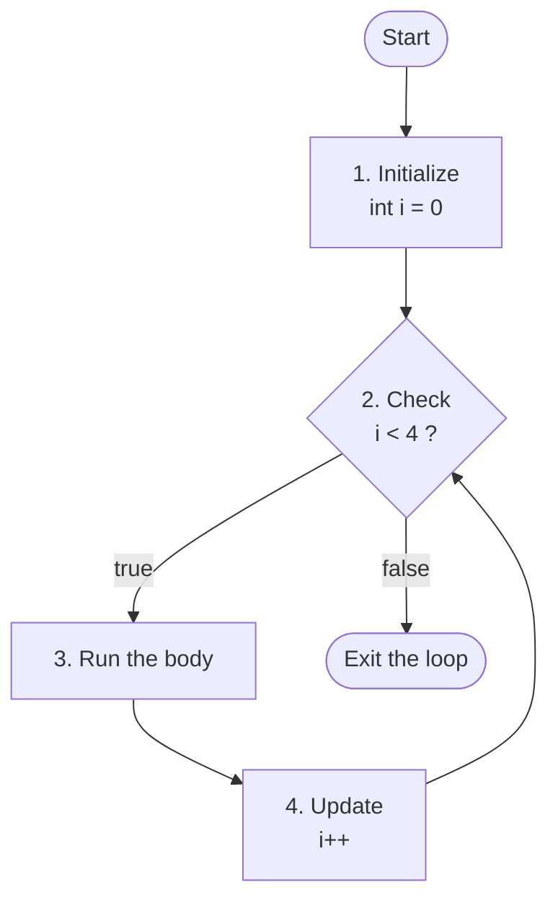
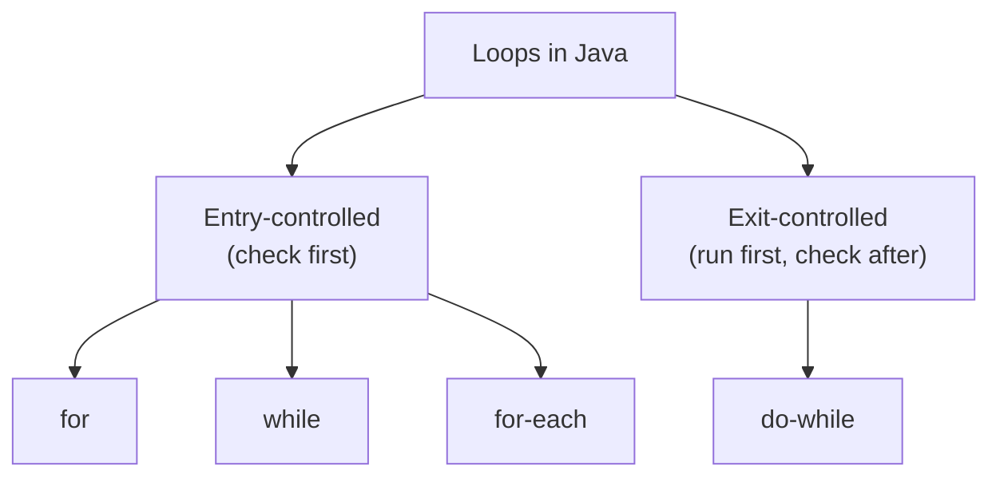
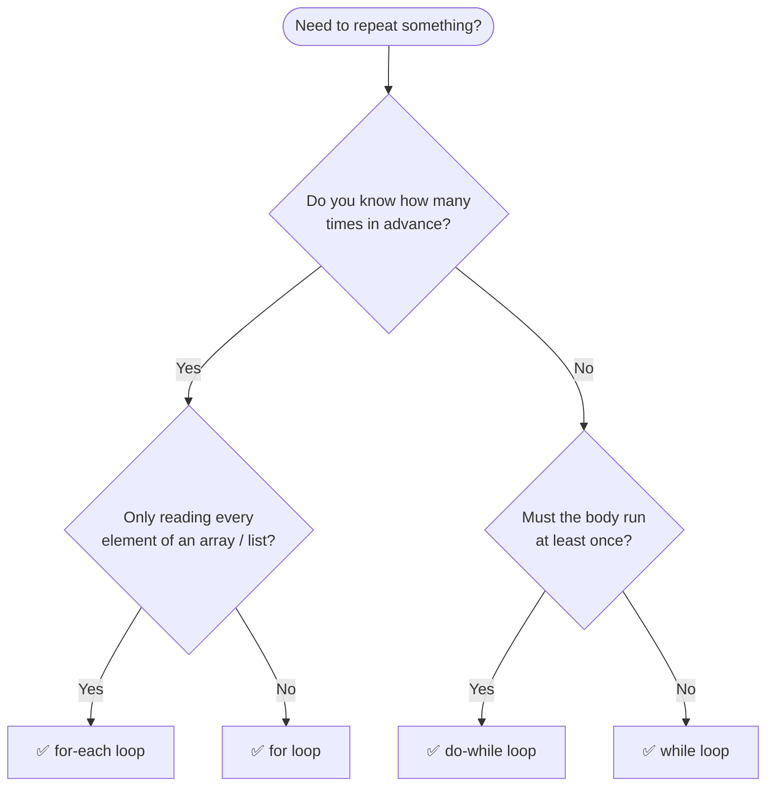

<a id="readme-top"></a>

# Loop

> **A loop repeats a block of code until a condition says stop — the simplest way to make a computer do hard work for you.**


| Quick Facts | Details |
|---|---|
| **Category** | Control-flow statement (repetition) |
| **Prerequisites** | Variables, data types, operators, `if` statements |
| **Counting** | Usually zero-based: `0` … `n - 1` (`i < n`) |
| **Runs** | As long as the condition is `true` (0, 1 or many times) |
| **Works with** | Java 8 and above |
| **At a glance** | One loop `O(n)` · Nested loops `O(n²)` · Doubling / halving `O(log n)` · Space `O(1)` |

## 🔰 Table of Contents

| Level | Sections |
|---|---|
| 🟢 **Level 1 — Understand** | [Definition](#-definition) · [Important Points](#-important-points) · [Memory Layout](#-memory-layout) |
| 🟡 **Level 2 — Use It** | [Creating Loops](#-creating-loops) · [Core Operations](#-core-operations) · [Use Cases](#-use-cases) · [Advantages](#-advantages) · [Limitations](#-limitations) · [Example](#-example) · [Code](#-code) |
| 🟠 **Level 3 — Master It** | [Time Complexity](#-time-complexity) · [Space Complexity](#-space-complexity) · [Common Patterns](#-common-patterns) · [Common Mistakes](#-common-mistakes) · [Interview Questions](#-interview-questions) |
| 🔴 **Level 4 — Wrap-up** | [Summary](#-summary) · [Cheat Sheet](#-cheat-sheet) |

## 📍 Definition

**Loop** is a **control-flow statement** that **repeats** a block of code **while** a **condition** stays `true` — you write the instructions once, and Java runs them as many times as needed.

In Java, loops are built into the language as statements: `for`, `while`, `do-while` and the enhanced `for` (for-each). Each run of the loop body is called an **iteration**, and the loop ends as soon as its condition becomes `false`.

| Term | Meaning | Example with `for (int i = 0; i < 3; i++)` |
|---|---|---|
| **Iteration** | One full run of the loop body | the body runs 3 times (`i` = `0`, `1`, `2`) |
| **Condition** | A `boolean` test that decides whether to run again | `i < 3` |
| **Loop variable** | The variable that changes on every iteration | `i` |

> [!TIP]
> **Real-life analogy:** picture running laps on a track. You decide how many laps (the condition), you count each lap (the loop variable), and you repeat the same run every time (the body). The moment the count is reached, you stop.

## 📌 Important Points

1. **Three questions** — every loop answers: where do I start, should I keep going, and what changes each time?
2. **Condition must be boolean** — Java accepts only `true` or `false` (no `0` / `1` like C), so `while (1)` is a compile error.
3. **Update or it never ends** — if nothing changes the condition, you get an **infinite loop**.
4. **Entry- vs exit-controlled** — `for`, `while` and for-each check **before** each iteration (they may run **zero** times); `do-while` checks **after** (it runs **at least once**).
5. **Loop variable scope** — a variable declared in the `for` header exists only inside that loop.
6. **`break` and `continue`** — `break` leaves the loop; `continue` skips to the next iteration.
7. **Braces matter** — without `{ }`, only the **next one statement** belongs to the loop.
8. **Nested loops multiply** — a loop inside a loop runs `outer × inner` times.
9. **for-each is read-only in spirit** — it visits every element, but the loop variable is a **copy** and there is no index.

**Update expressions** (the third part of a `for` header)

| Update | Meaning | Values of `i` |
|---|---|---|
| `i++` | add 1 | `0, 1, 2, 3` … |
| `i--` | subtract 1 | `5, 4, 3, 2` … |
| `i += 2` | step by 2 | `0, 2, 4, 6` … |
| `i *= 2` | double each time | `1, 2, 4, 8` … (only about `log n` iterations) |
| `i /= 2` | halve each time | `16, 8, 4, 2, 1` |

> [!IMPORTANT]
> **`<` vs `<=`** — `i < n` runs `n` times when you start at `0`; `i <= n` runs `n + 1` times. This off-by-one slip is the most common loop bug, so always check the first and the last iteration by hand.

## 🧱 Memory Layout

For `for (int i = 0; i < 4; i++) { ... }` the loop needs just **one slot** of memory — the counter `i`, a local variable on the **stack**. Java does not create a new `i` every time; it **reuses and updates the same slot**:

```text
      1       2       3       4       5       ← check number
  ┌───────┬───────┬───────┬───────┬───────┐
  │   0   │   1   │   2   │   3   │   4   │   ← value of i
  └───────┴───────┴───────┴───────┴───────┘
     true    true    true    true   false     ← i < 4 ?
```

The first four checks are `true`, so the body runs **4 times**; the fifth check is `false` and the loop ends. Behind that sits one fixed routine:

```text
Every loop answers three questions:
  1. Where do I start?       →  int i = 0     (runs ONCE, before the first check)
  2. Should I keep going?    →  i < 4         (checked BEFORE every iteration)
  3. What changes each time? →  i++           (runs AFTER every iteration)
```

One slot, updated again and again — no matter how many times the loop runs. That is why a loop's counter costs only **O(1)** memory.

Where does the program go on each pass? The loop is just a cycle — **check → body → update → check …**:



> [!NOTE]
> A variable declared in the `for` header (like `i`) exists only inside the loop. Variables declared **inside the body** are created fresh on every iteration, while variables declared **before** the loop survive it.

## 🔄 Creating Loops

### Initialize → Check → Update

```java
for (int i = 0;          // 1. initialize : runs ONCE, before the first check
     i < 5;              // 2. check      : tested BEFORE every iteration
     i++) {              // 3. update     : runs AFTER every iteration
    System.out.println(i);   // the body  : prints 0 1 2 3 4
}
```

### Three ways to loop

| Style | Syntax | Use when |
|---|---|---|
| `for` | `for (int i = 0; i < n; i++) { ... }` | you know **how many** times to repeat |
| `while` | `while (condition) { ... }` | you repeat **until something happens** (the count is unknown) |
| `do-while` | `do { ... } while (condition);` | the body must run **at least once** |

> [!NOTE]
> Reach for `for` when the number of repetitions is known, `while` when it depends on a condition, and `do-while` when you need at least one run (for example, showing a menu).

### Types of Loops



| Type | When the condition is checked | Example |
|---|---|---|
| **Entry-controlled** | before every iteration (may run 0 times) | `for`, `while`, for-each |
| **Exit-controlled** | after every iteration (runs at least once) | `do-while` |
| **Nested** | a loop inside another loop | rows × columns |
| **Infinite** | the condition never becomes `false` | `while (true) { ... }` (needs a `break`) |

```java
int[] marks = {85, 90, 78};
for (int m : marks) {                    // for-each: no index, no condition
    System.out.println(m);
}

for (int row = 1; row <= 2; row++) {     // nested: the inner loop finishes for every outer pass
    for (int col = 1; col <= 3; col++) {
        System.out.print(row * col + " ");
    }
    System.out.println();                // new line after each row
}
```

> [!NOTE]
> A for-each loop is the cleanest way to **read** every element, but it hides the index — use a normal `for` loop when you need the position or want to change the elements.

## ⚙️ Core Operations

| Operation | In Java | What happens |
|---|---|---|
| **Repeat `n` times** | `for (int i = 0; i < n; i++)` | the body runs exactly `n` times |
| **Repeat until a condition fails** | `while (x > 0) { ... }` | checks first, so it may run 0 times |
| **Run at least once** | `do { ... } while (x > 0);` | runs the body, then checks |
| **Traverse** | `for (int x : arr) { ... }` | visit every element once |
| **Count down** | `for (int i = n; i > 0; i--)` | run from `n` down to `1` |
| **Step** | `for (int i = 0; i < n; i += 2)` | skip every other value |
| **Skip** | `continue;` | jump straight to the next iteration |
| **Stop** | `break;` | leave the loop immediately |
| **Nest** | a loop inside a loop | the inner loop runs fully for every outer pass |
| **Exit outer loops** | `break outer;` (after a label `outer:`) | leave several loops at once |

### Trace — init, check, body, update

```text
for (int i = 1; i <= 3; i++) { sum += i; }          (sum starts at 0)

Step 0  init     i = 1
Step 1  check    1 <= 3 → true     run the body    sum = 0 + 1 = 1
Step 2  update   i++ → i = 2
Step 3  check    2 <= 3 → true     run the body    sum = 1 + 2 = 3
Step 4  update   i++ → i = 3
Step 5  check    3 <= 3 → true     run the body    sum = 3 + 3 = 6
Step 6  update   i++ → i = 4
Step 7  check    4 <= 3 → false    exit the loop   final sum = 6
```

### Control — break and continue

```text
for (int i = 1; i <= 5; i++) {
    if (i == 2) continue;          // skip the rest of this iteration
    if (i == 4) break;             // leave the loop completely
    System.out.print(i + " ");
}

Step 1  i = 1   no rule applies   → prints 1
Step 2  i = 2   continue          → body skipped, jump to i++
Step 3  i = 3   no rule applies   → prints 3
Step 4  i = 4   break             → loop ends (i = 5 is never reached)

Output: 1 3
```

> [!NOTE]
> Every loop runs on the same cycle — **start → check → body → update → check …** — and stops the moment the check is `false`. If nothing in the loop can ever make the check `false`, you get an **infinite loop**.

## 🎯 Use Cases

| Use case | Why a loop fits | Example |
|---|---|---|
| **Repeating a task** | write the code once, run it many times | print 1 to 100, send 50 reminders |
| **Traversing data** | visit every element of an array, String or list | sum of marks, find the maximum |
| **Searching and counting** | check items one by one until the answer shows up | linear search, count vowels |
| **Patterns and tables** | nested loops build rows × columns | multiplication table, star pyramid, matrices |
| **Input and menus** | keep asking until the input is valid | `do-while` menu, read until the user types `0` |
| **Algorithms** | sorting, binary search, DP tables, two pointers | bubble sort, prefix sums |
| **Simulations and games** | a "game loop" repeats until the player quits | `while (running) { update(); draw(); }` |

**Which loop should I use?**



## ⭐ Advantages

- ✅ **Less code** — write the instructions once instead of copy-pasting them a hundred times.
- ✅ **Scales effortlessly** — the same loop handles 10 or 10 million items; you change `n`, not the code.
- ✅ **Easy to maintain** — one place to fix a bug instead of many.
- ✅ **Constant extra memory** — a loop itself needs only a counter variable, so its space cost is `O(1)`.
- ✅ **Foundation** — arrays, strings, searching, sorting and dynamic programming all rely on loops.

## 🚧 Limitations

| Limitation | Why it happens | Workaround |
|---|---|---|
| **Infinite loops** | the condition never becomes `false` (usually a forgotten update) | make sure something changes the condition; add a safety `break` |
| **Off-by-one errors** | `<` vs `<=`, starting at 0 vs 1 | trace the first and last iteration by hand |
| **Nested loops get slow** | the work multiplies: `O(n²)`, `O(n³)` | use a better algorithm, sorting, or a `HashSet` / `HashMap` |
| **Hard to read when deeply nested** | many indentation levels and `break` / `continue` jumps | move the inner loop into its own method |
| **Changing a list while looping over it** | removing items inside for-each can throw `ConcurrentModificationException` | use an `Iterator` with `remove()`, or loop backwards by index |
| **for-each gives no index** | the loop variable is a copy of the element | use a normal `for` loop when you need the index or want to change elements |

## 🎲 Example

**Problem:** for `n = 5`, find the **sum** of 1 to `n`, the **factorial** of `n`, and how many **even numbers** lie between 1 and `n`.

| Input | Output |
|---|---|
| `n = 5` | Sum = `15` · Factorial = `120` · Even numbers = `2` |

**Approach**

1. Start with `sum = 0`, `factorial = 1` and `evens = 0`.
2. Loop `i` from 1 up to `n`.
3. In the body: add `i` to `sum`, multiply `factorial` by `i`, and if `i % 2 == 0` increase `evens`.
4. When the check `i <= n` turns `false`, the loop ends and the three results are ready.

**Dry run — building the sum**

| Step | `i` | `i <= 5` | `sum` after this step |
|---|---|---|---|
| start | 1 | – | `0` (`sum` starts at 0) |
| 1 | 1 | true | `1` (0 + 1) |
| 2 | 2 | true | `3` (1 + 2) |
| 3 | 3 | true | `6` (3 + 3) |
| 4 | 4 | true | `10` (6 + 4) |
| 5 | 5 | true | `15` (10 + 5) |
| end | 6 | false | the loop exits with `15` |

✅ Sum = **15**, found in a single pass over the numbers 1 to `n` → **O(n)**.

## 💻 Code

> Save it as `LoopDemo.java`, then run `javac LoopDemo.java` followed by `java LoopDemo`.

```java
public class LoopDemo {

    // Helper: prints "label : value" in neat columns
    static void show(String label, Object value) {
        System.out.printf("%-18s: %s%n", label, value);
    }

    // 1. Sum of 1..n (for loop) ...... Time O(n) | Space O(1)
    static int sumTo(int n) {
        int sum = 0;                              // the "accumulator"
        for (int i = 1; i <= n; i++) {
            sum += i;
        }
        return sum;
    }

    // 2. Factorial (while loop) ...... Time O(n) | Space O(1)
    static long factorial(int n) {
        long result = 1;
        int i = n;
        while (i > 1) {                           // checked BEFORE every iteration
            result *= i;
            i--;                                  // the update - without it: infinite loop!
        }
        return result;
    }

    // 3. Count digits (do-while) ..... Time O(log n) | Space O(1)
    static int countDigits(int number) {
        int count = 0;
        do {                                      // the body runs once BEFORE the first check,
            count++;                              // so 0 correctly has 1 digit
            number /= 10;
        } while (number != 0);
        return count;
    }

    // 4. Prime check (early exit) .... Time O(sqrt n) | Space O(1)
    static boolean isPrime(int n) {
        if (n < 2) {
            return false;
        }
        for (int i = 2; i * i <= n; i++) {        // only test divisors up to sqrt(n)
            if (n % i == 0) {
                return false;                     // found a divisor -> leave the loop early
            }
        }
        return true;
    }

    // 5. Triangle (nested loops) ..... Time O(n^2) | Space O(n^2)
    static String triangle(int rows) {
        StringBuilder sb = new StringBuilder();
        for (int row = 1; row <= rows; row++) {       // outer loop: one pass per line
            for (int star = 1; star <= row; star++) { // inner loop: runs fully for every line
                sb.append('*');
            }
            sb.append('\n');
        }
        return sb.toString();
    }

    public static void main(String[] args) {

        // ----- for loop: sum, factorial, even count -----
        int n = 5;
        int evens = 0;
        for (int i = 1; i <= n; i++) {
            if (i % 2 == 0) {
                evens++;                              // count the even numbers
            }
        }
        show("n", n);
        show("Sum of 1.." + n, sumTo(n));
        show("Factorial of " + n, factorial(n));
        show("Even numbers", evens);

        // ----- while / do-while: counting digits -----
        show("Digits in 12345", countDigits(12345));
        show("Digits in 0", countDigits(0));

        // ----- while vs do-while when the condition is false from the start -----
        int w = 0;
        while (w < 0) {
            w++;                                      // never runs
        }
        int d = 0;
        do {
            d++;                                      // runs once, then the check fails
        } while (d < 0);
        show("while ran", w + " time(s)");
        show("do-while ran", d + " time(s)");

        // ----- for-each: traverse an array -----
        int[] marks = {85, 90, 78, 92, 66};
        int total = 0;
        for (int m : marks) {
            total += m;
        }
        show("Total marks", total);

        // ----- continue & break -----
        StringBuilder kept = new StringBuilder();
        for (int i = 1; i <= 5; i++) {
            if (i == 2) continue;                     // skip this iteration
            if (i == 4) break;                        // leave the loop completely
            kept.append(i).append(' ');
        }
        show("continue / break", kept.toString().trim());

        // ----- while (true) with a break -----
        int number = 1;
        while (true) {
            if (number % 5 == 0 && number % 7 == 0) {
                break;                                // the only way out
            }
            number++;
        }
        show("Multiple of 5 & 7", number);

        // ----- primes: a loop that calls a loop -----
        StringBuilder primes = new StringBuilder();
        for (int i = 2; i <= 20; i++) {
            if (isPrime(i)) {
                primes.append(i).append(' ');
            }
        }
        show("Primes up to 20", primes.toString().trim());

        // ----- labeled break: search a 2D array -----
        int[][] grid = {
            {1, 2, 3},
            {4, 5, 6},
            {7, 8, 9}
        };
        String found = "not found";
        search:
        for (int r = 0; r < grid.length; r++) {
            for (int c = 0; c < grid[r].length; c++) {
                if (grid[r][c] == 6) {
                    found = "row " + r + ", column " + c;
                    break search;                     // leaves BOTH loops at once
                }
            }
        }
        show("Position of 6", found);

        // ----- nested loops: a triangle pattern -----
        System.out.println("Triangle (4 rows):");
        System.out.print(triangle(4));
    }
}
```

**Output**

```text
n                 : 5
Sum of 1..5       : 15
Factorial of 5    : 120
Even numbers      : 2
Digits in 12345   : 5
Digits in 0       : 1
while ran         : 0 time(s)
do-while ran      : 1 time(s)
Total marks       : 411
continue / break  : 1 3
Multiple of 5 & 7 : 35
Primes up to 20   : 2 3 5 7 11 13 17 19
Position of 6     : row 1, column 2
Triangle (4 rows):
*
**
***
****
```

> [!NOTE]
> Try changing `n` or the number of triangle rows and predict the output before you run it — tracing a loop by hand is the fastest way to get good at them.

## ⏳ Time Complexity

| Loop shape | Best | Average | Worst | Why? |
|---|---|---|---|---|
| Single loop up to `n` | O(n) | O(n) | O(n) | the body runs `n` times |
| Loop with an early exit (`break` / `return`) | O(1) | O(n) | O(n) | best case: the answer is found at once |
| Counter doubles or halves (`i *= 2`, `i /= 2`) | O(log n) | O(log n) | O(log n) | the remaining work shrinks by a factor each time |
| Step of 2 or more (`i += 2`) | O(n) | O(n) | O(n) | `n / 2` iterations is still linear |
| Divisor loop (`i * i <= n`) | O(1) | O(√n) | O(√n) | stops at the square root (prime check); best case: an even number |
| Two loops one after the other | O(n + m) | O(n + m) | O(n + m) | their costs **add**, they do not multiply |
| Nested loops, both up to `n` | O(n²) | O(n²) | O(n²) | `n × n` iterations |
| Nested loops, inner depends on outer (`j < i`) | O(n²) | O(n²) | O(n²) | 1 + 2 + … + n = n(n + 1) / 2 |
| Three nested loops | O(n³) | O(n³) | O(n³) | `n × n × n` iterations |

> The running time depends on **how many times the body runs**, not on how many lines it has.

**Feel the difference** — number of iterations for `n` items:

| n | O(log n) | O(n) | O(n²) | O(n³) |
|---|---|---|---|---|
| 10 | ~3 | 10 | 100 | 1,000 |
| 1,000 | ~10 | 1,000 | 1,000,000 | 1,000,000,000 |
| 1,000,000 | ~20 | 1,000,000 | 1,000,000,000,000 | 1,000,000,000,000,000,000 |

One loop over a million items is instant; two nested loops over the same million items mean a trillion iterations — minutes instead of milliseconds.

> [!TIP]
> **Rule of thumb:** one loop → `O(n)` · a loop inside a loop → `O(n²)` · a counter that doubles or halves → `O(log n)` · loops one after another **add**, loops inside loops **multiply**.

## 🚀 Space Complexity

A loop itself needs only **O(1)** space: a counter variable plus whatever variables you declare in the body. What costs memory is what you **build** inside the loop.

| Loop variable | Bytes | Typical use |
|---|---|---|
| `byte` | 1 | tiny counters (rare) |
| `short`, `char` | 2 | `for (char c = 'a'; c <= 'z'; c++)` |
| `int` | 4 | the normal counter |
| `long` | 8 | very large counts |
| `double` | 8 | avoid as a counter — rounding errors |

**Extra (auxiliary) space used by common loop shapes**

| Loop shape | Extra space | Reason |
|---|---|---|
| Counting, summing, finding max / min, searching | O(1) | only a few variables |
| Nested loops that just read data | O(1) | nesting adds iterations, not memory |
| Two pointers moving through data | O(1) | two index variables |
| Building a result (`StringBuilder`, list) | O(n) | stores one item per iteration |
| Filling a `dp[]` table | O(n) | one slot per step |
| Filling a 2D table with `n` rows and `m` columns | O(n × m) | one cell per inner iteration |
| Creating and keeping an object per iteration | O(n) | every kept object stays in memory |

> [!TIP]
> When asked about space complexity, count what the loop **stores**, not how often it runs. A loop that runs a million times but only updates one variable still uses **O(1)** space.

## 🧩 Common Patterns

Once the basics are clear, most loop-based interview questions boil down to a handful of patterns:

| Pattern | Core idea | Time | Space | Typical problems |
|---|---|---|---|---|
| **Accumulator** | keep a running total, product or maximum and update it every iteration | O(n) | O(1) | sum, average, factorial, max / min |
| **Counter** | count the items that satisfy a rule | O(n) | O(1) | count evens, count vowels, count matches |
| **Early Exit** | `break` or `return` the moment the answer is known | O(1) best, O(n) worst | O(1) | linear search, prime check, contains |
| **Nested Loops** | outer × inner loop to cover a grid or every pair | O(n²) | O(1) | star patterns, matrix traversal, pair sum |

<details>
<summary><b>Accumulator — average of an array</b></summary>

```java
static double average(int[] arr) {                 // assumes arr is not empty
    int sum = 0;                                   // the accumulator: a running total
    for (int value : arr) {
        sum += value;                              // update it on every iteration
    }
    return (double) sum / arr.length;
}
```

**Time** `O(n)` · **Space** `O(1)` — one pass, one extra variable.

</details>

<details>
<summary><b>Counter — how many numbers are divisible by k?</b></summary>

```java
static int countDivisible(int[] arr, int k) {
    int count = 0;                                 // the counter
    for (int value : arr) {
        if (value % k == 0) {
            count++;                               // only count the ones that match the rule
        }
    }
    return count;
}
```

**Time** `O(n)` · **Space** `O(1)`.

</details>

<details>
<summary><b>Early Exit — does the array contain a target?</b></summary>

```java
static boolean contains(int[] arr, int target) {
    for (int value : arr) {
        if (value == target) {
            return true;                           // stop the moment it is found
        }
    }
    return false;                                  // reached only after checking everything
}
```

**Time** `O(1)` best, `O(n)` worst · **Space** `O(1)`.

</details>

<details>
<summary><b>Nested Loops — does any pair add up to a target?</b></summary>

```java
static boolean hasPairWithSum(int[] arr, int target) {
    for (int i = 0; i < arr.length; i++) {
        for (int j = i + 1; j < arr.length; j++) {     // j starts after i, so every pair is checked once
            if (arr[i] + arr[j] == target) {
                return true;
            }
        }
    }
    return false;
}
```

**Time** `O(n²)` · **Space** `O(1)` — on a sorted array, two pointers solve the same problem in `O(n)`.

</details>

## 🚨 Common Mistakes

| # | Mistake | Why it is a problem | Fix |
|---|---|---|---|
| 1 | `for (int i = 0; i <= arr.length; i++)` | off-by-one → `ArrayIndexOutOfBoundsException` | use `i < arr.length` |
| 2 | `while (i < 10) { ... }` with no `i++` | nothing changes the condition → **infinite loop** | update the variable inside the loop |
| 3 | `for (int i = 0; i < 5; i++);` | the stray `;` is an empty body — your real block runs only once, after the loop | remove the `;` |
| 4 | a loop body without `{ }` | only the **first** statement belongs to the loop | always use braces |
| 5 | using `i` after the loop | `i` exists only inside the loop → compile error | declare `int i` before the loop if you need it afterwards |
| 6 | `for (int x : arr) x = x * 2;` | `x` is a **copy**; the array is unchanged | use an indexed loop: `arr[i] = arr[i] * 2;` |
| 7 | removing from a list inside for-each | can throw `ConcurrentModificationException` | use an `Iterator` and `it.remove()` |
| 8 | `break` inside a nested loop, expecting to leave both loops | `break` leaves only the **innermost** loop | use a label (`break outer;`) or `return` from a method |

## 🎤 Interview Questions

<details>
<summary><b>1. What is the difference between while and do-while?</b></summary>

A `while` loop checks the condition **before** the body, so it may run **zero** times. A `do-while` loop runs the body first and checks **afterwards**, so it always runs **at least once**.

```java
int x = 10;
while (x < 5) { System.out.println("while"); }          // condition false at once -> prints nothing
do { System.out.println("do-while"); } while (x < 5);   // body runs once, THEN the check fails -> prints do-while
```

</details>

<details>
<summary><b>2. What is the difference between a for loop and a for-each loop?</b></summary>

| Feature | `for` | for-each |
|---|---|---|
| Index available | Yes (`i`) | No |
| Can change the elements | Yes (`arr[i] = ...`) | No (the variable is a copy) |
| Can go backwards or skip | Yes (`i--`, `i += 2`) | No — always forward, one at a time |
| Works on | arrays and anything you can index | arrays and every `Iterable` (`List`, `Set` …) |
| Best for | when the position matters | simply reading every element |

</details>

<details>
<summary><b>3. What is an infinite loop, and how do you stop one?</b></summary>

A loop whose condition never becomes `false`. Sometimes it is intentional (`while (true)` or `for (;;)` in a game or server loop) and is left with `break`, `return` or an exception; by accident it usually means a forgotten update. While testing, stop a runaway program with `Ctrl + C`.

```java
int attempts = 0;
while (true) {                     // infinite on purpose
    attempts++;
    if (attempts == 3) {
        break;                     // the way out
    }
}
System.out.println(attempts);      // 3
```

</details>

<details>
<summary><b>4. What is the difference between break, continue and return?</b></summary>

`break` leaves the **nearest loop** completely. `continue` skips the rest of the **current iteration** and jumps to the update / check. `return` leaves the **whole method**, which also ends every loop inside it.

</details>

<details>
<summary><b>5. What is the time complexity of nested loops?</b></summary>

The iterations **multiply**: an outer loop of `n` and an inner loop of `m` give `O(n × m)`, and `O(n²)` when both go up to `n`. If the inner loop depends on the outer one (`j < i`), the total is `1 + 2 + … + n = n(n + 1) / 2`, which is still `O(n²)`. Loops that follow one another **add** instead: `O(n + m)`.

</details>

<details>
<summary><b>6. How do you exit several nested loops at once?</b></summary>

Put a **label** in front of the outer loop and use `break label;`. Moving the loops into a method and using `return` works too.

```java
outer:
for (int r = 0; r < 3; r++) {
    for (int c = 0; c < 3; c++) {
        if (r * c == 2) {
            break outer;           // leaves BOTH loops (here at r = 1, c = 2)
        }
    }
}
```

</details>

<details>
<summary><b>7. What is the time complexity of a loop whose counter doubles?</b></summary>

`O(log n)`. The counter jumps `1, 2, 4, 8, …`, so it needs only about `log₂ n` steps to reach `n`.

```java
int steps = 0;
for (int i = 1; i < 1000; i *= 2) {     // i = 1, 2, 4, 8 ... 512
    steps++;
}
System.out.println(steps);              // 10  (about log2 of 1000)
```

</details>

<details>
<summary><b>8. What is the difference between i++ and ++i?</b></summary>

`i++` uses the value **first**, then adds 1; `++i` adds 1 **first**, then uses the value. In a `for` header they behave the same, because the result of the update is thrown away.

```java
int i = 5;
int a = i++;                       // a = 5, i = 6  (use the value, THEN add 1)
int j = 5;
int b = ++j;                       // b = 6, j = 6  (add 1, THEN use the value)
System.out.println(a + " " + i + " " + b + " " + j);   // 5 6 6 6
```

</details>

## 🏁 Summary

- A loop **repeats** a block of code while a **condition** is `true`; every loop answers three questions: where to start, whether to keep going, and what changes each time.
- Java has four forms: `for` (known count), `while` (until a condition fails), `do-while` (at least once) and for-each (every element).
- `for`, `while` and for-each check **before** each iteration; `do-while` checks **after**.
- `break` leaves the loop, `continue` skips to the next iteration, and a **label** lets `break` leave nested loops.
- Running time depends on how often the body runs: one loop is **O(n)**, nested loops are **O(n²)**, and a doubling or halving counter is **O(log n)**.
- A loop itself uses **O(1)** space; memory grows only with what you **build** inside it.
- Most loop bugs are **off-by-one** errors or a **missing update** (an infinite loop) — trace the first and last iteration by hand.

### 📝 Cheat Sheet

| Question | Answer |
|---|---|
| What is it? | A statement that repeats a block of code while a condition is true |
| Four forms | `for`, `while`, `do-while`, for-each |
| Minimum runs | `for` / `while` / for-each: 0 · `do-while`: 1 |
| Control | `break` (stop) · `continue` (skip) · `break label` (leave nested loops) |
| One loop | O(n) |
| Nested loops | O(n²) |
| Counter doubles / halves | O(log n) |
| Space | O(1) for the loop itself |
| Best for | Repeating work, traversing data, searching, counting and patterns |
| Avoid when | A built-in method or a better algorithm is faster (e.g. a `HashSet` lookup instead of nested loops) |

> [!IMPORTANT]
> **Loops trade repetition for responsibility:** you write the work once and Java repeats it — in return you must make sure the loop starts correctly, changes something on every pass, and eventually stops.
