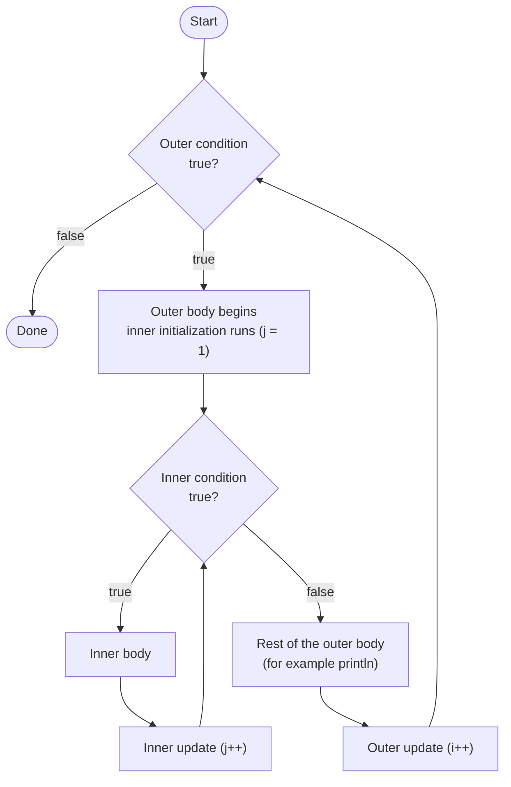

<a id="readme-top"></a>

# Nested Loops

> **A nested loop is a loop inside another loop — the inner loop runs completely for every single step of the outer loop, which is how rows and columns, patterns and pairs are handled.**


| Quick Facts | Details |
|---|---|
| **Category** | Loop — control flow (loops inside loops) |
| **Prerequisites** | `for` and `while` loops, arrays, 2D arrays basics |
| **Key keywords** | `for` · rows and columns · `break` · `continue` |
| **Works with** | Java 8 and above |
| **At a glance** | the inner loop restarts for every outer iteration · body runs `outer × inner` times · two nested loops → `O(n²)` |

## 🔰 Table of Contents

| Level | Sections |
|---|---|
| 🟢 **Level 1 — Understand** | [Definition](#-definition) · [Key Points](#-key-points) · [How It Works](#-how-it-works) |
| 🟡 **Level 2 — Use It** | [Syntax & Variations](#-syntax--variations) · [Common Patterns](#-common-patterns) · [When to Use](#-when-to-use) · [Example](#-example) · [Code](#-code) |
| 🔴 **Level 3 — Wrap-up** | [Time Complexity](#-time-complexity) · [Common Mistakes](#-common-mistakes) · [Interview Questions](#-interview-questions) · [Summary](#-summary) |

## 📍 Definition

**Nested loop** is a loop written **inside the body of another loop**. The **outer loop** controls the big steps (for example the rows) and the **inner loop** controls the small steps inside each big step (the columns). For every single iteration of the outer loop, the inner loop starts again from the beginning and runs **to the end**.

Any loops can be nested — `for` in `for`, `while` in `for`, for-each in for-each — and the nesting can go deeper than two levels, although two or three is typical.

| Term | Meaning | Example |
|---|---|---|
| **Outer loop** | The loop that contains the other loop | `for (int i = 0; i < rows; i++)` |
| **Inner loop** | The loop inside the outer loop's body — it restarts every time | `for (int j = 0; j < cols; j++)` |
| **Nesting depth** | How many loops are inside each other | two loops = depth 2 |
| **Rectangular** | The inner loop's count does not depend on the outer variable | `j < cols` |
| **Triangular** | The inner loop's count depends on the outer variable | `j <= i` |
| **Body** | The code in the innermost loop — it runs the most often | `System.out.print("*");` |

**Which loop moves faster?**

| Loop | Changes | Like a clock |
|---|---|---|
| **Outer** | slowest — one step per full run of the inner loop | the hour hand |
| **Inner** | fastest — it goes through all its values for every outer step | the minute hand |

> [!TIP]
> **Real-life analogy:** a clock. The minute hand (inner loop) travels all the way around — 60 steps — for every single step of the hour hand (outer loop). When the hour hand moves on, the minute hand starts again from zero.

## 📌 Key Points

1. **The inner loop is complete every time** — for each outer iteration it starts from its initialization and runs until its condition is `false`.
2. **Total work is multiplied** — if the outer loop runs `n` times and the inner loop `m` times, the innermost body runs `n × m` times.
3. **Triangular loops add up** — when the inner bound depends on the outer variable (`j <= i`), the body runs `1 + 2 + … + n = n(n + 1) / 2` times.
4. **Each loop needs its own variable name** — `i`, `j`, `k`; reusing the outer name in the inner loop does not compile.
5. **The inner variable is created fresh** — a variable declared in the inner loop's header starts over for every outer iteration; a counter you declare yourself (for example for a `while`) must be reset by you.
6. **Code between the loops runs once per outer iteration** — the statements after the inner loop but inside the outer body, such as `println()`.
7. **`break` and `continue` affect only the innermost loop** — a label is needed to reach the outer one (see loop-control.md).
8. **Depth multiplies the cost** — two nested loops over `n` items are `O(n²)`, three are `O(n³)`.

> [!IMPORTANT]
> **The inner loop starts over every time** — so before you trust a nested loop with big data, count how often the innermost body runs: `outer × inner`. A loop that is instant for `n = 100` can take minutes for `n = 100,000`.

## ⚙️ How It Works



Tracing two nested `for` loops, with `i` from `1` to `2` and `j` from `1` to `3`:

```text
for (int i = 1; i <= 2; i++) {              // outer
    for (int j = 1; j <= 3; j++) {          // inner
        print(i, j);
    }
}

i = 1   j = 1 → (1,1)   j = 2 → (1,2)   j = 3 → (1,3)   j = 4 → the inner loop ends
i = 2   j = 1 → (2,1)   j = 2 → (2,2)   j = 3 → (2,3)   j = 4 → the inner loop ends
i = 3   → the outer loop ends

The body ran 6 times = 2 × 3 — and j started again at 1 for every i.
```

> [!NOTE]
> The loops themselves are covered in for-loop.md, while-loop.md and for-each-loop.md, and how `break` and `continue` behave inside nested loops in loop-control.md.

## 🔄 Syntax & Variations

### Basic syntax

```java
for (int i = 0; i < rows; i++) {                // outer: runs `rows` times
    for (int j = 0; j < cols; j++) {            // inner: runs `cols` times for EVERY i
        // body: runs rows × cols times
    }
    // optional: runs once per outer iteration (for example println())
}
```

| Rule | Detail |
|---|---|
| **Depth** | any number of levels — two and three are the common ones |
| **Variable names** | every loop needs its own (`i`, `j`, `k`); reusing an outer name inside is a compile error |
| **Scope** | the inner loop variable exists only inside the inner loop and is created fresh for every outer iteration |
| **Code between the loops** | statements after the inner loop, inside the outer body, run once per outer iteration |
| **Mixed loop types** | any combination works — `for` in `while`, for-each in for-each, … |
| **Counters you declare yourself** | a counter used by an inner `while` must be reset inside the outer body |

### Shapes of nested loops

| Shape | Inner loop header | Body runs | Typical use |
|---|---|---|---|
| **Rectangle** | `for (int j = 0; j < cols; j++)` | `rows × cols` | grids, tables, 2D arrays |
| **Triangle (growing)** | `for (int j = 0; j <= i; j++)` | `1 + 2 + … + n = n(n + 1) / 2` | patterns, the pairs `j < i` |
| **Pairs (each once)** | `for (int j = i + 1; j < n; j++)` | `(n − 1) + … + 1 = n(n − 1) / 2` | duplicates, pair sums |
| **Shrinking** | `for (int j = i; j < n; j++)` | `n + (n − 1) + … + 1` | inverted triangles, sorting passes |
| **Doubling inner** | `for (int j = 1; j < n; j *= 2)` | `n × log₂ n` | divide-and-conquer shapes |
| **Three levels** | `for i … for j … for k …` | `n³` | all triples, three-way combinations |

### Walking a 2D array

```java
int[][] grid = {{1, 2, 3}, {4, 5, 6}};

// index style — when you need the row and column numbers
for (int r = 0; r < grid.length; r++) {                  // grid.length = number of rows
    for (int c = 0; c < grid[r].length; c++) {           // grid[r].length = columns in row r
        System.out.print(grid[r][c] + " ");
    }
    System.out.println();                                // end the row
}

// for-each style — when you only read the values
for (int[] row : grid) {                                 // each element of a 2D array is a row
    for (int cell : row) {
        System.out.print(cell + " ");
    }
    System.out.println();
}
```

### Designing a pattern

Make the **rows** the outer loop, the **symbols of one row** the inner loop(s), and call `println()` after the inner loop. Row `i` (from `1` to `n`) prints:

| Pattern | Row `i` prints | Inner loop |
|---|---|---|
| **Square** | `n` stars | `j <= n` |
| **Right triangle** | `i` stars | `j <= i` |
| **Inverted triangle** | `n − i + 1` stars | `j <= n - i + 1` |
| **Number triangle** | the numbers `1 … i` | `j <= i`, print `j` |
| **Pyramid** | `n − i` spaces, then `2i − 1` stars | two inner loops, one after the other |

## 🧩 Common Patterns

| Pattern | Idea | Skeleton |
|---|---|---|
| **Walk a grid** | one loop per dimension | `for (r…) { for (c…) { grid[r][c] } }` |
| **Print a shape** | rows outside, symbols inside, `println()` after | `for (i…) { for (j…) { print("*"); } println(); }` |
| **Row totals** | reset the accumulator for every row | `int sum = 0; for (c…) { sum += grid[r][c]; }` |
| **Column totals** | the column number picks the slot | `colSums[c] += grid[r][c];` |
| **Multiplication table** | cell `(i, j)` holds `i × j` | `printf("%4d", i * j);` |
| **All pairs, each once** | the inner loop starts at `i + 1` | `for (int j = i + 1; j < n; j++)` |
| **Duplicate check / pair sum** | compare every pair | `if (a[i] == a[j]) …` · `if (a[i] + a[j] == target) …` |
| **Bubble sort** | repeated passes that swap neighbors | `for (i…) { for (j < n - 1 - i) { swap if out of order } }` |

## 🎯 When to Use

| Need | Use | Benefit | Watch out |
|---|---|---|---|
| Rows and columns — 2D arrays, grids, tables | **nested loops** | one loop for each dimension | use `grid[r].length` so uneven rows work |
| Printing patterns and shapes | **nested loops** | rows outside, symbols inside | `println()` goes **after** the inner loop |
| Compare every pair (duplicates, pair sums) | **nested loops with `j = i + 1`** | every pair is visited exactly once | `O(n²)` — slow for large data |
| Simple sorting (bubble, selection) | **nested loops** | easy to follow | `O(n²)` — fine for learning, not for big arrays |
| Large inputs where `n²` is too slow | **a better approach** — a `HashSet` for duplicates, sorting plus two pointers for pair sums | `O(n)` or `O(n log n)` | needs a new idea or extra memory |
| One pass over the items is enough | **a single loop** | simpler and faster | do not nest "just in case" |

## 🎲 Example

**Problem:** print a right-angled triangle of **4 rows** of stars and work out how many stars it has. Row `i` has `i` stars, so the inner loop runs `i` times — a **triangular** nested loop.

**Dry run — the loops `for (i = 1; i <= 4; i++)` and `for (j = 1; j <= i; j++)`**

| Row `i` | Inner loop runs for `j` = | Printed | Stars so far |
|---|---|---|---|
| 1 | 1 | `*` | 1 |
| 2 | 1, 2 | `**` | 3 |
| 3 | 1, 2, 3 | `***` | 6 |
| 4 | 1, 2, 3, 4 | `****` | 10 |

✅ **10** stars = `1 + 2 + 3 + 4` = `n(n + 1) / 2` for `n = 4`. The inner body runs about `n² / 2` times, so the cost is **O(n²)**.

## 💻 Code

> Save it as `NestedLoopsDemo.java`, then run `javac NestedLoopsDemo.java` followed by `java NestedLoopsDemo`.

```java
import java.util.Arrays;

public class NestedLoopsDemo {

    // Helper: prints "label : value" in neat columns
    static void show(String label, Object value) {
        System.out.printf("%-30s: %s%n", label, value);
    }

    public static void main(String[] args) {

        // ----- How nested loops run: the inner loop restarts for EVERY outer iteration -----
        StringBuilder sb = new StringBuilder();
        int runs = 0;
        for (int i = 1; i <= 2; i++) {                  // outer: 2 iterations
            for (int j = 1; j <= 3; j++) {              // inner: 3 iterations for EACH i
                sb.append('(').append(i).append(',').append(j).append(") ");
                runs++;
            }
        }
        show("Pairs (i, j)", sb.toString().trim());
        show("Body runs (2 x 3)", runs);

        // ----- A grid: one loop per dimension -----
        int[][] grid = {{1, 2, 3}, {4, 5, 6}, {7, 8, 9}};
        int total = 0;
        StringBuilder rowSums = new StringBuilder();
        for (int r = 0; r < grid.length; r++) {                 // grid.length = number of rows
            int rowSum = 0;                                     // reset for EVERY row
            for (int c = 0; c < grid[r].length; c++) {          // grid[r].length = columns in row r
                rowSum += grid[r][c];
            }
            rowSums.append(rowSum).append(' ');
            total += rowSum;
        }
        show("Row sums / total", rowSums.toString().trim() + " / " + total);

        int[] colSums = new int[grid[0].length];
        for (int r = 0; r < grid.length; r++) {
            for (int c = 0; c < grid[r].length; c++) {
                colSums[c] += grid[r][c];                       // the column number picks the slot
            }
        }
        show("Column sums", Arrays.toString(colSums));

        // ----- Patterns: rows are the outer loop, symbols are the inner loop -----
        System.out.println("--- right triangle (4 rows)");
        for (int i = 1; i <= 4; i++) {
            for (int j = 1; j <= i; j++) {                      // row i prints i stars
                System.out.print("*");
            }
            System.out.println();                               // end the row: once per OUTER iteration
        }

        System.out.println("--- number triangle (4 rows)");
        for (int i = 1; i <= 4; i++) {
            for (int j = 1; j <= i; j++) {
                System.out.print(j);
            }
            System.out.println();
        }

        System.out.println("--- pyramid (4 rows)");
        for (int i = 1; i <= 4; i++) {
            for (int s = 1; s <= 4 - i; s++) {                  // first inner loop: the spaces
                System.out.print(" ");
            }
            for (int j = 1; j <= 2 * i - 1; j++) {              // second inner loop: the stars
                System.out.print("*");
            }
            System.out.println();
        }

        System.out.println("--- multiplication table (3 x 5)");
        for (int i = 1; i <= 3; i++) {
            for (int j = 1; j <= 5; j++) {
                System.out.printf("%4d", i * j);
            }
            System.out.println();
        }

        // ----- Pairs: start the inner loop at i + 1 so every pair is visited once -----
        int[] nums = {3, 8, 5, 3, 9};
        int pairs = 0;
        boolean hasDuplicate = false;
        StringBuilder sumPairs = new StringBuilder();
        for (int i = 0; i < nums.length; i++) {
            for (int j = i + 1; j < nums.length; j++) {
                pairs++;
                if (nums[i] == nums[j]) {
                    hasDuplicate = true;
                }
                if (nums[i] + nums[j] == 12) {
                    sumPairs.append('(').append(nums[i]).append(',').append(nums[j]).append(") ");
                }
            }
        }
        show("Pairs checked (5 items)", pairs);
        show("Has a duplicate?", hasDuplicate);
        show("Pairs adding up to 12", sumPairs.toString().trim());

        // ----- Bubble sort: two nested loops -----
        int[] arr = {5, 1, 4, 2, 8};
        int comparisons = 0;
        int swaps = 0;
        for (int i = 0; i < arr.length - 1; i++) {
            for (int j = 0; j < arr.length - 1 - i; j++) {      // the largest values settle at the end
                comparisons++;
                if (arr[j] > arr[j + 1]) {
                    int temp = arr[j];
                    arr[j] = arr[j + 1];
                    arr[j + 1] = temp;
                    swaps++;
                }
            }
        }
        show("Bubble sort result", Arrays.toString(arr));
        show("Comparisons / swaps", comparisons + " / " + swaps);

        // ----- A break leaves only the INNER loop -----
        int count = 0;
        for (int i = 0; i < 4; i++) {
            for (int j = 0; j < 4; j++) {
                if (j == 2) {
                    break;                                      // leaves only the inner loop
                }
                count++;
            }
        }
        show("Inner break: body runs", count + " (4 x 2, not 4 x 4)");

        // ----- The loop shape decides the cost (n = 10) -----
        int n = 10;
        int c1 = 0;
        for (int i = 0; i < n; i++) {
            for (int j = 0; j < n; j++) {
                c1++;
            }
        }
        show("rectangle  j < n", c1);

        int c2 = 0;
        for (int i = 0; i < n; i++) {
            for (int j = 0; j < i; j++) {
                c2++;
            }
        }
        show("triangle   j < i", c2);

        int c3 = 0;
        for (int i = 0; i < n; i++) {
            for (int j = i + 1; j < n; j++) {
                c3++;
            }
        }
        show("pairs      j = i + 1", c3);

        int c4 = 0;
        for (int i = 0; i < n; i++) {
            for (int j = 1; j < n; j *= 2) {
                c4++;
            }
        }
        show("doubling   j *= 2", c4);

        int c5 = 0;
        for (int i = 0; i < n; i++) {
            for (int j = 0; j < n; j++) {
                for (int k = 0; k < n; k++) {
                    c5++;
                }
            }
        }
        show("three loops i, j, k", c5);

        // ----- Trap: a while-loop counter that is not reset -----
        int notReset = 0;
        int jj = 0;                                             // declared OUTSIDE the outer loop: never reset
        for (int i = 0; i < 3; i++) {
            while (jj < 3) {
                notReset++;
                jj++;
            }
        }
        show("Not reset: body runs", notReset + " (expected 9)");
    }
}
```

**Output**

```text
Pairs (i, j)                  : (1,1) (1,2) (1,3) (2,1) (2,2) (2,3)
Body runs (2 x 3)             : 6
Row sums / total              : 6 15 24 / 45
Column sums                   : [12, 15, 18]
--- right triangle (4 rows)
*
**
***
****
--- number triangle (4 rows)
1
12
123
1234
--- pyramid (4 rows)
   *
  ***
 *****
*******
--- multiplication table (3 x 5)
   1   2   3   4   5
   2   4   6   8  10
   3   6   9  12  15
Pairs checked (5 items)       : 10
Has a duplicate?              : true
Pairs adding up to 12         : (3,9) (3,9)
Bubble sort result            : [1, 2, 4, 5, 8]
Comparisons / swaps           : 10 / 4
Inner break: body runs        : 8 (4 x 2, not 4 x 4)
rectangle  j < n              : 100
triangle   j < i              : 45
pairs      j = i + 1          : 45
doubling   j *= 2             : 40
three loops i, j, k           : 1000
Not reset: body runs          : 3 (expected 9)
```

> [!NOTE]
> Look at the cost lines for `n = 10`: the rectangle runs `10 × 10 = 100` times, the triangle and the pairs loop both run `45 = 10 × 9 / 2` times, the doubling loop `10 × 4 = 40` times, and three loops `1000` times. The last line is the trap: the `while` counter `jj` was never reset, so the inner loop ran only for the first outer iteration — `3` runs instead of `9`.

## ⏳ Time Complexity

| Loop shape | Body runs | Time |
|---|---|---|
| two nested loops, each `n` | `n × n` | **O(n²)** |
| rows × columns | `r × c` | **O(r × c)** |
| triangle (`j < i`) or pairs (`j = i + 1`) | `n(n − 1) / 2` | **O(n²)** — the `½` is ignored |
| three nested loops, each `n` | `n³` | **O(n³)** |
| outer `n`, inner doubling (`j *= 2`) | `n × log₂ n` | **O(n log n)** |
| outer `n`, inner a fixed number of times (say 10) | `10 × n` | **O(n)** |
| two loops **one after the other**, each `n` | `n + n` | **O(n)** — they add, they do not multiply |

Extra space is **O(1)**: only the loop variables and counters.

**Feel the difference** — number of times the innermost body runs for `n` items:

| n | one loop — O(n) | two nested — O(n²) | three nested — O(n³) |
|---|---|---|---|
| 10 | 10 | 100 | 1,000 |
| 100 | 100 | 10,000 | 1,000,000 |
| 1,000 | 1,000 | 1,000,000 | 1,000,000,000 |

> [!TIP]
> **Rule of thumb:** multiply the iteration counts of loops that are **inside** each other, add the counts of loops that come **one after the other**. As a very rough guide, a computer manages about 10⁸ simple steps per second — so `O(n²)` is comfortable up to a few thousand items and too slow for hundreds of thousands.

## 🚨 Common Mistakes

| # | Mistake | Why it is a problem | Fix |
|---|---|---|---|
| 1 | the same variable name in both loops (`for (int i…) { for (int i…) }`) | compile error "variable i is already defined" | use `i`, `j`, `k` |
| 2 | a counter or total that is not reset — `int rowSum = 0;` declared **outside** the outer loop, or a `while` counter set once | the second row's total includes the first row; the inner `while` never runs again | declare or reset it **inside** the outer loop body |
| 3 | the wrong bound — `j < n` instead of `j <= i` for a triangle, or `grid.length` for the columns of a non-square grid | the wrong shape, or `ArrayIndexOutOfBoundsException` when rows and columns are swapped | rows: `grid.length`, columns: `grid[r].length` |
| 4 | `println()` inside the inner loop, or missing after it | every symbol lands on its own line, or all rows end up on one line | put `println()` **after** the inner loop, inside the outer body |
| 5 | a plain `break` or `continue` expected to stop both loops | it affects only the inner loop | a labeled `break`, or a `return` from a method (see loop-control.md) |
| 6 | nested loops on big data when a better approach exists (a duplicate check for 100,000 items) | `n²` is about 10¹⁰ steps — far too slow | use a `HashSet` (`O(n)`) or sort first (`O(n log n)`) |

## 🎤 Interview Questions

<details>
<summary><b>1. What is a nested loop and how does it execute?</b></summary>

A nested loop is a loop inside the body of another loop. For every iteration of the **outer** loop, the **inner** loop starts from its initialization and runs completely until its condition is `false`; then the outer loop moves on and the inner loop starts again. The innermost body therefore runs `outer × inner` times.

</details>

<details>
<summary><b>2. How many times does the inner body run in <code>for (i = 0; i &lt; n; i++) for (j = 0; j &lt; i; j++)</code>?</b></summary>

The inner loop runs `0` times for `i = 0`, `1` time for `i = 1`, and so on up to `n − 1` times: `0 + 1 + … + (n − 1) = n(n − 1) / 2`. For `n = 10` that is `45`. The time complexity is still `O(n²)`, because constant factors such as `½` are ignored.

</details>

<details>
<summary><b>3. Is a loop after a loop the same as a loop inside a loop?</b></summary>

No. Loops **inside** each other multiply: `n × n = O(n²)`. Loops **one after the other** add: `n + n = O(n)`. That is why splitting one nested piece of work into two separate passes can turn `O(n²)` into `O(n)`.

</details>

<details>
<summary><b>4. How do you print patterns with nested loops?</b></summary>

Make the **rows** the outer loop and the **symbols in one row** the inner loop, and call `println()` after the inner loop. Work out, for row `i`, how many spaces and symbols are needed as a formula in `i` — for a right triangle `i` stars, for a pyramid `n − i` spaces and `2i − 1` stars. A pattern that needs two kinds of symbols in a row uses two inner loops one after the other.

</details>

<details>
<summary><b>5. How do <code>break</code> and <code>continue</code> work in nested loops?</b></summary>

Both affect only the **innermost** loop that contains them. To leave or continue an outer loop, put a label in front of it and use `break label;` or `continue label;` — or move the loops into a method and `return`. This is covered in loop-control.md.

</details>

<details>
<summary><b>6. How do you traverse a 2D array, and what does <code>grid[r].length</code> give?</b></summary>

Use one loop per dimension: the outer loop over `grid.length` (the number of rows) and the inner loop over `grid[r].length` (the number of columns in row `r`). Because a 2D array in Java is an array of arrays, the rows can have different lengths (a **jagged** array), which is why you should use `grid[r].length` and not `grid[0].length` for the inner bound. With for-each: `for (int[] row : grid) { for (int cell : row) { ... } }`.

</details>

<details>
<summary><b>7. How can you avoid the <code>O(n²)</code> cost of nested loops?</b></summary>

By using a better idea instead of comparing every pair. To find a **duplicate**, put the items into a `HashSet` as you go — `O(n)`. To find a **pair that adds up to a target**, store the numbers you have seen in a `HashSet`, or sort the array and move two pointers inward — `O(n log n)`. Nested loops are fine for small inputs and for naturally two-dimensional data such as grids.

</details>

## 🏁 Summary

- A **nested loop** is a loop inside another loop; the inner loop runs **completely** for every outer iteration.
- The innermost body runs **outer × inner** times; a triangular loop (`j <= i`) runs `n(n + 1) / 2` times and a pairs loop (`j = i + 1`) `n(n − 1) / 2` times.
- Each loop needs its **own variable name**, and any counter you manage yourself must be **reset** inside the outer loop.
- Use them for **grids and 2D arrays**, **patterns**, **tables**, **pairs** and simple sorting — rows are the outer loop, `println()` goes after the inner loop.
- `break` and `continue` affect only the **inner** loop; use a label or `return` to leave both.
- Time is **O(n²)** for two nested loops and **O(n³)** for three; loops one after the other only **add**.

### 📝 Cheat Sheet

| Question | Answer |
|---|---|
| Syntax | `for (i…) { for (j…) { body } }` |
| The inner loop | restarts completely for every outer iteration |
| Body runs | rectangle `outer × inner` · triangle `n(n + 1) / 2` · pairs `n(n − 1) / 2` |
| Walk a grid | `for (r < grid.length)` · `for (c < grid[r].length)` |
| Print a pattern | rows = outer loop · symbols = inner loop · `println()` after the inner loop |
| Visit each pair once | `for (int j = i + 1; j < n; j++)` |
| Leave both loops | a label with `break outer;`, or `return` — see loop-control.md |
| Time | two nested loops `O(n²)` · three `O(n³)` · one after the other `O(n)` |

> [!IMPORTANT]
> **The inner loop starts over every time:** count how often the innermost body runs — `outer × inner` — before you trust a nested loop with big data, and reset every counter the inner loop depends on.
