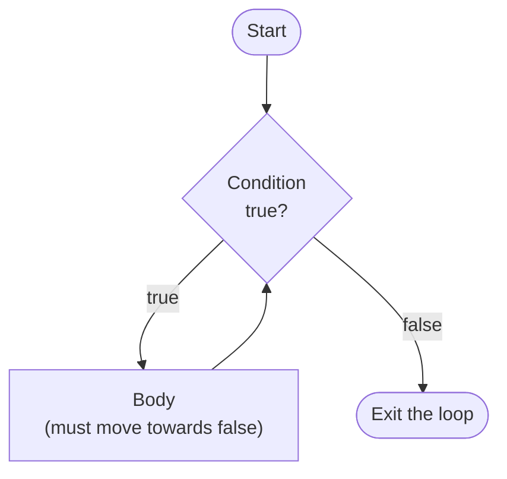
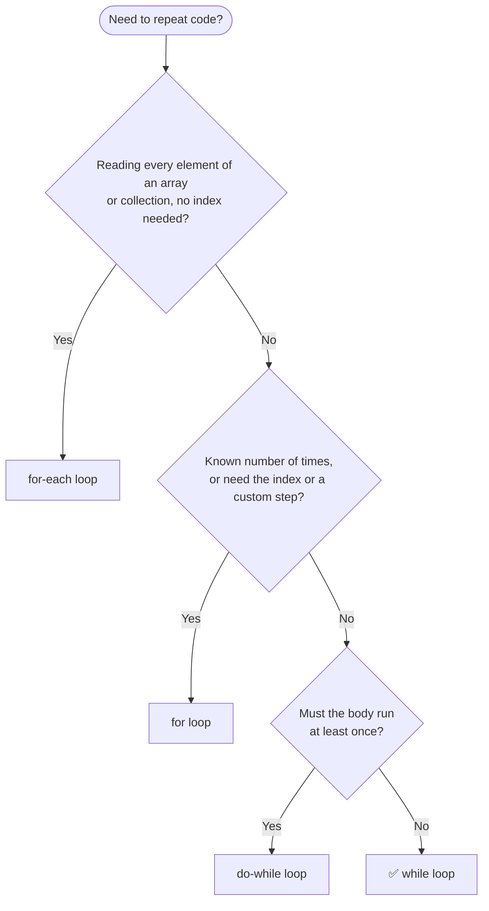

<a id="readme-top"></a>

# While Loop

> **The `while` loop repeats a block of code as long as a condition stays true — the loop to use when you do not know in advance how many times to repeat.**


| Quick Facts | Details |
|---|---|
| **Category** | Loop — control flow |
| **Prerequisites** | Variables, operators, `if` conditions, for loop basics |
| **Key keywords** | `while` · `break` · `continue` |
| **Works with** | Java 8 and above |
| **At a glance** | `while (condition) { body }` · Time `O(iterations × cost of the body)` |

## 🔰 Table of Contents

| Level | Sections |
|---|---|
| 🟢 **Level 1 — Understand** | [Definition](#-definition) · [Key Points](#-key-points) · [How It Works](#-how-it-works) |
| 🟡 **Level 2 — Use It** | [Syntax & Variations](#-syntax--variations) · [Common Patterns](#-common-patterns) · [When to Use](#-when-to-use) · [Example](#-example) · [Code](#-code) |
| 🔴 **Level 3 — Wrap-up** | [Time Complexity](#-time-complexity) · [Common Mistakes](#-common-mistakes) · [Interview Questions](#-interview-questions) · [Summary](#-summary) |

## 📍 Definition

**While loop** is a **condition-controlled loop**: it checks a `boolean` condition **before every iteration** and repeats the body **as long as the condition is `true`**.

Unlike the `for` loop it has **no built-in counter** — you write the initialization before the loop and the update inside the body yourself. That makes it the natural choice when repetition depends on a **condition or an event** rather than on a count: reading input until `"quit"`, peeling digits off a number, retrying until success, working through a list that changes.

| Term | Meaning | Example with `while (n > 0)` |
|---|---|---|
| **Condition** | The `boolean` expression checked before every iteration | `n > 0` |
| **Body** | The code that is repeated | `{ ... }` |
| **Loop-control variable** | The variable the condition depends on — it must change inside the body | `n` |
| **Initialization** | Written by you, before the loop | `int n = 4729;` |
| **Update** | Written by you, inside the body, so the condition can become `false` | `n /= 10;` |
| **Sentinel value** | A special value that means "stop" | `"quit"`, `-1` |
| **Iteration** | One complete run of the body | one pass with the current `n` |

**Where the three parts of a loop live**

| Part | Where it lives | If you forget it |
|---|---|---|
| **Initialization** | before the loop | compile error ("might not have been initialized") or a wrong starting value |
| **Condition** | in the parentheses | it is required — `while ()` does not compile |
| **Update** | inside the body | the condition never changes → an infinite loop |

> [!TIP]
> **Real-life analogy:** filling a bucket until it is full. You do not know how many cups it will take, so before every cup you look: "is the bucket full yet?" If not, you pour one more cup and look again. The loop ends only when the answer changes.

## 📌 Key Points

1. **One part in the header** — `while (condition) { body }`; the condition is required and must be a `boolean` (`while (n)` or `while (n = 5)` does not compile).
2. **Fixed order** — check the condition → run the body → check again … until the condition is `false`.
3. **Entry-controlled** — the condition is checked first, so the body can run **zero** times.
4. **You manage the loop variable** — initialize it before the loop and update it inside the body; the compiler will not do it for you.
5. **One extra check** — for `n` iterations the condition is evaluated `n + 1` times.
6. **Scope follows where you declare** — variables declared before the loop stay alive after it; variables declared inside the body are created fresh in every iteration and vanish at its end.
7. **`continue` goes straight to the condition** — it does not run any update for you, so an update placed after `continue` is skipped.
8. **Use `while` when the count is unknown** — when the number of iterations depends on data or events; use `for` when the count or the index matters.

> [!IMPORTANT]
> **Every while loop needs an exit** — something inside the body must move the loop towards a `false` condition (or end it with `break`). The classic bug is forgetting the update, which makes the loop run forever.

## ⚙️ How It Works



Tracing a digit-sum loop with `n = 4729` and `digitSum = 0`:

```text
while (n > 0) { digitSum += n % 10; n /= 10; }

Step 0   setup       n = 4729, digitSum = 0                  written by you, before the loop
Step 1   condition   4729 > 0 → true
Step 2   body        digitSum = 0 + 9 = 9        n = 472
Step 3   condition   472 > 0 → true
Step 4   body        digitSum = 9 + 2 = 11       n = 47
Step 5   condition   47 > 0 → true
Step 6   body        digitSum = 11 + 7 = 18      n = 4
Step 7   condition   4 > 0 → true
Step 8   body        digitSum = 18 + 4 = 22      n = 0
Step 9   condition   0 > 0 → false → the loop ends        digitSum = 22
```

The loop needed 4 iterations — but nothing in the code said "4". The number of steps came from the data, which is exactly what a `while` loop is for.

### A `while` is a `for` without the counter

```java
while (condition) { body }          // is the same as

for ( ; condition ; ) { body }
```

> [!NOTE]
> Use `for` when the counter belongs to the loop and `while` when the loop depends on a condition. The differences in scope and in what `continue` does are covered in for-loop.md; the variant that checks the condition **after** the body is covered in do-while-loop.md, and `break` and `continue` in loop-control.md.

## 🔄 Syntax & Variations

### Basic syntax

```java
initialization;
while (condition) {
    // body: runs while the condition is true
    update;
}
```

| Rule | Detail |
|---|---|
| **Condition** | required, a `boolean` expression in parentheses |
| **Initialization** | written before the loop |
| **Update** | written inside the body, so the condition can become `false` |
| **Braces** | optional for a single statement — always write them |
| **Scope** | variables declared before the loop stay alive after it; variables declared inside the body live for one iteration only |
| **`while (true)`** | an infinite loop; code after it is "unreachable" unless a `break` exists |

### Common forms

| Form | Example | Behavior |
|---|---|---|
| **Counter** | `int i = 0; while (i < n) { ...; i++; }` | works like a `for` loop |
| **Countdown** | `while (n > 0) { ...; n--; }` | counts or consumes down to zero |
| **Sentinel** | `while (!line.equals("quit"))` | runs until a special value appears |
| **Flag** | `boolean done = false; while (!done) { ...; done = true; }` | runs until the body sets the flag |
| **Two conditions** | `while (idx < arr.length && arr[idx] != key)` | stops at the end of the array or when found — check the bounds **first** |
| **Collection-driven** | `while (it.hasNext())` · `while (!queue.isEmpty())` | runs until nothing is left |
| **Infinite + `break`** | `while (true) { ...; if (done) break; }` | the exit test sits in the middle of the body |

### Scope of variables

```java
int i = 0;
while (i < 3) {
    int square = i * i;           // created fresh in every iteration, gone at the end of it
    i++;
}
System.out.println(i);            // 3 — declared before the loop, so it is still alive
System.out.println(square);       // compile error: cannot find symbol
```

### The read-ahead pattern

```java
String line = readLine();             // 1. read BEFORE the loop
while (!line.equals("quit")) {        // 2. test it
    process(line);                    // 3. use it
    line = readLine();                // 4. read the NEXT one at the END of the body
}
```

Reading the next value at the **end** of the body guarantees that every value is tested before it is processed.

## 🧩 Common Patterns

| Pattern | Idea | Skeleton |
|---|---|---|
| **Counter style** | initialize before, update inside | `int i = 0; while (i < n) { ...; i++; }` |
| **Sentinel / read-ahead** | keep going until a special value | `while (!line.equals("quit")) { ...; line = next(); }` |
| **Process until empty** | work through a queue, stack or list that changes | `while (!queue.isEmpty()) { x = queue.poll(); ... }` |
| **Digit processing** | peel off one digit per round | `while (n > 0) { d = n % 10; n /= 10; }` |
| **Repeat until a goal** | stop when a target is reached | `while (size > 1) { size /= 2; }` |
| **Euclid-style reduction** | shrink the problem every round | `while (b != 0) { r = a % b; a = b; b = r; }` |
| **Search with pointers** | move the range until it is empty (binary search) | `while (lo <= hi) { mid = ...; }` |
| **Retry / validate** | repeat until valid or out of attempts | `while (!valid && tries < 3)` |
| **Infinite + break** | exit from the middle of the body | `while (true) { if (done) break; }` |

## 🎯 When to Use

| Need | Use | Benefit | Watch out |
|---|---|---|---|
| Repeat until something happens and the count is unknown (input, retries, a goal) | **`while`** | the condition states exactly why the loop runs | make sure the body moves towards the exit |
| Work through a collection that changes during the loop (queue, stack, worklist) | **`while (!queue.isEmpty())`** | a for-each would throw `ConcurrentModificationException` when the collection changes | every pass must make progress |
| Peel digits, halve, divide, reduce | **`while`** | the number of steps depends on the value | `n > 0` or `n >= 0` — check the boundary |
| Stop early while searching (binary search `lo <= hi`) | **`while`** | free movement of the pointers | update the pointers correctly or the loop never ends |
| A fixed count, or you need the index | **`for`** instead | initialization, condition and update in one line | — |
| The body must run at least once (menus, input validation) | **do-while** instead | the condition is checked after the body | a semicolon after `while (...)` |
| Only read every element | **for-each** instead | no index, no off-by-one | cannot go backwards or modify primitives |

**Which loop should I use?**



## 🎲 Example

**Problem:** find the **GCD** of `48` and `18` with Euclid's algorithm — replace `(a, b)` by `(b, a % b)` until `b` is `0`. Nobody can say in advance how many rounds are needed, so a `while` loop is the right tool.

**Dry run — the loop `while (b != 0)`**

| Round | `a` | `b` | `a % b` | next `(a, b)` |
|---|---|---|---|---|
| 1 | 48 | 18 | 12 | `(18, 12)` |
| 2 | 18 | 12 | 6 | `(12, 6)` |
| 3 | 12 | 6 | 0 | `(6, 0)` |
| end | 6 | 0 | – | `b != 0` is `false` → stop, the GCD is `a` = **6** |

✅ GCD = **6** after 3 rounds and 4 condition checks. Every round shrinks the numbers quickly, so the cost is only **O(log min(a, b))**.

## 💻 Code

> Save it as `WhileLoopDemo.java`, then run `javac WhileLoopDemo.java` followed by `java WhileLoopDemo`.

```java
import java.util.ArrayDeque;
import java.util.Deque;

public class WhileLoopDemo {

    // Helper: prints "label : value" in neat columns
    static void show(String label, Object value) {
        System.out.printf("%-30s: %s%n", label, value);
    }

    public static void main(String[] args) {

        // ----- Counting: YOU write the initialization and the update -----
        StringBuilder sb = new StringBuilder();
        int i = 1;                                      // initialization (before the loop)
        while (i <= 5) {                                // condition
            sb.append(i).append(' ');
            i++;                                        // update (inside the body): forget it and the loop never ends
        }
        show("Count 1..5", sb.toString().trim());
        show("i after the loop", i);                    // declared outside the loop, so it is still alive

        // ----- Unknown number of steps: digits and digit sum -----
        int n = 4729;
        int digitSum = 0;
        int digits = 0;
        while (n > 0) {
            digitSum += n % 10;                         // the last digit
            n /= 10;                                    // drop the last digit
            digits++;
        }
        show("4729: digits / digit sum", digits + " / " + digitSum);

        // ----- Unknown number of steps: Euclid's algorithm for the GCD -----
        int a = 48, b = 18, rounds = 0;
        while (b != 0) {
            int remainder = a % b;
            a = b;
            b = remainder;
            rounds++;
        }
        show("gcd(48, 18) / rounds", a + " / " + rounds);

        // ----- Sentinel value: stop when the input says "quit" -----
        String[] input = {"12", "7", "30", "quit", "99"};       // pretend a user typed these
        int idx = 0;
        int total = 0;
        while (idx < input.length && !input[idx].equals("quit")) {   // bounds check FIRST
            total += Integer.parseInt(input[idx]);
            idx++;
        }
        show("Sum until \"quit\"", total + " (stopped at index " + idx + ")");
        // With a real keyboard it reads ahead: String line = sc.nextLine();
        //   while (!line.equals("quit")) { ...process line...; line = sc.nextLine(); }

        // ----- Repeat until a goal is reached -----
        int size = 1000;
        int halvings = 0;
        while (size > 1) {
            size /= 2;
            halvings++;
        }
        show("1000 halved until 1", halvings + " times");

        // ----- Process until empty: the collection changes while we loop -----
        Deque<Integer> queue = new ArrayDeque<>();
        queue.add(1);
        sb.setLength(0);
        while (!queue.isEmpty()) {
            int x = queue.poll();
            sb.append(x).append(' ');
            if (x < 4) {
                queue.add(x * 2);                       // the queue grows while we loop
            }
        }
        show("Queue grows while looping", sb.toString().trim());

        // ----- Zero iterations: the condition is checked FIRST -----
        int count = 0;
        int k = 10;
        while (k < 5) {                                 // false from the start
            count++;
        }
        show("Body runs when 10 < 5", count + " times");

        // ----- while (true) + break: leave the loop from the middle -----
        int attempts = 0;
        while (true) {
            attempts++;
            if (attempts * attempts > 50) {
                break;                                  // the exit test sits inside the body
            }
        }
        show("First a with a * a > 50", attempts);

        // ----- continue in a while: put the update BEFORE it -----
        sb.setLength(0);
        int j = 0;
        while (j < 6) {
            j++;                                        // update first, so continue cannot skip it
            if (j % 2 == 0) {
                continue;                               // jumps straight back to the condition
            }
            sb.append(j).append(' ');
        }
        show("Odd numbers with continue", sb.toString().trim());

        // ----- Trap: a loop that never updates (guarded here so the demo can end) -----
        int guard = 0;
        int stuck = 1;
        while (stuck > 0 && guard < 5) {                // stuck never changes: only the guard stops us
            guard++;
        }
        show("Loop with no update", "cut off by the guard after " + guard + " rounds");
    }
}
```

**Output**

```text
Count 1..5                    : 1 2 3 4 5
i after the loop              : 6
4729: digits / digit sum      : 4 / 22
gcd(48, 18) / rounds          : 6 / 3
Sum until "quit"              : 49 (stopped at index 3)
1000 halved until 1           : 9 times
Queue grows while looping     : 1 2 4
Body runs when 10 < 5         : 0 times
First a with a * a > 50       : 8
Odd numbers with continue     : 1 3 5
Loop with no update           : cut off by the guard after 5 rounds
```

> [!NOTE]
> Three details to notice: `i` is `6` after the loop because the loop ended when `i <= 5` became false; the `quit` loop tests `idx < input.length` **before** `input[idx]`, so a missing sentinel stops the loop instead of crashing; and in the last example only the artificial `guard` ends the loop — without it, a loop that never updates would run forever.

## ⏳ Time Complexity

| Loop | Iterations | Time |
|---|---|---|
| `while (i < n) { ...; i++; }` | `n` | **O(n)** |
| `while (n > 0) { n /= 10; }` — digits | about `log₁₀ n` | **O(log n)** |
| `while (n > 1) { n /= 2; }` — halving | about `log₂ n` | **O(log n)** |
| Euclid: `while (b != 0) { r = a % b; a = b; b = r; }` | at most about `log` of the smaller number | **O(log min(a, b))** |
| `while (!queue.isEmpty())` — every item handled once | number of items | **O(n)** |
| nested `while` loops that both run `n` times | `n × n` | **O(n²)** |
| a condition that never becomes `false` | endless | **never finishes** |

The loop itself needs only a few variables, so its extra space is **O(1)**; the total time is the number of iterations multiplied by the cost of one body.

**Feel the difference** — number of iterations for `n` items:

| n | `n /= 2` — O(log n) | `i++` — O(n) | nested — O(n²) |
|---|---|---|---|
| 10 | 3 | 10 | 100 |
| 1,000 | 9 | 1,000 | 1,000,000 |
| 1,000,000 | 19 | 1,000,000 | 1,000,000,000,000 |

> [!TIP]
> **Rule of thumb:** ask how fast the loop-control variable moves towards the exit — one step at a time → `O(n)`, halving or dividing → `O(log n)`, a loop inside a loop → multiply. If you cannot say how it moves towards the exit, the loop may not have an exit.

## 🚨 Common Mistakes

| # | Mistake | Why it is a problem | Fix |
|---|---|---|---|
| 1 | forgetting the update (`while (i < 5) { sum += i; }`) | `i` never changes, so the condition stays `true` forever | update the loop-control variable inside the body |
| 2 | `continue` placed before the update (`if (i % 2 == 0) continue; ...; i++;`) | `continue` jumps straight to the condition, `i++` is skipped and the loop never ends | put the update before `continue`, or use a `for` loop |
| 3 | `while (i < 3);` | the `;` is an empty body — `i` never changes, so the loop spins forever | remove the semicolon and always write braces |
| 4 | testing a counter with `!=` (`while (i != 10)` with `i += 3`, or `while (d != 1.0)` with `d += 0.1`) | the counter jumps over the value and the condition never becomes `false` | use `<` or `<=`, and count with an `int` |
| 5 | declaring the accumulator inside the body (`while (...) { int sum = 0; sum += i; }`) | it restarts at `0` in every iteration and is not visible after the loop | declare it **before** the loop |
| 6 | `=` instead of `==` in the condition | with an `int` it does not compile; with a `boolean`, `while (found = false)` compiles, assigns `false` and the loop never runs | compare with `==`, or simply write `while (!found)` |

## 🎤 Interview Questions

<details>
<summary><b>1. What is a while loop and how does it execute?</b></summary>

A `while` loop repeats its body as long as a `boolean` condition is `true`. It checks the condition **first**, runs the body, then checks again, until the condition is `false`. The initialization and the update are written by you outside the header and inside the body. It is an **entry-controlled** loop, so the body may run zero times.

</details>

<details>
<summary><b>2. When should you use a while loop instead of a for loop?</b></summary>

Use `while` when the number of iterations is **not known in advance** and depends on a condition or on data — reading input until `"quit"`, processing digits, retrying, or draining a queue. Use `for` when you know the count or need the index. Technically `while (cond)` is the same as `for (; cond; )`, so the choice is about readability.

</details>

<details>
<summary><b>3. What is the difference between <code>while</code> and <code>do-while</code>?</b></summary>

| Feature | `while` | `do-while` |
|---|---|---|
| Condition checked | **before** the body | **after** the body |
| Minimum runs of the body | 0 | 1 |
| Ends with | nothing | `while (condition);` — with a semicolon |
| Typical use | repeat while something holds — it may not run at all | menus, input validation, "try at least once" |

```java
int k = 10;
while (k < 5) { }              // body runs 0 times
do { } while (k < 5);          // body runs 1 time
```

</details>

<details>
<summary><b>4. How do you create an infinite loop and how do you leave it?</b></summary>

`while (true) { ... }` is an infinite loop (so is `for (;;)`). You leave it with `break`, `return`, an exception or `System.exit(...)`. It is used on purpose for servers, game loops and "retry until success" code. If no `break` exists, the compiler reports every statement after the loop as an **unreachable statement**.

</details>

<details>
<summary><b>5. What does <code>continue</code> do in a while loop?</b></summary>

It skips the rest of the current body and jumps straight to the **condition check**. A `while` loop has no update part of its own, so an update placed after `continue` is skipped — which can make the loop run forever. Put the update before the `continue`. In a `for` loop the same `continue` jumps to the update first, which is why it is safer there.

</details>

<details>
<summary><b>6. Why is a while loop the right choice for a queue that changes while you loop?</b></summary>

A for-each loop over a collection throws a `ConcurrentModificationException` if the collection is changed during the loop. With `while (!queue.isEmpty())` you take an item out with `poll()` and may add new items — the loop simply runs until the queue is empty. This is the pattern behind breadth-first search and work lists.

</details>

<details>
<summary><b>7. What is the time complexity of a while loop?</b></summary>

It is the number of iterations multiplied by the cost of one body. Moving one step at a time gives `O(n)`; halving (`n /= 2`) or removing digits (`n /= 10`) gives `O(log n)`; Euclid's GCD loop is `O(log min(a, b))`; nested loops multiply. A loop whose condition never becomes `false` never finishes.

</details>

## 🏁 Summary

- A **while loop** is condition-controlled: **check the condition → run the body → check again**, until the condition is `false`.
- It is **entry-controlled** — the body can run zero times — and the condition is evaluated one time more than the body runs.
- **You** write the initialization (before the loop) and the update (inside the body); forgetting the update is the classic infinite loop.
- `continue` jumps straight to the condition, so any update must come **before** it.
- Use `while` when the count is **unknown** — sentinels, digits, retries, queues — and `for` when the count or the index matters.
- Time is **iterations × cost of the body**: halving or digit loops are `O(log n)`, one step at a time is `O(n)`, nested loops multiply.

### 📝 Cheat Sheet

| Question | Answer |
|---|---|
| Syntax | `while (condition) { body }` |
| Order | check the condition → body → check again … until `false` |
| You write | the initialization (before) and the update (inside the body) |
| Infinite loop | `while (true) { ...; if (done) break; }` |
| Read until a value | read first → `while (!line.equals("quit"))` → read again at the end of the body |
| Process until empty | `while (!queue.isEmpty())` |
| `continue` | jumps to the condition — put the update **before** it |
| Zero runs | possible, because the condition is checked first |
| Time | iterations × cost of the body — halving or digit loops are `O(log n)` |

> [!IMPORTANT]
> **Every while loop needs an exit:** before you run it, point to the line in the body that moves the loop towards a `false` condition — if you cannot find that line, you have found the bug.
