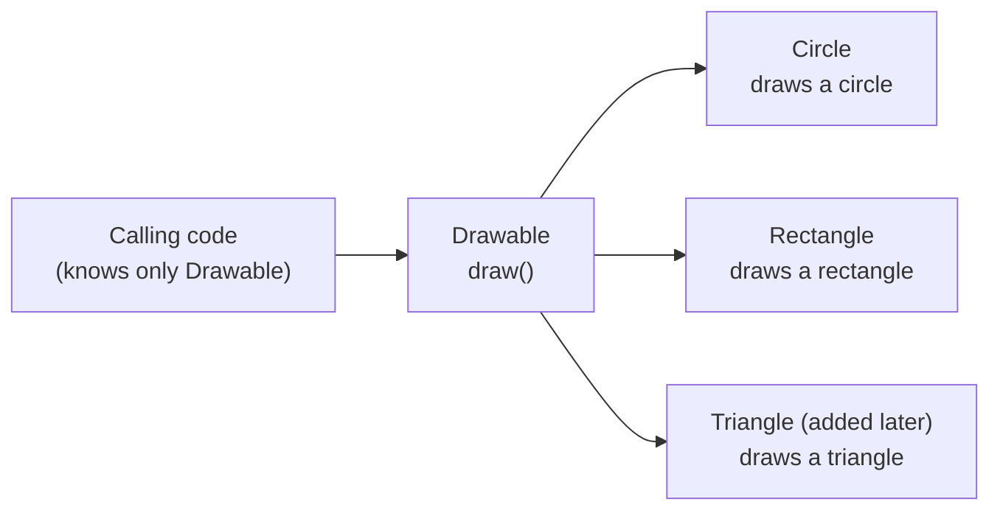
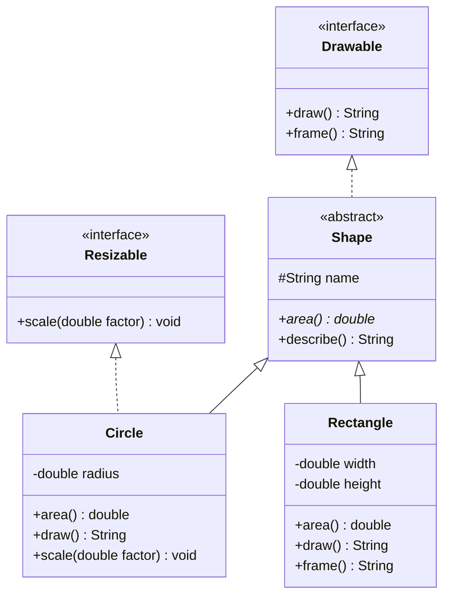

<a id="readme-top"></a>

# Abstraction

> **Abstraction shows what an object does and hides how it does it — callers work with a simple contract while the complicated details stay behind it.**


| Quick Facts | Details |
|---|---|
| **Category** | OOP pillar |
| **Prerequisites** | Class and object, inheritance, polymorphism |
| **Key keywords** | `abstract` · `interface` · `implements` · `default` · `static` |
| **Works with** | Java 8 and above (`private` interface methods need Java 9+) |

## 🔰 Table of Contents

| Level | Sections |
|---|---|
| 🟢 **Level 1 — Understand** | [Definition](#-definition) · [Key Points](#-key-points) · [How It Works](#-how-it-works) |
| 🟡 **Level 2 — Use It** | [Syntax & Variations](#-syntax--variations) · [When to Use](#-when-to-use) · [Example](#-example) · [Code](#-code) |
| 🔴 **Level 3 — Wrap-up** | [Common Mistakes](#-common-mistakes) · [Interview Questions](#-interview-questions) · [Summary](#-summary) |

## 📍 Definition

**Abstraction** is an OOP principle of **exposing only the essential features** of an object — **what** it does — and **hiding the implementation details** — **how** it does it.

In Java you achieve it with **abstract classes** (partly implemented) and **interfaces** (a contract that classes promise to fulfil).

| Term | Meaning | Example |
|---|---|---|
| **Abstraction** | Show *what*, hide *how* | `List` hides whether it stores elements in an array or a linked chain |
| **Abstract class** | A partly implemented class that cannot be instantiated | `abstract class Shape` |
| **Abstract method** | A method declared without a body; children must implement it | `abstract double area();` |
| **Interface** | A contract listing the methods a class must provide | `interface Drawable` |
| **`implements`** | Keyword a class uses to sign an interface | `class Circle implements Drawable` |
| **Concrete class** | A class with every method implemented — it can be instantiated | `Circle`, `Rectangle` |

**The two tools at a glance**

| Tool | What it is | Used with | A class can use |
|---|---|---|---|
| **Abstract class** | shared fields, constructors and code, plus abstract methods | `extends` | only **one** |
| **Interface** | a contract with no state (plus `default` / `static` methods since Java 8) | `implements` | **many** |

> [!TIP]
> **Real-life analogy:** driving a car. You use the steering wheel, pedals and gear lever (the contract), and you never need to know how the engine, gearbox or fuel injection work (the implementation). Any car that offers the same controls can be driven the same way.

## 📌 Key Points

1. **What, not how** — callers depend on a contract, not on the code behind it.
2. **Two tools** — abstract classes (partial implementation) and interfaces (pure contract).
3. **An abstract class cannot be instantiated** — `new Shape()` is a compile error, but it can have fields, constructors, concrete methods and abstract methods.
4. **An abstract method has no body** — it ends with `;` and exists only in an abstract class or an interface.
5. **Children must complete the contract** — a concrete class has to implement every inherited abstract method, otherwise it must be declared `abstract` itself.
6. **One class, many interfaces** — a class extends one class but can implement any number of interfaces.
7. **Interface members have implicit modifiers** — methods are `public abstract`, fields are `public static final`; Java 8 added `default` and `static` methods, Java 9 added `private` ones.
8. **Use the abstract type for variables** — `Shape s = new Circle(2);` — the variable has the abstract type, the object is a concrete child, and polymorphism does the rest.

> [!IMPORTANT]
> **You cannot `new` an abstract class or an interface** — but you can declare variables, parameters and arrays of that type and fill them with objects of concrete children. That is what makes abstraction useful.

## ⚙️ How It Works

The calling code knows only the contract; any class that fulfils it can be plugged in:



### Shared code + specific code working together

```text
Shape s = new Circle(2);
s.describe();

Step 1  compile time   Shape has describe() → the call compiles          (the object is a Circle, never a plain Shape)
Step 2  run time       describe() is concrete code written ONCE in Shape → it runs
Step 3  inside it      it calls area(), which is abstract in Shape → the JVM looks at the REAL object
Step 4  dispatch       the real object is a Circle → Circle.area() runs
Step 5  result         shared code (Shape) + specific code (Circle)       → "Circle area = 12.57"
```

### What the compiler enforces

```text
new Shape(2);                       error: Shape is abstract; cannot be instantiated
class Circle extends Shape { }      error: Circle is not abstract and does not override abstract method area() in Shape
```

> [!NOTE]
> Abstraction hides **complexity** so a class is easy to use; encapsulation hides **data** so it cannot be damaged — see encapsulation.md. The run-time method selection that makes this work is explained in polymorphism.md.

## 🔄 Syntax & Variations

### Abstract class

```java
abstract class Shape {
    protected final String name;                // fields are allowed

    Shape(String name) {                        // constructors are allowed (run through super(...))
        this.name = name;
    }

    public abstract double area();              // abstract: no body, children MUST implement it

    public String describe() {                  // concrete: written once, shared by all children
        return name + " area = " + String.format("%.2f", area());
    }
}
```

| Rule | Detail |
|---|---|
| **Declared with** | `abstract class Shape { ... }` |
| **Instantiation** | not allowed — `new Shape()` is a compile error |
| **Can contain** | abstract methods, concrete methods, fields, constructors, `static` members, initializer blocks |
| **Abstract method** | no body, ends with `;`, and cannot be `private`, `static` or `final` |
| **Has an abstract method?** | then the class must be declared `abstract` |
| **No abstract methods?** | still allowed — `abstract` then simply prevents plain objects |
| **Concrete child** | must implement **all** inherited abstract methods, otherwise it must be `abstract` too |
| **Constructor** | cannot be called with `new` directly, but runs when a child object is created (`super(...)`) |

### Interface

```java
interface Drawable {
    String draw();                              // implicitly public abstract

    default String frame() {                    // Java 8: a method WITH a body
        return "[" + draw() + "]";
    }

    static String version() {                   // Java 8: a static helper
        return "Drawable v1";
    }
}
```

| Member | Implicit modifiers | Notes |
|---|---|---|
| **Abstract method** | `public abstract` | the contract; the implementing class must declare it `public` |
| **Constant (field)** | `public static final` | must be given a value; interfaces hold no per-object state |
| **`default` method** (Java 8) | `public` | has a body; a child can inherit or override it — lets you add methods without breaking existing implementers |
| **`static` method** (Java 8) | `public` | called through the interface name, `Drawable.version()`; not inherited |
| **`private` method** (Java 9+) | `private` | a helper shared by the default methods |
| **Constructor / instance field** | — not allowed | an interface cannot hold state |

### Implementing interfaces

```java
class Circle extends Shape implements Drawable, Resizable {
    // one parent class + many interfaces
}
```

| Rule | Detail |
|---|---|
| **Keywords** | a class `extends` one class and `implements` many interfaces; an interface can `extends` many interfaces |
| **Access** | every implemented interface method must be declared `public` in the class |
| **Missing methods** | a concrete class must implement every abstract method of every interface it signs |
| **Same `default` method in two interfaces** | the class must override it and choose explicitly, for example `A.super.hello()` |

### Special kinds of interfaces

| Kind | Meaning | Example |
|---|---|---|
| **Functional interface** | exactly **one** abstract method; can be implemented with a lambda (Java 8) | `Runnable`, `Comparator<T>` |
| **Marker interface** | no methods at all; it only tags a class | `Serializable` |

### Where `abstract` can go

| Applied to | Allowed? | Meaning |
|---|---|---|
| **Class** | ✅ | cannot be instantiated |
| **Method** | ✅ | no body; children must implement it |
| **Field / variable** | ❌ | — |
| **Constructor** | ❌ | — |
| **Method that is also `private`, `static` or `final`** | ❌ | those modifiers contradict "children must override it" |

### The class hierarchy used on this page



## 🎯 When to Use

| Need | Use | Benefit | Watch out |
|---|---|---|---|
| Related classes share state or code, and one part must differ per class | **abstract class** | shared fields, constructor and concrete methods are written once; the differing part is forced on the children | a child can extend only one class |
| Unrelated classes must share a capability (`Comparable`, `Runnable`, `Drawable`) | **interface** | any class can sign it, whatever its parent is | no instance state — contract only |
| Callers should work with many types through one type | **abstract type as variable or parameter** | the implementation behind it can be swapped or extended | design the contract carefully — it is hard to change later |
| Add a method to an existing interface without breaking its implementers | **`default` method** (Java 8) | old classes keep compiling | two interfaces with the same default force the class to resolve the conflict |
| A fixed algorithm whose steps differ per child | **abstract class with a concrete method that calls abstract ones** | the flow is written once, children fill in the steps | too rigid if the flow itself changes per child |
| Stop anyone from creating a plain object of a general class | **`abstract` class** | `new Shape()` becomes a compile error | only makes sense when the class really is incomplete |

## 🎲 Example

**Problem:** model shapes — every shape must have an `area()` and be drawable, each shape computes and draws itself differently, and the code that builds the description text is written only once.

**Dry run — what each statement does**

| Step | Statement | What happens | Result |
|---|---|---|---|
| 1 | `Shape bad = new Shape("x");` | `Shape` is abstract → compile error, the line can never run | blocked |
| 2 | `Shape circle = new Circle(2);` | a concrete `Circle` is created; the variable has the abstract type | works |
| 3 | `circle.describe()` | the concrete method in `Shape` runs and calls `area()` → `Circle.area()` | `"Circle area = 12.57"` |
| 4 | loop over `Shape[]` calling `area()` | one call, each real object computes its own area | total `21.71` |
| 5 | `render(circle)` | `render` knows only `Drawable`; it calls the `default` method `frame()` | `"[drawing a circle]"` |
| 6 | `render(rect)` | `Rectangle` overrides `frame()` | `"<<drawing a rectangle>>"` |
| 7 | `circle instanceof Resizable` | `Circle` signed a second interface; `Rectangle` did not | `true` · `false` |

✅ The abstract class holds the shared code, each child supplies its own part, and the calling code depends only on the contract.

## 💻 Code

> Save it as `AbstractionDemo.java`, then run `javac AbstractionDemo.java` followed by `java AbstractionDemo`.

```java
// 1. An interface: a pure contract that any class can sign
interface Drawable {
    String draw();                                      // abstract: implicitly public

    default String frame() {                            // Java 8 default method: has a body
        return "[" + draw() + "]";
    }

    static String version() {                           // Java 8 static method: called as Drawable.version()
        return "Drawable v1";
    }
}

interface Resizable {
    void scale(double factor);
}

// 2. An abstract class: shared code + parts the children MUST supply
abstract class Shape implements Drawable {
    protected final String name;                        // abstract classes can have fields ...

    Shape(String name) {                                // ... and constructors (run through super(...))
        this.name = name;
    }

    public abstract double area();                      // abstract: every concrete child MUST implement it

    public String describe() {                          // concrete: written ONCE, shared by all children
        return name + " area = " + String.format("%.2f", area());
    }
}

// 3. Concrete classes: they implement everything that is still abstract
class Circle extends Shape implements Resizable {       // one parent class + many interfaces
    private double radius;

    Circle(double radius) {
        super("Circle");
        this.radius = radius;
    }

    @Override
    public double area() { return Math.PI * radius * radius; }

    @Override
    public String draw() { return "drawing a circle"; }

    @Override
    public void scale(double factor) { radius *= factor; }
}

class Rectangle extends Shape {
    private final double width, height;

    Rectangle(double width, double height) {
        super("Rectangle");
        this.width = width;
        this.height = height;
    }

    @Override
    public double area() { return width * height; }

    @Override
    public String draw() { return "drawing a rectangle"; }

    @Override
    public String frame() {                             // a child may override a default method
        return "<<" + draw() + ">>";
    }
}

public class AbstractionDemo {

    // Helper: prints "label : value" in neat columns
    static void show(String label, Object value) {
        System.out.printf("%-28s: %s%n", label, value);
    }

    // Knows ONLY the contract Drawable -- not Circle, not Rectangle
    static String render(Drawable d) {
        return d.frame();
    }

    public static void main(String[] args) {

        // ----- Abstract class: you cannot create it directly -----
        // Shape bad = new Shape("x");                  // compile error: Shape is abstract; cannot be instantiated
        Shape circle = new Circle(2);                   // abstract TYPE on the left, concrete OBJECT on the right
        Shape rect = new Rectangle(2, 3);

        // ----- Shared code in the abstract class + specific code in each child -----
        show("circle.describe()", circle.describe());
        show("rect.describe()", rect.describe());

        // ----- Polymorphism through the abstract type -----
        Shape[] shapes = { circle, rect, new Circle(1) };
        double total = 0;
        for (int i = 0; i < shapes.length; i++) {
            total += shapes[i].area();
        }
        show("Total area", String.format("%.2f", total));

        // ----- Interface: a contract anyone can sign -----
        show("render(circle)", render(circle));         // default method: [drawing a circle]
        show("render(rect)", render(rect));             // overridden default method: <<...>>
        Drawable dot = () -> "drawing a dot";           // one abstract method -> a lambda can implement it
        show("render(dot)", render(dot));
        show("Drawable.version()", Drawable.version()); // static interface method

        // ----- One class, many interfaces -----
        Circle small = new Circle(1);
        small.scale(3);
        show("Circle(1) scaled x3", small.describe());
        show("circle instanceof Resizable", circle instanceof Resizable);
        show("rect instanceof Resizable", rect instanceof Resizable);

        // ----- The contract is enforced by the compiler -----
        // class Triangle extends Shape { }             // compile error: does not override abstract method area()
    }
}
```

**Output**

```text
circle.describe()           : Circle area = 12.57
rect.describe()             : Rectangle area = 6.00
Total area                  : 21.71
render(circle)              : [drawing a circle]
render(rect)                : <<drawing a rectangle>>
render(dot)                 : [drawing a dot]
Drawable.version()          : Drawable v1
Circle(1) scaled x3         : Circle area = 28.27
circle instanceof Resizable : true
rect instanceof Resizable   : false
```

> [!NOTE]
> `Total area` is `12.57 + 6.00 + 3.14`. The lambda `() -> "drawing a dot"` works because `Drawable` has exactly one abstract method — `default` and `static` methods do not count — which makes it a functional interface.

## 🚨 Common Mistakes

| # | Mistake | Why it is a problem | Fix |
|---|---|---|---|
| 1 | `new Shape()` on an abstract class or interface | compile error: "Shape is abstract; cannot be instantiated" | create a concrete child: `Shape s = new Circle(2);` |
| 2 | a concrete child that forgets an abstract method | compile error: "Circle is not abstract and does not override abstract method area() in Shape" | implement the method, or declare the child `abstract` too |
| 3 | implementing an interface method without `public` (`String draw() { ... }`) | interface methods are public, and an override cannot reduce access → "draw() in Circle cannot implement draw() in Drawable" | write `public String draw()` |
| 4 | `private abstract double area();`, or an abstract method with a body | contradictory modifiers → "illegal combination of modifiers: abstract and private" / "abstract methods cannot have a body" | an abstract method has no body and is never `private`, `static` or `final` |
| 5 | trying to keep changing data in an interface (`int count = 0;` then `count++`) | interface fields are `public static final` constants → "cannot assign a value to static final variable count" | keep state in an abstract class or in the implementing class |
| 6 | two interfaces with the same `default` method, and a class that implements both without resolving it | compile error: "types A and B are incompatible" | override the method and choose: `A.super.hello()` |

## 🎤 Interview Questions

<details>
<summary><b>1. What is abstraction and how do you achieve it in Java?</b></summary>

Abstraction means showing only what an object does and hiding how it does it. In Java you achieve it with **abstract classes** (a partly implemented class with abstract methods) and **interfaces** (a contract of methods). Callers use the abstract type and never need to know which concrete class is behind it.

</details>

<details>
<summary><b>2. What is the difference between an abstract class and an interface?</b></summary>

| Feature | Abstract class | Interface |
|---|---|---|
| Used with | `extends` — only one | `implements` — many |
| Methods | abstract and concrete | abstract, plus `default` and `static` (Java 8) and `private` (Java 9) |
| Fields | any kind, including instance fields | only `public static final` constants |
| Constructor | yes | no |
| State | can hold per-object state | cannot |
| Method access | any modifier | public (implicitly) |
| Use when | related classes share state and code (IS-A) | unrelated classes share a capability (CAN-DO) |

</details>

<details>
<summary><b>3. Can an abstract class have a constructor, or no abstract methods at all?</b></summary>

Yes to both. An abstract class cannot be created with `new`, but its constructor **runs** when a child object is created (through `super(...)`) and initializes the fields of the abstract class. A class can also be declared `abstract` with **no** abstract methods — that simply prevents anyone from creating a plain object of it.

</details>

<details>
<summary><b>4. What is a default method and why was it added in Java 8?</b></summary>

A `default` method is an interface method **with a body**. It was added so that new methods could be added to existing interfaces (such as `forEach` on `Iterable`) without breaking every class that already implements them. If a class implements two interfaces that have the same default method, it must override the method and choose explicitly:

```java
interface A { default String hello() { return "A"; } }
interface B { default String hello() { return "B"; } }

class C implements A, B {
    @Override
    public String hello() { return A.super.hello(); }   // resolves the conflict → "A"
}
```

</details>

<details>
<summary><b>5. What is the difference between abstraction and encapsulation?</b></summary>

| Feature | Abstraction | Encapsulation |
|---|---|---|
| Hides | the **implementation complexity** | the **data** |
| Purpose | make the class easy to use | protect the data and keep the object valid |
| Level | design — what the user sees | implementation — inside the class |
| Achieved with | `abstract` classes and interfaces | `private` fields + public methods |

</details>

<details>
<summary><b>6. What is a functional interface?</b></summary>

An interface with exactly **one abstract method** (it may still have `default` and `static` methods). It can be implemented with a **lambda expression** — for example `Runnable r = () -> System.out.println("hi");`. The optional `@FunctionalInterface` annotation makes the compiler check that there is only one abstract method.

</details>

## 🏁 Summary

- **Abstraction** shows *what* an object does and hides *how* — callers depend on a contract, not on the code behind it.
- An **abstract class** shares fields, constructors and concrete code and forces children to implement the abstract methods; it cannot be instantiated.
- An **interface** is a pure contract with no state; since Java 8 it can also have `default` and `static` methods.
- A class **extends one** class but **implements many** interfaces, and a concrete class must implement every abstract method it inherits.
- Declare variables and parameters with the abstract type, fill them with concrete objects, and polymorphism picks the right code at run time.
- Together with encapsulation, inheritance and polymorphism, abstraction completes the **four pillars of OOP**.

### 📝 Cheat Sheet

| Question | Answer |
|---|---|
| Hide the *how*, show the *what* | an abstract class or an interface |
| Abstract class | `abstract class Shape { public abstract double area(); }` — `extends`, only one |
| Abstract method | no body, ends with `;` — children must implement it |
| Interface | `interface Drawable { String draw(); }` — `implements`, many allowed |
| Interface extras (Java 8) | `default` (with a body) · `static` (call it as `Drawable.version()`) |
| Create an object | never `new Shape()` — use `Shape s = new Circle(2);` |
| Which one to choose | shared state and code with IS-A → abstract class · shared capability → interface |
| Interface fields | always `public static final` constants |

> [!IMPORTANT]
> **Program to the contract, not the class:** let callers depend on an abstract class or an interface, so the implementation behind it can change — or grow with new types — without touching them.
