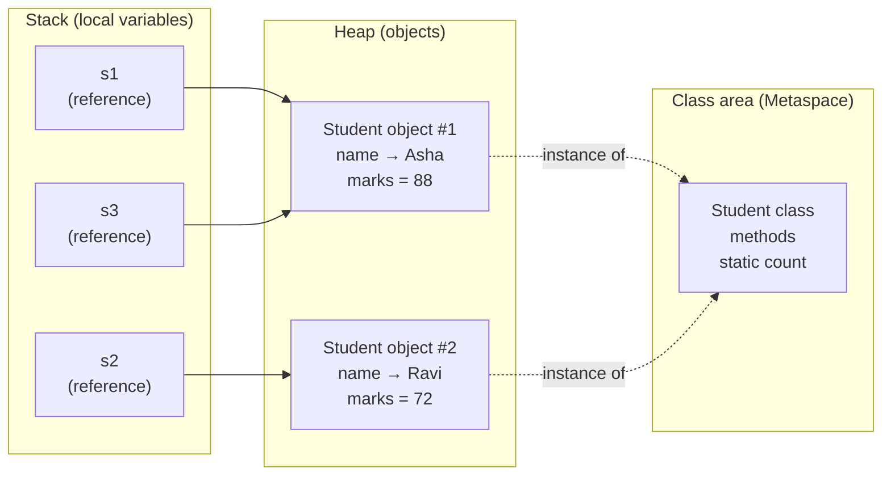

<a id="readme-top"></a>

# Class and Object

> **A class is the blueprint, an object is the real thing built from it — every other idea in OOP starts from this pair.**


| Quick Facts | Details |
|---|---|
| **Category** | OOP building block |
| **Prerequisites** | Variables, data types, methods |
| **Key keywords** | `class` · `new` · `this` · `static` |
| **Works with** | Java 8 and above |

## 🔰 Table of Contents

| Level | Sections |
|---|---|
| 🟢 **Level 1 — Understand** | [Definition](#-definition) · [Key Points](#-key-points) · [How It Works](#-how-it-works) |
| 🟡 **Level 2 — Use It** | [Syntax & Variations](#-syntax--variations) · [When to Use](#-when-to-use) · [Example](#-example) · [Code](#-code) |
| 🔴 **Level 3 — Wrap-up** | [Common Mistakes](#-common-mistakes) · [Interview Questions](#-interview-questions) · [Summary](#-summary) |

## 📍 Definition

**Class** is a **user-defined data type** — a blueprint that describes the **fields (data)** and **methods (behavior)** its objects will have.

**Object** is a **real instance** of a class — created with `new`, stored on the **heap**, and having its own **state**, **behavior** and **identity**.

| Term | Meaning | Example with `Student s1 = new Student("Asha", 88);` |
|---|---|---|
| **Class** | Blueprint that describes fields and methods | `class Student { ... }` |
| **Object** | One real instance built from the class | the student holding `"Asha"` and `88` |
| **Reference** | Variable that points to an object | `s1` |
| **Instance variable** | Data stored separately inside every object | `name`, `marks` |
| **Method** | Behavior an object can perform | `s1.display()` |
| **`new`** | Allocates the object and calls its constructor | `new Student("Asha", 88)` |

**Every object has three characteristics**

| Characteristic | Meaning | Example |
|---|---|---|
| **State** | the values currently stored in its fields | `name = "Asha"`, `marks = 88` |
| **Behavior** | what it can do — its methods | `display()`, `grade()` |
| **Identity** | what makes it a distinct object, even when the data is identical | two students with the same name and marks are still two objects |

> [!TIP]
> **Real-life analogy:** a class is an architect's plan for a house; every house built from the plan is an object. The plan exists once, but you can build many houses. Painting one house does not repaint the others — each house has its own copy of the data (instance variables), while the street name printed on the plan is shared by all of them (`static`).

## 📌 Key Points

1. **A class is a type, an object is a value of that type** — `Student` is the class, `s1` and `s2` are objects.
2. **One class, many objects** — each object gets its own copy of the instance variables.
3. **`new` creates the object** — it allocates memory on the heap, sets default values, runs the constructor and returns a reference.
4. **Variables hold references** — `Student s1` stores the address of the object, not the object itself.
5. **Reference copy ≠ object copy** — `Student s3 = s1;` creates no new object; both names point to the same one.
6. **`static` belongs to the class** — one copy shared by all objects; instance members belong to each object.
7. **Java is pass-by-value** — when you pass an object to a method, the *reference* is copied, so the method can change the object but cannot re-point the caller's variable.
8. **Unreachable objects are garbage collected** — when no reference points to an object, the JVM can free its memory; you never free it manually.

> [!IMPORTANT]
> **Declaration ≠ creation** — `Student s;` only declares a reference (it is `null` or unassigned). The object exists only after `new Student(...)` runs.

## ⚙️ How It Works

What `Student s = new Student("Asha", 88);` really does:

```text
Student s = new Student("Asha", 88);

Step 0  class load      first use only: the JVM loads Student once and sets up its static variables   count = 0
Step 1  allocate        one block on the heap for the object (header + name + marks)
Step 2  defaults        every instance variable gets its default value                                 name = null, marks = 0
Step 3  constructor     runs: this.name = "Asha", this.marks = 88, count++                            count = 1
Step 4  assign          the reference to the object is stored in the variable s
```

After these three lines, here is where everything lives:

```java
Student s1 = new Student("Asha", 88);
Student s2 = new Student("Ravi", 72);
Student s3 = s1;                       // a second name for the SAME object
```



Three references, but only **two** objects — `s1` and `s3` share object #1.

### Passing an object to a method

```text
Student s = new Student("Asha", 88);
change(s);                    // the VALUE of s (the address) is copied into the parameter x

Step 1  call           s and x hold the same address                     both point to one object
Step 2  x.marks += 5   follow the address, change the object             → the caller SEES the change
Step 3  x = new Student(...)   x now points to a new object              → the caller's s still points to the original
```

> [!NOTE]
> This page keeps the fields non-private to keep the code short. Real classes hide their fields behind methods — see encapsulation.md. For the exact size and layout of an object in memory, see the Memory Layout section of the OOP overview.

## 🔄 Syntax & Variations

### Declaring a class

```java
[access modifier] class ClassName {
    // fields          (data)
    // constructors    (build the object)
    // methods         (behavior)
}
```

| Rule | Detail |
|---|---|
| **Name** | PascalCase by convention — `Student`, `BankAccount` |
| **File name** | a `public` class must be saved in a file with the same name (`Student.java`) |
| **Access of a top-level class** | only `public` or no modifier (package-private); `private` and `protected` are for nested classes |
| **Classes per file** | any number, but at most one `public` top-level class |
| **Order inside the body** | fields, constructors and methods can come in any order; the convention is fields → constructors → methods |

### What a class can contain

| Member | Declared as | Belongs to |
|---|---|---|
| **Instance variable** | `String name;` | each object |
| **Static variable** | `static int count;` | the class (one shared copy) |
| **Instance method** | `void display() { ... }` | each object — can use `this` |
| **Static method** | `static int getCount() { ... }` | the class — no `this` |
| **Constructor** | `Student(String name, int marks) { ... }` | runs on `new` to build the object |
| **Initializer block** | `{ ... }` · `static { ... }` | per object · once per class |
| **Nested class** | `static class Node { ... }` | the outer class |

### Types of variables

| Variable | Declared | Lives in | Default value | Accessed with | Lifetime |
|---|---|---|---|---|---|
| **Instance** | inside the class, outside methods | inside the object (heap) | yes (`0`, `false`, `null`) | `s.name` | as long as the object |
| **Static** | inside the class, with `static` | class area, one copy | yes | `Student.count` | until the class is unloaded (normally the whole run) |
| **Local** | inside a method or block | stack | **none — must be assigned before use** | its name, inside the block only | until the block ends |
| **Parameter** | in the method signature | stack | the caller's value | its name, inside the method | until the method returns |

### Ways to create an object

| Way | Example | Note |
|---|---|---|
| **`new` keyword** | `new Student("Asha", 88)` | the everyday way; runs a constructor |
| **Anonymous object** | `new Student("Kabir", 59).display();` | no variable, usable only once |
| **Factory method** | `Student.of("Asha", 88)` | a static method that calls `new` for you |
| **Reflection** | `Student.class.getDeclaredConstructor().newInstance()` | needs a no-arg constructor; frameworks use it |
| **`clone()`** | `s.clone()` | the class must implement `Cloneable`; no constructor runs |
| **Deserialization** | `in.readObject()` | rebuilds an object from bytes; the class's own constructor does not run |

### `this` — the current object

| Use | Example | Meaning |
|---|---|---|
| Separate a field from a parameter | `this.name = name;` | left side is the field, right side is the parameter |
| Call another method of the same object | `this.grade()` | usually written as just `grade()` |
| Return the current object | `return this;` | enables chaining such as `a.setX(1).setY(2)` |
| Pass the current object | `register(this);` | hands the object itself to another method |
| Call another constructor | `this(name, 0);` | covered in constructor.md |

## 🎯 When to Use

| Need | Use | Benefit | Watch out |
|---|---|---|---|
| Data that is different for every object (name, marks) | **instance variable** | each object keeps its own copy | memory grows with every object |
| Data shared by all objects (a counter, a constant) | **`static` variable** (`static final` for constants) | one copy, saved memory | changes are visible to every object |
| Behavior that works on an object's data | **instance method** | reads and updates the fields through `this` | needs an object first |
| Helper behavior that needs no object data | **`static` method** | call it without creating an object, like `Math.max()` | cannot touch instance members directly |
| A value needed only inside one method | **local variable** | freed automatically when the method ends | no default value — assign it first |
| An object used exactly once | **anonymous object** | no extra variable | you cannot use it again |

## 🎲 Example

**Problem:** create a `Student` class with a name and marks, count how many students exist, and see how references and method calls treat the same object.

**Dry run — what each statement does**

| Step | Statement | What happens | Result |
|---|---|---|---|
| 1 | `Student s1 = new Student("Asha", 88);` | object #1 is created, `count` becomes 1 | `s1` → #1 |
| 2 | `Student s2 = new Student("Ravi", 72);` | object #2 is created, `count` becomes 2 | `s2` → #2 |
| 3 | `s2.marks = 95;` | only object #2 changes | `s1.marks` is still `88` |
| 4 | `Student s3 = s1;` | no new object, only a second reference | `s1` and `s3` → #1 |
| 5 | `s3.marks = 90;` | the change is made through either name | `s1.marks` = `90` |
| 6 | `curve(s1);` | the address is copied; the method changes object #1 | `s1.marks` = `95` |
| 7 | `reassign(s1);` | the method's copy points to a new object; `s1` is untouched | `s1.name` = `"Asha"` |

✅ Instance variables are per object, `static` is shared, and a method can change an object but cannot change which object the caller's variable points to.

## 💻 Code

> Save it as `ClassObjectDemo.java`, then run `javac ClassObjectDemo.java` followed by `java ClassObjectDemo`.

```java
class Student {
    // ----- instance variables: one copy PER OBJECT -----
    String name;
    int marks;

    // ----- static variable: ONE copy for the whole class -----
    static int count = 0;

    // ----- constructor: runs once for every `new` -----
    Student(String name, int marks) {
        this.name = name;                               // this.name = the field, name = the parameter
        this.marks = marks;
        count++;
    }

    // ----- instance method: works on one object's data -----
    String grade() {
        if (marks >= 80) return "A";
        if (marks >= 60) return "B";
        return "C";
    }

    void display() {
        System.out.println(name + " scored " + marks + " (grade " + grade() + ")");
    }

    // ----- static method: belongs to the class, needs no object -----
    static int getCount() {
        return count;
    }
}

class Defaults {
    int number;
    double price;
    boolean flag;
    String text;
}

public class ClassObjectDemo {

    // Helper: prints "label : value" in neat columns
    static void show(String label, Object value) {
        System.out.printf("%-22s: %s%n", label, value);
    }

    // Changes the OBJECT the reference points to -> the caller sees it
    static void curve(Student s) {
        s.marks += 5;
    }

    // Changes only the method's own COPY of the reference -> the caller does not see it
    static void reassign(Student s) {
        s = new Student("Zoya", 50);
    }

    public static void main(String[] args) {

        // ----- Create objects -----
        Student s1 = new Student("Asha", 88);
        Student s2 = new Student("Ravi", 72);
        s1.display();
        s2.display();

        // ----- Every object has its own copy of the instance variables -----
        s2.marks = 95;
        show("s1.marks", s1.marks);
        show("s2.marks", s2.marks);

        // ----- static: one copy shared by all objects -----
        show("Student.getCount()", Student.getCount());

        // ----- Default values of instance variables -----
        Defaults d = new Defaults();
        show("int / double", d.number + " / " + d.price);
        show("boolean / String", d.flag + " / " + d.text);

        // ----- Reference vs object -----
        Student s3 = s1;                                // second name for the SAME object
        s3.marks = 90;
        show("s1.marks (via s3)", s1.marks);
        show("s1 == s3", s1 == s3);
        Student s4 = new Student("Asha", 90);           // same data, but a different object
        show("s1 == s4", s1 == s4);

        // ----- Passing an object to a method (the reference is passed by value) -----
        curve(s1);
        show("After curve(s1)", s1.marks);
        reassign(s1);
        show("After reassign(s1)", s1.name);

        // ----- Array of objects -----
        Student[] batch = new Student[2];               // 2 empty slots, no Student exists yet
        show("batch[0]", batch[0]);
        batch[0] = new Student("Meera", 66);
        show("batch[0].name", batch[0].name);

        // ----- Anonymous object (no variable, used once) -----
        new Student("Kabir", 59).display();

        // ----- A reference that points to no object -----
        Student ghost = null;
        try {
            ghost.display();
        } catch (NullPointerException e) {
            show("Caught exception", "NullPointerException (ghost points to no object)");
        }
    }
}
```

**Output**

```text
Asha scored 88 (grade A)
Ravi scored 72 (grade B)
s1.marks              : 88
s2.marks              : 95
Student.getCount()    : 2
int / double          : 0 / 0.0
boolean / String      : false / null
s1.marks (via s3)     : 90
s1 == s3              : true
s1 == s4              : false
After curve(s1)       : 95
After reassign(s1)    : Asha
batch[0]              : null
batch[0].name         : Meera
Kabir scored 59 (grade C)
Caught exception      : NullPointerException (ghost points to no object)
```

> [!NOTE]
> `Student.getCount()` prints `2` because it is called right after `s1` and `s2` are created. `count` goes up by one for every `new Student(...)`, so it would be higher if you printed it again at the end of `main`.

## 🚨 Common Mistakes

| # | Mistake | Why it is a problem | Fix |
|---|---|---|---|
| 1 | `Student s; s.display();` | `Student s;` creates only a reference, no object — a local variable gives a compile error, a field is `null` → `NullPointerException` | create the object: `Student s = new Student(...);` |
| 2 | `Student[] a = new Student[3]; a[0].display();` | the array holds 3 empty slots (`null`), not 3 students | create each element: `a[0] = new Student(...);` |
| 3 | `s1 == s4` to compare two students | `==` compares **references**, not the data inside | override `equals()` and call `s1.equals(s4)` |
| 4 | writing `s = new Student(...)` inside a method and expecting the caller to see it | the method only re-points its own copy of the reference | `return` the new object and assign it in the caller |
| 5 | calling `display()` from `static void main` without an object | a static method has no `this` → "non-static method cannot be referenced from a static context" | create an object first: `new Student(...).display();` |
| 6 | making a field `static` by accident (`static String name;`) | every object then shares one value — changing it changes it for all | use `static` only for data that is truly shared |

## 🎤 Interview Questions

<details>
<summary><b>1. What is the difference between a class and an object?</b></summary>

| Feature | Class | Object |
|---|---|---|
| What it is | blueprint / template (a data type) | an instance of that class |
| Created with | the `class` keyword | the `new` keyword |
| Existence | logical — describes structure | physical — occupies heap memory at run time |
| Memory | class information is loaded once by the JVM | each object gets its own block on the heap |
| Count | declared once | many objects can be created from one class |
| Example | `Student` | `s1`, `s2` |

</details>

<details>
<summary><b>2. What happens when you write <code>Student s = new Student("Asha", 88);</code>?</b></summary>

The right side runs first: the JVM loads the class if it is not loaded yet, allocates a block on the heap, sets every instance variable to its default value, runs the constructor and returns the object's reference. The left side `Student s` is just a reference variable on the stack, and `=` stores the returned reference in it.

</details>

<details>
<summary><b>3. Is Java pass-by-value or pass-by-reference?</b></summary>

Java is always **pass-by-value**. For primitives the value is the number itself; for objects the value is the **reference** (the address). So a method can change the object the reference points to and the caller sees it, but assigning a new object to the parameter only re-points the method's own copy — the caller's variable is unchanged.

</details>

<details>
<summary><b>4. What is the difference between instance and static members?</b></summary>

| Feature | Instance member | Static member |
|---|---|---|
| Belongs to | each object | the class |
| Copies | one per object | one in total, shared |
| Accessed with | an object reference — `s.name` | the class name — `Student.count` |
| Can use `this` | yes | no |
| Can use instance members directly | yes | no — it needs an object |
| Created | when the object is created | when the class is initialized |

An instance method can use static members, but a static method cannot use instance members without an object.

</details>

<details>
<summary><b>5. In how many ways can you create an object in Java?</b></summary>

Commonly listed ways: the **`new` keyword**, **reflection** (`getDeclaredConstructor().newInstance()`), **`clone()`**, **deserialization**, and **factory methods** (which call `new` inside). `new` is by far the most used. With `clone()` and deserialization the class's own constructor does not run.

</details>

<details>
<summary><b>6. What happens to an object when no reference points to it?</b></summary>

The object becomes **unreachable** and eligible for **garbage collection**; the JVM frees its memory at some later time. You cannot free an object manually, and `System.gc()` is only a request, not a command. Setting a reference to `null` simply removes one way of reaching the object.

</details>

## 🏁 Summary

- A **class** is the blueprint (fields + methods); an **object** is a real instance with its own **state**, **behavior** and **identity**.
- `new` allocates the object on the **heap**, sets default values, runs the **constructor** and returns a **reference**.
- A variable holds a **reference**: `s3 = s1` shares one object, it does not copy it.
- **Instance** members are per object; **`static`** members belong to the class and are shared.
- Java is **pass-by-value**: a method receives a copy of the reference — it can change the object but not the caller's variable.
- Unreachable objects are cleaned up by the **garbage collector**.

### 📝 Cheat Sheet

| Question | Answer |
|---|---|
| Define a class | `class Student { fields; constructors; methods; }` |
| Create an object | `Student s = new Student("Asha", 88);` |
| Use an object | `s.display();` · `s.marks` |
| Use a static member | `Student.getCount();` — through the class name |
| Two names, one object | `Student t = s;` |
| Compare contents | `s.equals(t)` — never `==` |
| Default values | `0` · `0.0` · `false` · `null` — locals have none |

> [!IMPORTANT]
> **A class defines, an object exists:** write the class once, create as many objects as you need — and remember that your variable only points to the object.
