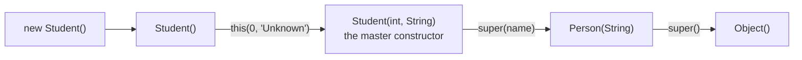

<a id="readme-top"></a>

# Constructor

> **A constructor is a special block of code that runs once when an object is created — it builds the object and puts it into a valid starting state.**


| Quick Facts | Details |
|---|---|
| **Category** | OOP building block |
| **Prerequisites** | Class and object, methods, `this` |
| **Key keywords** | `new` · `this(...)` · `super(...)` · `private` · `final` |
| **Works with** | Java 8 and above |

## 🔰 Table of Contents

| Level | Sections |
|---|---|
| 🟢 **Level 1 — Understand** | [Definition](#-definition) · [Key Points](#-key-points) · [How It Works](#-how-it-works) |
| 🟡 **Level 2 — Use It** | [Syntax & Variations](#-syntax--variations) · [When to Use](#-when-to-use) · [Example](#-example) · [Code](#-code) |
| 🔴 **Level 3 — Wrap-up** | [Common Mistakes](#-common-mistakes) · [Interview Questions](#-interview-questions) · [Summary](#-summary) |

## 📍 Definition

**Constructor** is a special block of code in a class that is **called automatically when an object is created with `new`**. It has the **same name as the class**, **no return type**, and its job is to **initialize the new object**.

| Term | Meaning | Example with `Student(int id, String name)` |
|---|---|---|
| **Constructor** | Special code that builds and initializes an object | `Student(int id, String name) { ... }` |
| **Default constructor** | The no-argument constructor the compiler adds when you write none | `Student() { super(); }` (invisible) |
| **No-arg constructor** | A constructor without parameters that you write yourself | `Student() { this(0, "Unknown"); }` |
| **Parameterized constructor** | Takes values to initialize the object | `Student(int id, String name)` |
| **Copy constructor** | Builds a new object from an existing one | `Student(Student other)` |
| **Constructor overloading** | Several constructors with different parameter lists in one class | all of the above together |
| **`this(...)` / `super(...)`** | Calls another constructor of the same class / of the parent | `this(0, "Unknown")` · `super(name)` |

**Three rules of a constructor**

| Rule | Detail | Example |
|---|---|---|
| **Same name** | exactly the class name, same capitalization | `Student(...)` inside `class Student` |
| **No return type** | not even `void` | `Student(int id)` — not `void Student(int id)` |
| **Called by `new`** | you never call it like a normal method | `new Student(1, "Asha")` |

> [!TIP]
> **Real-life analogy:** the first-time setup wizard of a new phone. It runs once, when the phone is switched on for the first time, and it sets the language, the account and the basic settings — so the phone is ready to use the moment you start. A constructor does the same for every new object.

## 📌 Key Points

1. **Same name as the class, no return type** — adding `void` turns it into an ordinary method (a classic trap).
2. **Runs automatically, once per object** — every `new` runs exactly one constructor of that class.
3. **The default constructor is conditional** — the compiler adds a no-argument constructor **only if you write no constructor at all**; write any one and it disappears.
4. **Constructors can be overloaded** — a class can have many, as long as the parameter lists differ.
5. **`this(...)` and `super(...)`** — `this(...)` calls another constructor of the same class, `super(...)` calls a parent constructor; each must be the **first statement**, and you cannot use both in one constructor. If you write neither, the compiler inserts `super()`.
6. **Not inherited, not overridden** — every class defines its own constructors; they cannot be `static`, `final` or `abstract`.
7. **Access modifiers apply** — a `private` constructor stops outside code from using `new` (Singleton, utility classes).
8. **Fixed initialization order** — parent constructor first, then the field initializers and `{ }` blocks, then the rest of the constructor body.

> [!IMPORTANT]
> **A constructor with a return type is not a constructor** — `void Student() { ... }` compiles, but it is just a method that nobody calls, and `new Student()` quietly uses the default constructor instead, so your initialization never runs.

## ⚙️ How It Works

What `new Student(1, "Asha")` does inside the constructor call, when `Student extends Person`:

```text
Student s = new Student(1, "Asha");

Step 0  class init     first use only: static fields and static { } blocks run — once per class
Step 1  allocate       one block on the heap, every field gets its default value
Step 2  constructor    Student(int, String) is called — its first line is super(name)
Step 3  parent first   Person's instance block and constructor run to the end
Step 4  initializers   Student's field initializers and { } blocks run, in the order they are written
Step 5  body           the rest of Student(int, String) runs → this.id = 1, count++
Step 6  assign         the finished object's reference is stored in the variable s
```

### Constructor chaining with `this(...)`



Each constructor hands the work on and the chain ends at `Object()`. Then the bodies finish in reverse: `Object()` → `Person(String)` → `Student(int, String)` → back in `Student()`.

### What the compiler adds for you

| You write | The compiler adds |
|---|---|
| no constructor at all | a **default constructor** — `ClassName() { super(); }`, with the same access as the class |
| a constructor with no `this(...)` or `super(...)` on its first line | `super();` as its first statement |

> [!NOTE]
> The default constructor is why `new Student()` works in a class with no constructors, and why it stops working the moment you add `Student(int id)`. Constructors in an inheritance chain are also traced step by step in inheritance.md, and `this` is explained in class-and-object.md.

## 🔄 Syntax & Variations

### Declaring a constructor

```java
class Student {
    private int id;
    private String name;

    Student(int id, String name) {          // same name as the class, no return type
        this.id = id;
        this.name = name;
    }
}
```

| Rule | Detail |
|---|---|
| **Name** | exactly the class name (case-sensitive) |
| **Return type** | none — not even `void` |
| **Access** | `public`, `protected`, default (no modifier) or `private` |
| **Not allowed** | `static`, `final`, `abstract`, `synchronized` |
| **Parameters** | any number — overloading is allowed |
| **`return`** | a bare `return;` is allowed, a value is not |
| **Exceptions** | may declare `throws` |
| **Inheritance** | not inherited and cannot be overridden |

### Types of constructors

| Type | Example | Use when |
|---|---|---|
| **Default** (compiler-provided) | nothing written | you need no special setup — and you wrote no other constructor |
| **No-arg** | `Student() { this(0, "Unknown"); }` | objects with sensible defaults, or frameworks that create objects through reflection |
| **Parameterized** | `Student(int id, String name)` | you know the values when the object is created |
| **Copy** | `Student(Student other) { this(other.id, other.name); }` | you need an independent duplicate — Java has no automatic copy constructor |

### Overloading and chaining

```java
class Student {
    private int id;
    private String name;

    Student() {                             // no-arg: delegate to the full constructor
        this(0, "Unknown");
    }

    Student(String name) {                  // one parameter: delegate again
        this(0, name);
    }

    Student(int id, String name) {          // the "master" constructor: the only one that assigns the fields
        this.id = id;
        this.name = name;
    }
}
```

Let one constructor do the real work and let the others delegate to it with `this(...)` — the initialization code then exists in one place only.

### `this(...)` and `super(...)`

| Call | Meaning | Rules |
|---|---|---|
| **`this(args)`** | run another constructor of the same class | must be the first statement; calls must not form a loop (compile error "recursive constructor invocation") |
| **`super(args)`** | run a parent constructor | must be the first statement; Java inserts `super()` if you write neither call |
| **Both together** | not allowed | each one must be the first statement, so only one fits |
| **Outside constructors** | not allowed | they work only on the first line of a constructor |

### Access modifiers on constructors

| Modifier | Who can use `new` | Typical use |
|---|---|---|
| `public` | everyone | normal classes |
| `protected` | the same package; subclasses reach it through `super(...)` | classes designed to be extended |
| *(none)* — package-private | the same package | classes used only inside one package |
| `private` | only the class itself | Singleton, utility classes, static factory methods, builders |

### Initialization order

| Order | What runs | Happens |
|---|---|---|
| 0 | `static` fields and `static { }` blocks | once, when the class is first used |
| 1 | the parent constructor chain (`super(...)`) | for every `new`, from the top down |
| 2 | this class's field initializers and `{ }` instance blocks | in the order they are written in the class |
| 3 | the rest of the constructor body | last |

## 🎯 When to Use

| Need | Use | Benefit | Watch out |
|---|---|---|---|
| Every object must start in a valid state | **parameterized constructor with validation** | an invalid object can never exist | the constructor may throw an exception |
| Several ways to create the same object | **overloaded constructors + `this(...)`** | flexible creation without duplicated code | too many overloads confuse callers — consider a builder |
| An independent duplicate of an object | **copy constructor** | explicit control over what is copied | mutable fields (arrays, lists) must be copied too |
| Outside code must not create objects (Singleton, utility class) | **`private` constructor** | the class controls how many objects exist | the class cannot be extended — no accessible constructor |
| An immutable object | **constructor sets `final` fields, no setters** | simple and thread-safe | every value is needed up front |
| The parent part of a child must be set up | **`super(args)`** | the parent's fields are initialized correctly | it must be the first line |
| Many optional values | **builder** instead of a giant constructor | readable creation code | an extra class to write |

## 🎲 Example

**Problem:** build a `Student` (which extends `Person`) that can be created with no information, with only a name, or with an id and a name; refuses a negative id; can be copied; and shows the exact order in which constructors and initializers run.

**Dry run — what each statement does**

| Step | Statement | What happens | Result |
|---|---|---|---|
| 1 | `new Student(1, "Asha")` | first use of the class: the static block runs; then `Person`'s block and constructor; then `Student`'s block; then the body | `static block` appears once |
| 2 | `new Student()` | `Student()` calls `this(0, "Unknown")`; the master constructor does all the work; then `Student()`'s own body runs | `id=0, name=Unknown` |
| 3 | `new Student("Ravi")` | delegates through `this(0, name)` to the master constructor | `id=0, name=Ravi` |
| 4 | `new Student(s1)` | the copy constructor passes `s1`'s values on to the master constructor | a new object with the same data, `copy == s1` is `false` |
| 5 | `new Student(-1, "Bad")` | the parent part is built, then the id check fails | `IllegalArgumentException`, object never completed |
| 6 | `new Logger()` | the constructor is `private` | compile error — only `Logger.getInstance()` works |

✅ One master constructor does the real work, the others delegate to it, and the parent part of an object is always built first.

## 💻 Code

> Save it as `ConstructorDemo.java`, then run `javac ConstructorDemo.java` followed by `java ConstructorDemo`.

```java
// Helper: prints "label : value" in neat columns
class Log {
    static void show(String label, Object value) {
        System.out.printf("%-26s: %s%n", label, value);
    }
}

class Person {
    protected String name;

    {                                                   // instance initializer block: runs before the constructor body
        Log.show("Person instance block", "runs");
    }

    Person(String name) {
        this.name = name;
        Log.show("Person constructor", name);
    }
}

class Student extends Person {
    private static int count = 0;                       // static: one copy, set up once when the class loads
    private final int id;
    private int marks = 50;                             // field initializer: runs before the constructor body

    static {                                            // static block: runs ONCE, when the class is first used
        Log.show("Student static block", "runs once");
    }

    {                                                   // instance initializer block
        Log.show("Student instance block", "marks = " + marks);
    }

    Student() {                                         // no-arg: delegate to the full constructor
        this(0, "Unknown");
        Log.show("Student() body", "runs last");
    }

    Student(String name) {                              // one parameter: delegate again
        this(0, name);
    }

    Student(Student other) {                            // copy constructor
        this(other.id, other.name);
        this.marks = other.marks;
    }

    Student(int id, String name) {                      // the "master" constructor: does the real work
        super(name);                                    // the parent part is built first
        if (id < 0) {
            throw new IllegalArgumentException("id cannot be negative");
        }
        this.id = id;
        count++;
        Log.show("Student constructor", name);
    }

    String describe() {
        return "id=" + id + ", name=" + name + ", marks=" + marks;
    }

    static int getCount() {
        return count;
    }
}

class Logger {
    private static final Logger INSTANCE = new Logger();

    private Logger() { }                                // private: nobody outside can call new Logger()

    static Logger getInstance() {
        return INSTANCE;
    }
}

class Trap {
    boolean initialized = false;

    void Trap() {                                       // BUG: a return type makes this an ordinary method
        initialized = true;
    }
}

public class ConstructorDemo {

    public static void main(String[] args) {

        // ----- Order: static block, parent, initializers, constructor body -----
        System.out.println("--- new Student(1, \"Asha\")");
        Student s1 = new Student(1, "Asha");

        // ----- Overloading + chaining with this(...) -----
        System.out.println("--- new Student()");
        Student s2 = new Student();
        System.out.println("--- new Student(\"Ravi\")");
        Student s3 = new Student("Ravi");

        // ----- Copy constructor -----
        System.out.println("--- new Student(s1)");
        Student copy = new Student(s1);
        Log.show("s1", s1.describe());
        Log.show("s2", s2.describe());
        Log.show("s3", s3.describe());
        Log.show("copy", copy.describe());
        Log.show("copy == s1", copy == s1);

        // ----- Validation: a constructor can refuse to build an invalid object -----
        System.out.println("--- new Student(-1, \"Bad\")");
        try {
            new Student(-1, "Bad");
        } catch (IllegalArgumentException e) {
            Log.show("Caught exception", e.getMessage());
        }
        Log.show("Students created", Student.getCount());       // 4 -- the failed one does not count

        // ----- private constructor: only the class itself can create the object -----
        // new Logger();                                // compile error: Logger() has private access in Logger
        Log.show("Same Logger object?", Logger.getInstance() == Logger.getInstance());

        // ----- A "constructor" with a return type is just a method -----
        Trap t = new Trap();                            // the compiler-provided default constructor ran
        Log.show("Trap initialized?", t.initialized);
    }
}
```

**Output**

```text
--- new Student(1, "Asha")
Student static block      : runs once
Person instance block     : runs
Person constructor        : Asha
Student instance block    : marks = 50
Student constructor       : Asha
--- new Student()
Person instance block     : runs
Person constructor        : Unknown
Student instance block    : marks = 50
Student constructor       : Unknown
Student() body            : runs last
--- new Student("Ravi")
Person instance block     : runs
Person constructor        : Ravi
Student instance block    : marks = 50
Student constructor       : Ravi
--- new Student(s1)
Person instance block     : runs
Person constructor        : Asha
Student instance block    : marks = 50
Student constructor       : Asha
s1                        : id=1, name=Asha, marks=50
s2                        : id=0, name=Unknown, marks=50
s3                        : id=0, name=Ravi, marks=50
copy                      : id=1, name=Asha, marks=50
copy == s1                : false
--- new Student(-1, "Bad")
Person instance block     : runs
Person constructor        : Bad
Student instance block    : marks = 50
Caught exception          : id cannot be negative
Students created          : 4
Same Logger object?       : true
Trap initialized?         : false
```

> [!NOTE]
> Look at the output for `new Student()`: the initializer blocks run only **once** even though two `Student` constructors are involved — they run in the constructor that calls `super(...)`, not in the ones that delegate with `this(...)`. In the failed `new Student(-1, "Bad")` the parent part was already built before the check threw the exception.

## 🚨 Common Mistakes

| # | Mistake | Why it is a problem | Fix |
|---|---|---|---|
| 1 | `void Student() { ... }` | the return type makes it an ordinary method; `new Student()` uses the default constructor and the initialization never runs | remove the return type |
| 2 | writing `Student(int id)` and then calling `new Student()` | the default constructor disappears → "constructor Student in class Student cannot be applied to given types" | write the no-arg constructor yourself |
| 3 | `System.out.println(...)` before `this(1);` (or `super(...)`) | the call must be the first statement → "call to this must be first statement in constructor" | move it to the first line; do any checks afterwards |
| 4 | `A() { this(1); }` and `A(int n) { this(); }` | the calls go round in a circle → "recursive constructor invocation" | one constructor must finish the work without `this(...)` |
| 5 | repeating the same field assignments in every overloaded constructor | the copies drift apart as the code changes | one master constructor, the others delegate with `this(...)` |
| 6 | a parent constructor that calls an overridable method | the child's override runs before the child's own fields are initialized — it sees `null` / `0` | call only `private` or `final` methods from a constructor |

## 🎤 Interview Questions

<details>
<summary><b>1. What is a constructor and how is it different from a method?</b></summary>

| Feature | Constructor | Method |
|---|---|---|
| Name | same as the class | any valid name |
| Return type | none — not even `void` | required |
| Called | automatically by `new` | explicitly by your code |
| Purpose | initialize a new object | perform an action |
| Inherited | no | yes |
| Can be `static`, `final`, `abstract` | no | yes |
| Count | runs once per object | any number of times |

</details>

<details>
<summary><b>2. What is a default constructor and when does the compiler add it?</b></summary>

It is a no-argument constructor that the compiler adds **only when a class has no constructor at all**. It has the same access as the class, calls `super()` and leaves the fields at their default values. As soon as you write any constructor yourself, the default one is no longer generated.

</details>

<details>
<summary><b>3. What is constructor chaining? What is the difference between <code>this()</code> and <code>super()</code>?</b></summary>

Constructor chaining is one constructor calling another so that the initialization code is written once.

| Feature | `this(...)` | `super(...)` |
|---|---|---|
| Calls | another constructor of the **same** class | a constructor of the **parent** class |
| Purpose | reuse code between overloaded constructors | build the parent part of the object |
| Position | first statement | first statement |
| Together | cannot be used in the same constructor | cannot be used in the same constructor |
| If omitted | nothing is added | `super()` is added automatically |

</details>

<details>
<summary><b>4. Can a constructor be private, final, static, abstract, inherited or overridden?</b></summary>

| Idea | Allowed? | Why |
|---|---|---|
| `private` | ✅ | only the class itself can create objects — used for Singleton, utility classes and factory methods |
| `public`, `protected`, default | ✅ | normal access control |
| `static` | ❌ | a constructor works on the object being created, not on the class |
| `final` | ❌ | meaningless — constructors cannot be overridden anyway |
| `abstract` | ❌ | a constructor must have a body |
| inherited / overridden | ❌ | each class has its own; a child calls the parent's with `super(...)` |
| returning a value | ❌ | it has no return type (a bare `return;` is allowed) |

</details>

<details>
<summary><b>5. In what order does Java initialize an object?</b></summary>

First, once per class, the `static` fields and `static` blocks. Then, for every `new`: the parent constructor chain from the top down, this class's field initializers and `{ }` instance blocks in the order they are written, and finally the rest of the constructor body. That is why a parent cannot see the child's initialized fields while the parent's constructor is running.

</details>

<details>
<summary><b>6. What is a copy constructor? Does Java provide one?</b></summary>

A copy constructor takes an object of its own class and builds a new, independent object with the same data. Java does **not** generate one — you write it yourself (or use `clone()`):

```java
Student(Student other) {
    this.id = other.id;
    this.name = other.name;       // String is immutable, so sharing it is safe
    // mutable fields (arrays, lists) must be copied as well
}
```

</details>

## 🏁 Summary

- A **constructor** has the class's name and no return type, and runs automatically once for every `new`.
- The compiler adds a **default constructor** only when you write none; any constructor you write removes it.
- Constructors can be **overloaded**, and `this(...)` lets one delegate to another so the real work lives in one place.
- `super(...)` builds the parent part first; it and `this(...)` must be the **first statement**, and Java inserts `super()` if you write neither.
- Order of events: **static** setup (once) → **parent constructor** → **field initializers and `{ }` blocks** → **constructor body**.
- A `private` constructor stops outside creation (Singleton, utility classes); constructors are never inherited, `static`, `final` or `abstract`.

### 📝 Cheat Sheet

| Question | Answer |
|---|---|
| Declare one | `ClassName(params) { ... }` — same name, no return type |
| Run it | `new ClassName(args)` — automatically, once per object |
| Default constructor | added by the compiler only when you write **no** constructor |
| Call another constructor of the same class | `this(args);` — first line |
| Call the parent constructor | `super(args);` — first line (`super()` is added if omitted) |
| Copy an object | a copy constructor — `Student(Student other)` |
| Block outside creation | a `private` constructor (Singleton, utility class) |
| Order | parent constructor → field initializers and `{ }` blocks → constructor body |

> [!IMPORTANT]
> **Build objects valid, in one place:** let one constructor do the real work and the validation, and let every other constructor delegate to it with `this(...)`.
