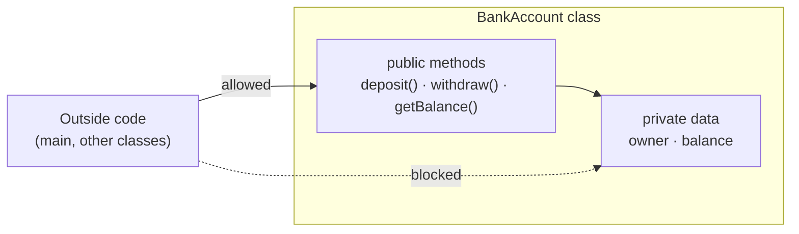

<a id="readme-top"></a>

# Encapsulation

> **Encapsulation wraps data and the code that works on it into one class and hides the data behind a public interface — so an object stays in control of its own state.**


| Quick Facts | Details |
|---|---|
| **Category** | OOP pillar |
| **Prerequisites** | Class and object, methods, access modifiers |
| **Key keywords** | `private` · `public` · `protected` · `final` · getters / setters |
| **Works with** | Java 8 and above |

## 🔰 Table of Contents

| Level | Sections |
|---|---|
| 🟢 **Level 1 — Understand** | [Definition](#-definition) · [Key Points](#-key-points) · [How It Works](#-how-it-works) |
| 🟡 **Level 2 — Use It** | [Syntax & Variations](#-syntax--variations) · [When to Use](#-when-to-use) · [Example](#-example) · [Code](#-code) |
| 🔴 **Level 3 — Wrap-up** | [Common Mistakes](#-common-mistakes) · [Interview Questions](#-interview-questions) · [Summary](#-summary) |

## 📍 Definition

**Encapsulation** is an OOP principle that **bundles data (fields) and the methods that work on it into one unit — a class** — and **restricts direct access** to that data. In Java this usually means making fields `private` and exposing controlled access through `public` methods.

It has two parts: **bundling** (data and behavior live together) and **data hiding** (outside code cannot touch the data directly).

| Term | Meaning | Example with `private double balance;` |
|---|---|---|
| **Encapsulation** | Bundling data with methods and hiding the data | the whole `BankAccount` class |
| **Data hiding** | Keeping fields invisible to outside code | `private double balance;` |
| **Access modifier** | Keyword that decides who can see a member | `private`, `public` |
| **Getter** | Public method that reads a field | `getBalance()` |
| **Setter** | Public method that changes a field, usually after a check | `setAge(int age)` |
| **Immutable class** | A class whose objects cannot change after creation | `String`, `Integer` |

**How to encapsulate a class — 3 steps**

| Step | What you do | Example |
|---|---|---|
| **1. Hide** | declare the fields `private` | `private double balance;` |
| **2. Expose** | add `public` methods for the things outsiders really need | `deposit()`, `withdraw()`, `getBalance()` |
| **3. Protect** | put the rules inside those methods | `if (amount > balance) return false;` |

> [!TIP]
> **Real-life analogy:** an ATM. You use the buttons and the screen (the public methods), while the cash vault (the private data) stays locked inside. The ATM checks your PIN and your balance (validation) before it changes anything — you can never reach in and edit the balance yourself.

## 📌 Key Points

1. **Two parts** — bundle data with the methods that use it, and hide the data from outside code.
2. **Fields `private`, methods `public`** — the standard recipe in Java.
3. **Every change goes through a method** — so the class can validate it and keep the object in a valid state.
4. **Control is the goal, not getters and setters** — leave out a setter and the field becomes read-only; use `final` and it can never change.
5. **Internals can change freely** — you can change how data is stored (say, rupees to paise) without breaking any code that uses the class.
6. **`private` is per class, not per object** — a method can read the private fields of another object of the same class.
7. **Mutable fields need care** — a getter that returns an array or list hands out the real internals; return a copy instead.
8. **The compiler enforces it** — touching a `private` member from outside is a compile-time error, not a run-time surprise.

> [!IMPORTANT]
> **Getters and setters alone are not encapsulation** — a `private` field with a plain `setX` that accepts any value is no safer than a `public` field. The protection comes from validation and from exposing only what outsiders really need.

## ⚙️ How It Works

Outside code reaches the data only through the public methods — and each method decides what is allowed:



### Direct access — stopped by the compiler

```text
acc.balance = -500;           // outside code, balance is private

Step 1  access check   balance is private → the compiler stops here
        error: balance has private access in BankAccount           (the program never runs)
```

### Access through a method — controlled by the class

```text
acc.withdraw(2000);           // outside code, the balance is 1500

Step 1  access check   withdraw() is public → the call is allowed
Step 2  validation     inside the method: amount > 0 and amount <= balance ?     2000 > 1500 → fails
Step 3  decision       the method refuses and returns false                      balance stays 1500
Step 4  result         the object was never left in an invalid state
```

> [!NOTE]
> Encapsulation hides **data** so it cannot be damaged; abstraction hides **complexity** so it is easier to use — see abstraction.md. Who can access what in a class hierarchy is covered in the access table of inheritance.md.

## 🔄 Syntax & Variations

### Encapsulating a class

```java
public class Person {
    private String name;                    // 1. hide the data
    private int age;

    public String getName() {               // 2. controlled read
        return name;
    }

    public void setAge(int age) {           // 3. controlled write, with a rule
        if (age < 0 || age > 120) {
            throw new IllegalArgumentException("Invalid age: " + age);
        }
        this.age = age;
    }
}
```

### Access modifiers

| Modifier | Visible to | Typical use |
|---|---|---|
| `private` | the same class only | fields and internal helper methods |
| *(none)* — package-private | the same package | helpers shared inside one package |
| `protected` | the same package + subclasses | members meant for child classes |
| `public` | everyone | the class's public interface (methods) |

### Getters and setters

| Style | Example | Use when |
|---|---|---|
| **Getter** | `public String getName()` | outsiders need to read the value (`boolean` getters are named `isActive()`) |
| **Setter with validation** | `public void setAge(int age)` | outsiders may change the value, but only to valid values |
| **Getter only** | `getId()` with no setter | the value must never change after creation |
| **Behavior method** | `deposit(amount)`, `withdraw(amount)` | the change is an action with rules — better than a raw setter |

### Kinds of encapsulated classes

| Kind | How | Example |
|---|---|---|
| **Read-write** | getter + validating setter | `getAge()` / `setAge(int)` |
| **Read-only** | getter only, field set in the constructor | `getOwner()` |
| **Write-only** | setter only (rare) | `setPassword(String)` |
| **Immutable** | `final` class, `private final` fields, no setters | `String`, `Integer`, `LocalDate` |

### Protecting mutable fields

| Situation | Safe approach |
|---|---|
| Constructor receives an array | copy it in: `this.scores = scores.clone();` |
| Getter returns an array | copy it out: `return scores.clone();` |
| Getter returns a `List` | `return Collections.unmodifiableList(list);` or a new `ArrayList<>(list)` |
| Field is an immutable type (`String`, `Integer`) | safe to return as it is |

## 🎯 When to Use

| Need | Use | Benefit | Watch out |
|---|---|---|---|
| A field has rules (balance ≥ 0, age in range) | **`private` field + validating method** | an invalid state becomes impossible | every rule needs a method |
| A value must never change after creation | **`private final` field, getter only** | read-only and safe to share | a "change" means creating a new object |
| An action with rules (withdraw, transfer) | **behavior method** instead of a setter | callers say *what* to do, the class decides *how* | design the public methods with care |
| Internals may change later (storage format) | **hide them behind methods** | refactor without breaking callers | a getter that returns the internals defeats it |
| A field is an array, list or `Date` | **defensive copies** in and out | callers cannot modify your internals | copying costs a little time and memory |
| Helper logic used only inside the class | **`private` method** | a smaller public surface | cannot be reused outside the class |

## 🎲 Example

**Problem:** protect a bank account so its balance changes only through `deposit` and `withdraw`, can never go negative, and the owner can never be changed.

**Dry run — what each statement does**

| Step | Statement | What the class does | Result |
|---|---|---|---|
| 1 | `new BankAccount("Asha", 1000)` | the constructor checks that the opening balance is not negative | `balance` = `1000` |
| 2 | `acc.balance = -500;` | `balance` is private → compile error, the line can never run | blocked |
| 3 | `acc.deposit(500)` | `500 > 0` → added | `balance` = `1500` |
| 4 | `acc.withdraw(2000)` | `2000 > 1500` → refused | returns `false`, `balance` still `1500` |
| 5 | `acc.withdraw(300)` | valid → subtracted | `balance` = `1200` |
| 6 | `acc.deposit(-50)` | amount is not positive → `IllegalArgumentException` | `balance` unchanged at `1200` |

✅ The account protects its own balance: the only way in is through methods, and every method checks the rules first.

## 💻 Code

> Save it as `EncapsulationDemo.java`, then run `javac EncapsulationDemo.java` followed by `java EncapsulationDemo`.

```java
import java.util.Arrays;

// 1. NOT encapsulated .... a public field: anyone can break the object
class BadAccount {
    public double balance;
}

// 2. Encapsulated ........ private data + public methods that enforce the rules
class BankAccount {
    private final String owner;                         // final + no setter -> read-only
    private double balance;                             // private -> only this class can touch it

    BankAccount(String owner, double openingBalance) {
        if (openingBalance < 0) {
            throw new IllegalArgumentException("Opening balance cannot be negative");
        }
        this.owner = owner;
        this.balance = openingBalance;
    }

    public void deposit(double amount) {
        if (amount <= 0) {
            throw new IllegalArgumentException("Deposit must be positive");
        }
        balance += amount;
    }

    public boolean withdraw(double amount) {
        if (amount <= 0 || amount > balance) {
            return false;                               // rejected: the balance can never go negative
        }
        balance -= amount;
        return true;
    }

    public double getBalance() { return balance; }      // getter: read access
    public String getOwner()   { return owner; }        // getter only: nobody can change the owner
}

// 3. Setter with validation + defensive copies
class Student {
    private final String name;                          // read-only
    private int age;                                    // read-write, but only valid values get in
    private final int[] scores;                         // an array is mutable -> copy it IN and OUT

    Student(String name, int age, int[] scores) {
        this.name = name;
        this.age = checkAge(age);
        this.scores = scores.clone();                   // copy IN: the caller's array can't change ours
    }

    private static int checkAge(int age) {              // private helper: an internal detail
        if (age < 0 || age > 120) {
            throw new IllegalArgumentException("Invalid age: " + age);
        }
        return age;
    }

    public String getName() { return name; }
    public int getAge()     { return age; }

    public void setAge(int age) {
        this.age = checkAge(age);                       // the rule lives in ONE place
    }

    public int[] getScores() {
        return scores.clone();                          // copy OUT: the caller gets a copy, not our array
    }

    public boolean isOlderThan(Student other) {
        return this.age > other.age;                    // private is per CLASS: we may read other.age
    }
}

// 4. A leak: private field, but the getter hands out the real array
class LeakyBox {
    private final int[] data = {1, 2, 3};

    public int[] getData() {
        return data;                                    // BUG: the caller now holds our internal array
    }
}

// 5. Immutable class: nothing can change after construction
final class Temperature {                               // final: nobody can extend it and break the rules
    private final double celsius;                       // final: set once, never changes

    Temperature(double celsius) {
        this.celsius = celsius;
    }

    public double getCelsius() { return celsius; }

    public Temperature warmedBy(double degrees) {       // a "change" returns a NEW object
        return new Temperature(celsius + degrees);
    }
}

public class EncapsulationDemo {

    // Helper: prints "label : value" in neat columns
    static void show(String label, Object value) {
        System.out.printf("%-26s: %s%n", label, value);
    }

    public static void main(String[] args) {

        // ----- Without encapsulation: anyone can break the object -----
        BadAccount bad = new BadAccount();
        bad.balance = -500;                             // nothing stops this
        show("BadAccount balance", bad.balance);

        // ----- With encapsulation: the object protects itself -----
        BankAccount acc = new BankAccount("Asha", 1000);
        // acc.balance = -500;                          // compile error: balance has private access
        acc.deposit(500);
        show("After deposit 500", acc.getBalance());
        show("Withdraw 2000", acc.withdraw(2000) ? "done" : "rejected");
        show("Withdraw 300", acc.withdraw(300) ? "done" : "rejected");
        show("Final balance", acc.getBalance());
        show("Owner (read-only)", acc.getOwner());
        try {
            acc.deposit(-50);
        } catch (IllegalArgumentException e) {
            show("Caught exception", e.getMessage());
        }

        // ----- Setter with validation -----
        int[] marks = {80, 90, 70};
        Student s = new Student("Asha", 20, marks);
        s.setAge(21);
        show("Age after setAge(21)", s.getAge());
        try {
            s.setAge(-5);
        } catch (IllegalArgumentException e) {
            show("setAge(-5)", e.getMessage());
        }
        show("Age is still", s.getAge());

        // ----- private is per class, not per object -----
        Student kid = new Student("Ravi", 15, new int[]{60});
        show("Asha older than Ravi?", s.isOlderThan(kid));

        // ----- Defensive copies -----
        marks[0] = 0;                                   // tamper with the ORIGINAL array
        show("Scores (input tampered)", Arrays.toString(s.getScores()));
        s.getScores()[1] = 0;                           // tamper with the returned COPY
        show("Scores (copy tampered)", Arrays.toString(s.getScores()));

        LeakyBox leaky = new LeakyBox();
        leaky.getData()[0] = 99;                        // the getter handed out the REAL array
        show("LeakyBox data", Arrays.toString(leaky.getData()));

        // ----- Immutable object -----
        Temperature t1 = new Temperature(20);
        Temperature t2 = t1.warmedBy(5);
        show("t1 / t2", t1.getCelsius() + " / " + t2.getCelsius());
    }
}
```

**Output**

```text
BadAccount balance        : -500.0
After deposit 500         : 1500.0
Withdraw 2000             : rejected
Withdraw 300              : done
Final balance             : 1200.0
Owner (read-only)         : Asha
Caught exception          : Deposit must be positive
Age after setAge(21)      : 21
setAge(-5)                : Invalid age: -5
Age is still              : 21
Asha older than Ravi?     : true
Scores (input tampered)   : [80, 90, 70]
Scores (copy tampered)    : [80, 90, 70]
LeakyBox data             : [99, 2, 3]
t1 / t2                   : 20.0 / 25.0
```

> [!NOTE]
> The `LeakyBox` line is the warning: its field is `private`, yet the data changed from `[1, 2, 3]` to `[99, 2, 3]` because the getter returned the real array. `private` protects the field name, not the object it points to.

## 🚨 Common Mistakes

| # | Mistake | Why it is a problem | Fix |
|---|---|---|---|
| 1 | `public double balance;` | any code can set an invalid value (`-500`), and the class cannot stop it | make the field `private` and expose methods |
| 2 | a `private` field with a setter that accepts anything | no real protection — it is the same as a public field | validate inside the setter, or replace it with a behavior method |
| 3 | `return scores;` (or a `List`) from a getter | the caller receives the real internals and can modify them | return a copy: `scores.clone()`, `Collections.unmodifiableList(list)` |
| 4 | `this.scores = scores;` in the constructor | the caller still holds the same array and can change it later | copy it in: `this.scores = scores.clone();` |
| 5 | a setter for a field that must never change (`setId`) | anyone can change the identity of the object | make the field `final` and provide only a getter |
| 6 | changing `private` to `public` just to remove a compile error | throws away the protection to fix a symptom | add the getter or method the caller really needs |

## 🎤 Interview Questions

<details>
<summary><b>1. What is encapsulation and how do you achieve it in Java?</b></summary>

Encapsulation is bundling data and the methods that work on it into one class and hiding the data from outside code. In Java you achieve it by declaring fields `private`, providing `public` methods (getters, setters or behavior methods) to access them, and putting validation rules inside those methods.

</details>

<details>
<summary><b>2. What is the difference between encapsulation and abstraction?</b></summary>

| Feature | Encapsulation | Abstraction |
|---|---|---|
| Hides | the **data** | the **implementation complexity** |
| Purpose | protect the data and keep the object valid | make the class easy to use |
| Level | implementation (inside the class) | design (what the user sees) |
| Achieved with | `private` fields + public methods | `abstract` classes and interfaces |
| Example | private `balance` with `withdraw()` | the `List` interface hiding `ArrayList` and `LinkedList` |

</details>

<details>
<summary><b>3. Why make fields private if you provide public getters and setters anyway?</b></summary>

Because a method gives you **control** and a public field does not. A setter can validate, a missing setter makes the field read-only, a getter can return a copy, and the internal representation can change without breaking callers. A public field offers none of that.

</details>

<details>
<summary><b>4. How do you create an immutable class?</b></summary>

| Rule | Why |
|---|---|
| declare the class `final` | so no subclass can add mutability |
| make all fields `private final` | they can be set only once |
| set everything in the constructor | there is no half-built state |
| provide no setters | nothing can change after creation |
| copy mutable fields in and out | callers cannot reach the internals |

`String`, `Integer` and `LocalDate` are immutable. Immutable objects are safe to share and thread-safe.

</details>

<details>
<summary><b>5. Can encapsulation be broken?</b></summary>

Yes. A getter that returns a mutable object leaks the internals, and a constructor that stores the caller's array or list lets the caller change it later. **Reflection** (`setAccessible(true)`) can also bypass `private`, so `private` is a design tool that prevents accidents — not a security boundary.

</details>

<details>
<summary><b>6. Is <code>private</code> per class or per object?</b></summary>

Per **class**. Code inside the class can access the private fields of **any** object of that class, not only `this`. For example, `isOlderThan(Student other)` can read `other.age` directly even though `age` is private.

</details>

## 🏁 Summary

- **Encapsulation** bundles data and methods into a class and hides the data behind a public interface.
- Make fields **`private`**, expose **`public`** methods, and put the **validation** inside them.
- The goal is **control**, not just getters and setters: no setter means read-only, `final` means it can never change.
- **Mutable fields** (arrays, lists) need defensive copies in and out, otherwise `private` does not really protect them.
- `private` is **per class**; access runs from `private` (narrowest) to `public` (widest).
- Benefits: protected data, freedom to change internals, easier maintenance and testing.

### 📝 Cheat Sheet

| Question | Answer |
|---|---|
| Hide a field | `private double balance;` |
| Read it | `public double getBalance() { return balance; }` |
| Change it safely | a method with a check — `deposit(amount)` or `setAge(age)` with validation |
| Read-only field | `private final` field + getter, no setter |
| Immutable class | `final` class + `private final` fields + no setters + defensive copies |
| Return a mutable field | `return scores.clone();` · `Collections.unmodifiableList(list)` |
| Access from narrowest to widest | `private` → *(none)* → `protected` → `public` |
| Helper used only inside the class | a `private` method |

> [!IMPORTANT]
> **Hide the data, expose the behavior:** make fields private, publish only the methods outsiders really need, and let the class enforce its own rules.
