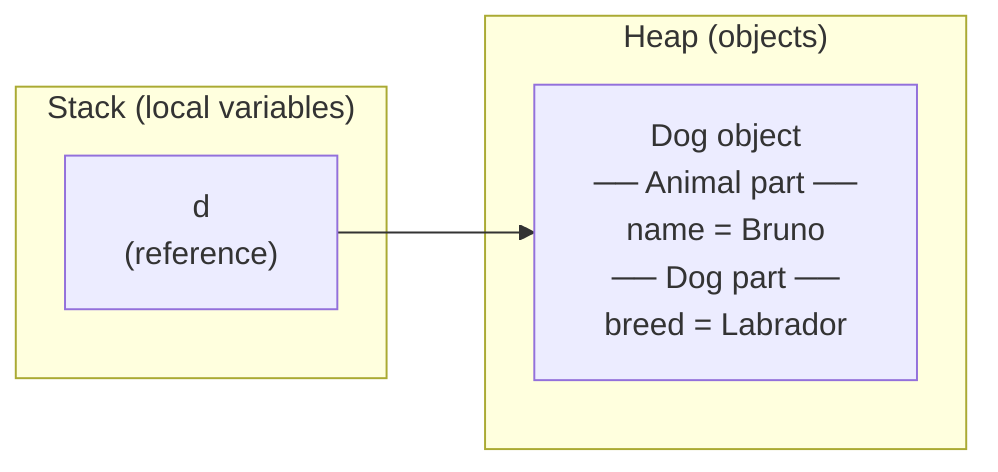
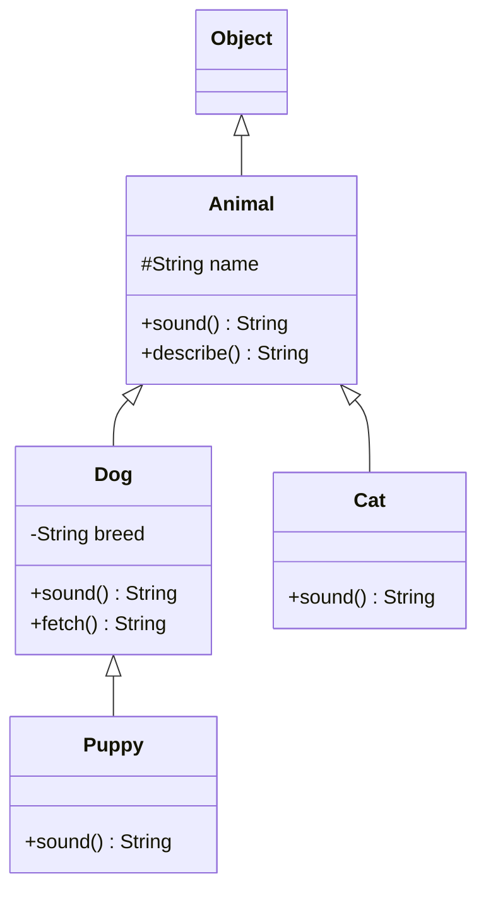

<a id="readme-top"></a>

# Inheritance

> **Inheritance lets a child class reuse and extend a parent class — write the common code once and every subclass gets it for free.**


| Quick Facts | Details |
|---|---|
| **Category** | OOP pillar |
| **Prerequisites** | Class and object, methods, access modifiers |
| **Key keywords** | `extends` · `super` · `@Override` · `protected` · `final` |
| **Works with** | Java 8 and above |

## 🔰 Table of Contents

| Level | Sections |
|---|---|
| 🟢 **Level 1 — Understand** | [Definition](#-definition) · [Key Points](#-key-points) · [How It Works](#-how-it-works) |
| 🟡 **Level 2 — Use It** | [Syntax & Variations](#-syntax--variations) · [When to Use](#-when-to-use) · [Example](#-example) · [Code](#-code) |
| 🔴 **Level 3 — Wrap-up** | [Common Mistakes](#-common-mistakes) · [Interview Questions](#-interview-questions) · [Summary](#-summary) |

## 📍 Definition

**Inheritance** is an OOP mechanism in which a **child class (subclass)** acquires the **fields and methods** of a **parent class (superclass)** using the `extends` keyword, so common code is written once and reused.

It models an **IS-A** relationship: a `Dog` **is an** `Animal`, so a `Dog` can do everything an `Animal` can do — and more.

| Term | Meaning | Example with `class Dog extends Animal` |
|---|---|---|
| **Superclass** | The class being inherited from (parent / base class) | `Animal` |
| **Subclass** | The class that inherits (child / derived class) | `Dog` |
| **`extends`** | Keyword that sets up the inheritance | `class Dog extends Animal` |
| **`super`** | Reaches the parent part of the current object | `super(name)` · `super.sound()` |
| **Overriding** | The child replaces an inherited method | `@Override String sound()` |
| **IS-A** | The relationship inheritance models | a `Dog` is an `Animal` |

**What a child receives from its parent**

| Member of the parent | Child gets it? | Note |
|---|---|---|
| `public` and `protected` fields / methods | ✅ yes | use them as if they were the child's own |
| package-private members (no modifier) | only in the same package | invisible to a child in another package |
| `private` fields / methods | ❌ not accessible | the data still exists inside the object — reach it through the parent's public or protected methods |
| Constructors | ❌ no | the child calls them with `super(...)` |
| `static` members | ✅ accessible | can be hidden by re-declaring, but not overridden |

> [!TIP]
> **Real-life analogy:** a `Vehicle` blueprint says every vehicle has wheels, an engine and can `start()`. `Car` and `Bike` take all of that for free and add what makes them special — a car adds a boot, a bike adds a kickstand — and a bike may even `start()` in its own way (overriding).

## 📌 Key Points

1. **`extends` creates the relationship** — `class Dog extends Animal` gives `Dog` the parent's accessible fields and methods.
2. **Use the IS-A test** — inherit only when "child IS-A parent" is true: a `Dog` is an `Animal`, but a `Car` is not an `Engine`.
3. **Single inheritance for classes** — a class extends exactly one class; a class with no `extends` silently extends `Object`.
4. **Chains are fine, cycles are not** — `Puppy → Dog → Animal` is allowed; extending two classes or inheriting in a circle is a compile error.
5. **Constructors are not inherited, but they chain** — a child constructor always runs a parent constructor first, through `super(...)` or an automatic `super()`.
6. **One object holds both parts** — a `Dog` object is one block on the heap containing the `Animal` fields and the `Dog` fields.
7. **Overriding replaces behavior** — the child redefines an inherited instance method, and the real object's version runs.
8. **`final` blocks inheritance** — a `final` class cannot be extended (like `String`) and a `final` method cannot be overridden.

> [!IMPORTANT]
> **IS-A, not just reuse** — if you only want to reuse some code, keep the other object as a field (composition, HAS-A). `Stack extends Vector` in the Java library is a well-known example of getting this wrong: a stack is not a vector, yet it exposes every `Vector` method.

## ⚙️ How It Works

What `Dog d = new Dog("Bruno", "Labrador");` does when `Dog` extends `Animal`:

```text
Dog d = new Dog("Bruno", "Labrador");          (Dog extends Animal, Animal extends Object)

Step 0  allocate       one block on the heap: Animal fields + Dog fields, all set to default values
Step 1  Dog(...)       called first — its first line is super(name)
Step 2  Animal(...)    called next — its first line is the automatic super() → Object()
Step 3  Object()       finishes first (the top of the chain)
Step 4  Animal body    runs next                                      name  = "Bruno"
Step 5  Dog body       finishes last                                  breed = "Labrador"
Step 6  assign         the reference is stored in the variable d
```

The result is **one** object that contains both parts:



### Calling a method — which version runs?

```text
Dog d = new Dog("Bruno", "Labrador");
d.describe();                // describe() is written only in Animal

Step 1  look in Dog      is describe() declared in Dog?                          no  → go up to the parent
Step 2  look in Animal   is describe() declared in Animal?                       yes → this code runs
Step 3  inside it        sound() is looked up again, from the REAL class (Dog)   Dog.sound() → "Woof"
```

> [!NOTE]
> The search always starts at the real class of the object and moves up the chain, so an overridden method in the child wins. Constructors are covered in depth in constructor.md and run-time method selection in polymorphism.md.

## 🔄 Syntax & Variations

### Declaring inheritance

```java
class Parent {
    // fields and methods that every child will get
}

class Child extends Parent {
    // extra fields and methods, plus overrides
}
```

| Rule | Detail |
|---|---|
| **Keyword** | `extends` — `class Dog extends Animal` |
| **One parent** | a class can extend only one class |
| **Default parent** | a class with no `extends` extends `Object` |
| **Constructors** | not inherited; the first line of a child constructor is `super(...)` — if you omit it, Java adds `super()`, which fails if the parent has no no-argument constructor |
| **Cannot be extended** | `final` classes such as `String` and the wrapper classes |
| **Child object type** | a child object can be stored in a parent variable: `Animal a = new Dog(...);` |

### Types of inheritance

| Type | Shape | In Java |
|---|---|---|
| **Single** | `Dog extends Animal` | ✅ |
| **Multilevel** | `Puppy extends Dog`, `Dog extends Animal` | ✅ |
| **Hierarchical** | `Dog extends Animal`, `Cat extends Animal` | ✅ |
| **Multiple** | `C extends A, B` | ❌ for classes — ✅ through interfaces (`implements A, B`) |
| **Hybrid** | a mix of the above | only when the "multiple" part uses interfaces |

The hierarchy used on this page:



### What a child can access

| Modifier | Same class | Same package | Child in another package | Everywhere |
|---|---|---|---|---|
| `private` | ✅ | ❌ | ❌ | ❌ |
| *(none)* — package-private | ✅ | ✅ | ❌ | ❌ |
| `protected` | ✅ | ✅ | ✅ (through inheritance) | ❌ |
| `public` | ✅ | ✅ | ✅ | ✅ |

### `super` — the parent part

| Use | Example | Meaning |
|---|---|---|
| Call a parent constructor | `super(name);` | must be the **first** line of the child constructor |
| Call the parent's version of a method | `super.sound()` | extend the parent's behavior instead of replacing it |
| Access a hidden parent field | `super.name` | when the child declares a field with the same name |

### Overriding rules

| Rule | Detail |
|---|---|
| **Signature** | same method name and same parameter list |
| **Return type** | the same, or a subtype of the parent's return type |
| **Access** | the same or wider — `protected` → `public` is fine, `public` → `protected` is an error |
| **Exceptions** | cannot throw new or broader checked exceptions than the parent's method |
| **Cannot be overridden** | `final` methods, `private` methods, constructors; `static` methods are hidden, not overridden |
| **`@Override`** | optional, but always write it — the compiler then checks that you really override |

## 🎯 When to Use

| Need | Use | Benefit | Watch out |
|---|---|---|---|
| Several classes share fields and methods and the IS-A test passes | **inheritance** (`extends`) | write the code once, reuse it everywhere | the child depends on the parent's internals |
| A child needs different behavior for one inherited method | **overriding** | same call, specialized behavior | keep the same signature and add `@Override` |
| A child should add to the parent's behavior, not replace it | **override + `super.method()`** | reuse and extend in one place | forgetting `super` silently drops the parent's work |
| A method must never change in any child | **`final` method** | safe and predictable behavior | children lose the freedom to customize it |
| A class must never be extended | **`final` class** | protects immutable types like `String` | cannot be subclassed, even for testing |
| Only some code is shared and IS-A does not hold | **composition** (HAS-A) | looser coupling, easy to swap parts | a little more code to delegate calls |

## 🎲 Example

**Problem:** model an animal hierarchy — `Dog` and `Cat` extend `Animal`, and `Puppy` extends `Dog` — and show the constructor order, an inherited method, overridden methods, `super.sound()`, a parent reference holding a child object, and `instanceof`.

**Dry run — what each statement does**

| Step | Statement | What happens | Result |
|---|---|---|---|
| 1 | `new Dog("Bruno", "Labrador")` | `Dog(...)` starts, calls `super(name)`, `Animal(...)` finishes first, then the rest of `Dog(...)` | the Animal line prints before the Dog line |
| 2 | `dog.describe()` | not in `Dog`, found in `Animal`; inside it `sound()` runs on the real object (`Dog`) | `"Bruno says Woof"` |
| 3 | `dog.fetch()` | declared in `Dog`; uses the inherited `name` and its own `breed` | `"Bruno the Labrador fetches the ball"` |
| 4 | `new Puppy("Tommy", "Beagle")` | chain `Puppy → Dog → Animal`; bodies finish top-down | Animal, Dog, then Puppy line |
| 5 | `puppy.describe()` | `Puppy.sound()` runs: `super.sound()` gives `"Woof"`, then adds `"... Yip"` | `"Tommy says Woof... Yip"` |
| 6 | `Animal pet = new Dog("Max", "Pug"); pet.sound()` | the variable is an `Animal`, the object is a `Dog`, so `Dog`'s version runs | `"Woof"` |
| 7 | `pet.fetch()` | compile error — `Animal` has no `fetch()`; a cast is needed | `((Dog) pet).fetch()` works |

✅ A child reuses the parent's code, overrides what it must change, adds what is its own — and the parent's constructor always runs first.

## 💻 Code

> Save it as `InheritanceDemo.java`, then run `javac InheritanceDemo.java` followed by `java InheritanceDemo`.

```java
class Animal {
    protected String name;                              // protected: visible to child classes

    Animal(String name) {
        this.name = name;
        System.out.println("Animal constructor      : " + name);
    }

    public String sound() {
        return "some sound";
    }

    public String describe() {
        return name + " says " + sound();               // sound() is looked up on the REAL object
    }
}

class Dog extends Animal {                              // single inheritance: Dog -> Animal
    private String breed;

    Dog(String name, String breed) {
        super(name);                                    // 1st line: run the parent constructor
        this.breed = breed;
        System.out.println("Dog constructor         : " + breed);
    }

    @Override
    public String sound() {                             // replaces Animal.sound()
        return "Woof";
    }

    public String fetch() {                             // only Dog has this method
        return name + " the " + breed + " fetches the ball";   // name is inherited from Animal
    }
}

class Puppy extends Dog {                               // multilevel: Puppy -> Dog -> Animal
    Puppy(String name, String breed) {
        super(name, breed);
        System.out.println("Puppy constructor       : done");
    }

    @Override
    public String sound() {
        return super.sound() + "... Yip";               // reuse the parent's version, then extend it
    }
}

class Cat extends Animal {                              // hierarchical: Dog and Cat share Animal
    Cat(String name) {
        super(name);
    }

    @Override
    public String sound() {
        return "Meow";
    }
}

public class InheritanceDemo {

    // Helper: prints "label : value" in neat columns
    static void show(String label, Object value) {
        System.out.printf("%-24s: %s%n", label, value);
    }

    public static void main(String[] args) {

        // ----- Constructor chain: parent first, child last -----
        Dog dog = new Dog("Bruno", "Labrador");

        // ----- Inherited method, overridden method, child-only method -----
        show("dog.describe()", dog.describe());         // describe() is written only in Animal
        show("dog.fetch()", dog.fetch());               // fetch() exists only in Dog

        // ----- Multilevel: Puppy -> Dog -> Animal -----
        Puppy puppy = new Puppy("Tommy", "Beagle");
        show("puppy.describe()", puppy.describe());

        // ----- Hierarchical: Dog, Puppy and Cat all share Animal -----
        Animal[] zoo = { dog, puppy, new Cat("Kitty") };
        for (int i = 0; i < zoo.length; i++) {
            show("zoo[" + i + "]", zoo[i].describe());
        }

        // ----- A parent reference can hold a child object -----
        Animal pet = new Dog("Max", "Pug");
        show("pet.sound()", pet.sound());               // Dog's version runs (chosen at run time)
        // pet.fetch();                                 // compile error: Animal has no fetch()
        show("((Dog) pet).fetch()", ((Dog) pet).fetch());

        // ----- IS-A checks with instanceof -----
        show("puppy instanceof Dog", puppy instanceof Dog);
        show("puppy instanceof Animal", puppy instanceof Animal);
        show("dog instanceof Puppy", dog instanceof Puppy);
        show("pet instanceof Cat", pet instanceof Cat);

        // ----- A wrong downcast fails at run time -----
        Animal cat = new Cat("Luna");
        try {
            Dog wrong = (Dog) cat;
        } catch (ClassCastException e) {
            show("Caught exception", "ClassCastException (a Cat is not a Dog)");
        }

        // ----- Every class extends Object -----
        show("Parent of Animal", Animal.class.getSuperclass().getSimpleName());
        show("Parent of Puppy", Puppy.class.getSuperclass().getSimpleName());
    }
}
```

**Output**

```text
Animal constructor      : Bruno
Dog constructor         : Labrador
dog.describe()          : Bruno says Woof
dog.fetch()             : Bruno the Labrador fetches the ball
Animal constructor      : Tommy
Dog constructor         : Beagle
Puppy constructor       : done
puppy.describe()        : Tommy says Woof... Yip
Animal constructor      : Kitty
zoo[0]                  : Bruno says Woof
zoo[1]                  : Tommy says Woof... Yip
zoo[2]                  : Kitty says Meow
Animal constructor      : Max
Dog constructor         : Pug
pet.sound()             : Woof
((Dog) pet).fetch()     : Max the Pug fetches the ball
puppy instanceof Dog    : true
puppy instanceof Animal : true
dog instanceof Puppy    : false
pet instanceof Cat      : false
Animal constructor      : Luna
Caught exception        : ClassCastException (a Cat is not a Dog)
Parent of Animal        : Object
Parent of Puppy         : Dog
```

> [!NOTE]
> The constructor lines print while the objects are being created, so they appear between the other lines — for example `Animal constructor : Kitty` prints when the `zoo` array is built, before the loop shows the three descriptions.

## 🚨 Common Mistakes

| # | Mistake | Why it is a problem | Fix |
|---|---|---|---|
| 1 | a child constructor that never calls `super(name)` when the parent only has `Animal(String name)` | Java inserts `super()` automatically, and the parent has no no-argument constructor → compile error "constructor Animal in class Animal cannot be applied to given types" | call `super(name);` as the first line, or add a no-argument constructor to the parent |
| 2 | using a parent's `private` field in the child (`return name;` when `name` is `private`) | private members are not accessible in the child → "name has private access in Animal" | make it `protected`, or use a getter |
| 3 | `String sound(int times)` in the child instead of `sound()` | that is an **overload**, so the parent's method still runs for `sound()` | always write `@Override` — the compiler catches it |
| 4 | `String describe()` in the child when the parent has `public String describe()` | an override cannot reduce access → "attempting to assign weaker access privileges; was public" | keep the same access or widen it |
| 5 | `Animal a = new Cat("Luna"); Dog d = (Dog) a;` | the cast compiles, but the real object is a `Cat` → `ClassCastException` at run time (and `Dog d = new Animal(...)` does not compile at all) | check first: `if (a instanceof Dog) { ... }` |
| 6 | extending a class only to reuse some of its code (`Stack extends Vector`) | breaks the IS-A rule and exposes methods the child should not have | use composition: keep the other object as a field |

## 🎤 Interview Questions

<details>
<summary><b>1. What is inheritance and why do we use it?</b></summary>

Inheritance lets one class (the child) acquire the accessible fields and methods of another class (the parent) with `extends`. It gives **code reuse** (write common code once), **extensibility** (add or override behavior in the child) and it is the basis of **run-time polymorphism**. It should be used only when a true **IS-A** relationship exists.

</details>

<details>
<summary><b>2. What are the types of inheritance in Java?</b></summary>

| Type | Example | Supported for classes? |
|---|---|---|
| Single | `B extends A` | ✅ |
| Multilevel | `C extends B`, `B extends A` | ✅ |
| Hierarchical | `B extends A`, `C extends A` | ✅ |
| Multiple | `C extends A, B` | ❌ — avoided because of the diamond problem |
| Hybrid | combination | ❌ with classes alone |

Java gets multiple inheritance of **type** through interfaces: `class C extends A implements X, Y`.

</details>

<details>
<summary><b>3. What is the difference between <code>this</code> and <code>super</code>?</b></summary>

| Feature | `this` | `super` |
|---|---|---|
| Refers to | the current object | the parent part of the current object |
| Fields | `this.name` — the current class's field | `super.name` — a hidden parent field |
| Methods | `this.show()` — current class's version | `super.show()` — the parent's version |
| Constructor call | `this(...)` — another constructor of the same class | `super(...)` — a parent constructor |
| Constructor rule | must be the first line | must be the first line (so you cannot use both in one constructor) |
| In `static` code | not allowed | not allowed |

</details>

<details>
<summary><b>4. Can you override <code>private</code>, <code>static</code> and <code>final</code> methods, or constructors?</b></summary>

| Member | Can it be overridden? | Why |
|---|---|---|
| `private` method | ❌ no | the child cannot even see it; a method with the same name in the child is a brand-new method |
| `static` method | ❌ no — it is **hidden** | it belongs to the class and is chosen by the reference type at compile time |
| `final` method | ❌ no | the compiler rejects the override |
| Constructor | ❌ no | constructors are not inherited |

</details>

<details>
<summary><b>5. In what order do constructors run when you create a child object?</b></summary>

From the top of the chain down: `Object()` → parent constructor → child constructor. Every constructor starts with `super(...)` (inserted automatically as `super()` if you do not write it), so the parent part of the object is always fully built before the child's own body runs. That is why the child can safely use inherited fields in its constructor body.

</details>

<details>
<summary><b>6. Are <code>private</code> members of the parent inherited?</b></summary>

They are **not accessible** in the child, but the data still **exists** inside the child object's memory as part of the parent's portion. The child can use it only through the parent's non-private methods, such as getters, or through `protected` members.

</details>

## 🏁 Summary

- **Inheritance** lets a child class reuse and extend a parent class with `extends`, modelling an **IS-A** relationship.
- A child gets the parent's `public` and `protected` members (and package-private ones in the same package) — never `private` ones, and constructors are not inherited.
- A class extends **one** class (every class ultimately extends `Object`); chains and hierarchies are fine, multiple parents come only through interfaces.
- A child object is **one block on the heap** with the parent part and the child part; the parent constructor always runs first.
- **Overriding** replaces an inherited instance method; the real object's version runs, and `super.method()` reuses the parent's version.
- `final` stops inheritance or overriding — and when IS-A does not hold, use **composition** instead.

### 📝 Cheat Sheet

| Question | Answer |
|---|---|
| Inherit from a class | `class Child extends Parent { }` |
| Call the parent constructor | `super(args);` — must be the first line |
| Call the parent's version of a method | `super.method();` |
| Replace an inherited method | `@Override`, same signature, same or wider access |
| Stop inheritance / overriding | `final class` / `final` method |
| Check IS-A at run time | `obj instanceof Parent` |
| Parent variable, child object | `Animal a = new Dog(...);` — only `Animal`'s members are visible |
| More than one parent type | `class C extends A implements X, Y` |

> [!IMPORTANT]
> **Inherit for IS-A, compose for HAS-A:** extend a class only when the child truly is a kind of the parent — otherwise keep the other object as a field and use it.
