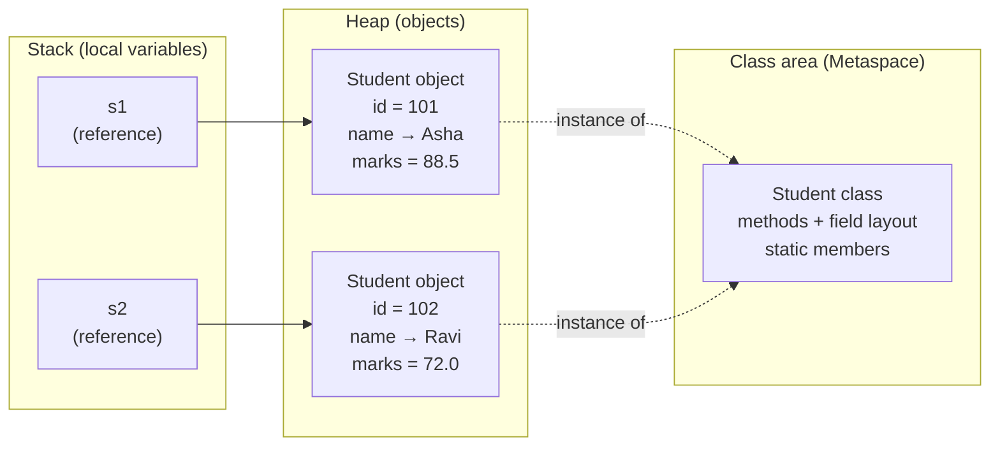
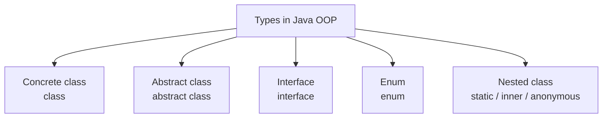
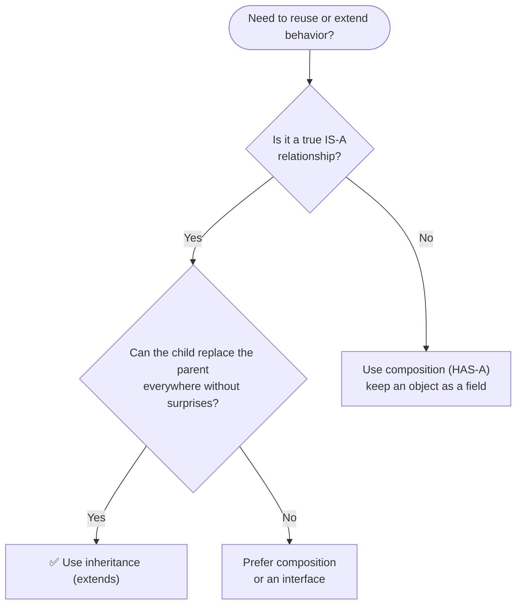

<a id="readme-top"></a>

# OOP

> **Object-Oriented Programming is the way Java organizes code — as objects that bundle data with behavior — and the foundation that almost every Java library and framework is built on.**


| Quick Facts | Details |
|---|---|
| **Category** | Programming paradigm |
| **Prerequisites** | Variables, data types, methods, loops, arrays |
| **Building blocks** | Class (blueprint) → Object (instance) |
| **Four pillars** | Encapsulation · Inheritance · Polymorphism · Abstraction |
| **Works with** | Java 8 and above |
| **At a glance** | Field access `O(1)` · Method call `O(1)` · Object size = header + fields + padding |

## 🔰 Table of Contents

| Level | Sections |
|---|---|
| 🟢 **Level 1 — Understand** | [Definition](#-definition) · [Important Points](#-important-points) · [Memory Layout](#-memory-layout) |
| 🟡 **Level 2 — Use It** | [Creating Objects](#-creating-objects) · [Core Operations](#-core-operations) · [Use Cases](#-use-cases) · [Advantages](#-advantages) · [Limitations](#-limitations) · [Example](#-example) · [Code](#-code) |
| 🟠 **Level 3 — Master It** | [Time Complexity](#-time-complexity) · [Space Complexity](#-space-complexity) · [Common Patterns](#-common-patterns) · [Common Mistakes](#-common-mistakes) · [Interview Questions](#-interview-questions) |
| 🔴 **Level 4 — Wrap-up** | [Summary](#-summary) · [Cheat Sheet](#-cheat-sheet) |

## 📍 Definition

**OOP (Object-Oriented Programming)** is a **programming paradigm** that organizes code around **objects** — bundles of **data (fields)** and **behavior (methods)** — created from **classes** and built on four pillars: **encapsulation**, **inheritance**, **polymorphism** and **abstraction**.

In Java, an object lives on the **heap**, your variable only holds a **reference** to it, and its class decides exactly which fields and methods it has.

| Term | Meaning | Example with `Student s = new Student(101, "Asha");` |
|---|---|---|
| **Class** | Blueprint that describes the fields and methods | `class Student { ... }` |
| **Object** | One real instance built from the class | `s` (the student with id `101`) |
| **Field** | Data stored inside an object | `id` → `101`, `name` → `"Asha"` |
| **Method** | Behavior an object can perform | `s.getName()` → `"Asha"` |
| **Constructor** | Special method that builds the object | `Student(int id, String name)` |

> [!TIP]
> **Real-life analogy:** a class is the blueprint of a car; every car built from it is an object. The pedals and steering wheel are the public controls you use, and the engine stays hidden under the bonnet — you drive without knowing how it works inside.

## 📌 Important Points

1. **Class vs object** — a class is the blueprint, an object is one real thing built from it with `new`.
2. **Four pillars** — encapsulation, inheritance, polymorphism and abstraction (table below).
3. **Objects live on the heap** — a variable such as `Student s` holds only a reference to the object.
4. **Reference type** — `Student b = a;` makes both names point to the *same* object; nothing is copied.
5. **Constructors** — same name as the class and no return type; if you write none, Java adds a default no-argument one.
6. **`this` and `super`** — `this` is the current object, `super` reaches the parent class.
7. **Access modifiers** — `private` (own class only), default (same package), `protected` (package + subclasses), `public` (everyone).
8. **Single inheritance of classes** — a class extends exactly one class (every class ultimately extends `Object`), but it can implement many interfaces.
9. **Auto-initialized fields** — instance fields get default values even if you never assign them (table below); local variables do not.

**The four pillars**

| Pillar | Meaning | Java tool | Real-life example |
|---|---|---|---|
| **Encapsulation** | bundle data with methods and hide the data | `private` fields + public methods | an ATM shows buttons, hides the vault |
| **Inheritance** | a child class reuses and extends a parent | `extends` | `Dog` **is an** `Animal` |
| **Polymorphism** | one name, many forms | overloading, overriding | `sound()` is `"Woof"` for a dog, `"Meow"` for a cat |
| **Abstraction** | show *what* it does, hide *how* | `abstract class`, `interface` | you call `list.add(x)` without knowing how it stores `x` |

**Default values** (instance fields, after `new ClassName()`)

| Field type | Default value |
|---|---|
| `byte`, `short`, `int`, `long` | `0` |
| `float`, `double` | `0.0` |
| `char` | `'\u0000'` (the null character) |
| `boolean` | `false` |
| Any object (`String`, `Integer`, your own class…) | `null` |

> [!IMPORTANT]
> **Overloading vs Overriding** — *overloading* means the same method name with different parameters (decided at compile time); *overriding* means a child class redefines a parent's method with the same signature (decided at run time). Mixing them up is a classic interview mistake.

## 🧱 Memory Layout

For `Student s = new Student(101, "Asha");` Java reserves **one block** of heap memory for the object, and the variable `s` keeps only its address:

```text
  Student object on the heap (typical 64-bit JVM, illustrative)
  ┌────────────────────────────────┐
  │ object header         12 bytes │   ← class pointer + JVM bookkeeping
  ├────────────────────────────────┤
  │ id    = 101            4 bytes │   ← int
  │ name  = ref            4 bytes │   ← reference to a String object
  │ marks = 88.5           8 bytes │   ← double
  ├────────────────────────────────┤
  │ padding                4 bytes │   ← round up to a multiple of 8
  └────────────────────────────────┘
    total = 12 + 4 + 4 + 8 + 4 = 32 bytes
```

Java works out the size and the position of every field with simple arithmetic:

```text
size of an object   = header + sum of all field sizes + padding (to a multiple of 8)
size of a Student   = 12 + 4 (id) + 4 (name ref) + 8 (marks) = 28 → padded to 32 bytes
address of s.marks  = start address of the object + fixed offset of the field
```

The offset of every field is decided once, when the class is compiled, so reading `s.marks` is one addition — no matter how many objects exist. That is why field access is **O(1)**. Instance fields exist once **per object**, while `static` members exist once **per class** and are shared by all objects.

Where does everything live? The variables sit on the **stack**; the objects sit on the **heap**; the class information is kept in the **class area (Metaspace)**:



> [!NOTE]
> A primitive field such as `int id` stores the **value** directly inside the object. A field of an object type such as `String name` stores a **reference**; the actual `String` object lives elsewhere on the heap. The exact layout (field order, header size) depends on the JVM.

## 🔄 Creating Objects

### Declare → Create → Use

```java
class Student {                          // the blueprint
    private int id;                      // field (data)
    private String name;

    Student(int id, String name) {       // constructor: runs once, on `new`
        this.id = id;
        this.name = name;
    }

    String getName() {                   // method (behavior)
        return name;
    }
}
```

```java
Student s;                               // 1. declare : just a reference (null), no object exists yet
s = new Student(101, "Asha");            // 2. create  : memory allocated on the heap, constructor runs
String n = s.getName();                  // 3. use     : call a method on the object
```

### Three ways to initialize

| Style | Syntax | Use when |
|---|---|---|
| Parameterized constructor | `Student s = new Student(101, "Asha");` | you know the values at creation time |
| No-arg constructor + setters | `Student s = new Student(); s.setName("Asha");` | values arrive later (the class must have a no-arg constructor) |
| Copy constructor | `Student t = new Student(s);` | you need an independent duplicate of an existing object |

> [!NOTE]
> Prefer `private` fields that are set through a constructor. If you write **any** constructor yourself, Java stops providing the free default one, so `new Student()` no longer compiles unless you add it.

### Types of classes



| Type | Purpose | Declaration |
|---|---|---|
| **Concrete class** | fully implemented, can be instantiated | `class Dog { }` |
| **Abstract class** | partly implemented, cannot be instantiated | `abstract class Animal { }` |
| **Interface** | a pure contract (what, not how) | `interface Swimmable { }` |
| **Enum** | a fixed set of constants | `enum Day { MON, TUE, WED }` |
| **Nested class** | a class declared inside another class | `static class Node { }` |

```java
abstract class Animal {                  // cannot be instantiated
    abstract String sound();             // no body: every child must supply one
}

interface Swimmable {                    // a contract
    void swim();
}

class Dog extends Animal implements Swimmable {   // one parent class + many interfaces
    String sound() { return "Woof"; }
    public void swim() { System.out.println("Dog paddles"); }
}
```

> [!NOTE]
> A class can **extend only one** class but **implement many** interfaces — that is how Java gets the benefits of multiple inheritance without its problems.

## ⚙️ Core Operations

| Operation | In Java | What happens |
|---|---|---|
| **Create** | `Student s = new Student(101, "Asha");` | allocate on the heap, run the constructor |
| **Access a field** | `s.getId()` (or `s.id` if not private) | read data stored in the object |
| **Call a method** | `s.getName();` | run behavior on that object |
| **Encapsulate** | `private` field + `getX()` / `setX()` | hide data, allow only controlled access |
| **Inherit** | `class Dog extends Animal` | the child reuses the parent's fields and methods |
| **Override** | `@Override String sound() { ... }` | the child replaces the parent's behavior |
| **Overload** | `add(int, int)` and `add(double, double)` | same name, different parameters |
| **Abstract** | `abstract class` / `interface` | define a contract, hide the details |
| **Implement** | `class Circle implements Drawable` | promise to supply the interface's methods |
| **Type check** | `if (a instanceof Dog)` | ask what the real object is |
| **Cast** | `Dog d = (Dog) a;` | treat the object as a more specific type |
| **Compare** | `p1.equals(p2)` | compare contents (once `equals` is overridden) |
| **Print** | `System.out.println(s);` | calls `toString()` for readable text |

### Create — the constructor chain

```text
new Dog("Bruno")     (Dog extends Animal, Animal extends Object)

Step 0  allocate       one block on the heap, every field gets its default value
Step 1  Dog(...)       called first, its first line is super(name)
Step 2  Animal(...)    called next, its first line is super() → Object()
Step 3  Object()       finishes first (the top of the chain)
Step 4  Animal body    runs next                    name = "Bruno"
Step 5  Dog body       finishes last
Step 6  return         the reference is stored in the variable
```

### Call — dynamic dispatch (polymorphism)

```text
Animal a = new Dog("Bruno");
a.sound();

Step 1  compile time   compiler checks that Animal has sound()       the reference type decides what you CAN call
Step 2  run time       JVM looks at the real object → it is a Dog    the object type decides WHICH version runs
Step 3  execute        Dog.sound() runs                              → "Woof"
```

> [!NOTE]
> Parent constructors always finish **before** the child's constructor body runs, so a child can safely rely on the parent part already being set up. Overridden methods are chosen at **run time**; overloaded methods are chosen at **compile time**.

## 🎯 Use Cases

| Use case | Why OOP fits | Example |
|---|---|---|
| **Modeling real-world things** | objects mirror real entities with data + behavior | `Student`, `BankAccount`, `Product` |
| **GUI and games** | many objects interact and share behavior | buttons, characters, enemies |
| **Large team projects** | encapsulation keeps parts independent | banking and e-commerce back ends |
| **Frameworks and libraries** | interfaces let others plug in their own code | JDBC `Connection`, Spring beans |
| **Reusable code** | inheritance and composition remove copy-paste | `Vehicle` → `Car`, `Bike` |
| **Swappable behavior** | polymorphism picks the right code at run time | payment by UPI, card or wallet |
| **The Java library itself** | the JDK is built from classes and interfaces | `String`, `ArrayList`, `Scanner`, exceptions |
| **Program entry** | Java code always lives inside a class | `public static void main(String[] args)` |

**Should I use inheritance?**



## ⭐ Advantages

- ✅ **Modularity** — every class is a self-contained unit that can be written, tested and fixed on its own.
- ✅ **Reusability** — inheritance and composition let you build on existing classes instead of rewriting them.
- ✅ **Data protection** — `private` fields mean an object controls how its own data may change.
- ✅ **Flexibility** — polymorphism lets you add new types without editing the code that uses them.
- ✅ **Foundation** — the Java library, frameworks and design patterns are all built on OOP, so understanding it makes everything else easier.

## 🚧 Limitations

| Limitation | Why it happens | Workaround |
|---|---|---|
| **More code up front** | classes, constructors, getters and setters add boilerplate | IDE code generation, `record` (Java 16+) |
| **Tight coupling in deep hierarchies** | a child depends on its parent's internals | prefer composition, keep hierarchies shallow |
| **Memory overhead** | every object carries a header and references | use primitives, reuse objects, cache immutable ones |
| **Slower than raw primitives in hot loops** | object creation and indirection cost a little | profile first; the JIT compiler inlines most small calls |
| **Over-engineering** | too many classes for a simple task | keep it simple — add abstraction only when it is needed |
| **Shared mutable state** | objects are references, so one change is seen everywhere | immutable objects, defensive copies |

## 🎲 Example

**Problem:** model a **bank account** with an owner and a balance, that supports **deposit** and **withdraw**, and **never lets the balance go negative**.

| Input | Output |
|---|---|
| `new BankAccount("Asha", 1000)` → `deposit(500)` → `withdraw(2000)` → `withdraw(300)` | Balance = `1200` · the `2000` withdrawal is rejected |

**Approach**

1. Make the fields `private` so nobody can change the balance directly (encapsulation).
2. Let the constructor set the owner and opening balance, and reject a negative opening balance.
3. `deposit` adds the amount only if it is positive.
4. `withdraw` subtracts only if `amount <= balance`, otherwise it returns `false`.
5. Outside code talks to the object only through these public methods.

**Dry run — the balance after every call**

| Step | Call | Check | `balance` after |
|---|---|---|---|
| start | `new BankAccount("Asha", 1000)` | opening balance ≥ 0 → OK | `1000` |
| 1 | `deposit(500)` | 500 > 0 → add | `1500` |
| 2 | `withdraw(2000)` | 2000 > 1500 → **reject** | `1500` (unchanged) |
| 3 | `withdraw(300)` | 300 ≤ 1500 → subtract | `1200` |

✅ Final balance = **1200**, and the object protected itself from the invalid withdrawal → every call is **O(1)**.

## 💻 Code

> Save it as `OopDemo.java`, then run `javac OopDemo.java` followed by `java OopDemo`.

```java
import java.util.Objects;

// 1. Encapsulation ........ private data + public methods
class BankAccount {
    private static int totalAccounts = 0;          // static -> one copy shared by ALL objects

    private final String owner;                    // private -> hidden from outside code
    private double balance;

    BankAccount(String owner, double balance) {    // constructor: runs once, on `new`
        if (balance < 0) {
            throw new IllegalArgumentException("Opening balance cannot be negative");
        }
        this.owner = owner;                        // this -> the object being built
        this.balance = balance;
        totalAccounts++;
    }

    void deposit(double amount) {
        if (amount > 0) {
            balance += amount;
        }
    }

    boolean withdraw(double amount) {
        if (amount > 0 && amount <= balance) {
            balance -= amount;
            return true;
        }
        return false;                              // rejected: the balance can never go negative
    }

    double getBalance() { return balance; }

    static int getTotalAccounts() { return totalAccounts; }

    @Override
    public String toString() {
        return owner + " (balance " + balance + ")";
    }
}

// 2. Inheritance .......... child IS-A parent and reuses its code
class Animal {
    protected String name;

    Animal(String name) {
        this.name = name;
    }

    String sound() {
        return "some sound";
    }

    String describe() {
        return name + " says " + sound();
    }
}

class Dog extends Animal {
    Dog(String name) {
        super(name);                               // call the parent constructor first
    }

    @Override
    String sound() {                               // 3a. Polymorphism: overriding (run time)
        return "Woof";
    }

    String fetch() {                               // a method only Dog has
        return name + " fetches the ball";
    }
}

class Cat extends Animal {
    Cat(String name) {
        super(name);
    }

    @Override
    String sound() {
        return "Meow";
    }
}

// 3b. Polymorphism: overloading (compile time) .... same name, different parameters
class Calculator {
    int add(int a, int b)           { return a + b; }
    double add(double a, double b)  { return a + b; }
    int add(int a, int b, int c)    { return a + b + c; }
}

// 4. Abstraction .......... expose WHAT, hide HOW
interface Drawable {
    String draw();
}

abstract class Shape implements Drawable {
    abstract double area();                        // no body: every child must supply it

    @Override
    public String toString() {                     // shared code, written once
        return getClass().getSimpleName() + " area = " + String.format("%.2f", area());
    }
}

class Circle extends Shape {
    private final double radius;

    Circle(double radius) { this.radius = radius; }

    @Override
    double area() { return Math.PI * radius * radius; }

    @Override
    public String draw() { return "drawing a circle"; }
}

class Rectangle extends Shape {
    private final double width, height;

    Rectangle(double width, double height) {
        this.width = width;
        this.height = height;
    }

    @Override
    double area() { return width * height; }

    @Override
    public String draw() { return "drawing a rectangle"; }
}

// 5. Composition .......... car HAS-A engine
class Engine {
    String start() { return "Engine started"; }
}

class Car {
    private final Engine engine = new Engine();    // HAS-A: the Engine is a field

    String drive() { return engine.start() + ", car is moving"; }
}

// 6. equals() and hashCode() ... compare CONTENTS, not references
class Point {
    private final int x, y;

    Point(int x, int y) {
        this.x = x;
        this.y = y;
    }

    @Override
    public boolean equals(Object o) {
        if (this == o) return true;
        if (!(o instanceof Point)) return false;
        Point p = (Point) o;
        return x == p.x && y == p.y;
    }

    @Override
    public int hashCode() {
        return Objects.hash(x, y);                 // equal objects MUST give equal hash codes
    }
}

public class OopDemo {

    // Helper: prints "label : value" in neat columns
    static void show(String label, Object value) {
        System.out.printf("%-20s: %s%n", label, value);
    }

    public static void main(String[] args) {

        // ----- Encapsulation: create & use an object -----
        BankAccount acc = new BankAccount("Asha", 1000);
        show("Opened", acc);
        acc.deposit(500);
        show("After deposit 500", acc.getBalance());
        show("Withdraw 2000", acc.withdraw(2000) ? "done" : "rejected");
        show("Withdraw 300", acc.withdraw(300) ? "done" : "rejected");
        show("Final balance", acc.getBalance());
        BankAccount second = new BankAccount("Ravi", 50);
        show("Accounts created", BankAccount.getTotalAccounts());

        // ----- Inheritance -----
        Dog dog = new Dog("Bruno");
        show("Inherited method", dog.describe());
        show("Dog-only method", dog.fetch());

        // ----- Polymorphism: overriding (decided at run time) -----
        Animal[] zoo = { new Dog("Bruno"), new Cat("Kitty"), new Animal("Thing") };
        for (int i = 0; i < zoo.length; i++) {
            show("zoo[" + i + "]", zoo[i].describe());
        }

        // ----- Polymorphism: overloading (decided at compile time) -----
        Calculator calc = new Calculator();
        show("add(2, 3)", calc.add(2, 3));
        show("add(2.5, 3.5)", calc.add(2.5, 3.5));
        show("add(1, 2, 3)", calc.add(1, 2, 3));

        // ----- Abstraction -----
        Shape[] shapes = { new Circle(1), new Rectangle(2, 3) };
        for (Shape s : shapes) {
            show(s.draw(), s);
        }

        // ----- Composition -----
        show("Car", new Car().drive());

        // ----- instanceof & casting -----
        Animal pet = new Dog("Tommy");
        show("pet instanceof Dog", pet instanceof Dog);
        show("pet instanceof Cat", pet instanceof Cat);
        show("After casting", ((Dog) pet).fetch());

        // ----- Reference vs separate object -----
        BankAccount alias = acc;                                // same object, two names
        BankAccount other = new BankAccount("Asha", 1200);      // different object, same data
        alias.deposit(100);
        show("acc (via alias)", acc.getBalance());
        show("other (untouched)", other.getBalance());

        // ----- == vs equals() -----
        Point p1 = new Point(3, 4);
        Point p2 = new Point(3, 4);
        show("p1 == p2", p1 == p2);
        show("p1.equals(p2)", p1.equals(p2));

        // ----- Invalid state protection -----
        try {
            new BankAccount("Bad", -5);
        } catch (IllegalArgumentException e) {
            show("Caught exception", e.getMessage());
        }
    }
}
```

**Output**

```text
Opened              : Asha (balance 1000.0)
After deposit 500   : 1500.0
Withdraw 2000       : rejected
Withdraw 300        : done
Final balance       : 1200.0
Accounts created    : 2
Inherited method    : Bruno says Woof
Dog-only method     : Bruno fetches the ball
zoo[0]              : Bruno says Woof
zoo[1]              : Kitty says Meow
zoo[2]              : Thing says some sound
add(2, 3)           : 5
add(2.5, 3.5)       : 6.0
add(1, 2, 3)        : 6
drawing a circle    : Circle area = 3.14
drawing a rectangle : Rectangle area = 6.00
Car                 : Engine started, car is moving
pet instanceof Dog  : true
pet instanceof Cat  : false
After casting       : Tommy fetches the ball
acc (via alias)     : 1300.0
other (untouched)   : 1200.0
p1 == p2            : false
p1.equals(p2)       : true
Caught exception    : Opening balance cannot be negative
```

> [!NOTE]
> Only one top-level class per file may be `public`, and its name must match the file name — that is why `OopDemo` is public and the other classes have no modifier.

## ⏳ Time Complexity

| Operation | Best | Average | Worst | Why? |
|---|---|---|---|---|
| Create an object (`new`) | O(1) | O(1) | O(1) | one fixed-size block, plus whatever the constructor itself does |
| Access a field `s.id` | O(1) | O(1) | O(1) | address = start of object + fixed offset |
| Call a method `s.m()` | O(1) | O(1) | O(1) | the call itself is constant; the method body adds its own cost |
| Overridden (virtual) call | O(1) | O(1) | O(1) | the JVM picks the version from the real object's class |
| Constructor chain | O(d) | O(d) | O(d) | `d` = inheritance depth, each parent constructor runs once |
| `equals()` — default (`Object`) | O(1) | O(1) | O(1) | compares references only |
| `equals()` — your own override | O(1) | O(k) | O(k) | `k` = fields compared, stops at the first difference |
| Shallow copy (copy constructor) | O(k) | O(k) | O(k) | `k` = fields copied |
| Deep copy | O(m) | O(m) | O(m) | `m` = total size of every nested object copied |

> OOP itself adds almost no cost — the **algorithm inside your methods** decides the complexity. The JIT compiler also inlines most small methods, so even overridden calls are cheap.

**Feel the difference** — number of steps for `n` items:

| n | 1 call of an O(1) method | `n` calls of an O(1) method | `n` calls of an O(n) method |
|---|---|---|---|
| 10 | 1 | 10 | 100 |
| 1,000 | 1 | 1,000 | 1,000,000 |
| 1,000,000 | 1 | 1,000,000 | 1,000,000,000,000 |

A method call looks like a single line, but its body may hide a loop — `list.contains(x)` is `O(n)`, so calling it inside a loop over `n` items costs `O(n²)`.

> [!TIP]
> **Rule of thumb:** total cost = number of calls × cost of one call · a method call inside a loop multiplies the cost · OOP organizes your code, it does not change its complexity.

## 🚀 Space Complexity

An object needs **header + fields + padding** bytes, so `n` objects need **O(n)** space. (Sizes below are typical for a 64-bit JVM with a 12-byte header and compressed references, and depend on the JVM.)

| Field type | Bytes per field | Note |
|---|---|---|
| `byte` | 1 | — |
| `short`, `char` | 2 | — |
| `int`, `float` | 4 | — |
| `long`, `double` | 8 | — |
| `boolean` | ~1 | JVM-dependent |
| object (`String` …) | 4–8 for the reference | the referenced object is extra |

**Worked example** — `Student` with `int id`, `String name`, `double marks`: `12 + 4 + 4 + 8 = 28` → padded to **32 bytes**. One million `Student` objects take about **32 MB**, plus the `String` objects their `name` fields point to.

**Extra (auxiliary) space used by common operations**

| Operation | Extra space | Reason |
|---|---|---|
| Create an object | O(1) | one fixed-size block, plus anything the constructor allocates |
| Reference assignment `b = a` | O(1) | copies only the reference, never the object |
| Call a method | O(1) | one stack frame per call (recursion: O(depth)) |
| Inheritance | none | a `Dog` holds the `Animal` fields in the same block, with one header |
| Overriding / polymorphism | none per object | method tables belong to the class, not to each object |
| `static` field | O(1) in total | one copy per class, shared by all objects |
| Shallow copy | O(1) | one new object; nested objects are shared |
| Deep copy | O(m) | every nested object is duplicated |
| A collection of `n` objects | O(n) | `n` objects plus `n` references |

> [!TIP]
> The cheapest object is the one you never create — reuse immutable objects, share constants with `static final`, and use primitives in hot loops.

## 🧩 Common Patterns

Once the basics are clear, most OOP designs boil down to a handful of patterns:

| Pattern | Core idea | Pillar used | Typical use |
|---|---|---|---|
| **Singleton** | only one instance of a class exists | Encapsulation (private constructor) | logger, configuration, connection pool |
| **Factory** | one method decides which class to create | Abstraction + Polymorphism | payment gateway, shape from a name |
| **Builder** | build a complex object step by step | Encapsulation | objects with many optional fields |
| **Strategy** | swap an algorithm at run time through an interface | Polymorphism | discount rules, sorting with `Comparator` |

<details>
<summary><b>Singleton — exactly one shared instance</b></summary>

```java
class Logger {
    private static final Logger INSTANCE = new Logger();   // created once, when the class loads

    private Logger() { }                                   // nobody outside can call new Logger()

    static Logger getInstance() {
        return INSTANCE;
    }

    void log(String msg) {
        System.out.println("[LOG] " + msg);
    }
}
// Logger.getInstance() == Logger.getInstance()   → true (the same object)
```

**Pillar** Encapsulation · **Benefit** one shared object — this eager version is also thread-safe, because the JVM loads a class only once.

</details>

<details>
<summary><b>Factory — one method decides which class to create</b></summary>

```java
interface Payment { void pay(int amount); }

class UpiPayment implements Payment {
    public void pay(int amount) { System.out.println("Paid " + amount + " via UPI"); }
}

class CardPayment implements Payment {
    public void pay(int amount) { System.out.println("Paid " + amount + " via Card"); }
}

class PaymentFactory {
    static Payment create(String type) {
        switch (type) {
            case "UPI":  return new UpiPayment();
            case "CARD": return new CardPayment();
            default: throw new IllegalArgumentException("Unknown type: " + type);
        }
    }
}
// PaymentFactory.create("UPI").pay(500);   → Paid 500 via UPI
```

**Pillar** Abstraction + Polymorphism · **Benefit** callers depend on `Payment`, not on the concrete classes.

</details>

<details>
<summary><b>Builder — create an object step by step</b></summary>

```java
class Pizza {
    private final String size;
    private final boolean cheese;
    private final boolean mushroom;

    private Pizza(Builder b) {
        this.size = b.size;
        this.cheese = b.cheese;
        this.mushroom = b.mushroom;
    }

    static class Builder {
        private String size = "medium";
        private boolean cheese;
        private boolean mushroom;

        Builder size(String size) { this.size = size; return this; }
        Builder cheese()          { this.cheese = true; return this; }
        Builder mushroom()        { this.mushroom = true; return this; }
        Pizza build()             { return new Pizza(this); }
    }
}
// Pizza p = new Pizza.Builder().size("large").cheese().build();
```

**Pillar** Encapsulation · **Benefit** no giant constructors, and the finished `Pizza` is immutable.

</details>

<details>
<summary><b>Strategy — swap behavior at run time</b></summary>

```java
interface DiscountStrategy {
    double apply(double price);
}

class Cart {
    private final DiscountStrategy strategy;           // behavior is injected (HAS-A)

    Cart(DiscountStrategy strategy) {
        this.strategy = strategy;
    }

    double checkout(double price) {
        return strategy.apply(price);
    }
}
// new Cart(price -> price * 0.90).checkout(1000)   → 900.0   (10% off, lambda = Java 8)
// new Cart(price -> price - 200).checkout(1000)    → 800.0   (flat 200 off)
```

**Pillar** Polymorphism · **Benefit** add a new discount without changing `Cart`.

</details>

## 🚨 Common Mistakes

| # | Mistake | Why it is a problem | Fix |
|---|---|---|---|
| 1 | `public int balance;` | anyone can set an invalid value, the class loses control | make fields `private` and expose methods |
| 2 | `s1 == s2` to compare objects | compares **references**, not contents | override `equals()` and use `s1.equals(s2)` |
| 3 | `Student b = a;` expecting a copy | both names point to the **same** object | copy constructor or `clone()` |
| 4 | overriding `equals()` without `hashCode()` | `HashMap` / `HashSet` stop working correctly | always override both together |
| 5 | `Student s = null; s.getName();` | the variable has no object → `NullPointerException` | create the object first, or check for `null` |
| 6 | `String sound(int x)` instead of `sound()` in the child | that is an **overload**, so the parent's method still runs | always write `@Override` — the compiler checks it |
| 7 | adding a parameterized constructor, then calling `new Student()` | the free default constructor disappears → compile error | write the no-arg constructor yourself |
| 8 | extending a class only to reuse code (`Stack extends Vector`) | breaks the IS-A rule and exposes unwanted methods | use composition (HAS-A) |

## 🎤 Interview Questions

<details>
<summary><b>1. What is the difference between a class and an object?</b></summary>

A **class** is a blueprint: it describes which fields and methods exist but occupies no object memory of its own. An **object** is one real instance created from the class with `new`; each object has its own copy of the instance fields. One class can produce any number of objects.

</details>

<details>
<summary><b>2. What are the four pillars of OOP?</b></summary>

| Pillar | One-line meaning | Java tool |
|---|---|---|
| Encapsulation | bundle data with methods, hide the data | `private` + getters / setters |
| Inheritance | a child reuses and extends a parent | `extends` |
| Polymorphism | one name, many forms | overloading, overriding |
| Abstraction | show *what*, hide *how* | `abstract class`, `interface` |

Encapsulation hides **data**; abstraction hides **complexity** (the implementation).

</details>

<details>
<summary><b>3. What is the difference between overloading and overriding?</b></summary>

| Feature | Overloading | Overriding |
|---|---|---|
| Where | same class | parent and child class |
| Signature | different parameters | same name and same parameters |
| Return type | can differ | same (or a subtype) |
| Decided | compile time | run time |
| Also called | static polymorphism | dynamic polymorphism |
| Needs inheritance | no | yes |
| Restrictions | none | cannot override `private`, `static` or `final` methods |

</details>

<details>
<summary><b>4. What is the difference between an abstract class and an interface?</b></summary>

| Feature | Abstract class | Interface |
|---|---|---|
| Inheritance | a class extends **one** | a class implements **many** |
| Methods | abstract and concrete | abstract, plus `default` and `static` (Java 8) |
| Fields | any kind, including instance fields | only `public static final` constants |
| Constructor | yes | no |
| Use when | related classes share state and code (IS-A) | unrelated classes share a capability (CAN-DO) |

</details>

<details>
<summary><b>5. What is the difference between == and equals(), and why override hashCode()?</b></summary>

`==` compares **references** (are these the same object?). `equals()` is inherited from `Object` and also compares references until you override it to compare **contents**. If two objects are `equals()`, they **must** return the same `hashCode()` — otherwise hash-based collections such as `HashMap` and `HashSet` break.

```java
Point a = new Point(3, 4);
Point b = new Point(3, 4);
System.out.println(a == b);          // false  (two different objects)
System.out.println(a.equals(b));     // true   (equals() overridden to compare x and y)
```

</details>

<details>
<summary><b>6. Why does Java not allow multiple inheritance of classes?</b></summary>

To avoid the **diamond problem**: if a class inherited from two parents that both define the same method, the compiler could not know which one to use. Java allows a class to `implement` many interfaces instead. If two interfaces supply the same `default` method, the class must override it and choose explicitly, for example with `A.super.hello()`.

</details>

<details>
<summary><b>7. Where is an object stored in memory?</b></summary>

Objects live on the **heap**. A local variable such as `s` lives on the **stack** and only holds the reference. Class information (methods, field layout) is kept in **Metaspace**, and `static` members belong to the class, not to any object. When no reference points to an object any more, the garbage collector can free it.

</details>

<details>
<summary><b>8. What is the difference between inheritance and composition?</b></summary>

**Inheritance** models an **IS-A** relationship (`Dog` is an `Animal`) and ties the child tightly to its parent. **Composition** models a **HAS-A** relationship (`Car` has an `Engine`): one object keeps another as a field and calls its methods. The common advice is *"favor composition over inheritance"* — use `extends` only when the IS-A relationship is real and the child can safely replace the parent everywhere.

</details>

<details>
<summary><b>9. What are the SOLID principles?</b></summary>

| Letter | Principle | In one line |
|---|---|---|
| **S** | Single Responsibility | a class should have only one reason to change |
| **O** | Open / Closed | open for extension, closed for modification |
| **L** | Liskov Substitution | a child must be usable wherever its parent is expected |
| **I** | Interface Segregation | many small interfaces beat one huge interface |
| **D** | Dependency Inversion | depend on abstractions (interfaces), not on concrete classes |

</details>

## 🏁 Summary

- OOP builds programs from **objects** — bundles of data and behavior — created from **classes**.
- The four pillars: **encapsulation** (hide data), **inheritance** (reuse), **polymorphism** (many forms), **abstraction** (hide complexity).
- Objects live on the **heap**; variables hold **references**, so `b = a` shares one object — copying needs a copy constructor or `clone()`.
- Field access and method calls are **O(1)**; the real cost is whatever the method's own code does.
- An object uses **header + fields + padding** bytes, so `n` objects need **O(n)** space.
- Prefer **composition (HAS-A)** over inheritance, and program against **interfaces**.
- Use OOP when you model real-world things and the code will keep growing; keep it simple when the task is tiny.

### 📝 Cheat Sheet

| Question | Answer |
|---|---|
| What is it? | A paradigm that builds programs from objects created from classes |
| Four pillars | Encapsulation · Inheritance · Polymorphism · Abstraction |
| Class vs object | Blueprint vs a real instance on the heap |
| Create an object | `new ClassName(args)` — the constructor runs |
| Hide data | `private` fields + public methods |
| Reuse code | `extends` (IS-A) or composition (HAS-A) |
| One name, many behaviors | overriding (run time) · overloading (compile time) |
| Contract only / partial blueprint | `interface` / `abstract class` |
| Compare objects | `equals()` + `hashCode()`, never `==` for contents |
| Field access / method call | O(1) |
| Best for | Large, growing programs that model real-world things |
| Avoid when | The task is tiny, or you would build deep inheritance chains |

> [!IMPORTANT]
> **OOP trades simplicity for structure:** you write a little more code up front and get code that is easier to extend, reuse and protect in return.
