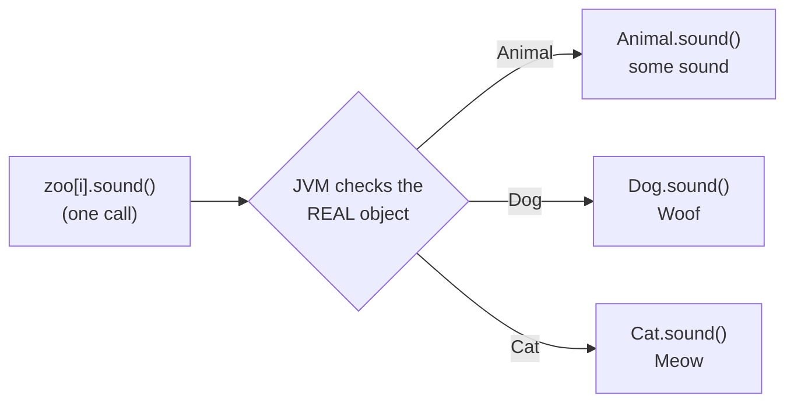

<a id="readme-top"></a>

# Polymorphism

> **Polymorphism means "many forms" — one method name, or one parent reference, can trigger different behavior depending on the arguments or on the real object.**


| Quick Facts | Details |
|---|---|
| **Category** | OOP pillar |
| **Prerequisites** | Class and object, inheritance, methods |
| **Key keywords** | `@Override` · `super` · `instanceof` · `final` |
| **Works with** | Java 8 and above |

## 🔰 Table of Contents

| Level | Sections |
|---|---|
| 🟢 **Level 1 — Understand** | [Definition](#-definition) · [Key Points](#-key-points) · [How It Works](#-how-it-works) |
| 🟡 **Level 2 — Use It** | [Syntax & Variations](#-syntax--variations) · [When to Use](#-when-to-use) · [Example](#-example) · [Code](#-code) |
| 🔴 **Level 3 — Wrap-up** | [Common Mistakes](#-common-mistakes) · [Interview Questions](#-interview-questions) · [Summary](#-summary) |

## 📍 Definition

**Polymorphism** (Greek word for "many forms") is the ability of **one name** — a method name, or a parent-class reference — to **behave differently** depending on the situation.

Java has two kinds: **compile-time polymorphism** (method **overloading**) and **run-time polymorphism** (method **overriding**).

| Term | Meaning | Example |
|---|---|---|
| **Polymorphism** | One name, many behaviors | `sound()` gives `"Woof"` for a dog and `"Meow"` for a cat |
| **Overloading** | Same method name, different parameters, in one class | `add(int, int)` and `add(double, double)` |
| **Overriding** | A child redefines an inherited method with the same signature | `Dog.sound()` replaces `Animal.sound()` |
| **Upcasting** | Storing a child object in a parent variable | `Animal a = new Dog();` |
| **Dynamic dispatch** | The JVM choosing the overridden method from the real object at run time | `a.sound()` runs `Dog`'s version |
| **Binding** | Linking a method call to the code that runs — early (compile time) or late (run time) | overloading = early, overriding = late |

**The two kinds at a glance**

| Kind | Also called | Achieved by | Decided by | Decided when |
|---|---|---|---|---|
| **Compile-time** | static / early binding | overloading | the compiler, from the **argument types** | while compiling |
| **Run-time** | dynamic / late binding | overriding | the JVM, from the **real object** | while the program runs |

> [!TIP]
> **Real-life analogy:** the *Power* button on a remote. You press the same button every time, but a TV, an AC and a music system each respond in their own way. The call is the same; the device decides what actually happens.

## 📌 Key Points

1. **Two kinds** — overloading is resolved at compile time, overriding at run time.
2. **Overloading** — the same method name with a different parameter list (number, types or order of parameters); changing only the return type is not enough.
3. **Overriding** — a child class redefines an inherited instance method with the same signature; it needs inheritance.
4. **Who chooses** — the compiler picks an overload from the *declared types of the arguments*; the JVM picks an override from the *real type of the object*.
5. **Two types are involved** — the variable's type decides which methods you *can* call; the object's type decides which *version* runs.
6. **Upcasting is automatic** — a parent variable can hold any child object; going back down needs a cast and an `instanceof` check.
7. **Only instance methods are polymorphic** — fields, `static` methods, `private` methods and constructors are not overridden.
8. **Code against the parent type** — a method that accepts `Animal` works for every present and future subclass without changes.

> [!IMPORTANT]
> **Fields and static methods are not polymorphic** — `Animal a = new Dog();` then `a.type` reads `Animal`'s field, because fields and static methods are chosen by the **variable's type**, not by the real object.

## ⚙️ How It Works

### Compile-time — overloading

```text
calc.add(2, 3.5);             // Calculator has add(int,int), add(double,double), add(int,int,int), add(String,String)

Step 1  compile time   the compiler reads the call: name = add, arguments = (int, double)
Step 2  match          no exact add(int, double) → the int is widened to double → add(double, double)
Step 3  fixed          the choice is written into the compiled code — nothing is decided at run time
```

### Run time — overriding

```text
Animal a = new Dog();
a.sound();

Step 1  compile time   the compiler checks that Animal has sound()          → the call compiles
Step 2  run time       the JVM looks at the REAL object: it is a Dog        (not at the variable's type)
Step 3  dispatch       Dog has its own sound() → that version is chosen
Step 4  execute        Dog.sound() runs                                     → "Woof"
```

One call, different versions — depending on the real object:



> [!NOTE]
> The method search starts at the real class of the object and moves up the inheritance chain, exactly as described in inheritance.md. Polymorphism through interfaces and abstract classes is covered in abstraction.md.

## 🔄 Syntax & Variations

### Overloading (compile-time)

```java
class Calculator {
    int add(int a, int b)           { return a + b; }
    double add(double a, double b)  { return a + b; }
    int add(int a, int b, int c)    { return a + b + c; }
    String add(String a, String b)  { return a + b; }
}
```

| Rule | Detail |
|---|---|
| **Must differ in** | the parameter list — number, types or order of the parameters |
| **Return type alone** | not enough — `int add(int a, int b)` and `double add(int a, int b)` do not compile |
| **Access modifier, `throws`** | can differ freely, but they do not count as a difference |
| **Where** | in the same class, or in a child class that adds another version of an inherited name |
| **Can be overloaded** | instance methods, `static` methods and constructors |

**How the compiler picks an overload** — it tries the phases in this order and stops at the first match:

| Order | Rule | Example |
|---|---|---|
| 1 | **Exact match** | `add(2, 3)` → `add(int, int)` |
| 2 | **Widening** of primitives (`int → long → float → double`) | `add(2, 3.5)` → `add(double, double)` |
| 3 | **Boxing / unboxing** | `Integer` argument → `int` parameter |
| 4 | **Varargs** (`int... nums`) | last resort |

If two overloads fit equally well, the call is **ambiguous** and does not compile.

### Overriding (run-time)

```java
class Animal {
    public String sound() { return "some sound"; }
}

class Dog extends Animal {
    @Override
    public String sound() { return "Woof"; }
}
```

| Rule | Detail |
|---|---|
| **Signature** | same name and same parameter list |
| **Return type** | the same, or a subtype of the parent's (covariant return) |
| **Access** | the same or wider than the parent's method |
| **Exceptions** | cannot throw new or broader checked exceptions |
| **`@Override`** | optional, but always write it — the compiler then checks that you really override |

### What is polymorphic?

| Member | Polymorphic? | Decided by |
|---|---|---|
| **Instance method** | ✅ yes — overridden | the **real object** (run time) |
| **`static` method** | ❌ hidden, not overridden | the **variable's type** (compile time) |
| **`private` method** | ❌ not visible to the child | the class that declares it |
| **`final` method** | ❌ cannot be overridden | the class that declares it |
| **Field** | ❌ hidden, not overridden | the **variable's type** (compile time) |
| **Constructor** | ❌ not inherited | — |

### Upcasting and downcasting

| Cast | Example | Safe? |
|---|---|---|
| **Upcast** (child → parent) | `Animal a = new Dog();` | ✅ always — implicit |
| **Downcast** (parent → child) | `Dog d = (Dog) a;` | ⚠ explicit; throws `ClassCastException` if the real object is not a `Dog` |
| **Checked downcast** | `if (a instanceof Dog) { Dog d = (Dog) a; }` | ✅ test first, then cast |

After an upcast you can call only the parent's members — but the object is still a `Dog`, and `Dog`'s overrides still run.

### Where you already use it

| Code | Polymorphism |
|---|---|
| `List<String> list = new ArrayList<>();` | the variable type is the interface; the `ArrayList` version of each method runs |
| `System.out.println(obj);` | `println` is **overloaded** (`int`, `char`, `String`, `Object` …) and calls the **overridden** `toString()` of the object |
| `Arrays.sort(arr);` | overloaded for `int[]`, `double[]`, `Object[]` and more |

## 🎯 When to Use

| Need | Use | Benefit | Watch out |
|---|---|---|---|
| The same action on different inputs (add ints, doubles, Strings) | **overloading** | one readable method name | too many overloads confuse callers |
| The same action, different behavior per type (sound, area, pay) | **overriding** | each class supplies its own version | keep the contract: same meaning, same signature, add `@Override` |
| Code must work with any member of a family (loop over `Animal[]`) | **parent-type variables and parameters** (upcasting) | new child classes work without changing existing code | only the parent's members are visible |
| Replace a long `if / else` or `switch` on a type | **overriding** | adding a new type means adding a class, not editing a chain | too many tiny classes if overused |
| Behavior must be chosen at run time | **polymorphism through an interface or parent class** | swap behavior without touching the caller | needs a common parent type |
| Call a child-only method on a parent variable | **`instanceof` + downcast** (last resort) | gives access to the child's extras | frequent casts usually mean the design needs a change |

## 🎲 Example

**Problem:** show both kinds of polymorphism — a `Calculator` that adds different kinds of values under one method name, and an `Animal` hierarchy where one call gives a different result depending on the real object — and show what polymorphism does **not** cover.

**Dry run — what each statement does**

| Step | Statement | What happens | Result |
|---|---|---|---|
| 1 | `calc.add(2, 3)` | compile time: two `int` arguments → `add(int, int)` | `5` |
| 2 | `calc.add(2, 3.5)` | no `add(int, double)`; the `int` is widened → `add(double, double)` | `5.5` |
| 3 | `zoo[i].sound()` in a loop | one call; at run time the JVM checks each real object | `some sound` · `Woof` · `Meow` |
| 4 | `Animal pet = new Dog(); pet.sound()` | variable type `Animal`, object type `Dog` → `Dog`'s version | `Woof` |
| 5 | `pet.type` | fields are chosen by the variable's type, not the object | `animal` |
| 6 | `who(pet)` | compile time: `pet` is declared as `Animal` → `who(Animal)` | `an animal` |
| 7 | `who((Dog) pet)` | after the cast the declared type is `Dog` → `who(Dog)` | `a dog` |

✅ Overloading is decided by the compiler from the declared types, overriding by the JVM from the real object — and fields and `static` methods follow the variable's type.

## 💻 Code

> Save it as `PolymorphismDemo.java`, then run `javac PolymorphismDemo.java` followed by `java PolymorphismDemo`.

```java
// 1. Compile-time polymorphism .... OVERLOADING: same name, different parameters
class Calculator {
    int add(int a, int b)           { return a + b; }
    double add(double a, double b)  { return a + b; }
    int add(int a, int b, int c)    { return a + b + c; }
    String add(String a, String b)  { return a + b; }
}

// 2. Run-time polymorphism ........ OVERRIDING: child replaces the parent's method
class Animal {
    String type = "animal";                             // fields are NOT polymorphic

    public String sound() {
        return "some sound";
    }

    static String kind() {                              // static methods are NOT polymorphic
        return "Animal";
    }
}

class Dog extends Animal {
    String type = "dog";                                // hides Animal.type, does not override it

    @Override
    public String sound() {
        return "Woof";
    }

    public String fetch() {                             // only Dog has this method
        return "fetching the ball";
    }

    static String kind() {                              // hides Animal.kind(), does not override it
        return "Dog";
    }
}

class Cat extends Animal {
    @Override
    public String sound() {
        return "Meow";
    }
}

public class PolymorphismDemo {

    // Helper: prints "label : value" in neat columns
    static void show(String label, Object value) {
        System.out.printf("%-24s: %s%n", label, value);
    }

    // ONE method that works for EVERY kind of Animal, even ones written later
    static String speak(Animal a) {
        return a.sound();
    }

    // Two overloads: the compiler picks one from the DECLARED type of the argument
    static String who(Animal a) { return "an animal"; }
    static String who(Dog d)    { return "a dog"; }

    public static void main(String[] args) {

        // ----- Compile-time polymorphism: overloading -----
        Calculator calc = new Calculator();
        show("add(2, 3)", calc.add(2, 3));
        show("add(2.5, 3.5)", calc.add(2.5, 3.5));
        show("add(1, 2, 3)", calc.add(1, 2, 3));
        show("add(\"Ja\", \"va\")", calc.add("Ja", "va"));
        show("add(2, 3.5)", calc.add(2, 3.5));          // no add(int, double): int is widened to double

        // ----- Run-time polymorphism: overriding -----
        Animal[] zoo = { new Animal(), new Dog(), new Cat() };
        for (int i = 0; i < zoo.length; i++) {
            show("zoo[" + i + "].sound()", zoo[i].sound());      // same call, different behavior
        }
        show("speak(new Cat())", speak(new Cat()));     // a method that accepts any Animal

        // ----- Upcasting and downcasting -----
        Animal pet = new Dog();                         // upcast: implicit and always safe
        show("pet.sound()", pet.sound());               // Dog's version (chosen at run time)
        // pet.fetch();                                 // compile error: Animal has no fetch()
        if (pet instanceof Dog) {
            show("((Dog) pet).fetch()", ((Dog) pet).fetch());    // downcast, after an instanceof check
        }

        // ----- Only instance methods are polymorphic -----
        show("pet.type (field)", pet.type);             // fields: decided by the VARIABLE type
        show("((Dog) pet).type", ((Dog) pet).type);
        show("pet.kind() (static)", pet.kind());        // static: also the VARIABLE type (legal but misleading)
        show("Dog.kind()", Dog.kind());

        // ----- Overload resolution uses the DECLARED type -----
        show("who(pet)", who(pet));                     // pet is declared as Animal -> who(Animal)
        show("who((Dog) pet)", who((Dog) pet));         // now the declared type is Dog -> who(Dog)
    }
}
```

**Output**

```text
add(2, 3)               : 5
add(2.5, 3.5)           : 6.0
add(1, 2, 3)            : 6
add("Ja", "va")         : Java
add(2, 3.5)             : 5.5
zoo[0].sound()          : some sound
zoo[1].sound()          : Woof
zoo[2].sound()          : Meow
speak(new Cat())        : Meow
pet.sound()             : Woof
((Dog) pet).fetch()     : fetching the ball
pet.type (field)        : animal
((Dog) pet).type        : dog
pet.kind() (static)     : Animal
Dog.kind()              : Dog
who(pet)                : an animal
who((Dog) pet)          : a dog
```

> [!NOTE]
> `pet.kind()` compiles, but calling a `static` method through an object is misleading — it runs the version of the **variable's type** (`Animal`). Call static methods through the class name, as in `Dog.kind()`.

## 🚨 Common Mistakes

| # | Mistake | Why it is a problem | Fix |
|---|---|---|---|
| 1 | overloading by return type only (`int add(int a, int b)` and `double add(int a, int b)`) | the compiler chooses by arguments, not by return type → "method add(int,int) is already defined" | change the parameter list, or use a different method name |
| 2 | `String sound(int times)` in the child instead of `sound()` | that is an **overload**, so `sound()` still runs the parent's version | always write `@Override` — the compiler catches it |
| 3 | expecting an overload to be chosen by the real object (`who(pet)` with `Animal pet = new Dog()`) | overloads are chosen at **compile time** from the declared type → `who(Animal)` runs | put the behavior in an overridden method, or cast on purpose: `who((Dog) pet)` |
| 4 | expecting fields or `static` methods to be polymorphic (`pet.type`) | they follow the **variable's type**, so you get `Animal`'s value | access data through an overridden method such as `getType()` and avoid hiding fields |
| 5 | `Dog d = (Dog) animal;` without checking | `ClassCastException` at run time if the object is a `Cat` | check first: `if (animal instanceof Dog)` |
| 6 | `Animal p = new Dog(); p.fetch();` | the variable's type decides what you can call → "cannot find symbol" | declare the method in the parent, or downcast after `instanceof` |

## 🎤 Interview Questions

<details>
<summary><b>1. What is polymorphism and what are its types?</b></summary>

Polymorphism means "many forms": one name or one parent reference can produce different behavior. Java has **compile-time polymorphism** (method overloading — the compiler picks the method from the argument types) and **run-time polymorphism** (method overriding — the JVM picks the method from the real object).

</details>

<details>
<summary><b>2. What is the difference between overloading and overriding?</b></summary>

| Feature | Overloading | Overriding |
|---|---|---|
| Where | same class (or a child adding a version) | parent and child class |
| Signature | different parameters | same name and same parameters |
| Return type | can differ | same, or a subtype |
| Resolved | compile time | run time |
| Also called | static / early binding | dynamic / late binding |
| Needs inheritance | no | yes |
| Methods allowed | instance, `static`, constructors | instance methods only |

</details>

<details>
<summary><b>3. What is dynamic method dispatch?</b></summary>

It is the way Java picks an overridden method at **run time**. A parent-type variable can hold a child object (`Animal a = new Dog();`), and when you call `a.sound()` the JVM looks at the **real object** — a `Dog` — and runs `Dog`'s version, not the version of the variable's type. The compiler only checks that `Animal` has a `sound()` method.

</details>

<details>
<summary><b>4. Are fields and static methods polymorphic?</b></summary>

No. Only **instance methods** are overridden. With `Animal a = new Dog();`, `a.type` reads the field declared in `Animal`, and `a.kind()` (a static method) runs `Animal`'s version, because both are resolved from the **variable's type** at compile time. A child that re-declares a field or a static method only **hides** the parent's.

</details>

<details>
<summary><b>5. Can you overload a method by changing only its return type?</b></summary>

No. The compiler chooses an overload from the **method name and the arguments** — the return type is not part of that choice, so two methods that differ only in return type would be ambiguous and the code does not compile. Changing only the access modifier or the `throws` clause does not create an overload either.

</details>

<details>
<summary><b>6. What is a covariant return type?</b></summary>

When overriding, the child's method may return a **subtype** of the parent's return type, so the overriding method is more specific:

```java
class Animal { Animal create() { return new Animal(); } }
class Dog extends Animal {
    @Override
    Dog create() { return new Dog(); }      // Dog is a subtype of Animal → allowed
}
```

Callers that use a `Dog` variable get a `Dog` back without a cast.

</details>

## 🏁 Summary

- **Polymorphism** is one name with many behaviors: **overloading** (compile time) and **overriding** (run time).
- **Overloading** — same name, different parameters; the compiler picks by the argument types (exact → widening → boxing → varargs).
- **Overriding** — a child redefines an inherited instance method; the JVM picks by the real object (**dynamic dispatch**).
- The **variable's type** decides what you can call; the **object's type** decides which version runs.
- Only **instance methods** are polymorphic — fields, `static`, `private` and constructors are not.
- **Upcasting** is automatic and safe; a **downcast** needs an `instanceof` check. Code written against the parent type keeps working when you add new child classes.

### 📝 Cheat Sheet

| Question | Answer |
|---|---|
| Same name, different parameters | **overloading** — `add(int, int)`, `add(double, double)` — compile time |
| Replace an inherited method | **overriding** — `@Override`, same signature — run time |
| Parent variable, child object | `Animal a = new Dog();` — upcasting, automatic |
| Call a child-only method | `if (a instanceof Dog) { ((Dog) a).fetch(); }` |
| Who decides? | overloading: the compiler (argument types) · overriding: the JVM (real object) |
| Not polymorphic | fields, `static` methods, `private` methods, constructors |
| Overload by return type only | ❌ compile error |

> [!IMPORTANT]
> **One call, many behaviors:** write your code against the parent type and let every object supply its own version — the calling code never changes when you add a new child class.
