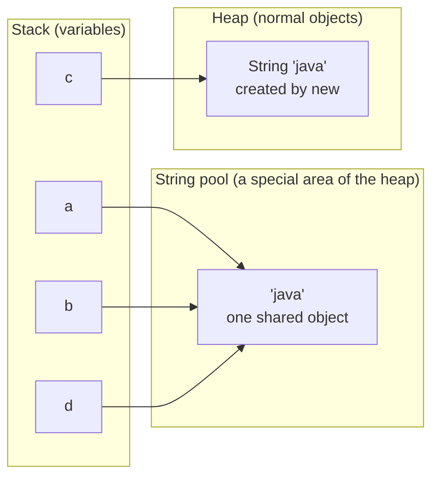

<a id="readme-top"></a>

# String Pool and Immutability

> **A String never changes after it is created — and because of that, Java can safely keep one shared copy of every literal in the String pool and let many variables point to it.**


| Quick Facts | Details |
|---|---|
| **Category** | String — memory and behavior (`java.lang.String`) |
| **Prerequisites** | String basics, objects and references, `==` vs `equals()` |
| **Key keywords** | `String` · literal · `new String(...)` · `intern()` · `equals()` · `final` |
| **Works with** | Java 8 and above |
| **At a glance** | the same literal = the same object · `new String(...)` = a new object · compare text with `equals()` |

## 🔰 Table of Contents

| Level | Sections |
|---|---|
| 🟢 **Level 1 — Understand** | [Definition](#-definition) · [Key Points](#-key-points) · [How It Works](#-how-it-works) |
| 🟡 **Level 2 — Use It** | [Syntax & Variations](#-syntax--variations) · [When to Use](#-when-to-use) · [Example](#-example) · [Code](#-code) |
| 🔴 **Level 3 — Wrap-up** | [Time Complexity](#-time-complexity) · [Common Mistakes](#-common-mistakes) · [Interview Questions](#-interview-questions) · [Summary](#-summary) |

## 📍 Definition

A **`String` is immutable**: once the object is created, its characters can never be changed. Every method that seems to change a String — `toUpperCase()`, `replace()`, `trim()`, `concat()` — leaves the original alone and returns a **new** String.

The **String pool** (also called the string constant pool or intern pool) is a special area of the heap where Java keeps **one shared copy of every String literal**. When two places in your program use the literal `"java"`, both variables point to the **same pooled object**. This sharing is only safe because Strings are immutable — nobody can change the shared copy behind another variable's back.

| Idea | Meaning | Example |
|---|---|---|
| **Immutability** | The characters of a String object never change | `s.toUpperCase()` returns a new String — `s` stays as it was |
| **String pool** | A shared area of the heap that holds one object per distinct literal | `"java" == "java"` is `true` |
| **Literal** | Text written directly in the code between double quotes | `String s = "Java";` |
| **`new String(...)`** | Always creates a separate object on the heap, outside the pool | `new String("java")` |
| **`intern()`** | Returns the pooled copy of a String (and adds it if it is missing) | `c.intern()` |
| **Reference comparison** | `==` asks "is it the very same object?" | `a == b` |
| **Content comparison** | `equals()` asks "are the characters the same?" | `a.equals(b)` |

> [!TIP]
> **Real-life analogy:** a library that keeps exactly one copy of each popular book. Everyone who asks for "Java Basics" is handed a reference to the same copy — and since nobody is allowed to write in the books, sharing is safe. `new String("Java")` is like photocopying the book into your own private copy: same words, but a different object.

## 📌 Key Points

1. **A String never changes** — after creation its characters are fixed; every "change" produces a new String.
2. **The variable changes, the object does not** — in `s = s + "x"` the variable `s` is re-pointed to a new String; the old object is untouched. (`final String s` is a different thing: it stops the *variable* from being re-pointed.)
3. **Literals are pooled** — the same literal anywhere in the program is the same object.
4. **`new String("x")` always makes a new object** — it is never the pooled one; `intern()` gives you the pooled copy.
5. **`==` compares references, `equals()` compares content** — always compare text with `equals()`.
6. **Compile-time constants are pooled, run-time results are not** — `"a" + "b"` and `final` constants are joined by the compiler; text built or read at run time is a new object.
7. **Immutability brings benefits** — safe sharing through the pool, thread safety, a cached `hashCode()` (which makes Strings good map keys) and security.
8. **The price is temporary objects** — every modification creates a new String, so use a `StringBuilder` for many edits (see stringbuilder-and-stringbuffer.md).

> [!IMPORTANT]
> **Never compare text with `==`** — it can print `true` for two literals and `false` for the very same words read from input or built at run time. Use `equals()`; put the literal first (`"yes".equals(answer)`) so a `null` variable cannot throw an exception.

## ⚙️ How It Works

For these four lines, here is where each object lives:

```java
String a = "java";
String b = "java";
String c = new String("java");
String d = c.intern();
```



```text
String a = "java";               1. the pool has no "java" yet → it is created in the pool; a points to it
String b = "java";               2. the pool already has "java" → b points to the SAME object
String c = new String("java");   3. new always creates a separate object on the heap; c points to it
String d = c.intern();           4. intern() looks up "java" in the pool and returns that pooled object

a == b → true     a == c → false     a == d → true     a.equals(c) → true
```

### What "immutable" means in practice

```text
String s = "Java";
s.toUpperCase();                 // a new String "JAVA" is created ... and thrown away — s is still "Java"
String keep = s;                 // a second variable on the same object
s = s.toUpperCase();             // s now points to a NEW String "JAVA"

Step 1  s and keep         → the object "Java"
Step 2  s.toUpperCase()    → creates "JAVA"; the object "Java" is not touched
Step 3  s = ...            → only the variable s moves to "JAVA"
Step 4  keep               → still "Java" — the old object was never changed
```

### Why Java made String immutable

| Reason | Benefit |
|---|---|
| **Pool sharing** | many variables can share one object because nobody can change it |
| **Thread safety** | an object that cannot change can be used by many threads without locks |
| **Cached hash code** | the `hashCode()` is computed once and remembered, so Strings are fast, safe `HashMap` keys |
| **Security** | a file name, class name or host name cannot change after it has been checked |
| **Simplicity** | no one can modify a String that was passed to a method |

> [!NOTE]
> Inside, a String keeps its characters in a `private final` array — a `char[]` in Java 8, a more compact `byte[]` since Java 9 — and the class itself is `final`, so nobody can subclass it and break the rules. The pool lives in the normal heap (since Java 7), so pooled Strings that are no longer used can be garbage collected. Mutable text is covered in stringbuilder-and-stringbuffer.md, and the String methods themselves in string.md.

## 🔄 Syntax & Variations

### Ways to get a String — and where it lives

| Way | Example | Lives in | Pooled? |
|---|---|---|---|
| **Literal** | `String s = "Java";` | the String pool | yes — shared |
| **`new`** | `new String("Java")` | the heap — a separate object | no |
| **Constant expression** | `"Ja" + "va"` | the pool — joined at compile time | yes |
| **Run-time concatenation** | `x + "va"` (a normal variable `x`) | the heap | no |
| **Method result** | `s.toUpperCase()`, `s.substring(1)`, `String.valueOf(5)` | the heap | no |
| **Input** | `scanner.nextLine()` | the heap | no |
| **`intern()`** | `c.intern()` | the pool — the shared copy | yes |

### Comparing Strings

| Need | Use | Example |
|---|---|---|
| Same content | `equals` | `a.equals(b)` |
| Same content, ignoring case | `equalsIgnoreCase` | `a.equalsIgnoreCase(b)` |
| Same object (rare) | `==` | `a == b` |
| Alphabetical order | `compareTo` | `a.compareTo(b)` — negative, `0` or positive |
| `null`-safe comparison | the literal first, or `Objects.equals` | `"yes".equals(x)` · `Objects.equals(a, b)` |
| Compare with a builder | `contentEquals` | `"abc".contentEquals(sb)` |

### Compile-time constants vs run time

With `String a = "java";`:

| Expression | `== a` ? | Why |
|---|---|---|
| `"ja" + "va"` | **true** | a constant expression — the compiler joins it into `"java"` |
| `y + "va"` with `final String y = "ja";` | **true** | `y` is a constant variable, so this is a constant too |
| `x + "va"` with `String x = "ja";` | **false** | `x` could change, so the join happens at run time and creates a new object |
| `(x + "va").intern()` | **true** | `intern()` returns the pooled copy |

### Methods never change the original

| Method | Returns | Is the original changed? |
|---|---|---|
| `toUpperCase()` · `toLowerCase()` | a new String | no |
| `trim()` · `strip()` | a new String | no |
| `replace(a, b)` | a new String | no |
| `substring(i, j)` | a new String | no |
| `concat(x)` · `s + x` | a new String | no |

```java
String s = "Java";
s.toUpperCase();                // does nothing useful — the result is thrown away
s = s.toUpperCase();            // assign the returned String to keep the result
```

## 🎯 When to Use

| Need | Use | Benefit | Watch out |
|---|---|---|---|
| Compare text | **`equals()`** | compares the characters | a `null` on the left throws — write the literal first |
| Create ordinary text | **a literal** `"text"` | pooled, shared, no extra object | — |
| A separate object on purpose (rare) | **`new String(s)`** | a distinct object | almost never needed — it breaks `==` and wastes memory |
| Many equal Strings arriving at run time, and memory matters | **`intern()`** | one shared copy | the lookup costs time — and `equals()` is still how you compare |
| Constants and map keys | **`String`** | immutable with a cached hash → safe keys | — |
| A password or secret you want to wipe after use | **`char[]`** | the array can be overwritten | a `String` stays in memory until it is garbage collected |
| Text that is built or edited a lot | **`StringBuilder`** | no new object per edit | convert to a String once at the end |

## 🎲 Example

**Problem:** with `a = "java"`, `b = "java"`, `c = new String("java")` and `d = c.intern()`, predict the results of the comparisons — and show what `s.toUpperCase()` does to `s`.

**Dry run — what each expression gives**

| Expression | Result | Why |
|---|---|---|
| `a == b` | `true` | both literals are the one pooled `"java"` |
| `a == c` | `false` | `c` is a separate object on the heap |
| `a.equals(c)` | `true` | the characters are the same |
| `a == d` | `true` | `intern()` returned the pooled object |
| `c == c.intern()` | `false` | `c` itself was never the pooled object |
| `s.toUpperCase();` with `s = "Java"` | `s` is still `"Java"` | a new String was created and thrown away |
| `s = s.toUpperCase();` | `s` is `"JAVA"` | the variable now points to the new String; the old `"Java"` is untouched |

✅ Equal literals share one object, `new` makes another, `intern()` goes back to the shared one — and text is compared with `equals()`.

## 💻 Code

> Save it as `StringPoolDemo.java`, then run `javac StringPoolDemo.java` followed by `java StringPoolDemo`.

```java
import java.util.Objects;

public class StringPoolDemo {

    // Helper: prints "label : value" in neat columns
    static void show(String label, Object value) {
        System.out.printf("%-30s: %s%n", label, value);
    }

    public static void main(String[] args) {

        // ----- The pool: equal literals are the SAME object -----
        String a = "java";
        String b = "java";
        String c = new String("java");                  // new ALWAYS creates a separate object on the heap
        String d = c.intern();                          // intern() returns the pooled "java"
        show("a == b  (two literals)", a == b);
        show("a == c  (literal vs new)", a == c);
        show("a.equals(c)", a.equals(c));
        show("a == d  (after intern)", a == d);
        show("c == c.intern() ?", c == c.intern());     // c itself is not the pooled object

        // ----- Compile-time constants vs run-time concatenation -----
        String x = "ja";
        final String y = "ja";
        show("(\"ja\" + \"va\") == a", ("ja" + "va") == a);          // true: joined at compile time
        show("(y + \"va\") == a  [final]", (y + "va") == a);         // true: y is a constant variable
        show("(x + \"va\") == a  [not final]", (x + "va") == a);     // false: built at run time
        show("(x + \"va\").intern() == a", (x + "va").intern() == a);   // true

        // ----- Immutability: the variable changes, the object does not -----
        String s = "Java";
        s.toUpperCase();                                // the new String is created ... and thrown away
        show("After s.toUpperCase()", s);
        String keep = s;                                // a second variable on the same object
        s = s.toUpperCase();                            // s now points to a NEW String
        show("s after reassignment", s);
        show("keep (the old object)", keep);
        show("s == keep ?", s == keep);

        // ----- Methods return new Strings; the original never changes -----
        String text = "  Hello  ";
        show("trim()", "[" + text.trim() + "]");
        show("text afterwards", "[" + text + "]");
        show("replace('l', 'L')", "Hello".replace('l', 'L'));
        show("substring(1, 3)", "Hello".substring(1, 3));

        // ----- Text that arrives at run time is not pooled -----
        String typed = new StringBuilder("ja").append("va").toString();     // pretend the user typed it
        show("typed == \"java\"", typed == "java");
        show("typed.equals(\"java\")", typed.equals("java"));

        // ----- Null-safe comparison -----
        String missing = null;
        show("\"yes\".equals(missing)", "yes".equals(missing));             // false, no exception
        show("Objects.equals(null, null)", Objects.equals(null, null));
        try {
            missing.equals("yes");                                           // the variable is null: NullPointerException
        } catch (NullPointerException e) {
            show("missing.equals(\"yes\")", "NullPointerException");
        }

        // ----- hashCode: equal Strings give equal hash codes, but not the other way round -----
        show("a.hashCode() == c.hashCode()", a.hashCode() == c.hashCode());
        show("\"Aa\" / \"BB\" hashCode", "Aa".hashCode() + " / " + "BB".hashCode());
        show("\"Aa\".equals(\"BB\")", "Aa".equals("BB"));
    }
}
```

**Output**

```text
a == b  (two literals)        : true
a == c  (literal vs new)      : false
a.equals(c)                   : true
a == d  (after intern)        : true
c == c.intern() ?             : false
("ja" + "va") == a            : true
(y + "va") == a  [final]      : true
(x + "va") == a  [not final]  : false
(x + "va").intern() == a      : true
After s.toUpperCase()         : Java
s after reassignment          : JAVA
keep (the old object)         : Java
s == keep ?                   : false
trim()                        : [Hello]
text afterwards               : [  Hello  ]
replace('l', 'L')             : HeLLo
substring(1, 3)               : el
typed == "java"               : false
typed.equals("java")          : true
"yes".equals(missing)         : false
Objects.equals(null, null)    : true
missing.equals("yes")         : NullPointerException
a.hashCode() == c.hashCode()  : true
"Aa" / "BB" hashCode          : 2112 / 2112
"Aa".equals("BB")             : false
```

> [!NOTE]
> Two groups of lines are worth a second look. `typed == "java"` is `false` although the words are identical — the text was built at run time, so it is not the pooled object, which is exactly why `==` must not be used for text. And `"Aa"` and `"BB"` have the **same** hash code `2112` but are **not** equal: equal Strings always have equal hash codes, but equal hash codes do not mean equal Strings.

## ⏳ Time Complexity

| Operation | Time | Note |
|---|---|---|
| `a == b` | **O(1)** | compares two references only |
| `a.equals(b)` | **O(n)** | compares characters and stops at the first difference; it checks the reference and the length first |
| `hashCode()` | **O(n)** the first time, **O(1)** afterwards | the result is cached inside the String |
| `length()`, `charAt(i)` | **O(1)** | |
| `intern()` | **O(n)** | hashes the text and looks it up in the pool |
| `substring(i, j)` | **O(k)** | copies the `k` characters it returns |
| `s + t`, `concat`, `toUpperCase`, `replace`, `trim` | **O(n)** | every one builds a new String |

Space: the pool saves memory because equal literals are stored **once**; every modification, on the other hand, creates a new object that later becomes garbage.

> [!TIP]
> **Rule of thumb:** `==` is instant but answers the wrong question for text; `equals()` is `O(n)` but correct. The cached hash code is why Strings work so well as `HashMap` keys: after the first call, `hashCode()` costs nothing.

## 🚨 Common Mistakes

| # | Mistake | Why it is a problem | Fix |
|---|---|---|---|
| 1 | `if (answer == "yes")` | `==` compares references: it can work for two literals and fail for text read from input or built at run time | `"yes".equals(answer)` |
| 2 | `s.toUpperCase();` or `s.trim();` on its own line | the new String is created and thrown away — `s` is unchanged | assign it: `s = s.toUpperCase();` |
| 3 | `new String("text")` for ordinary text | an extra object that is not pooled, and `==` stops working | use the literal `"text"` |
| 4 | `String t = s; s = s + "x";` and expecting `t` to change | `s` is re-pointed to a new String; `t` still points to the old, unchanged object | remember: the variable changes, the object does not |
| 5 | `a.equals(b)` when `a` can be `null` | `NullPointerException` | `"yes".equals(a)` or `Objects.equals(a, b)` |
| 6 | keeping a password in a `String` | a String cannot be wiped — it stays in memory (and possibly in the pool) until it is garbage collected | use a `char[]` and overwrite it after use: `Arrays.fill(pw, '\0')` |

## 🎤 Interview Questions

<details>
<summary><b>1. Why is String immutable in Java?</b></summary>

Mainly for **safety and efficiency**. Immutability lets the JVM **share** String objects through the pool, makes Strings **thread-safe** without locks, lets the **hash code be cached** (so Strings are fast, reliable `HashMap` keys), and protects **security-sensitive** values such as file names, class names and host names from being changed after a check. The cost is that every modification creates a new object.

</details>

<details>
<summary><b>2. What is the String pool and where does it live?</b></summary>

It is a special area of the **heap** that holds one shared object for every distinct String literal (and every interned String). Since Java 7 it lives in the normal heap — earlier it was in the permanent generation — so pooled Strings that are no longer reachable can be garbage collected.

</details>

<details>
<summary><b>3. What is the difference between <code>==</code> and <code>equals()</code>, and between <code>"a"</code> and <code>new String("a")</code>?</b></summary>

| Feature | `==` | `equals()` |
|---|---|---|
| Compares | references (the same object?) | characters (the same content?) |
| Speed | `O(1)` | `O(n)` |
| Use for text | no | yes |

| Feature | `"a"` (literal) | `new String("a")` |
|---|---|---|
| Object | the pooled, shared one | always a new object on the heap |
| `"a" == "a"` | `true` | `new String("a") == "a"` is `false` |

</details>

<details>
<summary><b>4. How many objects does <code>String s = new String("abc");</code> create?</b></summary>

**One or two.** The `new` creates one object on the heap. The literal `"abc"` inside the parentheses is a pooled object that is created only if the pool does not already contain `"abc"`. So it is two objects the first time and one when the literal already exists.

</details>

<details>
<summary><b>5. What does <code>intern()</code> do and when would you use it?</b></summary>

`intern()` returns the pooled version of a String: if the pool already has an equal String it returns that object, otherwise it adds this one and returns it. It can save memory when a program holds a huge number of equal Strings that arrive at run time (for example repeated labels read from a big file). It costs a lookup, and you should still compare with `equals()`, not `==`.

</details>

<details>
<summary><b>6. In <code>String s = "a"; s = s + "b";</code> — is the String modified?</b></summary>

No. A new String `"ab"` is created and the **variable** `s` is re-pointed to it; the original object `"a"` is unchanged and stays in the pool. That is also different from `final`: `final String s` stops the **variable** from being re-pointed, while immutability is about the **object** never changing.

</details>

<details>
<summary><b>7. Is <code>"a" + "b" == "ab"</code> true? What about <code>x + "b" == "ab"</code>?</b></summary>

`"a" + "b" == "ab"` is **true**: it is a constant expression, so the compiler joins it into the literal `"ab"`, which is pooled. The same holds when `x` is a `final` String initialized with a constant. With an ordinary variable, `x + "b"` is evaluated at run time, creates a new object, and `== "ab"` is **false** — unless you call `intern()` on the result.

</details>

## 🏁 Summary

- A **String is immutable**: its characters never change, and every "change" creates a **new** String.
- The **variable** can be re-pointed to another String; the **object** never changes — and `final` on a variable is something different.
- The **String pool** holds one shared object per literal; `new String(...)` always creates a separate object, and `intern()` returns the pooled one.
- `==` compares **references**, `equals()` compares **content** — always compare text with `equals()`, literal first to avoid `null` problems.
- **Compile-time constants** are pooled; text built or read at **run time** is not.
- Immutability gives **safe sharing, thread safety, a cached `hashCode()` and security** — the price is temporary objects, so use a `StringBuilder` for many edits.

### 📝 Cheat Sheet

| Question | Answer |
|---|---|
| Compare text | `a.equals(b)` · `a.equalsIgnoreCase(b)` — never `==` |
| `null`-safe compare | `"yes".equals(x)` · `Objects.equals(a, b)` |
| Create text | a literal: `String s = "Java";` — shared from the pool |
| Force a separate object | `new String("Java")` — rarely needed |
| Get the pooled copy | `s.intern()` |
| "Change" a String | `s = s.toUpperCase();` — assign the returned new String |
| Compile-time constants | `"a" + "b"` and `final` constants are pooled; run-time concatenation is not |
| Many edits in a loop | `StringBuilder` |
| Secrets such as passwords | `char[]`, overwritten after use |

> [!IMPORTANT]
> **The variable changes, the object does not:** a String is never edited — every "change" is a new String that the variable then points to — and text is compared with `equals()`, never with `==`.
