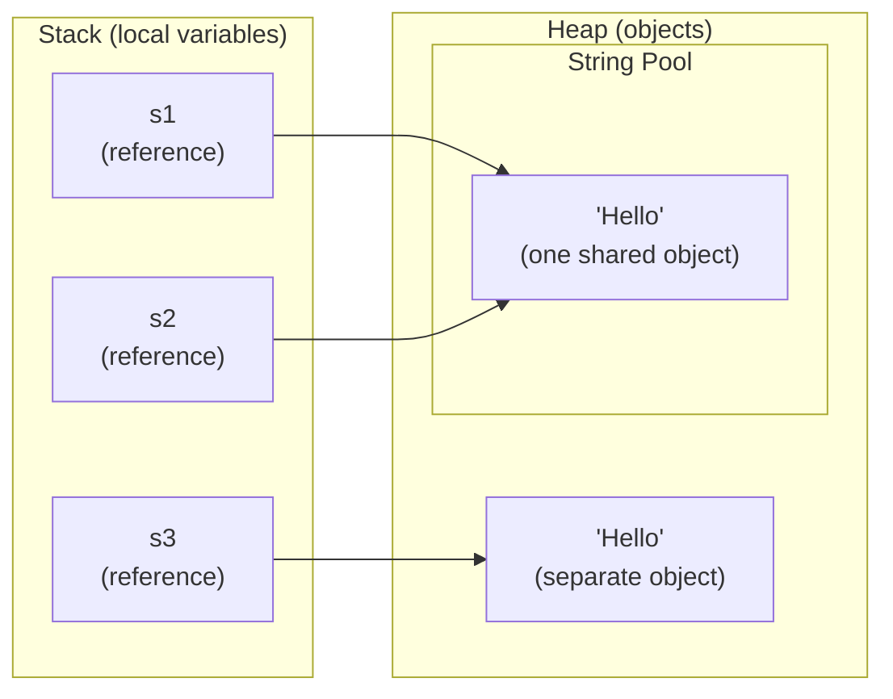
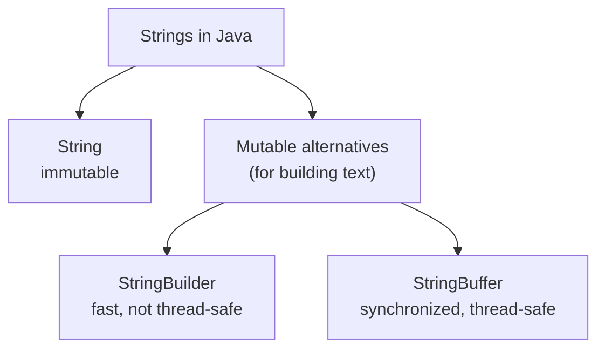
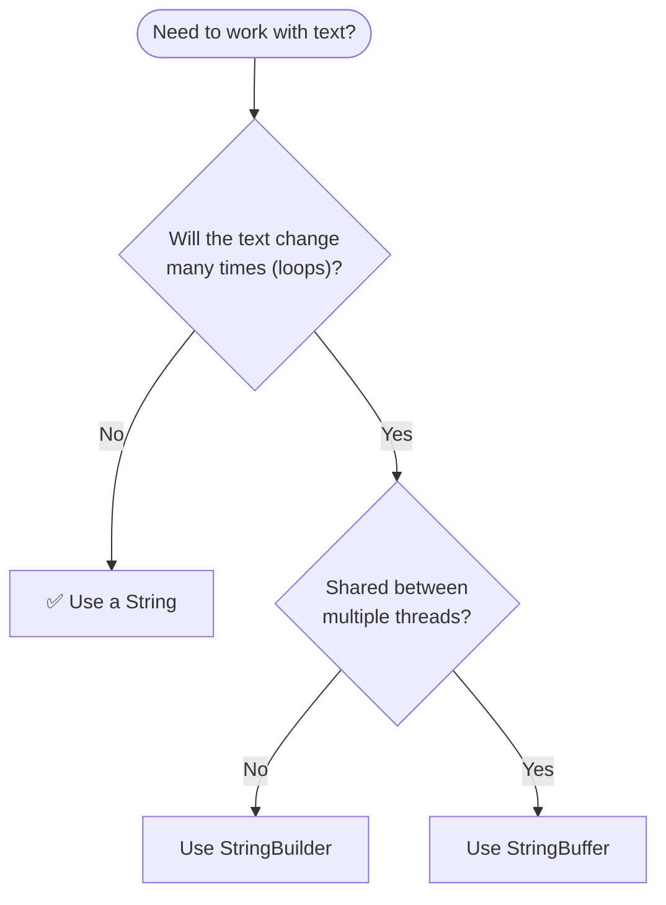

<a id="readme-top"></a>

# String

> **A string is an immutable sequence of characters — the most widely used class in Java, and the building block of almost every program that talks to humans.**


| Quick Facts | Details |
|---|---|
| **Category** | Linear data structure (a sequence of characters) |
| **Prerequisites** | Variables, data types, arrays, loops |
| **Indexing** | Zero-based (`0` … `length() - 1`) |
| **Size** | Fixed once created — a String never changes (immutable) |
| **Works with** | Java 8 and above |
| **At a glance** | Access `O(1)` · Search `O(n)` · Insert / Delete `O(n)` · Space `O(n)` |

## 🔰 Table of Contents

| Level | Sections |
|---|---|
| 🟢 **Level 1 — Understand** | [Definition](#-definition) · [Important Points](#-important-points) · [Memory Layout](#-memory-layout) |
| 🟡 **Level 2 — Use It** | [Creating Strings](#-creating-strings) · [Core Operations](#-core-operations) · [Use Cases](#-use-cases) · [Advantages](#-advantages) · [Limitations](#-limitations) · [Example](#-example) · [Code](#-code) |
| 🟠 **Level 3 — Master It** | [Time Complexity](#-time-complexity) · [Space Complexity](#-space-complexity) · [Common Patterns](#-common-patterns) · [Common Mistakes](#-common-mistakes) · [Interview Questions](#-interview-questions) |
| 🔴 **Level 4 — Wrap-up** | [Summary](#-summary) · [Cheat Sheet](#-cheat-sheet) |

## 📍 Definition

**String** is an **ordered** sequence of **characters**, accessed through a **zero-based index** and **immutable** — once it is created, its content can never change.

In Java, a String is also an **object** of the class `java.lang.String`: it lives on the **heap**, your variable only holds a **reference** to it, and it reports its size through the **`length()` method**.

| Term | Meaning | Example with `String name = "Java";` |
|---|---|---|
| **Character** | One symbol stored in the String | `'J'`, `'a'`, `'v'`, `'a'` |
| **Index** | Position of a character (starts at `0`) | `name.charAt(0)` → `'J'` |
| **Length** | Total number of characters | `name.length()` → `4` |

> [!TIP]
> **Real-life analogy:** picture a word printed in ink on a sheet of paper. You can read any letter by its position, but you cannot erase or change a letter — to "change" the word you have to print a fresh sheet. That fresh sheet is a new String object.

## 📌 Important Points

1. **Zero-based index** — the first character is `s.charAt(0)`, the last is `s.charAt(s.length() - 1)`.
2. **Immutable** — a String can never be changed after creation; methods like `toUpperCase()` return a **new** String.
3. **Made of characters** — a String is a sequence of `char` values (UTF-16 code units).
4. **A class, not a primitive** — `String` is `java.lang.String`; `"Java"` is an object, not a raw value like an `int`.
5. **Strings are objects** — created with a literal or `new`, stored on the heap, with a `length()` **method** (not a field).
6. **String Pool** — identical literals are stored once and shared: `String a = "hi"; String b = "hi";` points both names at the *same* object.
7. **Thread-safe by nature** — because nothing can change it, many threads can share one String safely.
8. **Bounds-checked** — an invalid index throws `StringIndexOutOfBoundsException` at runtime.
9. **Unicode-aware** — Strings can hold text in any language (Hindi, Chinese, emoji …); Java uses UTF-16 internally.

**Special values** (an unassigned String field or array slot is `null`, not `""`)

| Value | What it is | `length()` |
|---|---|---|
| `null` | no object at all — the variable points nowhere | calling it throws `NullPointerException` |
| `""` | an **empty** String — an object with zero characters | `0` |
| `"   "` | a **blank** String — contains only spaces | `3` |
| `"Java"` | a normal String | `4` |

> [!IMPORTANT]
> **`length` vs `length()` vs `size()`** — Strings use `str.length()` (a method), arrays use `arr.length` (a field), and collections such as `ArrayList` use `list.size()`. Mixing them up is a classic compile error.

## 🧱 Memory Layout

For `String s = "Hello";` Java keeps the five characters side by side in a hidden array — one slot per character (a `char[]` up to Java 8, a compact `byte[]` from Java 9 onward):

```text
      0       1       2       3       4       ← index
  ┌───────┬───────┬───────┬───────┬───────┐
  │  'H'  │  'e'  │  'l'  │  'l'  │  'o'  │   ← character
  └───────┴───────┴───────┴───────┴───────┘
      72     101     108     108     111      ← Unicode value
```

Every character is a number underneath (its Unicode value) and every slot has the same size, so Java finds any character with a single formula:

```text
position of character i = start of the characters + (i × size of one character)
"Hello".charAt(1) → 'e'      "Hello".length() → 5      last index → 5 - 1 = 4
```

One multiplication and one addition — no matter how long the String is. That is why `charAt(i)` is **O(1)**.

Where does everything live? The variables sit on the **stack**; the String objects sit on the **heap** — and equal literals share one object inside the **String Pool**:

```java
String s1 = "Hello";               // goes into the String Pool
String s2 = "Hello";               // reuses the pooled object -> same reference as s1
String s3 = new String("Hello");   // forces a brand-new object on the heap
```



> [!NOTE]
> `s1 == s2` is `true` (same pooled object) but `s1 == s3` is `false` (a separate object), while `s1.equals(s3)` is `true` because the characters match. Always compare Strings with `equals()`.

## 🔄 Creating Strings

### Declare → Create → Assign

```java
String name;                      // 1. declare : just a reference, no String exists yet
name = "Java";                    // 2. create  : the literal "Java" is stored in the String Pool
name = name + " DSA";             // 3. "modify": builds a NEW String; "Java" itself never changes
```

### Three ways to initialize

| Style | Syntax | Use when |
|---|---|---|
| Literal | `String s = "Java";` | the normal, recommended way (reuses the String Pool) |
| `new` keyword | `String s = new String("Java");` | you really need a separate object (rare) |
| From a `char[]` | `String s = new String(chars);` or `String.valueOf(chars)` | the characters are already stored in a `char[]` |

> [!NOTE]
> Prefer literals: `"Java"` reuses the String Pool, while `new String("Java")` always creates an extra object.

### Types of Strings



| Type | Mutable? | Declaration |
|---|---|---|
| **String** | no — immutable | `String s = "Java";` |
| **StringBuilder** | yes — fast, not thread-safe | `StringBuilder sb = new StringBuilder("Java");` |
| **StringBuffer** | yes — synchronized, thread-safe | `StringBuffer sf = new StringBuffer("Java");` |

```java
StringBuilder sb = new StringBuilder("Java");
sb.append(" DSA");                // changes the SAME object (no new String is created)
sb.insert(0, "Learn ");           // inserts at index 0
System.out.println(sb);           // Learn Java DSA
String result = sb.toString();    // convert back to an (immutable) String
```

> [!NOTE]
> `String` is immutable; `StringBuilder` and `StringBuffer` are **mutable** — reach for them whenever you build or edit text repeatedly.

## ⚙️ Core Operations

| Operation | In Java | What happens |
|---|---|---|
| **Access** | `char c = s.charAt(2);` | jump straight to the index |
| **Length** | `s.length()` | number of characters |
| **Traverse** | `for (char c : s.toCharArray()) { ... }` | visit every character once |
| **Search** | `s.indexOf("av")` or `s.contains("av")` | find where a substring lives |
| **Extract** | `s.substring(1, 3)` | copy a slice (the end index is excluded) |
| **Compare** | `s.equals(t)`, `s.equalsIgnoreCase(t)`, `s.compareTo(t)` | check the contents or the order |
| **Concatenate** | `s + t` or `s.concat(t)` | build a **new** String |
| **Modify** | `s.replace('a', 'o')`, `s.toUpperCase()`, `s.trim()` | each returns a **new** String |
| **Split / Join** | `s.split(",")` / `String.join("-", parts)` | break apart / glue together |
| **Convert** | `String.valueOf(42)` / `Integer.parseInt("42")` | to / from other types |

### Insert — copy, add, copy

```text
Insert "X" at index 2 of "Java"     (the original String is never touched)

Step 0  original            [J] [a] [v] [a]
Step 1  copy before index 2 [J] [a]
Step 2  add the new char    [J] [a] [X]
Step 3  copy the rest       [J] [a] [X] [v] [a]     → new String "JaXva"
```

### Delete — copy around the gap

```text
Delete the character at index 1 of "Java"     (a new String is built)

Step 0  original              [J] [a] [v] [a]
Step 1  copy before index 1   [J]
Step 2  skip index 1 ('a')
Step 3  copy after index 1    [J] [v] [a]     → new String "Jva"
```

> [!NOTE]
> A String cannot be edited in place, so every insert, delete or replace builds a **brand-new** String — copying up to `n` characters. That is exactly why these operations cost **O(n)**.

## 🎯 Use Cases

| Use case | Why a String fits | Example |
|---|---|---|
| **Text and messages** | Strings are made for human-readable text | names, emails, chat messages, error messages |
| **Keys and identifiers** | immutable with a cached hash code → safe, fast keys | `HashMap<String, Integer>` keys, usernames, IDs |
| **Parsing and validating input** | `split`, `trim`, `parseInt`, regex | CSV lines, form fields, `Integer.parseInt("42")` |
| **Pattern problems** | palindromes, anagrams, substrings | classic DSA questions on `charAt`, two pointers, sliding window |
| **Paths, URLs and queries** | all of these are just text | `"https://example.com"`, file paths, SQL strings |
| **Formatting output** | `printf`, `String.format`, concatenation | reports, logs, receipts |
| **Program input** | Java hands you command-line arguments as Strings | `public static void main(String[] args)` |

**Should I use a String?**



## ⭐ Advantages

- ✅ **Safe to share** — it is immutable, so nobody can change it behind your back; it is naturally thread-safe.
- ✅ **Memory-saving** — the String Pool stores identical literals only once.
- ✅ **Reliable keys** — the hash code is cached, so Strings make fast, dependable `HashMap` keys.
- ✅ **Rich built-in API** — `length`, `substring`, `indexOf`, `split`, `replace`, `format` … dozens of ready-made methods.
- ✅ **Foundation** — parsing, searching and formatting text runs through Strings in almost every program.

## 🚧 Limitations

| Limitation | Why it happens | Workaround |
|---|---|---|
| **Cannot be changed** | Strings are immutable | `StringBuilder` / `StringBuffer`, or reassign the variable to a new String |
| **Slow concatenation in loops** | every `+` builds a new String → `O(n)` each time, `O(n²)` overall | `StringBuilder.append()` |
| **`==` compares references** | Strings are objects, so `==` checks the reference, not the text | `equals()` / `equalsIgnoreCase()` |
| **Sensitive data lingers** | an immutable String cannot be wiped after use (e.g. passwords) | keep secrets in a `char[]` and clear it |
| **No `[]` indexing** | a String is an object, not an array | `charAt(i)` or `toCharArray()` |
| **Emoji and rare symbols count as two `char`s** | Java stores text as UTF-16 | `codePointCount()` / `codePoints()` |

## 🎲 Example

**Problem:** take a word, count its **vowels**, **reverse** it, and check whether it is a **palindrome**.

| Input | Output |
|---|---|
| `word = "level"` | Vowels = `2` · Reversed = `level` · Palindrome = `true` |

**Approach**

1. Store the word in a `String`.
2. Traverse it once with `charAt(i)`, counting the vowels.
3. Reverse it: copy the characters into a `char[]` and swap the two ends, moving inwards (a String cannot be edited in place).
4. Palindrome check: put one pointer at each end; while the characters match, move both inwards — if they meet or cross, it is a palindrome.

**Dry run — checking the palindrome with two pointers**

| Step | `left` | `right` | `charAt(left)` vs `charAt(right)` | Decision |
|---|---|---|---|---|
| start | 0 | 4 | – | pointers at both ends of `"level"` |
| 1 | 0 | 4 | `l` = `l` | match → move both inwards |
| 2 | 1 | 3 | `e` = `e` | match → move both inwards |
| 3 | 2 | 2 | – | `left` ≥ `right` → stop |

✅ `"level"` is a **palindrome**, decided in a single pass over half of the String → **O(n)**.

## 💻 Code

> Save it as `StringDemo.java`, then run `javac StringDemo.java` followed by `java StringDemo`.

```java
import java.util.Arrays;

public class StringDemo {

    // Helper: prints "label : value" in neat columns
    static void show(String label, Object value) {
        System.out.printf("%-18s: %s%n", label, value);
    }

    // 1. Count the vowels ......... Time O(n) | Space O(1)
    static int countVowels(String s) {
        int count = 0;
        for (int i = 0; i < s.length(); i++) {
            char c = Character.toLowerCase(s.charAt(i));
            if (c == 'a' || c == 'e' || c == 'i' || c == 'o' || c == 'u') {
                count++;                              // found a vowel
            }
        }
        return count;
    }

    // 2. Reverse .................. Time O(n) | Space O(n)
    //    a String is immutable, so we swap inside a char[] copy
    static String reverse(String s) {
        char[] chars = s.toCharArray();               // mutable copy of the characters
        int left = 0, right = chars.length - 1;
        while (left < right) {
            char temp = chars[left];                  // swap the two ends ...
            chars[left] = chars[right];
            chars[right] = temp;
            left++;                                   // ... then move towards the middle
            right--;
        }
        return new String(chars);
    }

    // 3. Palindrome check ......... Time O(n) | Space O(1)
    static boolean isPalindrome(String s) {
        int left = 0, right = s.length() - 1;
        while (left < right) {
            if (s.charAt(left) != s.charAt(right)) {
                return false;                         // mismatch -> not a palindrome
            }
            left++;
            right--;
        }
        return true;
    }

    // 4. Insert text at an index .. Time O(n) | Space O(n)
    static String insertAt(String s, int index, String text) {
        return s.substring(0, index) + text + s.substring(index);   // builds a NEW String
    }

    // 5. Delete one character ..... Time O(n) | Space O(n)
    static String deleteAt(String s, int index) {
        return s.substring(0, index) + s.substring(index + 1);      // builds a NEW String
    }

    public static void main(String[] args) {

        // ----- Create & initialize -----
        String word = "level";
        show("String", word);
        show("Length", word.length());
        show("First / Last", word.charAt(0) + " / " + word.charAt(word.length() - 1));

        // ----- Traverse: vowels, reverse, palindrome -----
        show("Vowels", countVowels(word));
        show("Reversed", reverse(word));
        show("Palindrome?", isPalindrome(word));
        show("Palindrome? (java)", isPalindrome("java"));

        // ----- Search -----
        show("Index of 'e'", word.indexOf('e'));
        show("Index of 'z'", word.indexOf('z'));
        show("Contains \"vel\"", word.contains("vel"));

        // ----- Immutability: a "change" creates a NEW String -----
        String upper = word.toUpperCase();
        show("Original", word);
        show("toUpperCase()", upper);

        // ----- Insert & delete (each returns a NEW String) -----
        show("Insert 'X' at 2", insertAt("Java", 2, "X"));
        show("Delete index 1", deleteAt("Java", 1));

        // ----- Substring, split & join -----
        String[] parts = "red,green,blue".split(",");
        show("Substring(1, 4)", word.substring(1, 4));
        show("Split", Arrays.toString(parts));
        show("Join", String.join(" | ", parts));

        // ----- == vs equals() -----
        String a = "Hello";
        String b = "Hello";
        String c = new String("Hello");
        show("a == b", a == b);
        show("a == c", a == c);
        show("a.equals(c)", a.equals(c));

        // ----- String vs StringBuilder -----
        StringBuilder sb = new StringBuilder("Java");
        sb.append(" DSA").insert(0, "Learn ");
        show("StringBuilder", sb);

        // ----- Out-of-bounds protection -----
        try {
            System.out.println(word.charAt(10));
        } catch (StringIndexOutOfBoundsException e) {
            show("Caught exception", e.getMessage());
        }
    }
}
```

**Output**

```text
String            : level
Length            : 5
First / Last      : l / l
Vowels            : 2
Reversed          : level
Palindrome?       : true
Palindrome? (java): false
Index of 'e'      : 1
Index of 'z'      : -1
Contains "vel"    : true
Original          : level
toUpperCase()     : LEVEL
Insert 'X' at 2   : JaXva
Delete index 1    : Jva
Substring(1, 4)   : eve
Split             : [red, green, blue]
Join              : red | green | blue
a == b            : true
a == c            : false
a.equals(c)       : true
StringBuilder     : Learn Java DSA
Caught exception  : Index 10 out of bounds for length 5
```

> [!NOTE]
> The exact wording of the exception message depends on your Java version.

## ⏳ Time Complexity

| Operation | Best | Average | Worst | Why? |
|---|---|---|---|---|
| Access `s.charAt(i)` | O(1) | O(1) | O(1) | position = start + i × size |
| Length `s.length()` | O(1) | O(1) | O(1) | the length is stored inside the String |
| Traversal | O(n) | O(n) | O(n) | every character is visited once |
| Search a character `indexOf(ch)` | O(1) | O(n) | O(n) | best case: the first character matches |
| Search a substring `indexOf(str)` | O(m) | O(n) | O(n × m) | `m` = length of the pattern; Java checks position by position |
| Compare `equals()` | O(1) | O(n) | O(n) | stops at the first mismatch; equal Strings need all `n` checks |
| Concatenate `s + t` | O(n + m) | O(n + m) | O(n + m) | a new String is created and both parts are copied |
| Insert / delete / replace | O(n) | O(n) | O(n) | a new String is built by copying |
| `sb.append(ch)` on a `StringBuilder` | O(1) | O(1) | O(n) | amortized O(1); now and then the buffer has to grow |

> Sorting the characters of a String is typically **O(n log n)**.

**Feel the difference** — character copies needed to build a String of `n` characters, one character at a time:

| n | `s += ch` in a loop — O(n²) | `StringBuilder.append(ch)` — O(n) |
|---|---|---|
| 1,000 | ~500,000 | ~1,000 |
| 100,000 | ~5,000,000,000 | ~100,000 |
| 1,000,000 | ~500,000,000,000 | ~1,000,000 |

Building a million-character String with `+=` copies about half a trillion characters; a `StringBuilder` copies about a million.

> [!TIP]
> **Rule of thumb:** one pass over the String → `O(n)` · `+` or `+=` inside a loop → `O(n²)` · `StringBuilder.append()` inside a loop → `O(n)` · `charAt(i)` or `length()` → `O(1)`.

## 🚀 Space Complexity

A String of `n` characters needs **O(n)** space: `n × (size of one character)` bytes, plus a small fixed object header.

| Text stored | Bytes per character | 1000 characters ≈ |
|---|---|---|
| Latin-1 text (English letters, digits, symbols) — Java 9+ | 1 | 1 KB |
| Anything else (Hindi, Chinese, emoji …) — Java 9+ | 2 | 2 KB |
| Any text — Java 8 | 2 | 2 KB |
| `StringBuilder` buffer | same as above, plus spare capacity | grows (roughly doubles) when full |

**Extra (auxiliary) space used by common operations**

| Operation | Extra space | Reason |
|---|---|---|
| `charAt`, `length`, traverse by index, search, compare | O(1) | only a few variables |
| Palindrome check with two pointers | O(1) | just two index variables |
| Reverse (through a `char[]` copy) | O(n) | needs a mutable copy of the characters |
| `substring`, `concat`, `replace`, `toUpperCase` | O(n) | each one creates a new String |
| `split` | O(n) | creates an array of new Strings |
| `toCharArray()` | O(n) | copies every character |
| Frequency count with `int[26]` | O(1) | a fixed-size table, independent of `n` |
| Building text with `StringBuilder` | O(n) | holds the characters being built |

> [!TIP]
> Interviewers often say "do it **in place**" — a String cannot be edited in place, so either work on a `char[]` copy (**O(n)** extra space) or just read the String with two pointers (**O(1)** extra space).

## 🧩 Common Patterns

Once the basics are clear, most String interview questions boil down to a handful of patterns:

| Pattern | Core idea | Time | Space | Typical problems |
|---|---|---|---|---|
| **Two Pointers** | two indexes walk towards each other from both ends | O(n) | O(1) | palindrome, reverse, valid palindrome |
| **Frequency Count** | count characters in an `int[26]` instead of comparing pairs | O(n) | O(1) | anagram, first unique character |
| **Sliding Window** | keep a window of the String and move its edges, updating the answer as it slides | O(n) | O(1) | longest substring without repeating characters |
| **Split & Join** | break the text into words, process each word, glue them back | O(n) | O(n) | reverse words, word count, CSV parsing |

<details>
<summary><b>Two Pointers — is a sentence a palindrome (ignoring symbols and case)?</b></summary>

```java
static boolean isCleanPalindrome(String s) {
    int left = 0, right = s.length() - 1;
    while (left < right) {
        while (left < right && !Character.isLetterOrDigit(s.charAt(left))) left++;     // skip symbols
        while (left < right && !Character.isLetterOrDigit(s.charAt(right))) right--;
        if (Character.toLowerCase(s.charAt(left)) != Character.toLowerCase(s.charAt(right))) {
            return false;
        }
        left++;
        right--;
    }
    return true;
}
```

**Time** `O(n)` · **Space** `O(1)` — building a cleaned copy first would cost `O(n)` extra space.

</details>

<details>
<summary><b>Frequency Count — are two Strings anagrams?</b></summary>

```java
static boolean isAnagram(String a, String b) {        // assumes lowercase letters a-z
    if (a.length() != b.length()) return false;
    int[] count = new int[26];
    for (int i = 0; i < a.length(); i++) {
        count[a.charAt(i) - 'a']++;                    // +1 for every letter of a
        count[b.charAt(i) - 'a']--;                    // -1 for every letter of b
    }
    for (int c : count) {
        if (c != 0) return false;                      // a leftover means different letters
    }
    return true;
}
```

**Time** `O(n)` · **Space** `O(1)` — the `int[26]` table has a fixed size however long the Strings are. Sorting both Strings instead would be `O(n log n)`.

</details>

<details>
<summary><b>Sliding Window — longest substring without repeating characters</b></summary>

```java
static int longestUniqueSubstring(String s) {          // assumes ASCII characters (below 128)
    int[] lastSeen = new int[128];                     // 1 + last index where each character appeared
    int best = 0, start = 0;                           // the window is s[start .. i]
    for (int i = 0; i < s.length(); i++) {
        char c = s.charAt(i);
        start = Math.max(start, lastSeen[c]);          // jump past the previous copy of c
        best = Math.max(best, i - start + 1);
        lastSeen[c] = i + 1;
    }
    return best;
}
```

**Time** `O(n)` · **Space** `O(1)` — checking every substring separately would be `O(n²)` or worse.

</details>

<details>
<summary><b>Split & Join — reverse the words of a sentence</b></summary>

```java
static String reverseWords(String s) {
    String[] words = s.trim().split("\\s+");           // split on one or more spaces
    int left = 0, right = words.length - 1;
    while (left < right) {                             // reverse the word order (two pointers again)
        String temp = words[left];
        words[left] = words[right];
        words[right] = temp;
        left++;
        right--;
    }
    return String.join(" ", words);
}
```

**Time** `O(n)` · **Space** `O(n)` — `split` creates a new array of new Strings.

</details>

## 🚨 Common Mistakes

| # | Mistake | Why it is a problem | Fix |
|---|---|---|---|
| 1 | `if (s1 == s2)` | compares **references**, not the text — it can be `false` for equal Strings | `s1.equals(s2)` (or `equalsIgnoreCase`) |
| 2 | `s.charAt(s.length())` or `i <= s.length()` | off-by-one → `StringIndexOutOfBoundsException` | the last valid index is `s.length() - 1` |
| 3 | `s.toUpperCase();` with the result ignored | Strings are immutable — the original is unchanged | `s = s.toUpperCase();` |
| 4 | `s.length` or `s.size()` | on a String, `length()` is a **method** → compile error | `s.length()` |
| 5 | `String s = null; s.length();` | `NullPointerException` | check `s != null` first, or write `"text".equals(s)` |
| 6 | `result += x;` inside a loop | every `+=` builds a new String → `O(n²)` | `StringBuilder.append(x)` |
| 7 | `"a" + 1 + 2` and `1 + 2 + "a"` | give `a12` and `3a` — `+` works left to right, so numbers are added before the first String joins in | add parentheses: `"a" + (1 + 2)` |
| 8 | forgetting the empty String (`""`) | `"".charAt(0)` throws an exception | check `s.isEmpty()` first |

## 🎤 Interview Questions

<details>
<summary><b>1. Why is String immutable in Java?</b></summary>

Immutability gives four big wins: **security** (a file path or database URL cannot be altered after it was validated), **thread-safety** (no locking needed), **String Pool sharing** (one object can safely serve many variables) and **reliable hashing** (the hash code is cached, so Strings make dependable `HashMap` keys).

</details>

<details>
<summary><b>2. What is the String Pool?</b></summary>

A special area of the heap where String literals are stored **once**. When you write `"Java"` again, Java reuses the existing object instead of creating a new one, which saves memory. `new String("Java")` skips the pool and always creates a new object.

</details>

<details>
<summary><b>3. What is the difference between == and equals()?</b></summary>

`==` compares **references** (are both names pointing to the same object?). `equals()` compares the **characters**. Always use `equals()` to compare Strings.

```java
String a = "Java";
String b = "Java";
String c = new String("Java");
System.out.println(a == b);          // true   (same pooled object)
System.out.println(a == c);          // false  (c is a separate object)
System.out.println(a.equals(c));     // true   (compares the characters)
```

</details>

<details>
<summary><b>4. What is the difference between String, StringBuilder and StringBuffer?</b></summary>

| Feature | `String` | `StringBuilder` | `StringBuffer` |
|---|---|---|---|
| Mutable? | No | Yes | Yes |
| Thread-safe? | Yes (immutable) | No | Yes (synchronized) |
| Speed for repeated changes | Slow | Fastest | Slower than `StringBuilder` |
| Since | Java 1.0 | Java 5 | Java 1.0 |
| Use when | fixed text, keys, constants | building text in one thread | building text shared by threads (rare) |

</details>

<details>
<summary><b>5. Why is += on a String inside a loop slow?</b></summary>

Every `+=` creates a brand-new String and copies all the old characters, so `n` appends cost `O(n²)` in total. A `StringBuilder` keeps one growing buffer, so the same work costs `O(n)`.

```java
StringBuilder sb = new StringBuilder();
for (int i = 0; i < 5; i++) {
    sb.append(i).append(',');        // one buffer, no new String per step
}
String result = sb.toString();       // 0,1,2,3,4,
```

</details>

<details>
<summary><b>6. How do you reverse a String?</b></summary>

There is no `reverse()` method on `String` itself (it is immutable). Either use a `StringBuilder`, or copy the characters into a `char[]` and swap the two ends moving inwards.

```java
String reversed = new StringBuilder("Java").reverse().toString();   // "avaJ"
```

</details>

<details>
<summary><b>7. How do you check whether two Strings are anagrams?</b></summary>

Count the letters. Use an `int[26]` table: add `1` for every letter of the first String and subtract `1` for every letter of the second; if every count ends at `0`, they are anagrams — `O(n)` time and `O(1)` space. Sorting both Strings and comparing also works, but costs `O(n log n)`.

</details>

<details>
<summary><b>8. What does intern() do?</b></summary>

`intern()` returns the **pooled** version of a String: if an equal String is already in the String Pool it is returned, otherwise this one is added to the pool.

```java
String a = "Java";
String b = new String("Java");
System.out.println(a == b);             // false  (b is a separate object)
System.out.println(a == b.intern());    // true   (intern() returns the pooled copy)
```

</details>

## 🏁 Summary

- A String is an **immutable** sequence of **characters**, accessed by a **zero-based index** with `charAt(i)`.
- It can **never be changed** — every "modification" (`replace`, `toUpperCase`, `+`) builds a **new** String.
- Reading a character by index is **O(1)**; inserting, deleting or concatenating is **O(n)** because a new String is copied.
- Searching is **O(n)** (`indexOf`); comparing with `equals()` is **O(n)** in the worst case.
- Space is **O(n)** for the String itself; reversing or editing needs **O(n)** extra because of immutability.
- Strings are **objects** and **reference types** — compare them with `equals()`, never `==`.
- Use a `String` for fixed text; use a `StringBuilder` when you build or edit text repeatedly.

### 📝 Cheat Sheet

| Question | Answer |
|---|---|
| What is it? | An immutable sequence of characters stored as an object |
| Valid indexes | `0` … `length() - 1` |
| Access | O(1) with `charAt(i)` |
| Search | O(n) |
| Insert / delete / replace | O(n) — builds a new String |
| Space | O(n) |
| Best for | Fixed text, keys, parsing and formatting |
| Avoid when | You edit or build text repeatedly (use `StringBuilder`) |

> [!IMPORTANT]
> **Strings trade changeability for safety:** you give up editing in place and get thread-safety, sharing and reliable hashing in return.
