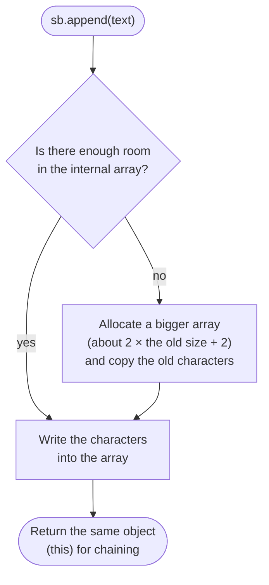
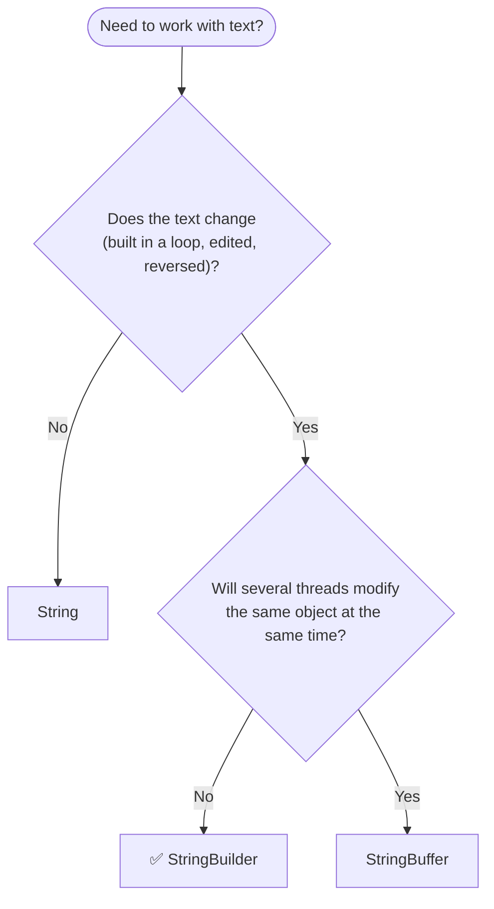

<a id="readme-top"></a>

# StringBuilder and StringBuffer

> **StringBuilder and StringBuffer are mutable text: you change one object in place instead of creating a new String for every edit — StringBuilder is the fast default, StringBuffer is its thread-safe twin.**


| Quick Facts | Details |
|---|---|
| **Category** | String — mutable text (`java.lang`) |
| **Prerequisites** | String basics and immutability, loops, objects and methods |
| **Key keywords** | `StringBuilder` · `StringBuffer` · `append` · `insert` · `reverse` · `toString` |
| **Works with** | Java 8 and above (`StringBuffer` since Java 1.0, `StringBuilder` since Java 5) |
| **At a glance** | `sb.append(x)` is `O(1)` per character · `s += x` in a loop is `O(n²)` · same methods in both classes |

## 🔰 Table of Contents

| Level | Sections |
|---|---|
| 🟢 **Level 1 — Understand** | [Definition](#-definition) · [Key Points](#-key-points) · [How It Works](#-how-it-works) |
| 🟡 **Level 2 — Use It** | [Syntax & Variations](#-syntax--variations) · [When to Use](#-when-to-use) · [Example](#-example) · [Code](#-code) |
| 🔴 **Level 3 — Wrap-up** | [Time Complexity](#-time-complexity) · [Common Mistakes](#-common-mistakes) · [Interview Questions](#-interview-questions) · [Summary](#-summary) |

## 📍 Definition

**StringBuilder** and **StringBuffer** are classes that hold a **mutable** (changeable) sequence of characters. A `String` can never change after it is created — every "change" makes a **new** object. A builder can **grow, shrink and be edited in place** — `append`, `insert`, `delete`, `reverse` — on one single object.

Both classes have **exactly the same methods**. The only real difference is **thread safety**: `StringBuffer` is **synchronized** (safe when several threads use one object, a little slower), `StringBuilder` is **not** (faster) — and it is the default choice.

| Term | Meaning | Example |
|---|---|---|
| **Mutable** | Can be changed after creation | `sb.append("x")` changes `sb` itself |
| **Immutable** | Can never change — a "change" creates a new object | `s.concat("x")` returns a new String, `s` stays |
| **StringBuilder** | Mutable text, not thread-safe, fast — the default | `new StringBuilder()` |
| **StringBuffer** | Mutable text, thread-safe (synchronized), slower — legacy | `new StringBuffer()` |
| **Length** | The number of characters currently in it | `sb.length()` |
| **Capacity** | The room in its internal array before it must grow | `sb.capacity()` |
| **Method chaining** | Modifying methods return the same object, so calls can be chained | `sb.append("a").append("b")` |
| **Synchronized** | Only one thread at a time can run the method | every `StringBuffer` method |

**The three at a glance**

| Feature | `String` | `StringBuilder` | `StringBuffer` |
|---|---|---|---|
| **Mutable** | no | yes | yes |
| **Thread-safe** | yes — it can never change | no | yes — synchronized |
| **Speed for many changes** | slow — a new object each time | fastest | a little slower than `StringBuilder` |
| **Since** | Java 1.0 | Java 5 | Java 1.0 |
| **`equals()` compares content** | yes | no — compares references | no — compares references |
| **Use it for** | fixed text, keys, constants | building and editing text in one thread (the default) | text edited by several threads (rare) |

> [!TIP]
> **Real-life analogy:** a `String` is text printed in ink on a page — to change one word you print a whole new page. A `StringBuilder` is a whiteboard: you erase and write on the same board. A `StringBuffer` is the same whiteboard in a shared room with a lock on the door — only one person can write at a time, which is safe but makes everybody wait a little.

## 📌 Key Points

1. **`String` is immutable, builders are mutable** — a builder changes one object in place; every `String` "change" creates a new one.
2. **Same methods, one difference** — `StringBuilder` and `StringBuffer` share the whole API; `StringBuffer` just adds `synchronized` to every method.
3. **Use `StringBuilder` by default** — choose `StringBuffer` only when several threads really modify one shared object, which is rare.
4. **Chaining** — `append`, `insert`, `delete`, `reverse` and the others return `this`, so `sb.append(a).append(b)` works.
5. **Length vs capacity** — length is how many characters are in use, capacity is the room available; when the room runs out the array grows automatically (roughly doubling), and only then are characters copied.
6. **`s += x` in a loop is the classic trap** — it copies the whole growing String every iteration, so `n` steps cost `O(n²)`; a builder costs `O(n)`.
7. **No content `equals()`** — builders do not override `equals()` or `hashCode()`, so `==` and `equals()` compare references; compare `toString()` or use `contentEquals`.
8. **A builder is not a String** — convert with `new StringBuilder(str)` and `sb.toString()`.

> [!IMPORTANT]
> **`+` inside a loop is the trap** — `result += x` looks harmless, but it builds a brand-new String and copies everything again on every iteration. Use a `StringBuilder` for text that is put together in a loop.

## ⚙️ How It Works

What happens when text is added one piece at a time:

| Step | `String s` with `s += …` | `StringBuilder sb` with `sb.append(…)` |
|---|---|---|
| start | `s = ""` — object A | `sb` is empty — object X |
| add `"a"` | a **new** String `"a"` (object B) — 1 character copied | `sb` now holds `"a"` — **still object X** |
| add `"b"` | a **new** String `"ab"` (object C) — 2 characters copied | `"ab"` — still X |
| add `"c"` | a **new** String `"abc"` (object D) — 3 characters copied | `"abc"` — still X |
| result | 3 new objects, `1 + 2 + 3 = 6` characters copied, the old Strings become garbage | 1 object, 3 characters written |

Inside the builder, the text lives in a character array. When an `append` does not fit, the array grows:



For example, `new StringBuilder()` starts with a capacity of `16`. After 16 characters it still fits; the 17th character makes the array grow to `34`. Growing is rare, which is why `append` is cheap **on average**.

`StringBuffer` works exactly the same way, with one addition: every method first takes the object's **lock**, so two threads can never interleave inside one call.

> [!NOTE]
> The `String` side of this table — immutability and the String pool — is covered in string-pool-and-immutability.md and string.md. A single `+` expression such as `"Hello " + name + "!"` is fine; the problem appears only when `+` is repeated in a loop.

## 🔄 Syntax & Variations

### Creating a builder

| Constructor | Example | Initial capacity | Use when |
|---|---|---|---|
| **Empty** | `new StringBuilder()` | `16` | the default |
| **With a capacity** | `new StringBuilder(1000)` | `1000` | you know roughly how big the text will be — fewer regrowths |
| **From a String** | `new StringBuilder("Java")` | text length + `16` = `20` | you start from existing text |

`StringBuffer` has the same constructors: `new StringBuffer()`, `new StringBuffer(1000)`, `new StringBuffer("Java")`.

### Core methods

Every example starts from `Hello` (indexes are `0`-based):

| Method | Example | Result | Note |
|---|---|---|---|
| **`append(x)`** | `sb.append(" World")` | `Hello World` | adds at the end; accepts any type |
| **`insert(i, x)`** | `sb.insert(0, ">> ")` | `>> Hello` | inserts at index `i` |
| **`delete(start, end)`** | `sb.delete(1, 3)` | `Hlo` | removes `start` … `end - 1` — the end is **exclusive** |
| **`deleteCharAt(i)`** | `sb.deleteCharAt(0)` | `ello` | removes one character |
| **`replace(start, end, str)`** | `sb.replace(0, 1, "J")` | `Jello` | the end is exclusive |
| **`reverse()`** | `sb.reverse()` | `olleH` | reverses the builder itself |
| **`setCharAt(i, ch)`** | `sb.setCharAt(0, 'J')` | `Jello` | overwrites one character |
| **`charAt(i)`** | `sb.charAt(1)` | `e` | reads one character |
| **`indexOf(str)`** | `sb.indexOf("l")` | `2` | `-1` when not found |
| **`substring(start, end)`** | `sb.substring(1, 3)` | `"el"` | returns a **String**; the builder is unchanged |
| **`length()` / `capacity()`** | `new StringBuilder("Hello")` | `5` / `21` | characters in use / room available |
| **`setLength(n)`** | `sb.setLength(0)` | *(empty)* | cuts the builder to `n` characters — `0` clears it |
| **`toString()`** | `sb.toString()` | `"Hello"` | makes a **String** copy |

### Capacity management

| Method | What it does |
|---|---|
| `new StringBuilder(n)` | starts with room for `n` characters |
| `ensureCapacity(n)` | makes sure there is room for at least `n` characters |
| `trimToSize()` | shrinks the array to the current length |

### Converting and comparing

```java
StringBuilder sb = new StringBuilder("Java");
String s = sb.toString();                    // builder → String (a copy)
StringBuilder back = new StringBuilder(s);   // String → builder (a copy)

sb.equals(back);                             // false — equals() is NOT overridden, it compares references
sb.toString().equals(back.toString());       // true  — compare the content
"Java".contentEquals(sb);                    // true  — String.contentEquals accepts a builder
```

### Joining text without a builder

| Need | Use | Example |
|---|---|---|
| A few values in **one** expression | `+` | `"Hello " + name + "!"` |
| Items with a separator | `String.join` (Java 8) | `String.join(", ", list)` |
| Items with a separator, prefix and suffix | `StringJoiner` (Java 8) | `new StringJoiner(", ", "[", "]")` |
| Text built in a loop or edited in place | `StringBuilder` | `sb.append(x)` |
| Text built in a loop and shared by threads | `StringBuffer` | `buf.append(x)` |

## 🎯 When to Use

| Need | Use | Benefit | Watch out |
|---|---|---|---|
| Build a String in a loop | **`StringBuilder`** | `O(n)` instead of `O(n²)` | call `toString()` once, at the end |
| Edit text in place (insert, delete, replace, reverse) | **`StringBuilder`** | methods a `String` does not have, and no new object per edit | the `end` index of `delete` and `replace` is exclusive |
| Several threads must append to one shared object | **`StringBuffer`** | each method call is thread-safe | a check-then-append sequence still needs its own lock, and it is slower |
| Join a few values in a single statement | **`+`** | short and clear | never repeat `+=` in a loop |
| Join items with a separator | **`String.join` / `StringJoiner`** | no manual comma handling | — |
| Text that never changes (constants, keys, map keys) | **`String`** | immutable, shareable, pooled | — |
| Reverse text or remove characters | **`StringBuilder`** | `reverse()` and `deleteCharAt()` | `reverse()` changes the builder itself |

**Which one should I use?**



## 🎲 Example

**Problem:** build the text `1,2,3,4,5` in a loop — without a trailing comma — and then produce its reverse, using a single `StringBuilder`.

**Dry run — the loop `for (int i = 1; i <= 5; i++) { sb.append(i).append(','); }`**

| Step | Action | `sb` after |
|---|---|---|
| 1 | `append(1)`, `append(',')` | `1,` |
| 2 | `append(2)`, `append(',')` | `1,2,` |
| 3 | `append(3)`, `append(',')` | `1,2,3,` |
| 4 | `append(4)`, `append(',')` | `1,2,3,4,` |
| 5 | `append(5)`, `append(',')` | `1,2,3,4,5,` |
| after the loop | `sb.setLength(sb.length() - 1)` — drops the last comma | `1,2,3,4,5` |
| copy and reverse | `new StringBuilder(sb).reverse()` | `5,4,3,2,1` |

✅ One builder object, no new String per step: `O(n)` for `n` numbers. The reverse was done on a **copy**, so the original `1,2,3,4,5` is still available.

## 💻 Code

> Save it as `StringBuilderDemo.java`, then run `javac StringBuilderDemo.java` followed by `java StringBuilderDemo`.

```java
import java.util.Arrays;
import java.util.List;

public class StringBuilderDemo {

    // Helper: prints "label : value" in neat columns
    static void show(String label, Object value) {
        System.out.printf("%-30s: %s%n", label, value);
    }

    public static void main(String[] args) {

        // ----- String is immutable: every "change" creates a new object -----
        String s = "Java";
        String t = s.concat(" rocks");
        show("s after concat", s);                              // unchanged
        show("t (the new String)", t);

        // ----- StringBuilder is mutable: the same object is changed -----
        StringBuilder sb = new StringBuilder("Java");
        StringBuilder same = sb.append(" rocks");               // append returns THIS object
        show("sb after append", sb);
        show("same == sb ?", same == sb);                       // true: one object, changed in place

        // ----- Core methods (each example starts from "Hello") -----
        show("append(\" World\")", new StringBuilder("Hello").append(" World"));
        show("insert(0, \">> \")", new StringBuilder("Hello").insert(0, ">> "));
        show("delete(1, 3)", new StringBuilder("Hello").delete(1, 3));          // end index is exclusive
        show("deleteCharAt(0)", new StringBuilder("Hello").deleteCharAt(0));
        show("replace(0, 1, \"J\")", new StringBuilder("Hello").replace(0, 1, "J"));
        show("reverse()", new StringBuilder("Hello").reverse());
        StringBuilder h = new StringBuilder("Hello");
        h.setCharAt(0, 'J');
        show("setCharAt(0, 'J')", h);
        show("charAt(1) / indexOf(\"l\")", h.charAt(1) + " / " + h.indexOf("l"));
        show("substring(1, 3) -> a String", h.substring(1, 3));

        // ----- Chaining: every modifying method returns the builder itself -----
        StringBuilder chain = new StringBuilder()
                .append("id=").append(7).append(", ok=").append(true).append(", ratio=").append(0.5);
        show("Chained append", chain);

        // ----- Build in a loop: 1,2,3,4,5 without a trailing comma, then reverse -----
        StringBuilder csv = new StringBuilder();
        for (int i = 1; i <= 5; i++) {
            csv.append(i).append(',');
        }
        csv.setLength(csv.length() - 1);                        // drop the last comma
        show("Built in a loop", csv);
        show("Reversed copy", new StringBuilder(csv).reverse());   // copy first, so csv itself stays as it was
        show("csv is still", csv);

        // ----- Length vs capacity -----
        StringBuilder cap = new StringBuilder();
        show("Empty: length / capacity", cap.length() + " / " + cap.capacity());
        cap.append("0123456789ABCDEF");                         // 16 characters: still fits
        show("16 chars: length / capacity", cap.length() + " / " + cap.capacity());
        cap.append('G');                                        // the 17th character: the array must grow
        show("17 chars: length / capacity", cap.length() + " / " + cap.capacity());
        show("new StringBuilder(\"Java\") cap", new StringBuilder("Java").capacity());

        // ----- equals() is NOT overridden: compare the content instead -----
        StringBuilder a = new StringBuilder("abc");
        StringBuilder b = new StringBuilder("abc");
        show("a.equals(b)", a.equals(b));
        show("toString().equals(...)", a.toString().equals(b.toString()));
        show("\"abc\".contentEquals(a)", "abc".contentEquals(a));

        // ----- StringBuffer: the same methods, but every method is synchronized -----
        StringBuffer buf = new StringBuffer();
        buf.append("thread-").append("safe");
        show("StringBuffer", buf);

        // ----- Joining without a builder -----
        List<String> words = Arrays.asList("red", "green", "blue");
        show("String.join(\", \", words)", String.join(", ", words));

        // ----- Why s += x in a loop is slow: count the characters copied -----
        int n = 1000;
        long copiedByConcat = 0;
        int length = 0;
        for (int i = 0; i < n; i++) {
            length++;                                           // s += "x" makes a new String one character longer ...
            copiedByConcat += length;                           // ... and copies all of its characters
        }
        show("s += \"x\" x1000 copies", copiedByConcat + " characters");

        // ----- Trap: new StringBuilder('A') is a capacity, not the text "A" -----
        StringBuilder trap = new StringBuilder('A');            // the char 'A' becomes the int 65 = a capacity
        show("new StringBuilder('A')", "length " + trap.length() + ", capacity " + trap.capacity());

        // ----- Trap: arithmetic on a char inside append -----
        show("append('a' + 1)", new StringBuilder().append('a' + 1));
        show("append((char) ('a' + 1))", new StringBuilder().append((char) ('a' + 1)));

        // ----- Trap: reverse() changes the builder itself -----
        StringBuilder word = new StringBuilder("Hello");
        String reversed = word.reverse().toString();
        show("reversed String", reversed);
        show("word afterwards", word);
    }
}
```

**Output**

```text
s after concat                : Java
t (the new String)            : Java rocks
sb after append               : Java rocks
same == sb ?                  : true
append(" World")              : Hello World
insert(0, ">> ")              : >> Hello
delete(1, 3)                  : Hlo
deleteCharAt(0)               : ello
replace(0, 1, "J")            : Jello
reverse()                     : olleH
setCharAt(0, 'J')             : Jello
charAt(1) / indexOf("l")      : e / 2
substring(1, 3) -> a String   : el
Chained append                : id=7, ok=true, ratio=0.5
Built in a loop               : 1,2,3,4,5
Reversed copy                 : 5,4,3,2,1
csv is still                  : 1,2,3,4,5
Empty: length / capacity      : 0 / 16
16 chars: length / capacity   : 16 / 16
17 chars: length / capacity   : 17 / 34
new StringBuilder("Java") cap : 20
a.equals(b)                   : false
toString().equals(...)        : true
"abc".contentEquals(a)        : true
StringBuffer                  : thread-safe
String.join(", ", words)      : red, green, blue
s += "x" x1000 copies         : 500500 characters
new StringBuilder('A')        : length 0, capacity 65
append('a' + 1)               : 98
append((char) ('a' + 1))      : b
reversed String               : olleH
word afterwards               : olleH
```

> [!NOTE]
> The last four lines are traps. `new StringBuilder('A')` is an **empty** builder with capacity `65`, because the `char` is read as the number `65`. `append('a' + 1)` adds `98`, because `'a' + 1` is an `int`. And after `word.reverse().toString()` the builder `word` itself is reversed. The line `s += "x" x1000 copies` shows that 1,000 concatenations copy `1 + 2 + … + 1000 = 500,500` characters — while a builder writes about 1,000.

## ⏳ Time Complexity

| Operation | StringBuilder / StringBuffer | String |
|---|---|---|
| append `k` characters at the end | **O(k)** — and `O(1)` per character on average | `O(n)` — builds a new String |
| `s += x` repeated `n` times | — | **O(n²)** in total |
| `append` repeated `n` times | **O(n)** in total | — |
| `charAt(i)`, `length()` | **O(1)** | `O(1)` |
| `setCharAt(i, ch)` | **O(1)** | not possible — immutable |
| `insert` / `delete` at the front or in the middle | **O(n)** — the rest is shifted | `O(n)` — a new String |
| `reverse()` | **O(n)** | `O(n)` — needs a builder |
| `toString()` | **O(n)** — copies the characters | — |
| `StringBuffer` extra | the same Big-O, plus a small constant cost for the lock | — |

Extra space is **O(n)** for the character array; because it grows by doubling, the capacity can be up to about twice the length.

**Feel the difference** — characters copied when `n` single characters are added one by one:

| n | `s += x` in a loop — `n(n + 1) / 2` | `StringBuilder.append` — about `n` |
|---|---|---|
| 1,000 | 500,500 | about 1,000 |
| 10,000 | 50,005,000 | about 10,000 |
| 100,000 | 5,000,050,000 | about 100,000 |

> [!TIP]
> **Rule of thumb:** one `+` in one statement is fine; `+=` in a loop is `O(n²)`. If you know the final size, pass it to the constructor — `new StringBuilder(10_000)` — and the array never has to grow.

## 🚨 Common Mistakes

| # | Mistake | Why it is a problem | Fix |
|---|---|---|---|
| 1 | `result += x` inside a loop | a new String is built and everything is copied again on every iteration → `O(n²)` | use a `StringBuilder` and call `toString()` once at the end |
| 2 | `sb1.equals(sb2)`, or `sb.equals("abc")` | `equals()` is not overridden, so it compares references and is `false` even for equal text (and `sb == "abc"` does not compile: "incomparable types") | compare `sb1.toString().equals(sb2.toString())` or `"abc".contentEquals(sb)` |
| 3 | `new StringBuilder('A')` | the `char` is read as the number `65` — you get an **empty** builder with capacity `65` | use a String: `new StringBuilder("A")` |
| 4 | `sb.append('a' + 1)` | `'a' + 1` is an `int`, so `98` is appended instead of `b` | cast it: `sb.append((char) ('a' + 1))` |
| 5 | `String r = sb.reverse().toString();` and then using `sb` as if it were unchanged | `reverse()` modifies the builder itself — `sb` is reversed too | reverse a copy: `new StringBuilder(sb).reverse().toString()` |
| 6 | `sb.delete(1, 3)` expecting characters `1` to `3` to go, or `sb.delete(3, 4)` on `"ab"` | the end index is **exclusive** (only `1` and `2` are removed), and a `start` beyond the length throws `StringIndexOutOfBoundsException` | remember `[start, end)` and check against `length()` |

## 🎤 Interview Questions

<details>
<summary><b>1. What is the difference between String, StringBuilder and StringBuffer?</b></summary>

`String` is **immutable** — every change creates a new object. `StringBuilder` and `StringBuffer` are **mutable** — they change one object in place. `StringBuilder` is **not synchronized** and is the fastest, so it is the default for building text in one thread. `StringBuffer` is **synchronized**, so it is thread-safe but slightly slower. Both builders have the same methods.

</details>

<details>
<summary><b>2. Why is <code>+=</code> on a String in a loop slow?</b></summary>

A `String` is immutable, so `s += x` cannot add to the existing object: it creates a **new** String and copies all the old characters plus the new ones. In a loop of `n` iterations that is `1 + 2 + … + n = n(n + 1) / 2` characters copied — `O(n²)` — and `n` short-lived objects for the garbage collector. A `StringBuilder` writes into one array and costs `O(n)` in total.

</details>

<details>
<summary><b>3. Why is StringBuilder faster than StringBuffer, and which should you use?</b></summary>

Every `StringBuffer` method is `synchronized`, so each call has to take and release a lock; `StringBuilder` skips that work. The Big-O is the same, but the constant cost is lower. Use `StringBuilder` unless several threads really modify one shared object — which is rare, because a text is usually built inside one method and then shared as an immutable `String`.

</details>

<details>
<summary><b>4. Does StringBuffer make my code completely thread-safe?</b></summary>

No. Each **single method call** is atomic, but a **sequence** of calls is not. In `if (buf.length() == 0) { buf.append("x"); }` another thread can append between the check and the `append`. Such compound actions need their own lock (`synchronized (buf) { ... }`).

</details>

<details>
<summary><b>5. What are length and capacity, and how does a builder grow?</b></summary>

**Length** is the number of characters in the builder; **capacity** is the size of its internal array. A new builder has capacity `16` (or the text length + `16` when created from a String). When an `append` does not fit, the array grows to roughly `2 × old capacity + 2` — `16` becomes `34` — and the old characters are copied. If you know the final size, create the builder with that capacity (or call `ensureCapacity`) to avoid regrowing.

</details>

<details>
<summary><b>6. How do you compare two StringBuilders? Why does <code>equals()</code> not work?</b></summary>

`StringBuilder` and `StringBuffer` do not override `equals()` and `hashCode()`, so they inherit the `Object` versions, which compare **references**. Two builders with the same text are therefore not equal. Compare the content with `a.toString().equals(b.toString())`, or with `"text".contentEquals(sb)`.

</details>

<details>
<summary><b>7. Is <code>"a" + b + "c"</code> bad? Does the compiler use a StringBuilder?</b></summary>

A single concatenation expression is fine. A constant expression such as `"a" + "b"` is joined by the compiler at compile time. With variables, the compiler generates efficient code that builds the result in one go (a `StringBuilder` in older versions, a more optimized mechanism in newer ones). The problem is **repeated** concatenation in a loop: each iteration builds a new result from scratch, so the work grows as `O(n²)`.

</details>

## 🏁 Summary

- **`String` is immutable**, **`StringBuilder` and `StringBuffer` are mutable** — builders change one object in place and return `this`, so calls can be chained.
- The two builders have **the same methods**; `StringBuffer` is **synchronized** (thread-safe, slightly slower), `StringBuilder` is not (faster, the default).
- A builder keeps a **length** and a **capacity**; when full it grows by roughly doubling, so `append` is cheap on average.
- **`s += x` in a loop is `O(n²)`**; a builder does the same job in `O(n)` — build with a builder, call `toString()` once, share the String.
- Builders **do not override `equals()`** — compare `toString()` or use `contentEquals`; `delete` and `replace` use an **exclusive** end index.
- Watch out for `new StringBuilder('A')` (a capacity, not text) and `append('a' + 1)` (appends a number).

### 📝 Cheat Sheet

| Question | Answer |
|---|---|
| Create | `new StringBuilder()` · `new StringBuilder("text")` · `new StringBuilder(1000)` (capacity) |
| Add at the end | `sb.append(x)` — returns the same builder, so it can be chained |
| Insert / delete / replace | `insert(i, x)` · `delete(start, end)` · `deleteCharAt(i)` · `replace(start, end, str)` — the end is exclusive |
| Reverse / clear | `reverse()` · `setLength(0)` |
| Get the result | `sb.toString()` |
| Compare content | `sb.toString().equals(...)` · `str.contentEquals(sb)` — never `sb.equals(...)` |
| Default choice | `StringBuilder` — fast, not thread-safe |
| Shared between threads | `StringBuffer` — synchronized |
| In a loop | never `s += x` — use a builder: `O(n)` instead of `O(n²)` |

> [!IMPORTANT]
> **Build with a builder, share as a String:** use a `StringBuilder` while you put text together, call `toString()` once at the end, and hand out the immutable `String`.
